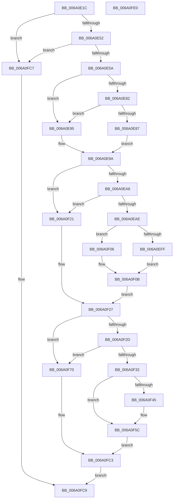

# BgpFwDisplayBugCheckProgressUpdate

- RVA: `0x006A0E1C`–`0x006A0FE1` (길이 `453` bytes)
- VA: `0x00000001406A0E1C`
- 실행 섹션: `.text`
- PDB 이름 있음: `예`; PDB Function 태그: `아니요`
- unwind 정보 RVA: `0x000DA620`
- 디코드: `119`개 명령, `453/453` bytes 표시
- 미해석 바이트: `0` (있으면 어셈블리에 `.byte`로 보존)

> 이 문서는 커널 이미지의 기계어와 PDB 기호를 분석해 생성했습니다. 4번과 5번은 함수 원형과 자료형을 바이너리 사용 방식에서 추정한 C 해석이며 원본 소스 복구 결과는 아닙니다.

## 1. Dependencies

- 직접 호출 지점: **10**; 고유 호출 대상: **8**
- 직접 호출자로 확인된 함수: **2**
- RIP 상대 이미지 참조: **19**

### Outgoing calls
- `0x006A0E5E` → [KeQueryPerformanceCounter](../37/KeQueryPerformanceCounter_function_0037E7E0.md) (function, `0x0037E7E0`)
- `0x006A0ED1` → [BcpGetDisplayType](BcpGetDisplayType_function_006A0A48.md) (function, `0x006A0A48`)
- `0x006A0EEC` → [BcpSetCursorPosition](BcpSetCursorPosition_function_006A0D50.md) (function, `0x006A0D50`)
- `0x006A0EFF` → [BcpDisplayProgressModernized](BcpDisplayProgressModernized_function_006A068C.md) (function, `0x006A068C`)
- `0x006A0F06` → [BcpDisplayProgress](BcpDisplayProgress_function_006A047C.md) (function, `0x006A047C`)
- `0x006A0F0D` → [KeQueryPerformanceCounter](../37/KeQueryPerformanceCounter_function_0037E7E0.md) (function, `0x0037E7E0`)
- `0x006A0F34` → [KeQueryPerformanceCounter](../37/KeQueryPerformanceCounter_function_0037E7E0.md) (function, `0x0037E7E0`)
- `0x006A0F57` → [KeStallExecutionProcessor](../44/KeStallExecutionProcessor_function_0044F620.md) (function, `0x0044F620`)
- `0x006A0F67` → [BgpFwDisplayBugCheckProgressUpdate](BgpFwDisplayBugCheckProgressUpdate_function_006A0E1C.md) (function, `0x006A0E1C`)
- `0x006A0F8E` → [BcpConvertProgressToString](../69/BcpConvertProgressToString_function_0069F574.md) (function, `0x0069F574`)

### Direct callers
- [KiBugCheckProgress](../5B/KiBugCheckProgress_function_005B3E90.md) at `0x005B3EFA`
- [BgpFwDisplayBugCheckProgressUpdate](BgpFwDisplayBugCheckProgressUpdate_function_006A0E1C.md) at `0x006A0F67`

### Static image references
- `0x006A0E33` → RVA `0x00EF0450` (`.data`; read)
- `0x006A0E6B` → RVA `0x00EF03A8` (`.data`; read)
- `0x006A0E72` → RVA `0x00EF03A0` (`.data`; read)
- `0x006A0EA6` → RVA `0x00EF03B0` (`.data`; read)
- `0x006A0EAE` → RVA `0x00EF03E8` (`.data`; read)
- `0x006A0EBD` → RVA `0x00EF03E4` (`.data`; read)
- `0x006A0EC7` → RVA `0x00EF03EC` (`.data`; read)
- `0x006A0ED6` → RVA `0x00EF0344` (`.data`; read)
- `0x006A0EDC` → RVA `0x00EF0348` (`.data`; read)
- `0x006A0EE3` → RVA `0x00EF0340` (`.data`; read)
- `0x006A0EF1` → RVA `0x00EF03D0` (`.data`; read)
- `0x006A0F12` → RVA `0x00EF03A8` (`.data`; write)
- `0x006A0F19` → RVA `0x00EF03B0` (`.data`; write)
- `0x006A0F70` → RVA `0x00E3EAB0` (`.data`; read)
- `0x006A0F7A` → RVA `0x00E3EAA0` (`.data`; read)
- `0x006A0F97` → RVA `0x00E3EB00` (`.data`; read)
- `0x006A0F9E` → RVA `0x00E3EAE0` (`.data`; read)
- `0x006A0FA9` → RVA `0x00E3EB10` (`.data`; read)
- `0x006A0FB4` → RVA `0x00E3EAF0` (`.data`; read)

## 2. Other-region calls and transfers

- 다른 실행 섹션으로 향하는 call: **0**
- 별도 외부 분기/꼬리 이동을 확인하지 못했습니다.

## 3. Assembly (complete function range)

```asm
006A0E1C  4C 8B DC                        mov r11, rsp
006A0E1F  49 89 5B 08                     mov qword ptr [r11 + 8], rbx
006A0E23  49 89 6B 10                     mov qword ptr [r11 + 0x10], rbp
006A0E27  56                              push rsi
006A0E28  57                              push rdi
006A0E29  41 54                           push r12
006A0E2B  41 56                           push r14
006A0E2D  41 57                           push r15
006A0E2F  48 83 EC 30                     sub rsp, 0x30
006A0E33  8B 05 17 F6 84 00               mov eax, dword ptr [rip + 0x84f617]
006A0E39  33 ED                           xor ebp, ebp
006A0E3B  49 89 6B 20                     mov qword ptr [r11 + 0x20], rbp
006A0E3F  45 8A E0                        mov r12b, r8b
006A0E42  4C 8B FA                        mov r15, rdx
006A0E45  44 8B F1                        mov r14d, ecx
006A0E48  0F BA E0 16                     bt eax, 0x16
006A0E4C  0F 82 75 01 00 00               jb 0x1406a0fc7
006A0E52  A8 10                           test al, 0x10
006A0E54  0F 84 6D 01 00 00               je 0x1406a0fc7
006A0E5A  49 8D 4B 20                     lea rcx, [r11 + 0x20]
006A0E5E  E8 7D D9 CD FF                  call 0x14037e7e0
006A0E63  48 8B 5C 24 78                  mov rbx, qword ptr [rsp + 0x78]
006A0E68  48 8B C8                        mov rcx, rax
006A0E6B  48 2B 0D 36 F5 84 00            sub rcx, qword ptr [rip + 0x84f536]
006A0E72  48 2B 05 27 F5 84 00            sub rax, qword ptr [rip + 0x84f527]
006A0E79  48 8D 34 1B                     lea rsi, [rbx + rbx]
006A0E7D  45 84 E4                        test r12b, r12b
006A0E80  74 13                           je 0x1406a0e95
006A0E82  48 3B C6                        cmp rax, rsi
006A0E85  7D 0E                           jge 0x1406a0e95
006A0E87  48 6B C0 64                     imul rax, rax, 0x64
006A0E8B  48 99                           cqo
006A0E8D  48 F7 FE                        idiv rsi
006A0E90  48 8B F8                        mov rdi, rax
006A0E93  EB 05                           jmp 0x1406a0e9a
006A0E95  BF 64 00 00 00                  mov edi, 0x64
006A0E9A  44 3B F7                        cmp r14d, edi
006A0E9D  41 0F 46 FE                     cmovbe edi, r14d
006A0EA1  48 3B CE                        cmp rcx, rsi
006A0EA4  7C 7B                           jl 0x1406a0f21
006A0EA6  3B 3D 04 F5 84 00               cmp edi, dword ptr [rip + 0x84f504]
006A0EAC  72 73                           jb 0x1406a0f21
006A0EAE  8B 05 34 F5 84 00               mov eax, dword ptr [rip + 0x84f534]
006A0EB4  48 8D 4C 24 20                  lea rcx, [rsp + 0x20]
006A0EB9  89 44 24 20                     mov dword ptr [rsp + 0x20], eax
006A0EBD  8B 05 21 F5 84 00               mov eax, dword ptr [rip + 0x84f521]
006A0EC3  89 44 24 24                     mov dword ptr [rsp + 0x24], eax
006A0EC7  8B 05 1F F5 84 00               mov eax, dword ptr [rip + 0x84f51f]
006A0ECD  89 44 24 28                     mov dword ptr [rsp + 0x28], eax
006A0ED1  E8 72 FB FF FF                  call 0x1406a0a48
006A0ED6  8B 15 68 F4 84 00               mov edx, dword ptr [rip + 0x84f468]
006A0EDC  4C 8D 05 65 F4 84 00            lea r8, [rip + 0x84f465]
006A0EE3  8B 0D 57 F4 84 00               mov ecx, dword ptr [rip + 0x84f457]
006A0EE9  44 8B D8                        mov r11d, eax
006A0EEC  E8 5F FE FF FF                  call 0x1406a0d50
006A0EF1  40 38 2D D8 F4 84 00            cmp byte ptr [rip + 0x84f4d8], bpl
006A0EF8  41 8B D3                        mov edx, r11d
006A0EFB  8B CF                           mov ecx, edi
006A0EFD  74 07                           je 0x1406a0f06
006A0EFF  E8 88 F7 FF FF                  call 0x1406a068c
006A0F04  EB 05                           jmp 0x1406a0f0b
006A0F06  E8 71 F5 FF FF                  call 0x1406a047c
006A0F0B  33 C9                           xor ecx, ecx
006A0F0D  E8 CE D8 CD FF                  call 0x14037e7e0
006A0F12  48 89 05 8F F4 84 00            mov qword ptr [rip + 0x84f48f], rax
006A0F19  89 3D 91 F4 84 00               mov dword ptr [rip + 0x84f491], edi
006A0F1F  EB 06                           jmp 0x1406a0f27
006A0F21  8B 3D 89 F4 84 00               mov edi, dword ptr [rip + 0x84f489]
006A0F27  41 83 FE 64                     cmp r14d, 0x64
006A0F2B  75 43                           jne 0x1406a0f70
006A0F2D  41 3B FE                        cmp edi, r14d
006A0F30  74 3E                           je 0x1406a0f70
006A0F32  33 C9                           xor ecx, ecx
006A0F34  E8 A7 D8 CD FF                  call 0x14037e7e0
006A0F39  48 2B 05 68 F4 84 00            sub rax, qword ptr [rip + 0x84f468]
006A0F40  48 3B C6                        cmp rax, rsi
006A0F43  7D 17                           jge 0x1406a0f5c
006A0F45  48 2B F0                        sub rsi, rax
006A0F48  48 69 C6 40 42 0F 00            imul rax, rsi, 0xf4240
006A0F4F  48 99                           cqo
006A0F51  48 F7 FB                        idiv rbx
006A0F54  48 8B C8                        mov rcx, rax
006A0F57  E8 C4 E6 DA FF                  call 0x14044f620
006A0F5C  45 8A C4                        mov r8b, r12b
006A0F5F  49 8B D7                        mov rdx, r15
006A0F62  B9 64 00 00 00                  mov ecx, 0x64
006A0F67  E8 B0 FE FF FF                  call 0x1406a0e1c
006A0F6C  8B E8                           mov ebp, eax
006A0F6E  EB 53                           jmp 0x1406a0fc3
006A0F70  48 8D 0D 39 DB 79 00            lea rcx, [rip + 0x79db39]
006A0F77  45 84 E4                        test r12b, r12b
006A0F7A  48 8D 05 1F DB 79 00            lea rax, [rip + 0x79db1f]
006A0F81  48 0F 44 C1                     cmove rax, rcx
006A0F85  49 8D 57 18                     lea rdx, [r15 + 0x18]
006A0F89  8B CF                           mov ecx, edi
006A0F8B  49 89 07                        mov qword ptr [r15], rax
006A0F8E  E8 E1 E5 FF FF                  call 0x14069f574
006A0F93  41 83 FE 01                     cmp r14d, 1
006A0F97  48 8D 0D 62 DB 79 00            lea rcx, [rip + 0x79db62]
006A0F9E  48 8D 05 3B DB 79 00            lea rax, [rip + 0x79db3b]
006A0FA5  48 0F 45 C1                     cmovne rax, rcx
006A0FA9  48 8D 0D 60 DB 79 00            lea rcx, [rip + 0x79db60]
006A0FB0  49 89 47 08                     mov qword ptr [r15 + 8], rax
006A0FB4  48 8D 05 35 DB 79 00            lea rax, [rip + 0x79db35]
006A0FBB  48 0F 45 C1                     cmovne rax, rcx
006A0FBF  49 89 47 10                     mov qword ptr [r15 + 0x10], rax
006A0FC3  8B C5                           mov eax, ebp
006A0FC5  EB 02                           jmp 0x1406a0fc9
006A0FC7  33 C0                           xor eax, eax
006A0FC9  48 8B 5C 24 60                  mov rbx, qword ptr [rsp + 0x60]
006A0FCE  48 8B 6C 24 68                  mov rbp, qword ptr [rsp + 0x68]
006A0FD3  48 83 C4 30                     add rsp, 0x30
006A0FD7  41 5F                           pop r15
006A0FD9  41 5E                           pop r14
006A0FDB  41 5C                           pop r12
006A0FDD  5F                              pop rdi
006A0FDE  5E                              pop rsi
006A0FDF  C3                              ret
006A0FE0  CC                              int3
```

## 4. C-style interpretation (structured pseudocode)

```c
__int64 __fastcall BgpFwDisplayBugCheckProgressUpdate(int a1, __int64 a2, unsigned __int8 a3)
{
    __int64 result;
    __int64 v_rbp;
    __int64 v_rdi;
    __int64 v_rsi;
    __int64 v_rsp;
    unsigned int v_stack_m30;
    unsigned int v_stack_m34;
    unsigned __int64 v_stack_m38;
    unsigned __int64 v_stack_p10;
    unsigned __int64 v_stack_p20;
    unsigned __int64 v_stack_p8;

    *(unsigned __int64 *)(v_rsp + 8) = v_rbx;
    *(unsigned __int64 *)(v_rsp + 16) = v_rbp;
    v_rsp = (v_rsp) - (48);
    v_rbp = 0;
    *(unsigned __int64 *)(v_rsp + 32) = 0;
    if (condition_is_below) goto loc_006A0FC7;
    if ((((unsigned __int8)((unsigned int)(*(unsigned int *)(v_rip + 8713751)))) & (16)) == 0) goto loc_006A0FC7;
    result = KeQueryPerformanceCounter(v_rsp + 32, a2, a3, a4);
    a1 = (result) - (*(unsigned __int64 *)(v_rip + 8713526));
    result = (result) - (*(unsigned __int64 *)(v_rip + 8713511));
    if (a3 == 0) goto loc_006A0E95;
    if (result >= (v_stack_p20 + v_stack_p20 * 1)) goto loc_006A0E95;
    result = (result) * (result);
    goto loc_006A0E9A;
loc_006A0E95:
loc_006A0E9A:
    v_rdi = 100;
    if (((unsigned int)((unsigned int)(a1))) <= 100) { v_rdi = (unsigned int)((unsigned int)(a1)); }
    if (a1 < (v_stack_p20 + v_stack_p20 * 1)) goto loc_006A0F21;
    if (((unsigned int)(v_rdi)) < (*(unsigned int *)(v_rip + 8713476))) goto loc_006A0F21;
    v_stack_m38 = (unsigned int)((unsigned int)(*(unsigned int *)(v_rip + 8713524)));
    v_stack_m34 = (unsigned int)((unsigned int)(*(unsigned int *)(v_rip + 8713505)));
    v_stack_m30 = (unsigned int)((unsigned int)(*(unsigned int *)(v_rip + 8713503)));
    result = BcpGetDisplayType(v_stack_m38, a2, a3, a4);
    result = BcpSetCursorPosition((unsigned int)(*(unsigned int *)(v_rip + 8713303)), (unsigned int)(*(unsigned int *)(v_rip + 8713320)), v_rip + 8713317, a4);
    if ((*(unsigned __int8 *)(v_rip + 8713432)) == 0) goto loc_006A0F06;
    result = BcpDisplayProgressModernized((unsigned int)((unsigned int)(v_rdi)), (unsigned int)((unsigned int)((unsigned int)((unsigned int)(result)))), v_rip + 8713317, a4);
    goto loc_006A0F0B;
loc_006A0F06:
    result = BcpDisplayProgress((unsigned int)((unsigned int)(v_rdi)), (unsigned int)((unsigned int)((unsigned int)((unsigned int)(result)))), v_rip + 8713317, a4);
loc_006A0F0B:
    a1 = 0;
    result = KeQueryPerformanceCounter(a1, (unsigned int)((unsigned int)((unsigned int)((unsigned int)(result)))), v_rip + 8713317, a4);
    *(unsigned __int64 *)(v_rip + 8713359) = result;
    *(unsigned int *)(v_rip + 8713361) = (unsigned int)(v_rdi);
    goto loc_006A0F27;
loc_006A0F21:
loc_006A0F27:
    if (((unsigned int)((unsigned int)(a1))) != 100) goto loc_006A0F70;
    if (((unsigned int)((unsigned int)(*(unsigned int *)(v_rip + 8713353)))) == ((unsigned int)((unsigned int)(a1)))) goto loc_006A0F70;
    a1 = 0;
    result = KeQueryPerformanceCounter(a1, (unsigned int)((unsigned int)((unsigned int)((unsigned int)(result)))), v_rip + 8713317, a4);
    result = (result) - (*(unsigned __int64 *)(v_rip + 8713320));
    v_rsi = v_stack_p20 + v_stack_p20 * 1;
    if (result < (v_stack_p20 + v_stack_p20 * 1)) {
        v_rsi = (v_stack_p20 + v_stack_p20 * 1) - (result);
        result = (result) * (v_rsi);
        a1 = result;
        result = KeStallExecutionProcessor(a1, (unsigned int)((unsigned int)((unsigned int)((unsigned int)(result)))), v_rip + 8713317, a4);
    }
    result = BgpFwDisplayBugCheckProgressUpdate(100, a2, a3, a4);
    goto loc_006A0FC3;
loc_006A0F70:
    result = v_rip + 7985951;
    if (a3 == 0) { result = v_rip + 7985977; }
    *(unsigned __int64 *)(a2) = result;
    result = BcpConvertProgressToString((unsigned int)((unsigned int)((unsigned int)(*(unsigned int *)(v_rip + 8713353)))), a2 + 24, a3, a4);
    result = v_rip + 7985979;
    if (((unsigned int)((unsigned int)(a1))) != 1) { result = v_rip + 7986018; }
    *(unsigned __int64 *)(a2 + 8) = result;
    result = v_rip + 7985973;
    if (((unsigned int)((unsigned int)(a1))) != 1) { result = v_rip + 7986016; }
    *(unsigned __int64 *)(a2 + 16) = result;
loc_006A0FC3:
    goto loc_006A0FC9;
loc_006A0FC7:
    result = 0;
loc_006A0FC9:
    v_rsp = (v_rsp) + (48);
    return result;
}
```

## 5. (Beta) C Style

```c
int64_t BgpFwDisplayBugCheckProgressUpdate(int32_t Arg1, void *Arg2, uint8_t Arg3)
{
    uint8_t *arg2 = (uint8_t *)Arg2;

    int64_t result;
    int64_t local_rbp;
    int64_t local_rdi;
    int64_t local_rsi;
    int64_t local_rsp;
    uint32_t v_stack_m30;
    uint32_t v_stack_m34;
    uint64_t v_stack_m38;
    uint64_t v_stack_p10;
    uint64_t v_stack_p20;
    uint64_t v_stack_p8;

    *(uint64_t *)(local_rsp + 0x8) = local_rbx;
    *(uint64_t *)(local_rsp + 0x10) = local_rbp;
    local_rsp = (local_rsp) - (48);
    local_rbp = 0;
    *(uint64_t *)(local_rsp + 0x20) = 0;
    if (condition_is_below) goto loc_006A0FC7;
    if ((((uint8_t)((uint32_t)(*(uint32_t *)(v_rip + 0x84F617)))) & (16)) == 0) goto loc_006A0FC7;
    result = KeQueryPerformanceCounter(local_rsp + 32, Arg2, Arg3, a4);
    Arg1 = (result) - (*(uint64_t *)(v_rip + 0x84F536));
    result = (result) - (*(uint64_t *)(v_rip + 0x84F527));
    if (Arg3 == 0) goto loc_006A0E95;
    if (result >= (v_stack_p20 + v_stack_p20 * 1)) goto loc_006A0E95;
    result = (result) * (result);
    goto loc_006A0E9A;
loc_006A0E95:
loc_006A0E9A:
    local_rdi = 100;
    if (((uint32_t)((uint32_t)(Arg1))) <= 100) { local_rdi = (uint32_t)((uint32_t)(Arg1)); }
    if (Arg1 < (v_stack_p20 + v_stack_p20 * 1)) goto loc_006A0F21;
    if (((uint32_t)(local_rdi)) < (*(uint32_t *)(v_rip + 0x84F504))) goto loc_006A0F21;
    v_stack_m38 = (uint32_t)((uint32_t)(*(uint32_t *)(v_rip + 0x84F534)));
    v_stack_m34 = (uint32_t)((uint32_t)(*(uint32_t *)(v_rip + 0x84F521)));
    v_stack_m30 = (uint32_t)((uint32_t)(*(uint32_t *)(v_rip + 0x84F51F)));
    result = BcpGetDisplayType(v_stack_m38, Arg2, Arg3, a4);
    result = BcpSetCursorPosition((uint32_t)(*(uint32_t *)(v_rip + 0x84F457)), (uint32_t)(*(uint32_t *)(v_rip + 0x84F468)), v_rip + 8713317, a4);
    if ((*(uint8_t *)(v_rip + 0x84F4D8)) == 0) goto loc_006A0F06;
    result = BcpDisplayProgressModernized((uint32_t)((uint32_t)(local_rdi)), (uint32_t)((uint32_t)((uint32_t)((uint32_t)(result)))), v_rip + 8713317, a4);
    goto loc_006A0F0B;
loc_006A0F06:
    result = BcpDisplayProgress((uint32_t)((uint32_t)(local_rdi)), (uint32_t)((uint32_t)((uint32_t)((uint32_t)(result)))), v_rip + 8713317, a4);
loc_006A0F0B:
    Arg1 = 0;
    result = KeQueryPerformanceCounter(Arg1, (uint32_t)((uint32_t)((uint32_t)((uint32_t)(result)))), v_rip + 8713317, a4);
    *(uint64_t *)(v_rip + 0x84F48F) = result;
    *(uint32_t *)(v_rip + 0x84F491) = (uint32_t)(local_rdi);
    goto loc_006A0F27;
loc_006A0F21:
loc_006A0F27:
    if (((uint32_t)((uint32_t)(Arg1))) != 100) goto loc_006A0F70;
    if (((uint32_t)((uint32_t)(*(uint32_t *)(v_rip + 0x84F489)))) == ((uint32_t)((uint32_t)(Arg1)))) goto loc_006A0F70;
    Arg1 = 0;
    result = KeQueryPerformanceCounter(Arg1, (uint32_t)((uint32_t)((uint32_t)((uint32_t)(result)))), v_rip + 8713317, a4);
    result = (result) - (*(uint64_t *)(v_rip + 0x84F468));
    local_rsi = v_stack_p20 + v_stack_p20 * 1;
    if (result < (v_stack_p20 + v_stack_p20 * 1)) {
        local_rsi = (v_stack_p20 + v_stack_p20 * 1) - (result);
        result = (result) * (local_rsi);
        Arg1 = result;
        result = KeStallExecutionProcessor(Arg1, (uint32_t)((uint32_t)((uint32_t)((uint32_t)(result)))), v_rip + 8713317, a4);
    }
    result = BgpFwDisplayBugCheckProgressUpdate(100, Arg2, Arg3, a4);
    goto loc_006A0FC3;
loc_006A0F70:
    result = v_rip + 7985951;
    if (Arg3 == 0) { result = v_rip + 7985977; }
    *(uint64_t *)(arg2) = result;
    result = BcpConvertProgressToString((uint32_t)((uint32_t)((uint32_t)(*(uint32_t *)(v_rip + 0x84F489)))), Arg2 + 24, Arg3, a4);
    result = v_rip + 7985979;
    if (((uint32_t)((uint32_t)(Arg1))) != 1) { result = v_rip + 7986018; }
    *(uint64_t *)(arg2 + 0x8) = result;
    result = v_rip + 7985973;
    if (((uint32_t)((uint32_t)(Arg1))) != 1) { result = v_rip + 7986016; }
    *(uint64_t *)(arg2 + 0x10) = result;
loc_006A0FC3:
    goto loc_006A0FC9;
loc_006A0FC7:
    result = 0;
loc_006A0FC9:
    local_rsp = (local_rsp) + (48);
    return result;
}
```

### 관측된 메모리 오프셋

구조체 형식이 확인되지 않은 접근은 인자 기준의 오프셋으로만 기록했습니다.

| 기준 인자 | 오프셋 표현 | 폭 (bit) | 접근 |
|---|---:|---:|---|
| `Arg2` | `+ 0x0` | `64` | `W` |
| `Arg2` | `+ 0x8` | `64` | `W` |
| `Arg2` | `+ 0x10` | `64` | `W` |
| `Arg2` | `+ 0x18` | `64` | `R` |

## 6. Execution-region graph

[열기: 2D/3D 그래프와 함수 탐색 컨트롤 패널](../../../control-panel.html?section=text&rva=0x006A0E1C&view=graph)

- 2D 그래프는 위에서 아래로 흐르고, 3D 그래프는 빈 공간을 드래그해 회전합니다. Shift+드래그는 이동, 휠은 확대·축소, 함수 노드 선택은 대상 보고서 이동입니다.

### Static fallback


