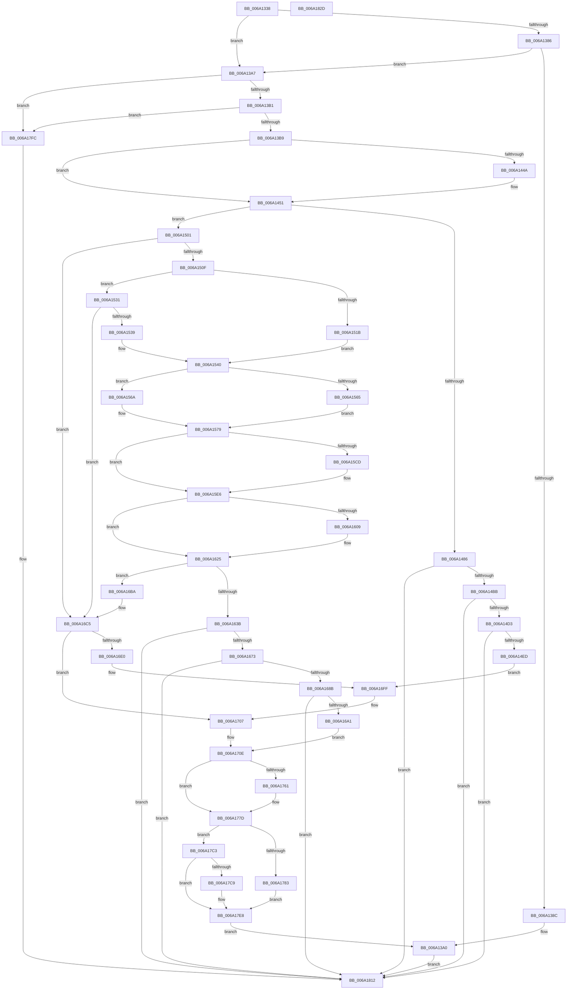

# BgpFwDisplayBugCheckScreenModernized

- RVA: `0x006A1338`–`0x006A182E` (길이 `1,270` bytes)
- VA: `0x00000001406A1338`
- 실행 섹션: `.text`
- PDB 이름 있음: `예`; PDB Function 태그: `아니요`
- unwind 정보 RVA: `0x000DA65C`
- 디코드: `310`개 명령, `1,270/1,270` bytes 표시
- 미해석 바이트: `0` (있으면 어셈블리에 `.byte`로 보존)

> 이 문서는 커널 이미지의 기계어와 PDB 기호를 분석해 생성했습니다. 4번과 5번은 함수 원형과 자료형을 바이너리 사용 방식에서 추정한 C 해석이며 원본 소스 복구 결과는 아닙니다.

## 1. Dependencies

- 직접 호출 지점: **30**; 고유 호출 대상: **13**
- 직접 호출자로 확인된 함수: **1**
- RIP 상대 이미지 참조: **34**

### Outgoing calls
- `0x006A138F` → [BcpDisplayEarlyBugCheckScreen](../../init/C8/BcpDisplayEarlyBugCheckScreen_function_00C8108C.md) (function, `0x00C8108C`)
- `0x006A139B` → [IoSaveBugCheckProgress](../59/IoSaveBugCheckProgress_function_00592E10.md) (function, `0x00592E10`)
- `0x006A13DC` → [BcpGetDisplayType](BcpGetDisplayType_function_006A0A48.md) (function, `0x006A0A48`)
- `0x006A1454` → [BgpClearScreen](../69/BgpClearScreen_function_0069EAB0.md) (function, `0x0069EAB0`)
- `0x006A145E` → [IoSaveBugCheckProgress](../59/IoSaveBugCheckProgress_function_00592E10.md) (function, `0x00592E10`)
- `0x006A146D` → [BcpSetCursorPosition](BcpSetCursorPosition_function_006A0D50.md) (function, `0x006A0D50`)
- `0x006A14AE` → [RtlAppendUnicodeStringToString](../40/RtlAppendUnicodeStringToString_function_0040FA50.md) (function, `0x0040FA50`)
- `0x006A14C6` → [RtlAppendUnicodeToString](../40/RtlAppendUnicodeToString_function_0040F990.md) (function, `0x0040F990`)
- `0x006A14DE` → [RtlAppendUnicodeStringToString](../40/RtlAppendUnicodeStringToString_function_0040FA50.md) (function, `0x0040FA50`)
- `0x006A158B` → [BcpSetCursorPosition](BcpSetCursorPosition_function_006A0D50.md) (function, `0x006A0D50`)
- `0x006A15C4` → [BgpFoGetStringAdvanceWidth](../69/BgpFoGetStringAdvanceWidth_function_0069F370.md) (function, `0x0069F370`)
- `0x006A15EE` → [BcpSetCursorPosition](BcpSetCursorPosition_function_006A0D50.md) (function, `0x006A0D50`)
- `0x006A15FE` → [BgpFoGetStringAdvanceWidth](../69/BgpFoGetStringAdvanceWidth_function_0069F370.md) (function, `0x0069F370`)
- `0x006A162E` → [BcpSetCursorPosition](BcpSetCursorPosition_function_006A0D50.md) (function, `0x006A0D50`)
- `0x006A1666` → [RtlAppendUnicodeStringToString](../40/RtlAppendUnicodeStringToString_function_0040FA50.md) (function, `0x0040FA50`)
- `0x006A167E` → [RtlAppendUnicodeToString](../40/RtlAppendUnicodeToString_function_0040F990.md) (function, `0x0040F990`)
- `0x006A1692` → [RtlAppendUnicodeStringToString](../40/RtlAppendUnicodeStringToString_function_0040FA50.md) (function, `0x0040FA50`)
- `0x006A16B3` → [BcpDisplayCriticalStringCentered](../69/BcpDisplayCriticalStringCentered_function_0069FAB8.md) (function, `0x0069FAB8`)
- `0x006A16D6` → [BcpDisplayCriticalStringCentered](../69/BcpDisplayCriticalStringCentered_function_0069FAB8.md) (function, `0x0069FAB8`)
- `0x006A16EC` → [BcpSetCursorPosition](BcpSetCursorPosition_function_006A0D50.md) (function, `0x006A0D50`)
- `0x006A1702` → [BcpDisplayCriticalStringCentered](../69/BcpDisplayCriticalStringCentered_function_0069FAB8.md) (function, `0x0069FAB8`)
- `0x006A1752` → [BcpSetCursorPosition](BcpSetCursorPosition_function_006A0D50.md) (function, `0x006A0D50`)
- `0x006A1778` → [BcpDisplayErrorInformationModernized](BcpDisplayErrorInformationModernized_function_006A00DC.md) (function, `0x006A00DC`)
- `0x006A1796` → [BcpSetCursorPosition](BcpSetCursorPosition_function_006A0D50.md) (function, `0x006A0D50`)
- `0x006A17A0` → [BcpDisplayProgressModernized](BcpDisplayProgressModernized_function_006A068C.md) (function, `0x006A068C`)
- `0x006A17A7` → [KeQueryPerformanceCounter](../37/KeQueryPerformanceCounter_function_0037E7E0.md) (function, `0x0037E7E0`)
- `0x006A17CD` → [KeQueryPerformanceCounter](../37/KeQueryPerformanceCounter_function_0037E7E0.md) (function, `0x0037E7E0`)
- `0x006A17E3` → [KeStallExecutionProcessor](../44/KeStallExecutionProcessor_function_0044F620.md) (function, `0x0044F620`)
- `0x006A1801` → [BgpClearScreen](../69/BgpClearScreen_function_0069EAB0.md) (function, `0x0069EAB0`)
- `0x006A180B` → [IoSaveBugCheckProgress](../59/IoSaveBugCheckProgress_function_00592E10.md) (function, `0x00592E10`)

### Direct callers
- [KiDisplayBlueScreen](../5B/KiDisplayBlueScreen_function_005B494C.md) at `0x005B4B94`

### Static image references
- `0x006A137C` → RVA `0x00EF0450` (`.data`; read)
- `0x006A13B9` → RVA `0x00EF03EC` (`.data`; read)
- `0x006A13C3` → RVA `0x00EF03E8` (`.data`; read)
- `0x006A13CA` → RVA `0x00EF03E4` (`.data`; read)
- `0x006A13E1` → RVA `0x00E0EF60` (`.data`; read)
- `0x006A1414` → RVA `0x00E3EBA0` (`.data`; read)
- `0x006A1479` → RVA `0x00E3EA80` (`.data`; read)
- `0x006A1486` → RVA `0x00E3EBD8` (`.data`; read)
- `0x006A148D` → RVA `0x00E3EB70` (`.data`; read)
- `0x006A14A3` → RVA `0x00E3EBD0` (`.data`; read)
- `0x006A14BB` → RVA `0x006CB4E0` (` ?? ::FNODOBFM::`string'`; read)
- `0x006A14D3` → RVA `0x00E3EB80` (`.data`; read)
- `0x006A151D` → RVA `0x00E3EAB0` (`.data`; read)
- `0x006A1524` → RVA `0x00E3EAD0` (`.data`; read)
- `0x006A1539` → RVA `0x00E3EAC0` (`.data`; read)
- `0x006A1540` → RVA `0x00EEFF10` (`.data`; read)
- `0x006A154E` → RVA `0x00EEFEF8` (`.data`; read)
- `0x006A1554` → RVA `0x00EEFEFC` (`.data`; read)
- `0x006A163B` → RVA `0x00E3EBE8` (`.data`; read)
- `0x006A165B` → RVA `0x00E3EBE0` (`.data`; read)
- `0x006A16E0` → RVA `0x00EEFF00` (`.data`; read)
- `0x006A172C` → RVA `0x00EF0344` (`.data`; write)
- `0x006A1733` → RVA `0x00EF0388` (`.data`; read)
- `0x006A173A` → RVA `0x00EF0384` (`.data`; write)
- `0x006A1740` → RVA `0x00EF0388` (`.data`; write)
- `0x006A1746` → RVA `0x00EF0340` (`.data`; write)
- `0x006A174C` → RVA `0x00EF0380` (`.data`; write)
- `0x006A1783` → RVA `0x00EF0344` (`.data`; read)
- `0x006A1789` → RVA `0x00EF0348` (`.data`; read)
- `0x006A1790` → RVA `0x00EF0340` (`.data`; read)
- `0x006A17AC` → RVA `0x00EF03B0` (`.data`; read/write)
- `0x006A17B3` → RVA `0x00EF03A0` (`.data`; write)
- `0x006A17BA` → RVA `0x00EF03A8` (`.data`; write)
- `0x006A17E8` → RVA `0x00E3EA90` (`.data`; read)

## 2. Other-region calls and transfers

- 다른 실행 섹션으로 향하는 call: **1**
  - `0x006A138F` → [BcpDisplayEarlyBugCheckScreen](../../init/C8/BcpDisplayEarlyBugCheckScreen_function_00C8108C.md) (`.text` → `INIT`)
- 별도 외부 분기/꼬리 이동을 확인하지 못했습니다.

## 3. Assembly (complete function range)

```asm
006A1338  48 8B C4                        mov rax, rsp
006A133B  48 89 58 20                     mov qword ptr [rax + 0x20], rbx
006A133F  4C 89 40 18                     mov qword ptr [rax + 0x18], r8
006A1343  48 89 50 10                     mov qword ptr [rax + 0x10], rdx
006A1347  89 48 08                        mov dword ptr [rax + 8], ecx
006A134A  55                              push rbp
006A134B  56                              push rsi
006A134C  57                              push rdi
006A134D  41 54                           push r12
006A134F  41 55                           push r13
006A1351  41 56                           push r14
006A1353  41 57                           push r15
006A1355  48 8B EC                        mov rbp, rsp
006A1358  48 81 EC 80 00 00 00            sub rsp, 0x80
006A135F  33 C0                           xor eax, eax
006A1361  4D 8B E9                        mov r13, r9
006A1364  48 89 45 E0                     mov qword ptr [rbp - 0x20], rax
006A1368  8B F0                           mov esi, eax
006A136A  89 45 B0                        mov dword ptr [rbp - 0x50], eax
006A136D  8B D8                           mov ebx, eax
006A136F  48 89 45 F0                     mov qword ptr [rbp - 0x10], rax
006A1373  44 8B D9                        mov r11d, ecx
006A1376  88 45 D0                        mov byte ptr [rbp - 0x30], al
006A1379  88 45 D4                        mov byte ptr [rbp - 0x2c], al
006A137C  8B 05 CE F0 84 00               mov eax, dword ptr [rip + 0x84f0ce]
006A1382  A8 04                           test al, 4
006A1384  74 21                           je 0x1406a13a7
006A1386  0F BA E0 16                     bt eax, 0x16
006A138A  72 1B                           jb 0x1406a13a7
006A138C  4D 8B C1                        mov r8, r9
006A138F  E8 F8 FC 5D 00                  call 0x140c8108c
006A1394  B9 83 00 00 00                  mov ecx, 0x83
006A1399  8B D8                           mov ebx, eax
006A139B  E8 70 1A EF FF                  call 0x140592e10
006A13A0  8B C3                           mov eax, ebx
006A13A2  E9 6B 04 00 00                  jmp 0x1406a1812
006A13A7  0F BA E0 16                     bt eax, 0x16
006A13AB  0F 82 4B 04 00 00               jb 0x1406a17fc
006A13B1  A8 10                           test al, 0x10
006A13B3  0F 84 43 04 00 00               je 0x1406a17fc
006A13B9  8B 05 2D F0 84 00               mov eax, dword ptr [rip + 0x84f02d]
006A13BF  48 8D 4D C0                     lea rcx, [rbp - 0x40]
006A13C3  44 8B 3D 1E F0 84 00            mov r15d, dword ptr [rip + 0x84f01e]
006A13CA  44 8B 35 13 F0 84 00            mov r14d, dword ptr [rip + 0x84f013]
006A13D1  44 89 7D C0                     mov dword ptr [rbp - 0x40], r15d
006A13D5  44 89 75 C4                     mov dword ptr [rbp - 0x3c], r14d
006A13D9  89 45 C8                        mov dword ptr [rbp - 0x38], eax
006A13DC  E8 67 F6 FF FF                  call 0x1406a0a48
006A13E1  4C 8D 05 78 DB 76 00            lea r8, [rip + 0x76db78]
006A13E8  4C 63 E0                        movsxd r12, eax
006A13EB  49 6B FC 54                     imul rdi, r12, 0x54
006A13EF  42 8B 4C 07 50                  mov ecx, dword ptr [rdi + r8 + 0x50]
006A13F4  42 8B 54 07 20                  mov edx, dword ptr [rdi + r8 + 0x20]
006A13F9  42 21 5C 07 14                  and dword ptr [rdi + r8 + 0x14], ebx
006A13FE  42 21 5C 07 10                  and dword ptr [rdi + r8 + 0x10], ebx
006A1403  8D 04 09                        lea eax, [rcx + rcx]
006A1406  44 2B F8                        sub r15d, eax
006A1409  8D 04 12                        lea eax, [rdx + rdx]
006A140C  44 2B F0                        sub r14d, eax
006A140F  46 89 7C 07 18                  mov dword ptr [rdi + r8 + 0x18], r15d
006A1414  48 8B 05 85 D7 79 00            mov rax, qword ptr [rip + 0x79d785]
006A141B  46 89 74 07 1C                  mov dword ptr [rdi + r8 + 0x1c], r14d
006A1420  41 D1 EE                        shr r14d, 1
006A1423  46 2B 74 07 48                  sub r14d, dword ptr [rdi + r8 + 0x48]
006A1428  41 D1 EF                        shr r15d, 1
006A142B  44 03 F2                        add r14d, edx
006A142E  44 03 F9                        add r15d, ecx
006A1431  44 89 75 E4                     mov dword ptr [rbp - 0x1c], r14d
006A1435  48 8B 48 18                     mov rcx, qword ptr [rax + 0x18]
006A1439  44 89 7D DC                     mov dword ptr [rbp - 0x24], r15d
006A143D  44 89 7D E0                     mov dword ptr [rbp - 0x20], r15d
006A1441  41 81 FB C8 01 00 00            cmp r11d, 0x1c8
006A1448  75 07                           jne 0x1406a1451
006A144A  C7 41 28 00 00 00 FF            mov dword ptr [rcx + 0x28], 0xff000000
006A1451  8B 49 28                        mov ecx, dword ptr [rcx + 0x28]
006A1454  E8 57 D6 FF FF                  call 0x14069eab0
006A1459  B9 85 00 00 00                  mov ecx, 0x85
006A145E  E8 AD 19 EF FF                  call 0x140592e10
006A1463  4C 8D 45 E4                     lea r8, [rbp - 0x1c]
006A1467  41 8B D6                        mov edx, r14d
006A146A  41 8B CF                        mov ecx, r15d
006A146D  E8 DE F8 FF FF                  call 0x1406a0d50
006A1472  81 7D 40 C8 01 00 00            cmp dword ptr [rbp + 0x40], 0x1c8
006A1479  4C 8D 15 00 D6 79 00            lea r10, [rip + 0x79d600]
006A1480  44 8B 75 60                     mov r14d, dword ptr [rbp + 0x60]
006A1484  75 7B                           jne 0x1406a1501
006A1486  0F B7 05 4B D7 79 00            movzx eax, word ptr [rip + 0x79d74b]
006A148D  48 8D 15 DC D6 79 00            lea rdx, [rip + 0x79d6dc]
006A1494  0F 57 C0                        xorps xmm0, xmm0
006A1497  48 8D 4D C0                     lea rcx, [rbp - 0x40]
006A149B  0F 11 45 C0                     movups xmmword ptr [rbp - 0x40], xmm0
006A149F  66 89 45 C2                     mov word ptr [rbp - 0x3e], ax
006A14A3  48 8B 05 26 D7 79 00            mov rax, qword ptr [rip + 0x79d726]
006A14AA  48 89 45 C8                     mov qword ptr [rbp - 0x38], rax
006A14AE  E8 9D E5 D6 FF                  call 0x14040fa50
006A14B3  85 C0                           test eax, eax
006A14B5  0F 88 57 03 00 00               js 0x1406a1812
006A14BB  48 8D 15 1E A0 02 00            lea rdx, [rip + 0x2a01e]
006A14C2  48 8D 4D C0                     lea rcx, [rbp - 0x40]
006A14C6  E8 C5 E4 D6 FF                  call 0x14040f990
006A14CB  85 C0                           test eax, eax
006A14CD  0F 88 3F 03 00 00               js 0x1406a1812
006A14D3  48 8D 15 A6 D6 79 00            lea rdx, [rip + 0x79d6a6]
006A14DA  48 8D 4D C0                     lea rcx, [rbp - 0x40]
006A14DE  E8 6D E5 D6 FF                  call 0x14040fa50
006A14E3  8B D8                           mov ebx, eax
006A14E5  85 C0                           test eax, eax
006A14E7  0F 88 25 03 00 00               js 0x1406a1812
006A14ED  48 8D 15 6C DA 76 00            lea rdx, [rip + 0x76da6c]
006A14F4  8B 54 17 08                     mov edx, dword ptr [rdi + rdx + 8]
006A14F8  48 8D 4D C0                     lea rcx, [rbp - 0x40]
006A14FC  E9 FE 01 00 00                  jmp 0x1406a16ff
006A1501  B8 01 00 00 00                  mov eax, 1
006A1506  44 84 F0                        test al, r14b
006A1509  0F 85 B6 01 00 00               jne 0x1406a16c5
006A150F  41 8B C6                        mov eax, r14d
006A1512  83 E0 04                        and eax, 4
006A1515  41 F6 C6 02                     test r14b, 2
006A1519  74 16                           je 0x1406a1531
006A151B  85 C0                           test eax, eax
006A151D  48 8D 0D 8C D5 79 00            lea rcx, [rip + 0x79d58c]
006A1524  48 8D 35 A5 D5 79 00            lea rsi, [rip + 0x79d5a5]
006A152B  48 0F 44 F1                     cmove rsi, rcx
006A152F  EB 0F                           jmp 0x1406a1540
006A1531  85 C0                           test eax, eax
006A1533  0F 84 8C 01 00 00               je 0x1406a16c5
006A1539  48 8D 35 80 D5 79 00            lea rsi, [rip + 0x79d580]
006A1540  4C 8B 3D C9 E9 84 00            mov r15, qword ptr [rip + 0x84e9c9]
006A1547  4C 8D 0D 12 DA 76 00            lea r9, [rip + 0x76da12]
006A154E  8B 05 A4 E9 84 00               mov eax, dword ptr [rip + 0x84e9a4]
006A1554  8B 15 A2 E9 84 00               mov edx, dword ptr [rip + 0x84e9a2]
006A155A  89 45 E0                        mov dword ptr [rbp - 0x20], eax
006A155D  89 55 D8                        mov dword ptr [rbp - 0x28], edx
006A1560  4D 85 FF                        test r15, r15
006A1563  74 05                           je 0x1406a156a
006A1565  45 8B 3F                        mov r15d, dword ptr [r15]
006A1568  EB 0F                           jmp 0x1406a1579
006A156A  46 8B 7C 0F 18                  mov r15d, dword ptr [rdi + r9 + 0x18]
006A156F  46 03 7C 0F 10                  add r15d, dword ptr [rdi + r9 + 0x10]
006A1574  46 03 7C 0F 50                  add r15d, dword ptr [rdi + r9 + 0x50]
006A1579  42 8B 5C 0F 10                  mov ebx, dword ptr [rdi + r9 + 0x10]
006A157E  45 33 C0                        xor r8d, r8d
006A1581  42 03 5C 0F 50                  add ebx, dword ptr [rdi + r9 + 0x50]
006A1586  8B CB                           mov ecx, ebx
006A1588  89 5D E8                        mov dword ptr [rbp - 0x18], ebx
006A158B  E8 C0 F7 FF FF                  call 0x1406a0d50
006A1590  48 8B 0D 09 D6 79 00            mov rcx, qword ptr [rip + 0x79d609]
006A1597  4C 8D 45 B0                     lea r8, [rbp - 0x50]
006A159B  42 8B 44 0F 08                  mov eax, dword ptr [rdi + r9 + 8]
006A15A0  48 8B 51 18                     mov rdx, qword ptr [rcx + 0x18]
006A15A4  89 42 38                        mov dword ptr [rdx + 0x38], eax
006A15A7  48 8B 05 F2 D5 79 00            mov rax, qword ptr [rip + 0x79d5f2]
006A15AE  42 8B 4C 0F 08                  mov ecx, dword ptr [rdi + r9 + 8]
006A15B3  89 48 08                        mov dword ptr [rax + 8], ecx
006A15B6  48 8D 42 28                     lea rax, [rdx + 0x28]
006A15BA  48 8B C8                        mov rcx, rax
006A15BD  48 89 45 C0                     mov qword ptr [rbp - 0x40], rax
006A15C1  49 8B D2                        mov rdx, r10
006A15C4  E8 A7 DD FF FF                  call 0x14069f370
006A15C9  85 C0                           test eax, eax
006A15CB  78 19                           js 0x1406a15e6
006A15CD  8B 45 D0                        mov eax, dword ptr [rbp - 0x30]
006A15D0  B9 01 00 00 00                  mov ecx, 1
006A15D5  8B 55 B0                        mov edx, dword ptr [rbp - 0x50]
006A15D8  03 D3                           add edx, ebx
006A15DA  0F B6 C0                        movzx eax, al
006A15DD  41 3B D7                        cmp edx, r15d
006A15E0  0F 47 C1                        cmova eax, ecx
006A15E3  89 45 D0                        mov dword ptr [rbp - 0x30], eax
006A15E6  8B 55 D8                        mov edx, dword ptr [rbp - 0x28]
006A15E9  45 33 C0                        xor r8d, r8d
006A15EC  8B CB                           mov ecx, ebx
006A15EE  E8 5D F7 FF FF                  call 0x1406a0d50
006A15F3  48 8B 4D C0                     mov rcx, qword ptr [rbp - 0x40]
006A15F7  4C 8D 45 B0                     lea r8, [rbp - 0x50]
006A15FB  48 8B D6                        mov rdx, rsi
006A15FE  E8 6D DD FF FF                  call 0x14069f370
006A1603  8B D8                           mov ebx, eax
006A1605  85 C0                           test eax, eax
006A1607  78 1C                           js 0x1406a1625
006A1609  8B 45 D4                        mov eax, dword ptr [rbp - 0x2c]
006A160C  B9 01 00 00 00                  mov ecx, 1
006A1611  44 8B 45 E8                     mov r8d, dword ptr [rbp - 0x18]
006A1615  44 03 45 B0                     add r8d, dword ptr [rbp - 0x50]
006A1619  45 3B C7                        cmp r8d, r15d
006A161C  0F B6 C0                        movzx eax, al
006A161F  0F 47 C1                        cmova eax, ecx
006A1622  89 45 D4                        mov dword ptr [rbp - 0x2c], eax
006A1625  8B 55 D8                        mov edx, dword ptr [rbp - 0x28]
006A1628  45 33 C0                        xor r8d, r8d
006A162B  8B 4D E0                        mov ecx, dword ptr [rbp - 0x20]
006A162E  E8 1D F7 FF FF                  call 0x1406a0d50
006A1633  8B 4D D0                        mov ecx, dword ptr [rbp - 0x30]
006A1636  3A 4D D4                        cmp cl, byte ptr [rbp - 0x2c]
006A1639  74 7F                           je 0x1406a16ba
006A163B  0F B7 05 A6 D5 79 00            movzx eax, word ptr [rip + 0x79d5a6]
006A1642  4C 8D 3D 37 D4 79 00            lea r15, [rip + 0x79d437]
006A1649  0F 57 C0                        xorps xmm0, xmm0
006A164C  48 8D 4D C0                     lea rcx, [rbp - 0x40]
006A1650  0F 11 45 C0                     movups xmmword ptr [rbp - 0x40], xmm0
006A1654  66 89 45 C2                     mov word ptr [rbp - 0x3e], ax
006A1658  49 8B D7                        mov rdx, r15
006A165B  48 8B 05 7E D5 79 00            mov rax, qword ptr [rip + 0x79d57e]
006A1662  48 89 45 C8                     mov qword ptr [rbp - 0x38], rax
006A1666  E8 E5 E3 D6 FF                  call 0x14040fa50
006A166B  85 C0                           test eax, eax
006A166D  0F 88 9F 01 00 00               js 0x1406a1812
006A1673  48 8D 15 66 9E 02 00            lea rdx, [rip + 0x29e66]
006A167A  48 8D 4D C0                     lea rcx, [rbp - 0x40]
006A167E  E8 0D E3 D6 FF                  call 0x14040f990
006A1683  85 C0                           test eax, eax
006A1685  0F 88 87 01 00 00               js 0x1406a1812
006A168B  48 8B D6                        mov rdx, rsi
006A168E  48 8D 4D C0                     lea rcx, [rbp - 0x40]
006A1692  E8 B9 E3 D6 FF                  call 0x14040fa50
006A1697  8B D8                           mov ebx, eax
006A1699  85 C0                           test eax, eax
006A169B  0F 88 71 01 00 00               js 0x1406a1812
006A16A1  48 8D 15 B8 D8 76 00            lea rdx, [rip + 0x76d8b8]
006A16A8  45 8B CC                        mov r9d, r12d
006A16AB  8B 54 17 08                     mov edx, dword ptr [rdi + rdx + 8]
006A16AF  48 8D 4D C0                     lea rcx, [rbp - 0x40]
006A16B3  E8 00 E4 FF FF                  call 0x14069fab8
006A16B8  EB 54                           jmp 0x1406a170e
006A16BA  44 8B 7D DC                     mov r15d, dword ptr [rbp - 0x24]
006A16BE  4C 8D 15 BB D3 79 00            lea r10, [rip + 0x79d3bb]
006A16C5  48 8D 15 94 D8 76 00            lea rdx, [rip + 0x76d894]
006A16CC  45 8B CC                        mov r9d, r12d
006A16CF  8B 54 17 08                     mov edx, dword ptr [rdi + rdx + 8]
006A16D3  49 8B CA                        mov rcx, r10
006A16D6  E8 DD E3 FF FF                  call 0x14069fab8
006A16DB  48 85 F6                        test rsi, rsi
006A16DE  74 27                           je 0x1406a1707
006A16E0  8B 15 1A E8 84 00               mov edx, dword ptr [rip + 0x84e81a]
006A16E6  45 33 C0                        xor r8d, r8d
006A16E9  41 8B CF                        mov ecx, r15d
006A16EC  E8 5F F6 FF FF                  call 0x1406a0d50
006A16F1  48 8D 05 68 D8 76 00            lea rax, [rip + 0x76d868]
006A16F8  48 8B CE                        mov rcx, rsi
006A16FB  8B 54 07 08                     mov edx, dword ptr [rdi + rax + 8]
006A16FF  45 8B CC                        mov r9d, r12d
006A1702  E8 B1 E3 FF FF                  call 0x14069fab8
006A1707  4C 8D 3D 72 D3 79 00            lea r15, [rip + 0x79d372]
006A170E  8B 4D DC                        mov ecx, dword ptr [rbp - 0x24]
006A1711  4C 8D 0D 48 D8 76 00            lea r9, [rip + 0x76d848]
006A1718  46 8B 44 0F 4C                  mov r8d, dword ptr [rdi + r9 + 0x4c]
006A171D  44 03 05 DC E7 84 00            add r8d, dword ptr [rip + 0x84e7dc]
006A1724  42 8B 54 0F 20                  mov edx, dword ptr [rdi + r9 + 0x20]
006A1729  41 03 D0                        add edx, r8d
006A172C  44 89 05 11 EC 84 00            mov dword ptr [rip + 0x84ec11], r8d
006A1733  4C 8D 05 4E EC 84 00            lea r8, [rip + 0x84ec4e]
006A173A  89 15 44 EC 84 00               mov dword ptr [rip + 0x84ec44], edx
006A1740  89 15 42 EC 84 00               mov dword ptr [rip + 0x84ec42], edx
006A1746  89 0D F4 EB 84 00               mov dword ptr [rip + 0x84ebf4], ecx
006A174C  89 0D 2E EC 84 00               mov dword ptr [rip + 0x84ec2e], ecx
006A1752  E8 F9 F5 FF FF                  call 0x1406a0d50
006A1757  8B 45 40                        mov eax, dword ptr [rbp + 0x40]
006A175A  3D C8 01 00 00                  cmp eax, 0x1c8
006A175F  74 1C                           je 0x1406a177d
006A1761  4C 8B 4D 50                     mov r9, qword ptr [rbp + 0x50]
006A1765  8B D0                           mov edx, eax
006A1767  4C 8B 45 48                     mov r8, qword ptr [rbp + 0x48]
006A176B  41 8B CC                        mov ecx, r12d
006A176E  44 89 74 24 28                  mov dword ptr [rsp + 0x28], r14d
006A1773  4C 89 6C 24 20                  mov qword ptr [rsp + 0x20], r13
006A1778  E8 5F E9 FF FF                  call 0x1406a00dc
006A177D  41 F6 C6 04                     test r14b, 4
006A1781  75 40                           jne 0x1406a17c3
006A1783  8B 15 BB EB 84 00               mov edx, dword ptr [rip + 0x84ebbb]
006A1789  4C 8D 05 B8 EB 84 00            lea r8, [rip + 0x84ebb8]
006A1790  8B 0D AA EB 84 00               mov ecx, dword ptr [rip + 0x84ebaa]
006A1796  E8 B5 F5 FF FF                  call 0x1406a0d50
006A179B  41 8B D4                        mov edx, r12d
006A179E  33 C9                           xor ecx, ecx
006A17A0  E8 E7 EE FF FF                  call 0x1406a068c
006A17A5  33 C9                           xor ecx, ecx
006A17A7  E8 34 D0 CD FF                  call 0x14037e7e0
006A17AC  83 25 FD EB 84 00 00            and dword ptr [rip + 0x84ebfd], 0
006A17B3  48 89 05 E6 EB 84 00            mov qword ptr [rip + 0x84ebe6], rax
006A17BA  48 89 05 E7 EB 84 00            mov qword ptr [rip + 0x84ebe7], rax
006A17C1  EB 25                           jmp 0x1406a17e8
006A17C3  41 F6 C6 02                     test r14b, 2
006A17C7  75 1F                           jne 0x1406a17e8
006A17C9  48 8D 4D F0                     lea rcx, [rbp - 0x10]
006A17CD  E8 0E D0 CD FF                  call 0x14037e7e0
006A17D2  48 69 45 F0 80 96 98 00         imul rax, qword ptr [rbp - 0x10], 0x989680
006A17DA  48 99                           cqo
006A17DC  48 F7 7D F0                     idiv qword ptr [rbp - 0x10]
006A17E0  48 8B C8                        mov rcx, rax
006A17E3  E8 38 DE DA FF                  call 0x14044f620
006A17E8  48 8D 05 A1 D2 79 00            lea rax, [rip + 0x79d2a1]
006A17EF  4D 89 7D 00                     mov qword ptr [r13], r15
006A17F3  49 89 45 08                     mov qword ptr [r13 + 8], rax
006A17F7  E9 A4 FB FF FF                  jmp 0x1406a13a0
006A17FC  B9 00 00 00 FF                  mov ecx, 0xff000000
006A1801  E8 AA D2 FF FF                  call 0x14069eab0
006A1806  B9 84 00 00 00                  mov ecx, 0x84
006A180B  E8 00 16 EF FF                  call 0x140592e10
006A1810  33 C0                           xor eax, eax
006A1812  48 8B 9C 24 D8 00 00 00         mov rbx, qword ptr [rsp + 0xd8]
006A181A  48 81 C4 80 00 00 00            add rsp, 0x80
006A1821  41 5F                           pop r15
006A1823  41 5E                           pop r14
006A1825  41 5D                           pop r13
006A1827  41 5C                           pop r12
006A1829  5F                              pop rdi
006A182A  5E                              pop rsi
006A182B  5D                              pop rbp
006A182C  C3                              ret
006A182D  CC                              int3
```

## 4. C-style interpretation (structured pseudocode)

```c
__int64 __fastcall BgpFwDisplayBugCheckScreenModernized(int a1, __int64 a2, __int64 a3, __int64 a4, unsigned int a5)
{
    __int64 result;
    __int64 v_r14;
    __int64 v_r15;
    __int64 v_rbx;
    __int64 v_rdi;
    __int64 v_rsi;
    __int64 v_rsp;
    unsigned __int64 v_stack_m48;
    unsigned int v_stack_m50;
    unsigned int v_stack_m54;
    unsigned __int64 v_stack_m58;
    unsigned int v_stack_m5C;
    unsigned int v_stack_m60;
    unsigned __int8 v_stack_m64;
    unsigned __int8 v_stack_m68;
    unsigned int v_stack_m70;
    unsigned int v_stack_m74;
    unsigned __int16 v_stack_m76;
    unsigned __int64 v_stack_m78;
    unsigned int v_stack_m88;
    unsigned int v_stack_m90;
    unsigned __int64 v_stack_m98;
    unsigned __int64 v_stack_p10;
    unsigned __int64 v_stack_p18;
    unsigned __int64 v_stack_p20;
    unsigned int v_stack_p8;

    *(unsigned __int64 *)(v_rsp + 32) = v_rbx;
    *(unsigned __int64 *)(v_rsp + 24) = a3;
    *(unsigned __int64 *)(v_rsp + 16) = a2;
    *(unsigned int *)(v_rsp + 8) = a1;
    v_rsp = (v_rsp) - (128);
    result = 0;
    v_stack_m58 = 0;
    v_stack_m88 = 0;
    v_stack_m48 = 0;
    v_stack_m68 = 0;
    v_stack_m64 = 0;
    if ((((unsigned __int8)((unsigned int)(*(unsigned int *)(v_rip + 8712398)))) & (4)) == 0) goto loc_006A13A7;
    if (condition_is_below) goto loc_006A13A7;
    result = BcpDisplayEarlyBugCheckScreen(a1, a2, a4, a4);
    result = IoSaveBugCheckProgress(131, a2, a4, a4);
loc_006A13A0:
    goto loc_006A1812;
loc_006A13A7:
    if (condition_is_below) goto loc_006A17FC;
    if ((((unsigned __int8)((unsigned int)((unsigned int)((unsigned int)((unsigned int)(result)))))) & (16)) == 0) goto loc_006A17FC;
    v_stack_m78 = (unsigned int)((unsigned int)(*(unsigned int *)(v_rip + 8712222)));
    v_stack_m74 = (unsigned int)((unsigned int)(*(unsigned int *)(v_rip + 8712211)));
    v_stack_m70 = (unsigned int)((unsigned int)(*(unsigned int *)(v_rip + 8712237)));
    result = BcpGetDisplayType(v_stack_m78, a2, a4, a4);
    v_rdi = (v_rdi) * ((int)((unsigned int)(result)));
    v_r15 = (unsigned int)(((unsigned int)(*(unsigned int *)(v_rip + 8712222))) - ((unsigned int)((unsigned int)(*(unsigned int *)(v_rdi + v_rip + 7789432 * 1 + 80)) + (unsigned int)(*(unsigned int *)(v_rdi + v_rip + 7789432 * 1 + 80)) * 1)));
    v_r14 = (unsigned int)(((unsigned int)(*(unsigned int *)(v_rip + 8712211))) - ((unsigned int)((unsigned int)(*(unsigned int *)(v_rdi + v_rip + 7789432 * 1 + 32)) + (unsigned int)(*(unsigned int *)(v_rdi + v_rip + 7789432 * 1 + 32)) * 1)));
    *(unsigned int *)(v_rdi + v_rip + 7789432 * 1 + 24) = (unsigned int)(v_r15);
    *(unsigned int *)(v_rdi + v_rip + 7789432 * 1 + 28) = (unsigned int)(v_r14);
    v_r14 = (unsigned int)((v_r14) >> (1));
    v_r14 = (unsigned int)((v_r14) - (*(unsigned int *)(v_rdi + v_rip + 7789432 * 1 + 72)));
    v_r15 = (unsigned int)((v_r15) >> (1));
    v_r14 = (unsigned int)((v_r14) + ((unsigned int)((unsigned int)(*(unsigned int *)(v_rdi + v_rip + 7789432 * 1 + 32)))));
    v_r15 = (unsigned int)((v_r15) + ((unsigned int)((unsigned int)(*(unsigned int *)(v_rdi + v_rip + 7789432 * 1 + 80)))));
    v_stack_m54 = (unsigned int)(v_r14);
    v_stack_m5C = (unsigned int)(v_r15);
    v_stack_m58 = (unsigned int)(v_r15);
    if (((unsigned int)((unsigned int)(a1))) == 456) {
        *(unsigned int *)(*(unsigned __int64 *)(*(unsigned __int64 *)(v_rip + 7985029) + 24) + 40) = 0xFF000000ULL;
    }
    result = BgpClearScreen((unsigned int)(*(unsigned int *)(*(unsigned __int64 *)(*(unsigned __int64 *)(v_rip + 7985029) + 24) + 40)), (unsigned int)(*(unsigned int *)(v_rdi + v_rip + 7789432 * 1 + 32)), v_rip + 7789432, a4);
    result = IoSaveBugCheckProgress(133, (unsigned int)(*(unsigned int *)(v_rdi + v_rip + 7789432 * 1 + 32)), v_rip + 7789432, a4);
    result = BcpSetCursorPosition((unsigned int)((unsigned int)(v_r15)), (unsigned int)((unsigned int)(v_r14)), v_stack_m54, a4);
    if (v_stack_p8 != 456) goto loc_006A1501;
    v_stack_m78 = v_xmm0;
    v_stack_m76 = (unsigned __int16)(*(unsigned __int16 *)(v_rip + 7984971));
    v_stack_m70 = *(unsigned __int64 *)(v_rip + 7984934);
    result = RtlAppendUnicodeStringToString(v_stack_m78, v_rip + 7984860, v_stack_m54, a4);
    if (sign_flag) goto loc_006A1812;
    result = RtlAppendUnicodeToString(v_stack_m78, v_rip + 172062, v_stack_m54, a4);
    if (sign_flag) goto loc_006A1812;
    result = RtlAppendUnicodeStringToString(v_stack_m78, v_rip + 7984806, v_stack_m54, a4);
    if (sign_flag) goto loc_006A1812;
    goto loc_006A16FF;
loc_006A1501:
    if (((1) & ((unsigned __int8)((unsigned int)(a5)))) != 0) goto loc_006A16C5;
    result = (unsigned int)(((unsigned int)((unsigned int)((unsigned int)(a5)))) & (4));
    if ((((unsigned __int8)((unsigned int)(a5))) & (2)) == 0) goto loc_006A1531;
    v_rsi = v_rip + 7984549;
    if ((unsigned int)(result) == 0) { v_rsi = v_rip + 7984524; }
    goto loc_006A1540;
loc_006A1531:
    if ((unsigned int)(result) == 0) goto loc_006A16C5;
loc_006A1540:
    v_stack_m58 = (unsigned int)((unsigned int)(*(unsigned int *)(v_rip + 8710564)));
    v_stack_m60 = (unsigned int)((unsigned int)(*(unsigned int *)(v_rip + 8710562)));
    if (*(unsigned __int64 *)(v_rip + 8710601) == 0) goto loc_006A156A;
    goto loc_006A1579;
loc_006A156A:
    v_r15 = (unsigned int)(((unsigned int)(*(unsigned int *)(v_rdi + v_rip + 7789074 * 1 + 24))) + (*(unsigned int *)(v_rdi + v_rip + 7789074 * 1 + 16)));
    v_r15 = (unsigned int)((v_r15) + (*(unsigned int *)(v_rdi + v_rip + 7789074 * 1 + 80)));
loc_006A1579:
    a3 = 0;
    v_rbx = (unsigned int)(((unsigned int)(*(unsigned int *)(v_rdi + v_rip + 7789074 * 1 + 16))) + (*(unsigned int *)(v_rdi + v_rip + 7789074 * 1 + 80)));
    v_stack_m50 = (unsigned int)(v_rbx);
    result = BcpSetCursorPosition((unsigned int)((unsigned int)(v_rbx)), (unsigned int)(*(unsigned int *)(v_rip + 8710562)), a3, v_rip + 7789074);
    *(unsigned int *)(*(unsigned __int64 *)(*(unsigned __int64 *)(v_rip + 7984649) + 24) + 56) = (unsigned int)((unsigned int)(*(unsigned int *)(v_rdi + v_rip + 7789074 * 1 + 8)));
    *(unsigned int *)(*(unsigned __int64 *)(v_rip + 7984626) + 8) = (unsigned int)((unsigned int)(*(unsigned int *)(v_rdi + v_rip + 7789074 * 1 + 8)));
    v_stack_m78 = *(unsigned __int64 *)(*(unsigned __int64 *)(v_rip + 7984649) + 24) + 40;
    result = BgpFoGetStringAdvanceWidth(*(unsigned __int64 *)(*(unsigned __int64 *)(v_rip + 7984649) + 24) + 40, v_rip + 7984640, v_stack_m88, v_rip + 7789074);
    if (!(sign_flag)) {
        result = v_stack_m68;
        a1 = 1;
        a2 = v_stack_m88;
        a2 = (unsigned int)((a2) + ((unsigned int)(v_rbx)));
        result = (unsigned __int8)(result);
        if (((unsigned int)(a2)) > ((unsigned int)(v_r15))) { result = a1; }
        v_stack_m68 = (unsigned int)(result);
    }
    a3 = 0;
    result = BcpSetCursorPosition((unsigned int)((unsigned int)(v_rbx)), (unsigned int)(v_stack_m60), a3, v_rip + 7789074);
    result = BgpFoGetStringAdvanceWidth(v_stack_m78, v_rip + 7984512, v_stack_m88, v_rip + 7789074);
    if (!(sign_flag)) {
        result = v_stack_m64;
        a1 = 1;
        a3 = v_stack_m50;
        a3 = (unsigned int)((a3) + (v_stack_m88));
        result = (unsigned __int8)(result);
        if (((unsigned int)(a3)) > ((unsigned int)(v_r15))) { result = a1; }
        v_stack_m64 = (unsigned int)(result);
    }
    a3 = 0;
    result = BcpSetCursorPosition((unsigned int)(v_stack_m58), (unsigned int)(v_stack_m60), a3, v_rip + 7789074);
    if (((unsigned __int8)((unsigned int)(v_stack_m68))) == v_stack_m64) goto loc_006A16BA;
    v_stack_m78 = v_xmm0;
    v_stack_m76 = (unsigned __int16)(*(unsigned __int16 *)(v_rip + 7984550));
    v_stack_m70 = *(unsigned __int64 *)(v_rip + 7984510);
    result = RtlAppendUnicodeStringToString(v_stack_m78, v_rip + 7984183, a3, v_rip + 7789074);
    if (sign_flag) goto loc_006A1812;
    result = RtlAppendUnicodeToString(v_stack_m78, v_rip + 171622, a3, v_rip + 7789074);
    if (sign_flag) goto loc_006A1812;
    result = RtlAppendUnicodeStringToString(v_stack_m78, v_rip + 7984512, a3, v_rip + 7789074);
    if (sign_flag) goto loc_006A1812;
    result = BcpDisplayCriticalStringCentered(v_stack_m78, (unsigned int)(*(unsigned int *)(v_rdi + v_rip + 7788728 * 1 + 8)), a3, (unsigned int)((unsigned int)((int)((unsigned int)(result)))));
    goto loc_006A170E;
loc_006A16BA:
loc_006A16C5:
    result = BcpDisplayCriticalStringCentered(v_rip + 7984059, (unsigned int)(*(unsigned int *)(v_rdi + v_rip + 7788692 * 1 + 8)), a3, (unsigned int)((unsigned int)((int)((unsigned int)(result)))));
    if (v_rip + 7984512 == 0) goto loc_006A1707;
    a3 = 0;
    result = BcpSetCursorPosition((unsigned int)((unsigned int)((unsigned int)(v_stack_m5C))), (unsigned int)(*(unsigned int *)(v_rip + 8710170)), a3, (unsigned int)((unsigned int)((int)((unsigned int)(result)))));
loc_006A16FF:
    result = BcpDisplayCriticalStringCentered(v_rip + 7984512, (unsigned int)(*(unsigned int *)(v_rdi + v_rip + 7788648 * 1 + 8)), a3, (unsigned int)((unsigned int)((int)((unsigned int)(result)))));
loc_006A1707:
loc_006A170E:
    a3 = (unsigned int)(((unsigned int)(*(unsigned int *)(v_rdi + v_rip + 7788616 * 1 + 76))) + (*(unsigned int *)(v_rip + 8710108)));
    a2 = (unsigned int)(((unsigned int)(*(unsigned int *)(v_rdi + v_rip + 7788616 * 1 + 32))) + ((unsigned int)(a3)));
    *(unsigned int *)(v_rip + 8711185) = (unsigned int)(a3);
    *(unsigned int *)(v_rip + 8711236) = (unsigned int)(a2);
    *(unsigned int *)(v_rip + 8711234) = (unsigned int)(a2);
    *(unsigned int *)(v_rip + 8711156) = (unsigned int)((unsigned int)(v_stack_m5C));
    *(unsigned int *)(v_rip + 8711214) = (unsigned int)((unsigned int)(v_stack_m5C));
    result = BcpSetCursorPosition((unsigned int)(v_stack_m5C), a2, v_rip + 8711246, v_rip + 7788616);
    result = (unsigned int)(v_stack_p8);
    if (((unsigned int)((unsigned int)(v_stack_p8))) != 456) {
        a4 = v_stack_p18;
        a2 = (unsigned int)((unsigned int)(v_stack_p8));
        a3 = v_stack_p10;
        a1 = (unsigned int)((int)((unsigned int)(result)));
        v_stack_m90 = (unsigned int)((unsigned int)(a5));
        v_stack_m98 = a4;
        result = BcpDisplayErrorInformationModernized(a1, a2, a3, a4);
    }
    if ((((unsigned __int8)((unsigned int)(a5))) & (4)) != 0) goto loc_006A17C3;
    result = BcpSetCursorPosition((unsigned int)(*(unsigned int *)(v_rip + 8711082)), (unsigned int)(*(unsigned int *)(v_rip + 8711099)), v_rip + 8711096, a4);
    a1 = 0;
    result = BcpDisplayProgressModernized(a1, (unsigned int)((unsigned int)((int)((unsigned int)(result)))), v_rip + 8711096, a4);
    a1 = 0;
    result = KeQueryPerformanceCounter(a1, (unsigned int)((unsigned int)((int)((unsigned int)(result)))), v_rip + 8711096, a4);
    *(unsigned __int64 *)(v_rip + 8711142) = result;
    *(unsigned __int64 *)(v_rip + 8711143) = result;
    goto loc_006A17E8;
loc_006A17C3:
    if ((((unsigned __int8)((unsigned int)(a5))) & (2)) == 0) {
        a1 = v_stack_m48;
        result = KeQueryPerformanceCounter(a1, (unsigned int)((unsigned int)((int)((unsigned int)(result)))), v_rip + 8711096, a4);
        result = (result) * (v_stack_m48);
        a1 = result;
        result = KeStallExecutionProcessor(a1, (unsigned int)((unsigned int)((int)((unsigned int)(result)))), v_rip + 8711096, a4);
    }
    *(unsigned __int64 *)(a4) = v_rip + 7983986;
    *(unsigned __int64 *)(a4 + 8) = v_rip + 7983777;
    goto loc_006A13A0;
loc_006A17FC:
    result = BgpClearScreen((unsigned int)(0xFF000000ULL), (unsigned int)((unsigned int)((int)((unsigned int)(result)))), v_rip + 8711096, a4);
    result = IoSaveBugCheckProgress(132, (unsigned int)((unsigned int)((int)((unsigned int)(result)))), v_rip + 8711096, a4);
    result = 0;
loc_006A1812:
    v_rsp = (v_rsp) + (128);
    return result;
}
```

## 5. (Beta) C Style

```c
int64_t BgpFwDisplayBugCheckScreenModernized(int32_t Arg1, int64_t Arg2, int64_t Arg3, void *Arg4, uint32_t Arg5)
{
    uint8_t *arg4 = (uint8_t *)Arg4;

    int64_t result;
    int64_t local_r14;
    int64_t local_r15;
    int64_t local_rbx;
    int64_t local_rdi;
    int64_t local_rsi;
    int64_t local_rsp;
    uint64_t v_stack_m48;
    uint32_t v_stack_m50;
    uint32_t v_stack_m54;
    uint64_t v_stack_m58;
    uint32_t v_stack_m5C;
    uint32_t v_stack_m60;
    uint8_t v_stack_m64;
    uint8_t v_stack_m68;
    uint32_t v_stack_m70;
    uint32_t v_stack_m74;
    uint16_t v_stack_m76;
    uint64_t v_stack_m78;
    uint32_t v_stack_m88;
    uint32_t v_stack_m90;
    uint64_t v_stack_m98;
    uint64_t v_stack_p10;
    uint64_t v_stack_p18;
    uint64_t v_stack_p20;
    uint32_t v_stack_p8;

    *(uint64_t *)(local_rsp + 0x20) = local_rbx;
    *(uint64_t *)(local_rsp + 0x18) = Arg3;
    *(uint64_t *)(local_rsp + 0x10) = Arg2;
    *(uint32_t *)(local_rsp + 0x8) = Arg1;
    local_rsp = (local_rsp) - (128);
    result = 0;
    v_stack_m58 = 0;
    v_stack_m88 = 0;
    v_stack_m48 = 0;
    v_stack_m68 = 0;
    v_stack_m64 = 0;
    if ((((uint8_t)((uint32_t)(*(uint32_t *)(v_rip + 0x84F0CE)))) & (4)) == 0) goto loc_006A13A7;
    if (condition_is_below) goto loc_006A13A7;
    result = BcpDisplayEarlyBugCheckScreen(Arg1, Arg2, Arg4, Arg4);
    result = IoSaveBugCheckProgress(131, Arg2, Arg4, Arg4);
loc_006A13A0:
    goto loc_006A1812;
loc_006A13A7:
    if (condition_is_below) goto loc_006A17FC;
    if ((((uint8_t)((uint32_t)((uint32_t)((uint32_t)((uint32_t)(result)))))) & (16)) == 0) goto loc_006A17FC;
    v_stack_m78 = (uint32_t)((uint32_t)(*(uint32_t *)(v_rip + 0x84F01E)));
    v_stack_m74 = (uint32_t)((uint32_t)(*(uint32_t *)(v_rip + 0x84F013)));
    v_stack_m70 = (uint32_t)((uint32_t)(*(uint32_t *)(v_rip + 0x84F02D)));
    result = BcpGetDisplayType(v_stack_m78, Arg2, Arg4, Arg4);
    local_rdi = (local_rdi) * ((int32_t)((uint32_t)(result)));
    local_r15 = (uint32_t)(((uint32_t)(*(uint32_t *)(v_rip + 0x84F01E))) - ((uint32_t)((uint32_t)(*(uint32_t *)(local_rdi + v_rip + 0x76DB78 * 1 + 0x50)) + (uint32_t)(*(uint32_t *)(local_rdi + v_rip + 0x76DB78 * 1 + 0x50)) * 1)));
    local_r14 = (uint32_t)(((uint32_t)(*(uint32_t *)(v_rip + 0x84F013))) - ((uint32_t)((uint32_t)(*(uint32_t *)(local_rdi + v_rip + 0x76DB78 * 1 + 0x20)) + (uint32_t)(*(uint32_t *)(local_rdi + v_rip + 0x76DB78 * 1 + 0x20)) * 1)));
    *(uint32_t *)(local_rdi + v_rip + 0x76DB78 * 1 + 0x18) = (uint32_t)(local_r15);
    *(uint32_t *)(local_rdi + v_rip + 0x76DB78 * 1 + 0x1C) = (uint32_t)(local_r14);
    local_r14 = (uint32_t)((local_r14) >> (1));
    local_r14 = (uint32_t)((local_r14) - (*(uint32_t *)(local_rdi + v_rip + 0x76DB78 * 1 + 0x48)));
    local_r15 = (uint32_t)((local_r15) >> (1));
    local_r14 = (uint32_t)((local_r14) + ((uint32_t)((uint32_t)(*(uint32_t *)(local_rdi + v_rip + 0x76DB78 * 1 + 0x20)))));
    local_r15 = (uint32_t)((local_r15) + ((uint32_t)((uint32_t)(*(uint32_t *)(local_rdi + v_rip + 0x76DB78 * 1 + 0x50)))));
    v_stack_m54 = (uint32_t)(local_r14);
    v_stack_m5C = (uint32_t)(local_r15);
    v_stack_m58 = (uint32_t)(local_r15);
    if (((uint32_t)((uint32_t)(Arg1))) == 456) {
        *(uint32_t *)(*(uint64_t *)(*(uint64_t *)(v_rip + 0x79D785) + 0x18) + 0x28) = 0xFF000000ULL;
    }
    result = BgpClearScreen((uint32_t)(*(uint32_t *)(*(uint64_t *)(*(uint64_t *)(v_rip + 0x79D785) + 0x18) + 0x28)), (uint32_t)(*(uint32_t *)(local_rdi + v_rip + 0x76DB78 * 1 + 0x20)), v_rip + 7789432, Arg4);
    result = IoSaveBugCheckProgress(133, (uint32_t)(*(uint32_t *)(local_rdi + v_rip + 0x76DB78 * 1 + 0x20)), v_rip + 7789432, Arg4);
    result = BcpSetCursorPosition((uint32_t)((uint32_t)(local_r15)), (uint32_t)((uint32_t)(local_r14)), v_stack_m54, Arg4);
    if (v_stack_p8 != 456) goto loc_006A1501;
    v_stack_m78 = v_xmm0;
    v_stack_m76 = (uint16_t)(*(uint16_t *)(v_rip + 0x79D74B));
    v_stack_m70 = *(uint64_t *)(v_rip + 0x79D726);
    result = RtlAppendUnicodeStringToString(v_stack_m78, v_rip + 7984860, v_stack_m54, Arg4);
    if (sign_flag) goto loc_006A1812;
    result = RtlAppendUnicodeToString(v_stack_m78, v_rip + 172062, v_stack_m54, Arg4);
    if (sign_flag) goto loc_006A1812;
    result = RtlAppendUnicodeStringToString(v_stack_m78, v_rip + 7984806, v_stack_m54, Arg4);
    if (sign_flag) goto loc_006A1812;
    goto loc_006A16FF;
loc_006A1501:
    if (((1) & ((uint8_t)((uint32_t)(Arg5)))) != 0) goto loc_006A16C5;
    result = (uint32_t)(((uint32_t)((uint32_t)((uint32_t)(Arg5)))) & (4));
    if ((((uint8_t)((uint32_t)(Arg5))) & (2)) == 0) goto loc_006A1531;
    local_rsi = v_rip + 7984549;
    if ((uint32_t)(result) == 0) { local_rsi = v_rip + 7984524; }
    goto loc_006A1540;
loc_006A1531:
    if ((uint32_t)(result) == 0) goto loc_006A16C5;
loc_006A1540:
    v_stack_m58 = (uint32_t)((uint32_t)(*(uint32_t *)(v_rip + 0x84E9A4)));
    v_stack_m60 = (uint32_t)((uint32_t)(*(uint32_t *)(v_rip + 0x84E9A2)));
    if (*(uint64_t *)(v_rip + 0x84E9C9) == 0) goto loc_006A156A;
    goto loc_006A1579;
loc_006A156A:
    local_r15 = (uint32_t)(((uint32_t)(*(uint32_t *)(local_rdi + v_rip + 0x76DA12 * 1 + 0x18))) + (*(uint32_t *)(local_rdi + v_rip + 0x76DA12 * 1 + 0x10)));
    local_r15 = (uint32_t)((local_r15) + (*(uint32_t *)(local_rdi + v_rip + 0x76DA12 * 1 + 0x50)));
loc_006A1579:
    Arg3 = 0;
    local_rbx = (uint32_t)(((uint32_t)(*(uint32_t *)(local_rdi + v_rip + 0x76DA12 * 1 + 0x10))) + (*(uint32_t *)(local_rdi + v_rip + 0x76DA12 * 1 + 0x50)));
    v_stack_m50 = (uint32_t)(local_rbx);
    result = BcpSetCursorPosition((uint32_t)((uint32_t)(local_rbx)), (uint32_t)(*(uint32_t *)(v_rip + 0x84E9A2)), Arg3, v_rip + 7789074);
    *(uint32_t *)(*(uint64_t *)(*(uint64_t *)(v_rip + 0x79D609) + 0x18) + 0x38) = (uint32_t)((uint32_t)(*(uint32_t *)(local_rdi + v_rip + 0x76DA12 * 1 + 0x8)));
    *(uint32_t *)(*(uint64_t *)(v_rip + 0x79D5F2) + 0x8) = (uint32_t)((uint32_t)(*(uint32_t *)(local_rdi + v_rip + 0x76DA12 * 1 + 0x8)));
    v_stack_m78 = *(uint64_t *)(*(uint64_t *)(v_rip + 0x79D609) + 0x18) + 40;
    result = BgpFoGetStringAdvanceWidth(*(uint64_t *)(*(uint64_t *)(v_rip + 0x79D609) + 0x18) + 40, v_rip + 7984640, v_stack_m88, v_rip + 7789074);
    if (!(sign_flag)) {
        result = v_stack_m68;
        Arg1 = 1;
        Arg2 = v_stack_m88;
        Arg2 = (uint32_t)((Arg2) + ((uint32_t)(local_rbx)));
        result = (uint8_t)(result);
        if (((uint32_t)(Arg2)) > ((uint32_t)(local_r15))) { result = Arg1; }
        v_stack_m68 = (uint32_t)(result);
    }
    Arg3 = 0;
    result = BcpSetCursorPosition((uint32_t)((uint32_t)(local_rbx)), (uint32_t)(v_stack_m60), Arg3, v_rip + 7789074);
    result = BgpFoGetStringAdvanceWidth(v_stack_m78, v_rip + 7984512, v_stack_m88, v_rip + 7789074);
    if (!(sign_flag)) {
        result = v_stack_m64;
        Arg1 = 1;
        Arg3 = v_stack_m50;
        Arg3 = (uint32_t)((Arg3) + (v_stack_m88));
        result = (uint8_t)(result);
        if (((uint32_t)(Arg3)) > ((uint32_t)(local_r15))) { result = Arg1; }
        v_stack_m64 = (uint32_t)(result);
    }
    Arg3 = 0;
    result = BcpSetCursorPosition((uint32_t)(v_stack_m58), (uint32_t)(v_stack_m60), Arg3, v_rip + 7789074);
    if (((uint8_t)((uint32_t)(v_stack_m68))) == v_stack_m64) goto loc_006A16BA;
    v_stack_m78 = v_xmm0;
    v_stack_m76 = (uint16_t)(*(uint16_t *)(v_rip + 0x79D5A6));
    v_stack_m70 = *(uint64_t *)(v_rip + 0x79D57E);
    result = RtlAppendUnicodeStringToString(v_stack_m78, v_rip + 7984183, Arg3, v_rip + 7789074);
    if (sign_flag) goto loc_006A1812;
    result = RtlAppendUnicodeToString(v_stack_m78, v_rip + 171622, Arg3, v_rip + 7789074);
    if (sign_flag) goto loc_006A1812;
    result = RtlAppendUnicodeStringToString(v_stack_m78, v_rip + 7984512, Arg3, v_rip + 7789074);
    if (sign_flag) goto loc_006A1812;
    result = BcpDisplayCriticalStringCentered(v_stack_m78, (uint32_t)(*(uint32_t *)(local_rdi + v_rip + 0x76D8B8 * 1 + 0x8)), Arg3, (uint32_t)((uint32_t)((int32_t)((uint32_t)(result)))));
    goto loc_006A170E;
loc_006A16BA:
loc_006A16C5:
    result = BcpDisplayCriticalStringCentered(v_rip + 7984059, (uint32_t)(*(uint32_t *)(local_rdi + v_rip + 0x76D894 * 1 + 0x8)), Arg3, (uint32_t)((uint32_t)((int32_t)((uint32_t)(result)))));
    if (v_rip + 7984512 == 0) goto loc_006A1707;
    Arg3 = 0;
    result = BcpSetCursorPosition((uint32_t)((uint32_t)((uint32_t)(v_stack_m5C))), (uint32_t)(*(uint32_t *)(v_rip + 0x84E81A)), Arg3, (uint32_t)((uint32_t)((int32_t)((uint32_t)(result)))));
loc_006A16FF:
    result = BcpDisplayCriticalStringCentered(v_rip + 7984512, (uint32_t)(*(uint32_t *)(local_rdi + v_rip + 0x76D868 * 1 + 0x8)), Arg3, (uint32_t)((uint32_t)((int32_t)((uint32_t)(result)))));
loc_006A1707:
loc_006A170E:
    Arg3 = (uint32_t)(((uint32_t)(*(uint32_t *)(local_rdi + v_rip + 0x76D848 * 1 + 0x4C))) + (*(uint32_t *)(v_rip + 0x84E7DC)));
    Arg2 = (uint32_t)(((uint32_t)(*(uint32_t *)(local_rdi + v_rip + 0x76D848 * 1 + 0x20))) + ((uint32_t)(Arg3)));
    *(uint32_t *)(v_rip + 0x84EC11) = (uint32_t)(Arg3);
    *(uint32_t *)(v_rip + 0x84EC44) = (uint32_t)(Arg2);
    *(uint32_t *)(v_rip + 0x84EC42) = (uint32_t)(Arg2);
    *(uint32_t *)(v_rip + 0x84EBF4) = (uint32_t)((uint32_t)(v_stack_m5C));
    *(uint32_t *)(v_rip + 0x84EC2E) = (uint32_t)((uint32_t)(v_stack_m5C));
    result = BcpSetCursorPosition((uint32_t)(v_stack_m5C), Arg2, v_rip + 8711246, v_rip + 7788616);
    result = (uint32_t)(v_stack_p8);
    if (((uint32_t)((uint32_t)(v_stack_p8))) != 456) {
        Arg4 = v_stack_p18;
        Arg2 = (uint32_t)((uint32_t)(v_stack_p8));
        Arg3 = v_stack_p10;
        Arg1 = (uint32_t)((int32_t)((uint32_t)(result)));
        v_stack_m90 = (uint32_t)((uint32_t)(Arg5));
        v_stack_m98 = Arg4;
        result = BcpDisplayErrorInformationModernized(Arg1, Arg2, Arg3, Arg4);
    }
    if ((((uint8_t)((uint32_t)(Arg5))) & (4)) != 0) goto loc_006A17C3;
    result = BcpSetCursorPosition((uint32_t)(*(uint32_t *)(v_rip + 0x84EBAA)), (uint32_t)(*(uint32_t *)(v_rip + 0x84EBBB)), v_rip + 8711096, Arg4);
    Arg1 = 0;
    result = BcpDisplayProgressModernized(Arg1, (uint32_t)((uint32_t)((int32_t)((uint32_t)(result)))), v_rip + 8711096, Arg4);
    Arg1 = 0;
    result = KeQueryPerformanceCounter(Arg1, (uint32_t)((uint32_t)((int32_t)((uint32_t)(result)))), v_rip + 8711096, Arg4);
    *(uint64_t *)(v_rip + 0x84EBE6) = result;
    *(uint64_t *)(v_rip + 0x84EBE7) = result;
    goto loc_006A17E8;
loc_006A17C3:
    if ((((uint8_t)((uint32_t)(Arg5))) & (2)) == 0) {
        Arg1 = v_stack_m48;
        result = KeQueryPerformanceCounter(Arg1, (uint32_t)((uint32_t)((int32_t)((uint32_t)(result)))), v_rip + 8711096, Arg4);
        result = (result) * (v_stack_m48);
        Arg1 = result;
        result = KeStallExecutionProcessor(Arg1, (uint32_t)((uint32_t)((int32_t)((uint32_t)(result)))), v_rip + 8711096, Arg4);
    }
    *(uint64_t *)(arg4) = v_rip + 7983986;
    *(uint64_t *)(arg4 + 0x8) = v_rip + 7983777;
    goto loc_006A13A0;
loc_006A17FC:
    result = BgpClearScreen((uint32_t)(0xFF000000ULL), (uint32_t)((uint32_t)((int32_t)((uint32_t)(result)))), v_rip + 8711096, Arg4);
    result = IoSaveBugCheckProgress(132, (uint32_t)((uint32_t)((int32_t)((uint32_t)(result)))), v_rip + 8711096, Arg4);
    result = 0;
loc_006A1812:
    local_rsp = (local_rsp) + (128);
    return result;
}
```

### 관측된 메모리 오프셋

구조체 형식이 확인되지 않은 접근은 인자 기준의 오프셋으로만 기록했습니다.

| 기준 인자 | 오프셋 표현 | 폭 (bit) | 접근 |
|---|---:|---:|---|
| `Arg4` | `+ 0x0` | `64` | `W` |
| `Arg4` | `+ 0x8` | `64` | `W` |

## 6. Execution-region graph

[열기: 2D/3D 그래프와 함수 탐색 컨트롤 패널](../../../control-panel.html?section=text&rva=0x006A1338&view=graph)

- 2D 그래프는 위에서 아래로 흐르고, 3D 그래프는 빈 공간을 드래그해 회전합니다. Shift+드래그는 이동, 휠은 확대·축소, 함수 노드 선택은 대상 보고서 이동입니다.

### Static fallback


