# BgpFwDisplayBugCheckScreen

- RVA: `0x006A0FE8`–`0x006A1331` (길이 `841` bytes)
- VA: `0x00000001406A0FE8`
- 실행 섹션: `.text`
- PDB 이름 있음: `예`; PDB Function 태그: `아니요`
- unwind 정보 RVA: `0x000DA63C`
- 디코드: `201`개 명령, `841/841` bytes 표시
- 미해석 바이트: `0` (있으면 어셈블리에 `.byte`로 보존)

> 이 문서는 커널 이미지의 기계어와 PDB 기호를 분석해 생성했습니다. 4번과 5번은 함수 원형과 자료형을 바이너리 사용 방식에서 추정한 C 해석이며 원본 소스 복구 결과는 아닙니다.

## 1. Dependencies

- 직접 호출 지점: **24**; 고유 호출 대상: **14**
- 직접 호출자로 확인된 함수: **1**
- RIP 상대 이미지 참조: **28**

### Outgoing calls
- `0x006A102D` → [BcpDisplayEarlyBugCheckScreen](../../init/C8/BcpDisplayEarlyBugCheckScreen_function_00C8108C.md) (function, `0x00C8108C`)
- `0x006A1039` → [IoSaveBugCheckProgress](../59/IoSaveBugCheckProgress_function_00592E10.md) (function, `0x00592E10`)
- `0x006A107A` → [BcpGetDisplayType](BcpGetDisplayType_function_006A0A48.md) (function, `0x006A0A48`)
- `0x006A10A4` → [BgpClearScreen](../69/BgpClearScreen_function_0069EAB0.md) (function, `0x0069EAB0`)
- `0x006A10AE` → [IoSaveBugCheckProgress](../59/IoSaveBugCheckProgress_function_00592E10.md) (function, `0x00592E10`)
- `0x006A10C9` → [BcpSetCursorPosition](BcpSetCursorPosition_function_006A0D50.md) (function, `0x006A0D50`)
- `0x006A10F4` → [BcpDisplayCriticalString](../69/BcpDisplayCriticalString_function_0069F754.md) (function, `0x0069F754`)
- `0x006A1118` → [BcpSetCursorPosition](BcpSetCursorPosition_function_006A0D50.md) (function, `0x006A0D50`)
- `0x006A1148` → [BcpDisplayCriticalString](../69/BcpDisplayCriticalString_function_0069F754.md) (function, `0x0069F754`)
- `0x006A1152` → [BcpDisplayCriticalCharacter](../69/BcpDisplayCriticalCharacter_function_0069F678.md) (function, `0x0069F678`)
- `0x006A11AE` → [BcpDisplayCriticalString](../69/BcpDisplayCriticalString_function_0069F754.md) (function, `0x0069F754`)
- `0x006A11C7` → [BgpGetBitsPerPixel](../48/BgpGetBitsPerPixel_function_0048CDA0.md) (function, `0x0048CDA0`)
- `0x006A1209` → [BcpGetComponentOffsets](BcpGetComponentOffsets_function_006A08C8.md) (function, `0x006A08C8`)
- `0x006A122C` → [BcpSetCursorPosition](BcpSetCursorPosition_function_006A0D50.md) (function, `0x006A0D50`)
- `0x006A1251` → [BcpDisplayErrorInformation](../69/BcpDisplayErrorInformation_function_0069FE74.md) (function, `0x0069FE74`)
- `0x006A1267` → [BgpGxDrawRectangle](../48/BgpGxDrawRectangle_function_0048C91C.md) (function, `0x0048C91C`)
- `0x006A1271` → [IoSaveBugCheckProgress](../59/IoSaveBugCheckProgress_function_00592E10.md) (function, `0x00592E10`)
- `0x006A128D` → [BcpSetCursorPosition](BcpSetCursorPosition_function_006A0D50.md) (function, `0x006A0D50`)
- `0x006A1296` → [BcpDisplayProgress](BcpDisplayProgress_function_006A047C.md) (function, `0x006A047C`)
- `0x006A129D` → [KeQueryPerformanceCounter](../37/KeQueryPerformanceCounter_function_0037E7E0.md) (function, `0x0037E7E0`)
- `0x006A12C3` → [KeQueryPerformanceCounter](../37/KeQueryPerformanceCounter_function_0037E7E0.md) (function, `0x0037E7E0`)
- `0x006A12DB` → [KeStallExecutionProcessor](../44/KeStallExecutionProcessor_function_0044F620.md) (function, `0x0044F620`)
- `0x006A1301` → [BgpClearScreen](../69/BgpClearScreen_function_0069EAB0.md) (function, `0x0069EAB0`)
- `0x006A130B` → [IoSaveBugCheckProgress](../59/IoSaveBugCheckProgress_function_00592E10.md) (function, `0x00592E10`)

### Direct callers
- [KiDisplayBlueScreen](../5B/KiDisplayBlueScreen_function_005B494C.md) at `0x005B4B9B`

### Static image references
- `0x006A1018` → RVA `0x00EF0450` (`.data`; read)
- `0x006A1057` → RVA `0x00EF03E8` (`.data`; read)
- `0x006A1066` → RVA `0x00EF03E4` (`.data`; read)
- `0x006A1070` → RVA `0x00EF03EC` (`.data`; read)
- `0x006A107F` → RVA `0x00E3EBA0` (`.data`; read)
- `0x006A10B3` → RVA `0x00E0EF60` (`.data`; read)
- `0x006A10E2` → RVA `0x0000C278` (`.rdata`; read)
- `0x006A10ED` → RVA `0x0000C430` (`.rdata`; read)
- `0x006A10FE` → RVA `0x00E3EA80` (`.data`; read)
- `0x006A1112` → RVA `0x00EEFF00` (`.data`; read)
- `0x006A1121` → RVA `0x00E3EB70` (`.data`; read)
- `0x006A1134` → RVA `0x00E3EB60` (`.data`; read)
- `0x006A1169` → RVA `0x00E3EB80` (`.data`; read)
- `0x006A1182` → RVA `0x00E3EAB0` (`.data`; read)
- `0x006A1189` → RVA `0x00E3EAD0` (`.data`; read)
- `0x006A1192` → RVA `0x00E3EAC0` (`.data`; read)
- `0x006A1199` → RVA `0x00E3EAA0` (`.data`; read)
- `0x006A11B3` → RVA `0x00EF04D8` (`.data`; read)
- `0x006A11EC` → RVA `0x00EF0380` (`.data`; read)
- `0x006A11F3` → RVA `0x00EF0340` (`.data`; read)
- `0x006A1219` → RVA `0x00EF0384` (`.data`; read)
- `0x006A121F` → RVA `0x00EF0388` (`.data`; read)
- `0x006A127A` → RVA `0x00EF0344` (`.data`; read)
- `0x006A1280` → RVA `0x00EF0348` (`.data`; read)
- `0x006A12A2` → RVA `0x00EF03B0` (`.data`; read/write)
- `0x006A12A8` → RVA `0x00EF03A0` (`.data`; write)
- `0x006A12AF` → RVA `0x00EF03A8` (`.data`; write)
- `0x006A12EB` → RVA `0x00E3EA90` (`.data`; read)

## 2. Other-region calls and transfers

- 다른 실행 섹션으로 향하는 call: **1**
  - `0x006A102D` → [BcpDisplayEarlyBugCheckScreen](../../init/C8/BcpDisplayEarlyBugCheckScreen_function_00C8108C.md) (`.text` → `INIT`)
- 별도 외부 분기/꼬리 이동을 확인하지 못했습니다.

## 3. Assembly (complete function range)

```asm
006A0FE8  48 8B C4                        mov rax, rsp
006A0FEB  48 89 58 08                     mov qword ptr [rax + 8], rbx
006A0FEF  48 89 68 10                     mov qword ptr [rax + 0x10], rbp
006A0FF3  48 89 70 20                     mov qword ptr [rax + 0x20], rsi
006A0FF7  4C 89 40 18                     mov qword ptr [rax + 0x18], r8
006A0FFB  57                              push rdi
006A0FFC  41 54                           push r12
006A0FFE  41 55                           push r13
006A1000  41 56                           push r14
006A1002  41 57                           push r15
006A1004  48 83 EC 50                     sub rsp, 0x50
006A1008  48 83 60 C0 00                  and qword ptr [rax - 0x40], 0
006A100D  4D 8B E1                        mov r12, r9
006A1010  48 83 60 B8 00                  and qword ptr [rax - 0x48], 0
006A1015  4C 8B EA                        mov r13, rdx
006A1018  8B 05 32 F4 84 00               mov eax, dword ptr [rip + 0x84f432]
006A101E  8B E9                           mov ebp, ecx
006A1020  A8 04                           test al, 4
006A1022  74 21                           je 0x1406a1045
006A1024  0F BA E0 16                     bt eax, 0x16
006A1028  72 1B                           jb 0x1406a1045
006A102A  4D 8B C1                        mov r8, r9
006A102D  E8 5A 00 5E 00                  call 0x140c8108c
006A1032  B9 83 00 00 00                  mov ecx, 0x83
006A1037  8B D8                           mov ebx, eax
006A1039  E8 D2 1D EF FF                  call 0x140592e10
006A103E  8B C3                           mov eax, ebx
006A1040  E9 CD 02 00 00                  jmp 0x1406a1312
006A1045  0F BA E0 16                     bt eax, 0x16
006A1049  0F 82 AD 02 00 00               jb 0x1406a12fc
006A104F  A8 10                           test al, 0x10
006A1051  0F 84 A5 02 00 00               je 0x1406a12fc
006A1057  8B 05 8B F3 84 00               mov eax, dword ptr [rip + 0x84f38b]
006A105D  48 8D 4C 24 40                  lea rcx, [rsp + 0x40]
006A1062  89 44 24 40                     mov dword ptr [rsp + 0x40], eax
006A1066  8B 05 78 F3 84 00               mov eax, dword ptr [rip + 0x84f378]
006A106C  89 44 24 44                     mov dword ptr [rsp + 0x44], eax
006A1070  8B 05 76 F3 84 00               mov eax, dword ptr [rip + 0x84f376]
006A1076  89 44 24 48                     mov dword ptr [rsp + 0x48], eax
006A107A  E8 C9 F9 FF FF                  call 0x1406a0a48
006A107F  48 8B 0D 1A DB 79 00            mov rcx, qword ptr [rip + 0x79db1a]
006A1086  BE C8 01 00 00                  mov esi, 0x1c8
006A108B  48 63 F8                        movsxd rdi, eax
006A108E  48 6B DF 54                     imul rbx, rdi, 0x54
006A1092  48 8B 51 18                     mov rdx, qword ptr [rcx + 0x18]
006A1096  3B EE                           cmp ebp, esi
006A1098  75 07                           jne 0x1406a10a1
006A109A  C7 42 28 00 00 00 FF            mov dword ptr [rdx + 0x28], 0xff000000
006A10A1  8B 4A 28                        mov ecx, dword ptr [rdx + 0x28]
006A10A4  E8 07 DA FF FF                  call 0x14069eab0
006A10A9  B9 85 00 00 00                  mov ecx, 0x85
006A10AE  E8 5D 1D EF FF                  call 0x140592e10
006A10B3  4C 8D 3D A6 DE 76 00            lea r15, [rip + 0x76dea6]
006A10BA  42 8B 4C 3B 10                  mov ecx, dword ptr [rbx + r15 + 0x10]
006A10BF  4D 8D 47 14                     lea r8, [r15 + 0x14]
006A10C3  4C 03 C3                        add r8, rbx
006A10C6  41 8B 10                        mov edx, dword ptr [r8]
006A10C9  E8 82 FC FF FF                  call 0x1406a0d50
006A10CE  F7 05 78 F3 84 00 00 00 02 00   test dword ptr [rip + 0x84f378], 0x20000
006A10D8  75 1F                           jne 0x1406a10f9
006A10DA  42 8B 54 3B 0C                  mov edx, dword ptr [rbx + r15 + 0xc]
006A10DF  44 8B CF                        mov r9d, edi
006A10E2  48 8D 0D 8F B1 96 FF            lea rcx, [rip - 0x694e71]
006A10E9  3B EE                           cmp ebp, esi
006A10EB  75 07                           jne 0x1406a10f4
006A10ED  48 8D 0D 3C B3 96 FF            lea rcx, [rip - 0x694cc4]
006A10F4  E8 5B E6 FF FF                  call 0x14069f754
006A10F9  42 8B 54 3B 24                  mov edx, dword ptr [rbx + r15 + 0x24]
006A10FE  4C 8D 15 7B D9 79 00            lea r10, [rip + 0x79d97b]
006A1105  42 8B 4C 3B 20                  mov ecx, dword ptr [rbx + r15 + 0x20]
006A110A  45 33 C0                        xor r8d, r8d
006A110D  42 03 4C 3B 10                  add ecx, dword ptr [rbx + r15 + 0x10]
006A1112  03 15 E8 ED 84 00               add edx, dword ptr [rip + 0x84ede8]
006A1118  E8 33 FC FF FF                  call 0x1406a0d50
006A111D  3B EE                           cmp ebp, esi
006A111F  75 09                           jne 0x1406a112a
006A1121  48 8D 0D 48 DA 79 00            lea rcx, [rip + 0x79da48]
006A1128  EB 16                           jmp 0x1406a1140
006A112A  F7 05 1C F3 84 00 00 00 00 10   test dword ptr [rip + 0x84f31c], 0x10000000
006A1134  48 8D 0D 25 DA 79 00            lea rcx, [rip + 0x79da25]
006A113B  75 03                           jne 0x1406a1140
006A113D  49 8B CA                        mov rcx, r10
006A1140  42 8B 54 3B 08                  mov edx, dword ptr [rbx + r15 + 8]
006A1145  44 8B CF                        mov r9d, edi
006A1148  E8 07 E6 FF FF                  call 0x14069f754
006A114D  42 8B 54 3B 08                  mov edx, dword ptr [rbx + r15 + 8]
006A1152  E8 21 E5 FF FF                  call 0x14069f678
006A1157  8B B4 24 A0 00 00 00            mov esi, dword ptr [rsp + 0xa0]
006A115E  41 B6 01                        mov r14b, 1
006A1161  81 FD C8 01 00 00               cmp ebp, 0x1c8
006A1167  75 09                           jne 0x1406a1172
006A1169  48 8D 0D 10 DA 79 00            lea rcx, [rip + 0x79da10]
006A1170  EB 34                           jmp 0x1406a11a6
006A1172  41 84 F6                        test r14b, sil
006A1175  75 3C                           jne 0x1406a11b3
006A1177  8B C6                           mov eax, esi
006A1179  83 E0 04                        and eax, 4
006A117C  40 F6 C6 02                     test sil, 2
006A1180  74 10                           je 0x1406a1192
006A1182  48 8D 15 27 D9 79 00            lea rdx, [rip + 0x79d927]
006A1189  48 8D 0D 40 D9 79 00            lea rcx, [rip + 0x79d940]
006A1190  EB 0E                           jmp 0x1406a11a0
006A1192  48 8D 0D 27 D9 79 00            lea rcx, [rip + 0x79d927]
006A1199  48 8D 15 00 D9 79 00            lea rdx, [rip + 0x79d900]
006A11A0  85 C0                           test eax, eax
006A11A2  48 0F 44 CA                     cmove rcx, rdx
006A11A6  42 8B 54 3B 08                  mov edx, dword ptr [rbx + r15 + 8]
006A11AB  44 8B CF                        mov r9d, edi
006A11AE  E8 A1 E5 FF FF                  call 0x14069f754
006A11B3  4C 8B 05 1E F3 84 00            mov r8, qword ptr [rip + 0x84f31e]
006A11BA  45 33 C9                        xor r9d, r9d
006A11BD  4D 85 C0                        test r8, r8
006A11C0  75 05                           jne 0x1406a11c7
006A11C2  45 32 F6                        xor r14b, r14b
006A11C5  EB 1B                           jmp 0x1406a11e2
006A11C7  E8 D4 BB DE FF                  call 0x14048cda0
006A11CC  41 39 40 08                     cmp dword ptr [r8 + 8], eax
006A11D0  73 0C                           jae 0x1406a11de
006A11D2  F7 05 74 F2 84 00 00 0C 00 00   test dword ptr [rip + 0x84f274], 0xc00
006A11DC  75 E4                           jne 0x1406a11c2
006A11DE  45 8B 48 04                     mov r9d, dword ptr [r8 + 4]
006A11E2  8B DE                           mov ebx, esi
006A11E4  4C 8D 44 24 38                  lea r8, [rsp + 0x38]
006A11E9  83 E3 04                        and ebx, 4
006A11EC  48 8D 15 8D F1 84 00            lea rdx, [rip + 0x84f18d]
006A11F3  48 8D 0D 46 F1 84 00            lea rcx, [rip + 0x84f146]
006A11FA  0F 94 C0                        sete al
006A11FD  88 44 24 28                     mov byte ptr [rsp + 0x28], al
006A1201  44 89 4C 24 20                  mov dword ptr [rsp + 0x20], r9d
006A1206  44 8B CF                        mov r9d, edi
006A1209  E8 BA F6 FF FF                  call 0x1406a08c8
006A120E  44 8B F8                        mov r15d, eax
006A1211  85 C0                           test eax, eax
006A1213  0F 88 DE 00 00 00               js 0x1406a12f7
006A1219  8B 15 65 F1 84 00               mov edx, dword ptr [rip + 0x84f165]
006A121F  4C 8D 05 62 F1 84 00            lea r8, [rip + 0x84f162]
006A1226  8B 0D 54 F1 84 00               mov ecx, dword ptr [rip + 0x84f154]
006A122C  E8 1F FB FF FF                  call 0x1406a0d50
006A1231  81 FD C8 01 00 00               cmp ebp, 0x1c8
006A1237  74 33                           je 0x1406a126c
006A1239  4C 8B 8C 24 90 00 00 00         mov r9, qword ptr [rsp + 0x90]
006A1241  4D 8B C5                        mov r8, r13
006A1244  89 74 24 28                     mov dword ptr [rsp + 0x28], esi
006A1248  8B D5                           mov edx, ebp
006A124A  8B CF                           mov ecx, edi
006A124C  4C 89 64 24 20                  mov qword ptr [rsp + 0x20], r12
006A1251  E8 1E EC FF FF                  call 0x14069fe74
006A1256  45 84 F6                        test r14b, r14b
006A1259  74 11                           je 0x1406a126c
006A125B  48 8B 0D 76 F2 84 00            mov rcx, qword ptr [rip + 0x84f276]
006A1262  48 8D 54 24 38                  lea rdx, [rsp + 0x38]
006A1267  E8 B0 B6 DE FF                  call 0x14048c91c
006A126C  B9 86 00 00 00                  mov ecx, 0x86
006A1271  E8 9A 1B EF FF                  call 0x140592e10
006A1276  85 DB                           test ebx, ebx
006A1278  75 3E                           jne 0x1406a12b8
006A127A  8B 15 C4 F0 84 00               mov edx, dword ptr [rip + 0x84f0c4]
006A1280  4C 8D 05 C1 F0 84 00            lea r8, [rip + 0x84f0c1]
006A1287  8B 0D B3 F0 84 00               mov ecx, dword ptr [rip + 0x84f0b3]
006A128D  E8 BE FA FF FF                  call 0x1406a0d50
006A1292  8B D7                           mov edx, edi
006A1294  33 C9                           xor ecx, ecx
006A1296  E8 E1 F1 FF FF                  call 0x1406a047c
006A129B  33 C9                           xor ecx, ecx
006A129D  E8 3E D5 CD FF                  call 0x14037e7e0
006A12A2  21 1D 08 F1 84 00               and dword ptr [rip + 0x84f108], ebx
006A12A8  48 89 05 F1 F0 84 00            mov qword ptr [rip + 0x84f0f1], rax
006A12AF  48 89 05 F2 F0 84 00            mov qword ptr [rip + 0x84f0f2], rax
006A12B6  EB 28                           jmp 0x1406a12e0
006A12B8  40 F6 C6 02                     test sil, 2
006A12BC  75 22                           jne 0x1406a12e0
006A12BE  48 8D 4C 24 30                  lea rcx, [rsp + 0x30]
006A12C3  E8 18 D5 CD FF                  call 0x14037e7e0
006A12C8  48 69 44 24 30 80 96 98 00      imul rax, qword ptr [rsp + 0x30], 0x989680
006A12D1  48 99                           cqo
006A12D3  48 F7 7C 24 30                  idiv qword ptr [rsp + 0x30]
006A12D8  48 8B C8                        mov rcx, rax
006A12DB  E8 40 E3 DA FF                  call 0x14044f620
006A12E0  48 8D 05 99 D7 79 00            lea rax, [rip + 0x79d799]
006A12E7  49 89 04 24                     mov qword ptr [r12], rax
006A12EB  48 8D 05 9E D7 79 00            lea rax, [rip + 0x79d79e]
006A12F2  49 89 44 24 08                  mov qword ptr [r12 + 8], rax
006A12F7  41 8B C7                        mov eax, r15d
006A12FA  EB 16                           jmp 0x1406a1312
006A12FC  B9 00 00 00 FF                  mov ecx, 0xff000000
006A1301  E8 AA D7 FF FF                  call 0x14069eab0
006A1306  B9 84 00 00 00                  mov ecx, 0x84
006A130B  E8 00 1B EF FF                  call 0x140592e10
006A1310  33 C0                           xor eax, eax
006A1312  4C 8D 5C 24 50                  lea r11, [rsp + 0x50]
006A1317  49 8B 5B 30                     mov rbx, qword ptr [r11 + 0x30]
006A131B  49 8B 6B 38                     mov rbp, qword ptr [r11 + 0x38]
006A131F  49 8B 73 48                     mov rsi, qword ptr [r11 + 0x48]
006A1323  49 8B E3                        mov rsp, r11
006A1326  41 5F                           pop r15
006A1328  41 5E                           pop r14
006A132A  41 5D                           pop r13
006A132C  41 5C                           pop r12
006A132E  5F                              pop rdi
006A132F  C3                              ret
006A1330  CC                              int3
```

## 4. C-style interpretation (structured pseudocode)

```c
__int64 __fastcall BgpFwDisplayBugCheckScreen(int a1, __int64 a2, __int64 a3, __int64 a4, unsigned int a5)
{
    __int64 result;
    __int64 v_r14;
    __int64 v_rbx;
    __int64 v_rsp;
    unsigned __int64 v_stack_m28;
    unsigned int v_stack_m30;
    unsigned int v_stack_m34;
    unsigned __int64 v_stack_m38;
    unsigned __int64 v_stack_m40;
    unsigned __int64 v_stack_m48;
    unsigned __int8 v_stack_m50;
    unsigned int v_stack_m58;
    unsigned __int64 v_stack_p18;

    *(unsigned __int64 *)(v_rsp + 8) = v_rbx;
    *(unsigned __int64 *)(v_rsp + 16) = v_rbp;
    *(unsigned __int64 *)(v_rsp + 32) = v_rsi;
    *(unsigned __int64 *)(v_rsp + 24) = a3;
    v_rsp = (v_rsp) - (80);
    if ((((unsigned __int8)((unsigned int)(*(unsigned int *)(v_rip + 8713266)))) & (4)) == 0) goto loc_006A1045;
    if (condition_is_below) goto loc_006A1045;
    result = BcpDisplayEarlyBugCheckScreen(a1, a2, a4, a4);
    result = IoSaveBugCheckProgress(131, a2, a4, a4);
    goto loc_006A1312;
loc_006A1045:
    if (condition_is_below) goto loc_006A12FC;
    if ((((unsigned __int8)((unsigned int)((unsigned int)((unsigned int)((unsigned int)(result)))))) & (16)) == 0) goto loc_006A12FC;
    v_stack_m38 = (unsigned int)((unsigned int)(*(unsigned int *)(v_rip + 8713099)));
    v_stack_m34 = (unsigned int)((unsigned int)(*(unsigned int *)(v_rip + 8713080)));
    v_stack_m30 = (unsigned int)((unsigned int)(*(unsigned int *)(v_rip + 8713078)));
    result = BcpGetDisplayType(v_stack_m38, a2, a4, a4);
    v_rbx = ((unsigned int)((unsigned int)(result))) * ((int)((unsigned int)(result)));
    if (((unsigned int)((unsigned int)(a1))) == 456) {
        *(unsigned int *)(*(unsigned __int64 *)(*(unsigned __int64 *)(v_rip + 7985946) + 24) + 40) = 0xFF000000ULL;
    }
    result = BgpClearScreen((unsigned int)(*(unsigned int *)(*(unsigned __int64 *)(*(unsigned __int64 *)(v_rip + 7985946) + 24) + 40)), *(unsigned __int64 *)(*(unsigned __int64 *)(v_rip + 7985946) + 24), a4, a4);
    result = IoSaveBugCheckProgress(133, *(unsigned __int64 *)(*(unsigned __int64 *)(v_rip + 7985946) + 24), a4, a4);
    a3 = (v_rip + 7790246 + 20) + (v_rbx);
    result = BcpSetCursorPosition((unsigned int)(*(unsigned int *)(v_rbx + v_rip + 7790246 * 1 + 16)), (unsigned int)(*(unsigned int *)(a3)), a3, a4);
    if (((*(unsigned int *)(v_rip + 8713080)) & (0x20000ULL)) != 0) goto loc_006A10F9;
    if (((unsigned int)((unsigned int)(a1))) == 456) {
        a1 = v_rip - 6900932;
    }
    result = BcpDisplayCriticalString(a1, (unsigned int)(*(unsigned int *)(v_rbx + v_rip + 7790246 * 1 + 12)), a3, (unsigned int)((unsigned int)((int)((unsigned int)(result)))));
loc_006A10F9:
    a3 = 0;
    a1 = (unsigned int)(((unsigned int)(*(unsigned int *)(v_rbx + v_rip + 7790246 * 1 + 32))) + (*(unsigned int *)(v_rbx + v_rip + 7790246 * 1 + 16)));
    a2 = (unsigned int)(((unsigned int)(*(unsigned int *)(v_rbx + v_rip + 7790246 * 1 + 36))) + (*(unsigned int *)(v_rip + 8711656)));
    result = BcpSetCursorPosition(a1, a2, a3, (unsigned int)((unsigned int)((int)((unsigned int)(result)))));
    if (((unsigned int)((unsigned int)(a1))) != 456) goto loc_006A112A;
    goto loc_006A1140;
loc_006A112A:
    if (((*(unsigned int *)(v_rip + 8712988)) & (0x10000000ULL)) == 0) {
        a1 = v_rip + 7985531;
    }
    result = BcpDisplayCriticalString(a1, (unsigned int)(*(unsigned int *)(v_rbx + v_rip + 7790246 * 1 + 8)), a3, (unsigned int)((unsigned int)((int)((unsigned int)(result)))));
    result = BcpDisplayCriticalCharacter(a1, (unsigned int)(*(unsigned int *)(v_rbx + v_rip + 7790246 * 1 + 8)), a3, (unsigned int)((unsigned int)((int)((unsigned int)(result)))));
    if (((unsigned int)((unsigned int)(a1))) != 456) goto loc_006A1172;
    goto loc_006A11A6;
loc_006A1172:
    if (((1) & ((unsigned __int8)((unsigned int)(a5)))) != 0) goto loc_006A11B3;
    result = (unsigned int)(((unsigned int)((unsigned int)((unsigned int)(a5)))) & (4));
    if ((((unsigned __int8)((unsigned int)(a5))) & (2)) == 0) goto loc_006A1192;
    goto loc_006A11A0;
loc_006A1192:
loc_006A11A0:
    a1 = v_rip + 7985447;
    if ((unsigned int)(result) == 0) { a1 = v_rip + 7985408; }
loc_006A11A6:
    result = BcpDisplayCriticalString(a1, (unsigned int)(*(unsigned int *)(v_rbx + v_rip + 7790246 * 1 + 8)), a3, (unsigned int)((unsigned int)((int)((unsigned int)(result)))));
loc_006A11B3:
    a4 = 0;
    if (*(unsigned __int64 *)(v_rip + 8712990) != 0) goto loc_006A11C7;
loc_006A11C2:
    v_r14 = 0;
    goto loc_006A11E2;
loc_006A11C7:
    result = BgpGetBitsPerPixel(a1, (unsigned int)(*(unsigned int *)(v_rbx + v_rip + 7790246 * 1 + 8)), *(unsigned __int64 *)(v_rip + 8712990), a4);
    if ((*(unsigned int *)(*(unsigned __int64 *)(v_rip + 8712990) + 8)) >= ((unsigned int)(result))) goto loc_006A11DE;
    if (((*(unsigned int *)(v_rip + 8712820)) & (0xC00ULL)) != 0) goto loc_006A11C2;
loc_006A11DE:
loc_006A11E2:
    v_rbx = (unsigned int)(((unsigned int)((unsigned int)((unsigned int)(a5)))) & (4));
    result = (condition_is_equal) ? 1 : 0;
    v_stack_m50 = (unsigned __int8)(result);
    v_stack_m58 = (unsigned int)((unsigned int)(*(unsigned int *)(*(unsigned __int64 *)(v_rip + 8712990) + 4)));
    result = BcpGetComponentOffsets(v_rip + 8712518, v_rip + 8712589, v_stack_m40, (unsigned int)((unsigned int)((int)((unsigned int)(result)))));
    if (sign_flag) goto loc_006A12F7;
    result = BcpSetCursorPosition((unsigned int)(*(unsigned int *)(v_rip + 8712532)), (unsigned int)(*(unsigned int *)(v_rip + 8712549)), v_rip + 8712546, (unsigned int)((unsigned int)((int)((unsigned int)(result)))));
    if (((unsigned int)((unsigned int)(a1))) == 456) goto loc_006A126C;
    v_stack_m50 = (unsigned int)((unsigned int)(a5));
    v_stack_m58 = 0;
    result = BcpDisplayErrorInformation((unsigned int)((unsigned int)((int)((unsigned int)(result)))), (unsigned int)((unsigned int)((unsigned int)(a1))), a2, v_stack_p18);
    if (0 != 0) {
        a1 = *(unsigned __int64 *)(v_rip + 8712822);
        a2 = v_stack_m40;
        result = BgpGxDrawRectangle(a1, a2, a2, v_stack_p18);
    }
    result = IoSaveBugCheckProgress(134, a2, a2, v_stack_p18);
    if ((unsigned int)(v_rbx) != 0) goto loc_006A12B8;
    result = BcpSetCursorPosition((unsigned int)(*(unsigned int *)(v_rip + 8712371)), (unsigned int)(*(unsigned int *)(v_rip + 8712388)), v_rip + 8712385, v_stack_p18);
    a1 = 0;
    result = BcpDisplayProgress(a1, (unsigned int)((unsigned int)((int)((unsigned int)(result)))), v_rip + 8712385, v_stack_p18);
    a1 = 0;
    result = KeQueryPerformanceCounter(a1, (unsigned int)((unsigned int)((int)((unsigned int)(result)))), v_rip + 8712385, v_stack_p18);
    *(unsigned __int64 *)(v_rip + 8712433) = result;
    *(unsigned __int64 *)(v_rip + 8712434) = result;
    goto loc_006A12E0;
loc_006A12B8:
    if ((((unsigned __int8)((unsigned int)(a5))) & (2)) == 0) {
        a1 = v_stack_m48;
        result = KeQueryPerformanceCounter(a1, (unsigned int)((unsigned int)((int)((unsigned int)(result)))), v_rip + 8712385, v_stack_p18);
        result = (result) * (v_stack_m48);
        a1 = result;
        result = KeStallExecutionProcessor(a1, (unsigned int)((unsigned int)((int)((unsigned int)(result)))), v_rip + 8712385, v_stack_p18);
    }
    *(unsigned __int64 *)(a4) = v_rip + 7985049;
    *(unsigned __int64 *)(a4 + 8) = v_rip + 7985054;
loc_006A12F7:
    goto loc_006A1312;
loc_006A12FC:
    result = BgpClearScreen((unsigned int)(0xFF000000ULL), (unsigned int)((unsigned int)((int)((unsigned int)(result)))), v_rip + 8712385, v_stack_p18);
    result = IoSaveBugCheckProgress(132, (unsigned int)((unsigned int)((int)((unsigned int)(result)))), v_rip + 8712385, v_stack_p18);
    result = 0;
loc_006A1312:
    return result;
}
```

## 5. (Beta) C Style

```c
int64_t BgpFwDisplayBugCheckScreen(int32_t Arg1, int64_t Arg2, int64_t Arg3, void *Arg4, uint32_t Arg5)
{
    uint8_t *arg4 = (uint8_t *)Arg4;

    int64_t result;
    int64_t local_r14;
    int64_t local_rbx;
    int64_t local_rsp;
    uint64_t v_stack_m28;
    uint32_t v_stack_m30;
    uint32_t v_stack_m34;
    uint64_t v_stack_m38;
    uint64_t v_stack_m40;
    uint64_t v_stack_m48;
    uint8_t v_stack_m50;
    uint32_t v_stack_m58;
    uint64_t v_stack_p18;

    *(uint64_t *)(local_rsp + 0x8) = local_rbx;
    *(uint64_t *)(local_rsp + 0x10) = local_rbp;
    *(uint64_t *)(local_rsp + 0x20) = local_rsi;
    *(uint64_t *)(local_rsp + 0x18) = Arg3;
    local_rsp = (local_rsp) - (80);
    if ((((uint8_t)((uint32_t)(*(uint32_t *)(v_rip + 0x84F432)))) & (4)) == 0) goto loc_006A1045;
    if (condition_is_below) goto loc_006A1045;
    result = BcpDisplayEarlyBugCheckScreen(Arg1, Arg2, Arg4, Arg4);
    result = IoSaveBugCheckProgress(131, Arg2, Arg4, Arg4);
    goto loc_006A1312;
loc_006A1045:
    if (condition_is_below) goto loc_006A12FC;
    if ((((uint8_t)((uint32_t)((uint32_t)((uint32_t)((uint32_t)(result)))))) & (16)) == 0) goto loc_006A12FC;
    v_stack_m38 = (uint32_t)((uint32_t)(*(uint32_t *)(v_rip + 0x84F38B)));
    v_stack_m34 = (uint32_t)((uint32_t)(*(uint32_t *)(v_rip + 0x84F378)));
    v_stack_m30 = (uint32_t)((uint32_t)(*(uint32_t *)(v_rip + 0x84F376)));
    result = BcpGetDisplayType(v_stack_m38, Arg2, Arg4, Arg4);
    local_rbx = ((uint32_t)((uint32_t)(result))) * ((int32_t)((uint32_t)(result)));
    if (((uint32_t)((uint32_t)(Arg1))) == 456) {
        *(uint32_t *)(*(uint64_t *)(*(uint64_t *)(v_rip + 0x79DB1A) + 0x18) + 0x28) = 0xFF000000ULL;
    }
    result = BgpClearScreen((uint32_t)(*(uint32_t *)(*(uint64_t *)(*(uint64_t *)(v_rip + 0x79DB1A) + 0x18) + 0x28)), *(uint64_t *)(*(uint64_t *)(v_rip + 0x79DB1A) + 0x18), Arg4, Arg4);
    result = IoSaveBugCheckProgress(133, *(uint64_t *)(*(uint64_t *)(v_rip + 0x79DB1A) + 0x18), Arg4, Arg4);
    Arg3 = (v_rip + 7790246 + 20) + (local_rbx);
    result = BcpSetCursorPosition((uint32_t)(*(uint32_t *)(local_rbx + v_rip + 0x76DEA6 * 1 + 0x10)), (uint32_t)(*(uint32_t *)(Arg3)), Arg3, Arg4);
    if (((*(uint32_t *)(v_rip + 0x84F378)) & (0x20000ULL)) != 0) goto loc_006A10F9;
    if (((uint32_t)((uint32_t)(Arg1))) == 456) {
        Arg1 = v_rip - 6900932;
    }
    result = BcpDisplayCriticalString(Arg1, (uint32_t)(*(uint32_t *)(local_rbx + v_rip + 0x76DEA6 * 1 + 0xC)), Arg3, (uint32_t)((uint32_t)((int32_t)((uint32_t)(result)))));
loc_006A10F9:
    Arg3 = 0;
    Arg1 = (uint32_t)(((uint32_t)(*(uint32_t *)(local_rbx + v_rip + 0x76DEA6 * 1 + 0x20))) + (*(uint32_t *)(local_rbx + v_rip + 0x76DEA6 * 1 + 0x10)));
    Arg2 = (uint32_t)(((uint32_t)(*(uint32_t *)(local_rbx + v_rip + 0x76DEA6 * 1 + 0x24))) + (*(uint32_t *)(v_rip + 0x84EDE8)));
    result = BcpSetCursorPosition(Arg1, Arg2, Arg3, (uint32_t)((uint32_t)((int32_t)((uint32_t)(result)))));
    if (((uint32_t)((uint32_t)(Arg1))) != 456) goto loc_006A112A;
    goto loc_006A1140;
loc_006A112A:
    if (((*(uint32_t *)(v_rip + 0x84F31C)) & (0x10000000ULL)) == 0) {
        Arg1 = v_rip + 7985531;
    }
    result = BcpDisplayCriticalString(Arg1, (uint32_t)(*(uint32_t *)(local_rbx + v_rip + 0x76DEA6 * 1 + 0x8)), Arg3, (uint32_t)((uint32_t)((int32_t)((uint32_t)(result)))));
    result = BcpDisplayCriticalCharacter(Arg1, (uint32_t)(*(uint32_t *)(local_rbx + v_rip + 0x76DEA6 * 1 + 0x8)), Arg3, (uint32_t)((uint32_t)((int32_t)((uint32_t)(result)))));
    if (((uint32_t)((uint32_t)(Arg1))) != 456) goto loc_006A1172;
    goto loc_006A11A6;
loc_006A1172:
    if (((1) & ((uint8_t)((uint32_t)(Arg5)))) != 0) goto loc_006A11B3;
    result = (uint32_t)(((uint32_t)((uint32_t)((uint32_t)(Arg5)))) & (4));
    if ((((uint8_t)((uint32_t)(Arg5))) & (2)) == 0) goto loc_006A1192;
    goto loc_006A11A0;
loc_006A1192:
loc_006A11A0:
    Arg1 = v_rip + 7985447;
    if ((uint32_t)(result) == 0) { Arg1 = v_rip + 7985408; }
loc_006A11A6:
    result = BcpDisplayCriticalString(Arg1, (uint32_t)(*(uint32_t *)(local_rbx + v_rip + 0x76DEA6 * 1 + 0x8)), Arg3, (uint32_t)((uint32_t)((int32_t)((uint32_t)(result)))));
loc_006A11B3:
    Arg4 = 0;
    if (*(uint64_t *)(v_rip + 0x84F31E) != 0) goto loc_006A11C7;
loc_006A11C2:
    local_r14 = 0;
    goto loc_006A11E2;
loc_006A11C7:
    result = BgpGetBitsPerPixel(Arg1, (uint32_t)(*(uint32_t *)(local_rbx + v_rip + 0x76DEA6 * 1 + 0x8)), *(uint64_t *)(v_rip + 0x84F31E), Arg4);
    if ((*(uint32_t *)(*(uint64_t *)(v_rip + 0x84F31E) + 0x8)) >= ((uint32_t)(result))) goto loc_006A11DE;
    if (((*(uint32_t *)(v_rip + 0x84F274)) & (0xC00ULL)) != 0) goto loc_006A11C2;
loc_006A11DE:
loc_006A11E2:
    local_rbx = (uint32_t)(((uint32_t)((uint32_t)((uint32_t)(Arg5)))) & (4));
    result = (condition_is_equal) ? 1 : 0;
    v_stack_m50 = (uint8_t)(result);
    v_stack_m58 = (uint32_t)((uint32_t)(*(uint32_t *)(*(uint64_t *)(v_rip + 0x84F31E) + 0x4)));
    result = BcpGetComponentOffsets(v_rip + 8712518, v_rip + 8712589, v_stack_m40, (uint32_t)((uint32_t)((int32_t)((uint32_t)(result)))));
    if (sign_flag) goto loc_006A12F7;
    result = BcpSetCursorPosition((uint32_t)(*(uint32_t *)(v_rip + 0x84F154)), (uint32_t)(*(uint32_t *)(v_rip + 0x84F165)), v_rip + 8712546, (uint32_t)((uint32_t)((int32_t)((uint32_t)(result)))));
    if (((uint32_t)((uint32_t)(Arg1))) == 456) goto loc_006A126C;
    v_stack_m50 = (uint32_t)((uint32_t)(Arg5));
    v_stack_m58 = 0;
    result = BcpDisplayErrorInformation((uint32_t)((uint32_t)((int32_t)((uint32_t)(result)))), (uint32_t)((uint32_t)((uint32_t)(Arg1))), Arg2, v_stack_p18);
    if (0 != 0) {
        Arg1 = *(uint64_t *)(v_rip + 0x84F276);
        Arg2 = v_stack_m40;
        result = BgpGxDrawRectangle(Arg1, Arg2, Arg2, v_stack_p18);
    }
    result = IoSaveBugCheckProgress(134, Arg2, Arg2, v_stack_p18);
    if ((uint32_t)(local_rbx) != 0) goto loc_006A12B8;
    result = BcpSetCursorPosition((uint32_t)(*(uint32_t *)(v_rip + 0x84F0B3)), (uint32_t)(*(uint32_t *)(v_rip + 0x84F0C4)), v_rip + 8712385, v_stack_p18);
    Arg1 = 0;
    result = BcpDisplayProgress(Arg1, (uint32_t)((uint32_t)((int32_t)((uint32_t)(result)))), v_rip + 8712385, v_stack_p18);
    Arg1 = 0;
    result = KeQueryPerformanceCounter(Arg1, (uint32_t)((uint32_t)((int32_t)((uint32_t)(result)))), v_rip + 8712385, v_stack_p18);
    *(uint64_t *)(v_rip + 0x84F0F1) = result;
    *(uint64_t *)(v_rip + 0x84F0F2) = result;
    goto loc_006A12E0;
loc_006A12B8:
    if ((((uint8_t)((uint32_t)(Arg5))) & (2)) == 0) {
        Arg1 = v_stack_m48;
        result = KeQueryPerformanceCounter(Arg1, (uint32_t)((uint32_t)((int32_t)((uint32_t)(result)))), v_rip + 8712385, v_stack_p18);
        result = (result) * (v_stack_m48);
        Arg1 = result;
        result = KeStallExecutionProcessor(Arg1, (uint32_t)((uint32_t)((int32_t)((uint32_t)(result)))), v_rip + 8712385, v_stack_p18);
    }
    *(uint64_t *)(arg4) = v_rip + 7985049;
    *(uint64_t *)(arg4 + 0x8) = v_rip + 7985054;
loc_006A12F7:
    goto loc_006A1312;
loc_006A12FC:
    result = BgpClearScreen((uint32_t)(0xFF000000ULL), (uint32_t)((uint32_t)((int32_t)((uint32_t)(result)))), v_rip + 8712385, v_stack_p18);
    result = IoSaveBugCheckProgress(132, (uint32_t)((uint32_t)((int32_t)((uint32_t)(result)))), v_rip + 8712385, v_stack_p18);
    result = 0;
loc_006A1312:
    return result;
}
```

### 관측된 메모리 오프셋

구조체 형식이 확인되지 않은 접근은 인자 기준의 오프셋으로만 기록했습니다.

| 기준 인자 | 오프셋 표현 | 폭 (bit) | 접근 |
|---|---:|---:|---|
| `Arg4` | `+ 0x0` | `64` | `W` |
| `Arg4` | `+ 0x8` | `64` | `W` |

## 6. Execution-region graph

[열기: 2D/3D 그래프와 함수 탐색 컨트롤 패널](../../../control-panel.html?section=text&rva=0x006A0FE8&view=graph)

- 2D 그래프는 위에서 아래로 흐르고, 3D 그래프는 빈 공간을 드래그해 회전합니다. Shift+드래그는 이동, 휠은 확대·축소, 함수 노드 선택은 대상 보고서 이동입니다.

### Static fallback

```mermaid
flowchart TD
  bb_006A0FE8[BB_006A0FE8]
  bb_006A1024[BB_006A1024]
  bb_006A102A[BB_006A102A]
  bb_006A1045[BB_006A1045]
  bb_006A104F[BB_006A104F]
  bb_006A1057[BB_006A1057]
  bb_006A109A[BB_006A109A]
  bb_006A10A1[BB_006A10A1]
  bb_006A10DA[BB_006A10DA]
  bb_006A10ED[BB_006A10ED]
  bb_006A10F4[BB_006A10F4]
  bb_006A10F9[BB_006A10F9]
  bb_006A1121[BB_006A1121]
  bb_006A112A[BB_006A112A]
  bb_006A113D[BB_006A113D]
  bb_006A1140[BB_006A1140]
  bb_006A1169[BB_006A1169]
  bb_006A1172[BB_006A1172]
  bb_006A1177[BB_006A1177]
  bb_006A1182[BB_006A1182]
  bb_006A1192[BB_006A1192]
  bb_006A11A0[BB_006A11A0]
  bb_006A11A6[BB_006A11A6]
  bb_006A11B3[BB_006A11B3]
  bb_006A11C2[BB_006A11C2]
  bb_006A11C7[BB_006A11C7]
  bb_006A11D2[BB_006A11D2]
  bb_006A11DE[BB_006A11DE]
  bb_006A11E2[BB_006A11E2]
  bb_006A1219[BB_006A1219]
  bb_006A1239[BB_006A1239]
  bb_006A125B[BB_006A125B]
  bb_006A126C[BB_006A126C]
  bb_006A127A[BB_006A127A]
  bb_006A12B8[BB_006A12B8]
  bb_006A12BE[BB_006A12BE]
  bb_006A12E0[BB_006A12E0]
  bb_006A12F7[BB_006A12F7]
  bb_006A12FC[BB_006A12FC]
  bb_006A1312[BB_006A1312]
  bb_006A1330[BB_006A1330]
  bb_006A0FE8 -->|branch| bb_006A1045
  bb_006A0FE8 -->|fallthrough| bb_006A1024
  bb_006A1024 -->|branch| bb_006A1045
  bb_006A1024 -->|fallthrough| bb_006A102A
  bb_006A102A -->|branch| bb_006A1312
  bb_006A1045 -->|branch| bb_006A12FC
  bb_006A1045 -->|fallthrough| bb_006A104F
  bb_006A104F -->|branch| bb_006A12FC
  bb_006A104F -->|fallthrough| bb_006A1057
  bb_006A1057 -->|branch| bb_006A10A1
  bb_006A1057 -->|fallthrough| bb_006A109A
  bb_006A109A -->|flow| bb_006A10A1
  bb_006A10A1 -->|branch| bb_006A10F9
  bb_006A10A1 -->|fallthrough| bb_006A10DA
  bb_006A10DA -->|branch| bb_006A10F4
  bb_006A10DA -->|fallthrough| bb_006A10ED
  bb_006A10ED -->|flow| bb_006A10F4
  bb_006A10F4 -->|flow| bb_006A10F9
  bb_006A10F9 -->|branch| bb_006A112A
  bb_006A10F9 -->|fallthrough| bb_006A1121
  bb_006A1121 -->|branch| bb_006A1140
  bb_006A112A -->|branch| bb_006A1140
  bb_006A112A -->|fallthrough| bb_006A113D
  bb_006A113D -->|flow| bb_006A1140
  bb_006A1140 -->|branch| bb_006A1172
  bb_006A1140 -->|fallthrough| bb_006A1169
  bb_006A1169 -->|branch| bb_006A11A6
  bb_006A1172 -->|branch| bb_006A11B3
  bb_006A1172 -->|fallthrough| bb_006A1177
  bb_006A1177 -->|branch| bb_006A1192
  bb_006A1177 -->|fallthrough| bb_006A1182
  bb_006A1182 -->|branch| bb_006A11A0
  bb_006A1192 -->|flow| bb_006A11A0
  bb_006A11A0 -->|flow| bb_006A11A6
  bb_006A11A6 -->|flow| bb_006A11B3
  bb_006A11B3 -->|branch| bb_006A11C7
  bb_006A11B3 -->|fallthrough| bb_006A11C2
  bb_006A11C2 -->|branch| bb_006A11E2
  bb_006A11C7 -->|branch| bb_006A11DE
  bb_006A11C7 -->|fallthrough| bb_006A11D2
  bb_006A11D2 -->|branch| bb_006A11C2
  bb_006A11D2 -->|fallthrough| bb_006A11DE
  bb_006A11DE -->|flow| bb_006A11E2
  bb_006A11E2 -->|branch| bb_006A12F7
  bb_006A11E2 -->|fallthrough| bb_006A1219
  bb_006A1219 -->|branch| bb_006A126C
  bb_006A1219 -->|fallthrough| bb_006A1239
  bb_006A1239 -->|branch| bb_006A126C
  bb_006A1239 -->|fallthrough| bb_006A125B
  bb_006A125B -->|flow| bb_006A126C
  bb_006A126C -->|branch| bb_006A12B8
  bb_006A126C -->|fallthrough| bb_006A127A
  bb_006A127A -->|branch| bb_006A12E0
  bb_006A12B8 -->|branch| bb_006A12E0
  bb_006A12B8 -->|fallthrough| bb_006A12BE
  bb_006A12BE -->|flow| bb_006A12E0
  bb_006A12E0 -->|flow| bb_006A12F7
  bb_006A12F7 -->|branch| bb_006A1312
  bb_006A12FC -->|flow| bb_006A1312
```


