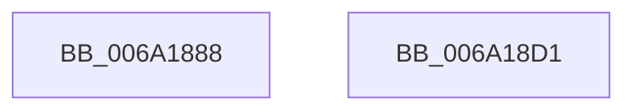

# BgpRasGetGlyphAdvanceWidth

- RVA: `0x006A1888`–`0x006A18D2` (길이 `74` bytes)
- VA: `0x00000001406A1888`
- 실행 섹션: `.text`
- PDB 이름 있음: `예`; PDB Function 태그: `아니요`
- unwind 정보 RVA: `0x00071A74`
- 디코드: `20`개 명령, `74/74` bytes 표시
- 미해석 바이트: `0` (있으면 어셈블리에 `.byte`로 보존)

> 이 문서는 커널 이미지의 기계어와 PDB 기호를 분석해 생성했습니다. 4번과 5번은 함수 원형과 자료형을 바이너리 사용 방식에서 추정한 C 해석이며 원본 소스 복구 결과는 아닙니다.

## 1. Dependencies

- 직접 호출 지점: **1**; 고유 호출 대상: **1**
- 직접 호출자로 확인된 함수: **4**
- RIP 상대 이미지 참조: **0**

### Outgoing calls
- `0x006A18C1` → [RaspGetXExtent](RaspGetXExtent_function_006A1F7C.md) (function, `0x006A1F7C`)

### Direct callers
- [BgpFoGetAdvanceWidth](../69/BgpFoGetAdvanceWidth_function_0069F350.md) at `0x0069F35E`
- [BgpFoGetStringAdvanceWidth](../69/BgpFoGetStringAdvanceWidth_function_0069F370.md) at `0x0069F3D1`
- [BcpDisplayCriticalString](../69/BcpDisplayCriticalString_function_0069F754.md) at `0x0069F8C0`
- [BcpDisplayCriticalString](../69/BcpDisplayCriticalString_function_0069F754.md) at `0x0069F982`
- [BcpDisplayCriticalStringCentered](../69/BcpDisplayCriticalStringCentered_function_0069FAB8.md) at `0x0069FC78`
- [BcpDisplayCriticalStringCentered](../69/BcpDisplayCriticalStringCentered_function_0069FAB8.md) at `0x0069FD38`

### Static image references
- 디코드된 RIP-relative 메모리 참조가 없습니다.

## 2. Other-region calls and transfers

- 다른 실행 섹션으로 향하는 call: **0**
- 별도 외부 분기/꼬리 이동을 확인하지 못했습니다.

## 3. Assembly (complete function range)

```asm
006A1888  40 53                           push rbx
006A188A  48 83 EC 50                     sub rsp, 0x50
006A188E  33 C0                           xor eax, eax
006A1890  48 8D 5C 24 30                  lea rbx, [rsp + 0x30]
006A1895  44 0F B7 CA                     movzx r9d, dx
006A1899  48 89 44 24 40                  mov qword ptr [rsp + 0x40], rax
006A189E  48 8B 84 24 80 00 00 00         mov rax, qword ptr [rsp + 0x80]
006A18A6  0F 57 C0                        xorps xmm0, xmm0
006A18A9  48 85 C0                        test rax, rax
006A18AC  48 8B D1                        mov rdx, rcx
006A18AF  41 0F B7 C9                     movzx ecx, r9w
006A18B3  48 0F 45 D8                     cmovne rbx, rax
006A18B7  48 89 5C 24 28                  mov qword ptr [rsp + 0x28], rbx
006A18BC  0F 11 44 24 30                  movups xmmword ptr [rsp + 0x30], xmm0
006A18C1  E8 B6 06 00 00                  call 0x1406a1f7c
006A18C6  48 83 63 10 00                  and qword ptr [rbx + 0x10], 0
006A18CB  48 83 C4 50                     add rsp, 0x50
006A18CF  5B                              pop rbx
006A18D0  C3                              ret
006A18D1  CC                              int3
```

## 4. C-style interpretation (structured pseudocode)

```c
__int64 __fastcall BgpRasGetGlyphAdvanceWidth(__int64 a1, unsigned __int16 a2, __int64 a3, __int64 a4, __int64 a5)
{
    __int64 result;
    __int64 v_rbx;
    __int64 v_rsp;
    unsigned __int64 v_stack_m18;
    unsigned __int64 v_stack_m28;
    unsigned __int64 v_stack_m30;

    v_rsp = (v_rsp) - (80);
    result = 0;
    v_stack_m18 = 0;
    v_rbx = v_stack_m28;
    if (a5 != 0) { v_rbx = a5; }
    v_stack_m30 = v_rbx;
    v_stack_m28 = v_xmm0;
    result = RaspGetXExtent(a2, a1, a3, a2);
    v_rsp = (v_rsp) + (80);
    return result;
}
```

## 5. (Beta) C Style

```c
int64_t BgpRasGetGlyphAdvanceWidth(int64_t Arg1, uint16_t Arg2, int64_t Arg3, int64_t Arg4, int64_t Arg5)
{
    int64_t result;
    int64_t local_rbx;
    int64_t local_rsp;
    uint64_t v_stack_m18;
    uint64_t v_stack_m28;
    uint64_t v_stack_m30;

    local_rsp = (local_rsp) - (80);
    result = 0;
    v_stack_m18 = 0;
    local_rbx = v_stack_m28;
    if (Arg5 != 0) { local_rbx = Arg5; }
    v_stack_m30 = local_rbx;
    v_stack_m28 = v_xmm0;
    result = RaspGetXExtent(Arg2, Arg1, Arg3, Arg2);
    local_rsp = (local_rsp) + (80);
    return result;
}
```

## 6. Execution-region graph

[열기: 2D/3D 그래프와 함수 탐색 컨트롤 패널](../../../control-panel.html?section=text&rva=0x006A1888&view=graph)

- 2D 그래프는 위에서 아래로 흐르고, 3D 그래프는 빈 공간을 드래그해 회전합니다. Shift+드래그는 이동, 휠은 확대·축소, 함수 노드 선택은 대상 보고서 이동입니다.

### Static fallback


