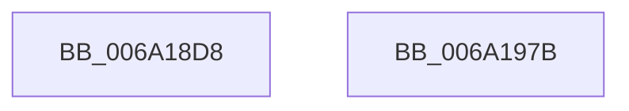

# BgpRasGetGlyphTextCellDimensions

- RVA: `0x006A18D8`–`0x006A197C` (길이 `164` bytes)
- VA: `0x00000001406A18D8`
- 실행 섹션: `.text`
- PDB 이름 있음: `예`; PDB Function 태그: `아니요`
- unwind 정보 RVA: `0x00060BC4`
- 디코드: `48`개 명령, `164/164` bytes 표시
- 미해석 바이트: `0` (있으면 어셈블리에 `.byte`로 보존)

> 이 문서는 커널 이미지의 기계어와 PDB 기호를 분석해 생성했습니다. 4번과 5번은 함수 원형과 자료형을 바이너리 사용 방식에서 추정한 C 해석이며 원본 소스 복구 결과는 아닙니다.

## 1. Dependencies

- 직접 호출 지점: **1**; 고유 호출 대상: **1**
- 직접 호출자로 확인된 함수: **2**
- RIP 상대 이미지 참조: **0**

### Outgoing calls
- `0x006A1941` → [BgpFmRoundUp](../3E/BgpFmRoundUp_function_003E4218.md) (function, `0x003E4218`)

### Direct callers
- [BgpTxtDisplayCharacter](../47/BgpTxtDisplayCharacter_function_0047F120.md) at `0x0047F254`
- [BgpFoGetTextMetrics](../4E/BgpFoGetTextMetrics_function_004E3FC4.md) at `0x004E3FD9`

### Static image references
- 디코드된 RIP-relative 메모리 참조가 없습니다.

## 2. Other-region calls and transfers

- 다른 실행 섹션으로 향하는 call: **0**
- 별도 외부 분기/꼬리 이동을 확인하지 못했습니다.

## 3. Assembly (complete function range)

```asm
006A18D8  48 89 5C 24 08                  mov qword ptr [rsp + 8], rbx
006A18DD  48 89 74 24 10                  mov qword ptr [rsp + 0x10], rsi
006A18E2  57                              push rdi
006A18E3  48 83 EC 20                     sub rsp, 0x20
006A18E7  4C 8B 51 08                     mov r10, qword ptr [rcx + 8]
006A18EB  48 8B FA                        mov rdi, rdx
006A18EE  44 8B 49 10                     mov r9d, dword ptr [rcx + 0x10]
006A18F2  49 8B F0                        mov rsi, r8
006A18F5  41 0F B7 42 78                  movzx eax, word ptr [r10 + 0x78]
006A18FA  45 8B 5A 60                     mov r11d, dword ptr [r10 + 0x60]
006A18FE  41 0F BF 4A 54                  movsx ecx, word ptr [r10 + 0x54]
006A1903  48 8D 1C C0                     lea rbx, [rax + rax*8]
006A1907  49 0F BF 42 50                  movsx rax, word ptr [r10 + 0x50]
006A190C  49 0F AF C1                     imul rax, r9
006A1910  48 C1 E3 03                     shl rbx, 3
006A1914  49 0F AF C3                     imul rax, r11
006A1918  48 C1 E0 06                     shl rax, 6
006A191C  48 99                           cqo
006A191E  48 F7 FB                        idiv rbx
006A1921  4C 8B C0                        mov r8, rax
006A1924  41 0F BF 42 52                  movsx eax, word ptr [r10 + 0x52]
006A1929  2B C1                           sub eax, ecx
006A192B  48 98                           cdqe
006A192D  49 0F AF C1                     imul rax, r9
006A1931  49 0F AF C3                     imul rax, r11
006A1935  48 C1 E0 06                     shl rax, 6
006A1939  48 99                           cqo
006A193B  48 F7 FB                        idiv rbx
006A193E  48 8B C8                        mov rcx, rax
006A1941  E8 D2 28 D4 FF                  call 0x1403e4218
006A1946  48 8B 5C 24 30                  mov rbx, qword ptr [rsp + 0x30]
006A194B  83 C0 02                        add eax, 2
006A194E  89 07                           mov dword ptr [rdi], eax
006A1950  41 8B C0                        mov eax, r8d
006A1953  C1 F8 06                        sar eax, 6
006A1956  8B C8                           mov ecx, eax
006A1958  81 C9 00 00 00 FC               or ecx, 0xfc000000
006A195E  45 85 C0                        test r8d, r8d
006A1961  0F 49 C8                        cmovns ecx, eax
006A1964  41 F6 C0 20                     test r8b, 0x20
006A1968  8D 41 01                        lea eax, [rcx + 1]
006A196B  0F 44 C1                        cmove eax, ecx
006A196E  89 06                           mov dword ptr [rsi], eax
006A1970  48 8B 74 24 38                  mov rsi, qword ptr [rsp + 0x38]
006A1975  48 83 C4 20                     add rsp, 0x20
006A1979  5F                              pop rdi
006A197A  C3                              ret
006A197B  CC                              int3
```

## 4. C-style interpretation (structured pseudocode)

```c
__int64 __fastcall BgpRasGetGlyphTextCellDimensions(__int64 a1, __int64 a2, __int64 a3)
{
    __int64 result;
    __int64 v_rbx;
    __int64 v_rsp;
    unsigned __int64 v_stack_p10;
    unsigned __int64 v_stack_p8;

    v_stack_p8 = v_rbx;
    v_stack_p10 = v_rsi;
    v_rsp = (v_rsp) - (32);
    result = ((__int16)(*(unsigned __int16 *)(*(unsigned __int64 *)(a1 + 8) + 80))) * ((unsigned int)(*(unsigned int *)(a1 + 16)));
    v_rbx = (*(unsigned __int16 *)(*(unsigned __int64 *)(a1 + 8) + 120) + *(unsigned __int16 *)(*(unsigned __int64 *)(a1 + 8) + 120) * 8) << (3);
    result = (result) * ((unsigned int)(*(unsigned int *)(*(unsigned __int64 *)(a1 + 8) + 96)));
    result = (result) << (6);
    result = (unsigned int)(((__int16)(*(unsigned __int16 *)(*(unsigned __int64 *)(a1 + 8) + 82))) - ((unsigned int)((__int16)(*(unsigned __int16 *)(*(unsigned __int64 *)(a1 + 8) + 84)))));
    result = (result) * ((unsigned int)(*(unsigned int *)(a1 + 16)));
    result = (result) * ((unsigned int)(*(unsigned int *)(*(unsigned __int64 *)(a1 + 8) + 96)));
    result = (result) << (6);
    result = BgpFmRoundUp(result, a2, result, (unsigned int)(*(unsigned int *)(a1 + 16)));
    result = (unsigned int)((result) + (2));
    *(unsigned int *)(a2) = (unsigned int)(result);
    result = (unsigned int)(((unsigned int)((unsigned int)(result))) >> (6));
    a1 = (unsigned int)(((unsigned int)((unsigned int)(result))) | (0xFC000000ULL));
    if (!sign_flag) { a1 = (unsigned int)(result); }
    result = a1 + 1;
    if ((((unsigned __int8)(result)) & (32)) == 0) { result = (unsigned int)(a1); }
    *(unsigned int *)(a3) = (unsigned int)(result);
    v_rsp = (v_rsp) + (32);
    return result;
}
```

## 5. (Beta) C Style

```c
int64_t BgpRasGetGlyphTextCellDimensions(void *Arg1, void *Arg2, void *Arg3)
{
    uint8_t *arg1 = (uint8_t *)Arg1;
    uint8_t *arg2 = (uint8_t *)Arg2;
    uint8_t *arg3 = (uint8_t *)Arg3;

    int64_t result;
    int64_t local_rbx;
    int64_t local_rsp;
    uint64_t v_stack_p10;
    uint64_t v_stack_p8;

    v_stack_p8 = local_rbx;
    v_stack_p10 = local_rsi;
    local_rsp = (local_rsp) - (32);
    result = ((int16_t)(*(uint16_t *)(*(uint64_t *)(arg1 + 0x8) + 0x50))) * ((uint32_t)(*(uint32_t *)(arg1 + 0x10)));
    local_rbx = (*(uint16_t *)(*(uint64_t *)(arg1 + 0x8) + 0x78) + *(uint16_t *)(*(uint64_t *)(arg1 + 0x8) + 0x78) * 8) << (3);
    result = (result) * ((uint32_t)(*(uint32_t *)(*(uint64_t *)(arg1 + 0x8) + 0x60)));
    result = (result) << (6);
    result = (uint32_t)(((int16_t)(*(uint16_t *)(*(uint64_t *)(arg1 + 0x8) + 0x52))) - ((uint32_t)((int16_t)(*(uint16_t *)(*(uint64_t *)(arg1 + 0x8) + 0x54)))));
    result = (result) * ((uint32_t)(*(uint32_t *)(arg1 + 0x10)));
    result = (result) * ((uint32_t)(*(uint32_t *)(*(uint64_t *)(arg1 + 0x8) + 0x60)));
    result = (result) << (6);
    result = BgpFmRoundUp(result, Arg2, result, (uint32_t)(*(uint32_t *)(arg1 + 0x10)));
    result = (uint32_t)((result) + (2));
    *(uint32_t *)(arg2) = (uint32_t)(result);
    result = (uint32_t)(((uint32_t)((uint32_t)(result))) >> (6));
    Arg1 = (uint32_t)(((uint32_t)((uint32_t)(result))) | (0xFC000000ULL));
    if (!sign_flag) { Arg1 = (uint32_t)(result); }
    result = Arg1 + 1;
    if ((((uint8_t)(result)) & (32)) == 0) { result = (uint32_t)(Arg1); }
    *(uint32_t *)(arg3) = (uint32_t)(result);
    local_rsp = (local_rsp) + (32);
    return result;
}
```

### 관측된 메모리 오프셋

구조체 형식이 확인되지 않은 접근은 인자 기준의 오프셋으로만 기록했습니다.

| 기준 인자 | 오프셋 표현 | 폭 (bit) | 접근 |
|---|---:|---:|---|
| `Arg1` | `+ 0x8` | `64` | `R` |
| `Arg1` | `+ 0x10` | `32` | `R` |
| `Arg2` | `+ 0x0` | `32` | `W` |
| `Arg3` | `+ 0x0` | `32` | `W` |

## 6. Execution-region graph

[열기: 2D/3D 그래프와 함수 탐색 컨트롤 패널](../../../control-panel.html?section=text&rva=0x006A18D8&view=graph)

- 2D 그래프는 위에서 아래로 흐르고, 3D 그래프는 빈 공간을 드래그해 회전합니다. Shift+드래그는 이동, 휠은 확대·축소, 함수 노드 선택은 대상 보고서 이동입니다.

### Static fallback


