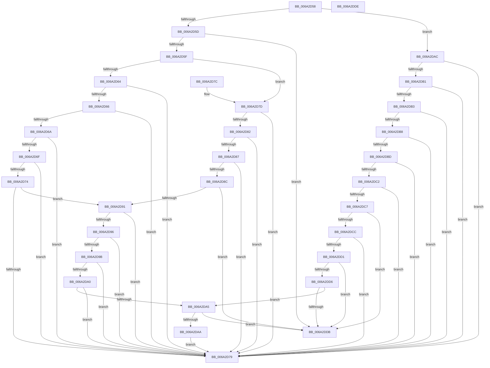

# CmClassPropertyWrite

- RVA: `0x006A2D58`–`0x006A2DDF` (길이 `135` bytes)
- VA: `0x00000001406A2D58`
- 실행 섹션: `.text`
- PDB 이름 있음: `예`; PDB Function 태그: `아니요`
- unwind 정보 RVA: `0x000DB714`
- 디코드: `58`개 명령, `135/135` bytes 표시
- 미해석 바이트: `0` (있으면 어셈블리에 `.byte`로 보존)

> 이 문서는 커널 이미지의 기계어와 PDB 기호를 분석해 생성했습니다. 4번과 5번은 함수 원형과 자료형을 바이너리 사용 방식에서 추정한 C 해석이며 원본 소스 복구 결과는 아닙니다.

## 1. Dependencies

- 직접 호출 지점: **0**; 고유 호출 대상: **0**
- 직접 호출자로 확인된 함수: **2**
- RIP 상대 이미지 참조: **0**

### Outgoing calls
- 직접 디코드된 call 명령이 없습니다.

### Direct callers
- [CmSetInstallerClassRegPropWorker](../../page/82/CmSetInstallerClassRegPropWorker_function_0082ABF4.md) at `0x0082AC77`
- [PiPnpRtlCmActionCallback](../../page/8E/PiPnpRtlCmActionCallback_function_008EF110.md) at `0x008EF666`

### Static image references
- 디코드된 RIP-relative 메모리 참조가 없습니다.

## 2. Other-region calls and transfers

- 다른 실행 섹션으로 향하는 call: **0**
- 별도 외부 분기/꼬리 이동을 확인하지 못했습니다.

## 3. Assembly (complete function range)

```asm
006A2D58  83 F9 13                        cmp ecx, 0x13
006A2D5B  7F 4F                           jg 0x1406a2dac
006A2D5D  74 7C                           je 0x1406a2ddb
006A2D5F  83 F9 09                        cmp ecx, 9
006A2D62  7F 19                           jg 0x1406a2d7d
006A2D64  74 13                           je 0x1406a2d79
006A2D66  85 C9                           test ecx, ecx
006A2D68  74 0F                           je 0x1406a2d79
006A2D6A  83 E9 01                        sub ecx, 1
006A2D6D  74 0A                           je 0x1406a2d79
006A2D6F  83 E9 01                        sub ecx, 1
006A2D72  74 05                           je 0x1406a2d79
006A2D74  83 E9 01                        sub ecx, 1
006A2D77  75 18                           jne 0x1406a2d91
006A2D79  32 C0                           xor al, al
006A2D7B  C3                              ret
006A2D7C  CC                              int3
006A2D7D  83 E9 0A                        sub ecx, 0xa
006A2D80  74 F7                           je 0x1406a2d79
006A2D82  83 E9 01                        sub ecx, 1
006A2D85  74 F2                           je 0x1406a2d79
006A2D87  83 E9 01                        sub ecx, 1
006A2D8A  74 ED                           je 0x1406a2d79
006A2D8C  83 E9 01                        sub ecx, 1
006A2D8F  74 4A                           je 0x1406a2ddb
006A2D91  83 E9 01                        sub ecx, 1
006A2D94  74 E3                           je 0x1406a2d79
006A2D96  83 E9 01                        sub ecx, 1
006A2D99  74 DE                           je 0x1406a2d79
006A2D9B  83 E9 01                        sub ecx, 1
006A2D9E  74 D9                           je 0x1406a2d79
006A2DA0  83 E9 01                        sub ecx, 1
006A2DA3  74 D4                           je 0x1406a2d79
006A2DA5  83 F9 01                        cmp ecx, 1
006A2DA8  74 31                           je 0x1406a2ddb
006A2DAA  EB CD                           jmp 0x1406a2d79
006A2DAC  83 F9 1D                        cmp ecx, 0x1d
006A2DAF  7F C8                           jg 0x1406a2d79
006A2DB1  74 C6                           je 0x1406a2d79
006A2DB3  83 E9 14                        sub ecx, 0x14
006A2DB6  74 C1                           je 0x1406a2d79
006A2DB8  83 E9 01                        sub ecx, 1
006A2DBB  74 BC                           je 0x1406a2d79
006A2DBD  83 E9 01                        sub ecx, 1
006A2DC0  74 B7                           je 0x1406a2d79
006A2DC2  83 E9 01                        sub ecx, 1
006A2DC5  74 B2                           je 0x1406a2d79
006A2DC7  83 E9 01                        sub ecx, 1
006A2DCA  74 0F                           je 0x1406a2ddb
006A2DCC  83 E9 01                        sub ecx, 1
006A2DCF  74 A8                           je 0x1406a2d79
006A2DD1  83 E9 01                        sub ecx, 1
006A2DD4  74 05                           je 0x1406a2ddb
006A2DD6  83 E9 01                        sub ecx, 1
006A2DD9  75 CA                           jne 0x1406a2da5
006A2DDB  B0 01                           mov al, 1
006A2DDD  C3                              ret
006A2DDE  CC                              int3
```

## 4. C-style interpretation (structured pseudocode)

```c
__int64 __fastcall CmClassPropertyWrite(int a1)
{
    __int64 result;

    if (a1 > 19) goto loc_006A2DAC;
    if (a1 == 19) goto loc_006A2DDB;
    if (a1 > 9) goto loc_006A2D7D;
    if (a1 == 9) goto loc_006A2D79;
    if (a1 == 0) goto loc_006A2D79;
    a1 = (unsigned int)((a1) - (1));
    if (condition_is_equal) goto loc_006A2D79;
    a1 = (unsigned int)((a1) - (1));
    if (condition_is_equal) goto loc_006A2D79;
    a1 = (unsigned int)((a1) - (1));
    if (condition_is_not_equal) goto loc_006A2D91;
loc_006A2D79:
    result = 0;
    return result;
loc_006A2D7D:
    a1 = (unsigned int)((a1) - (10));
    if (condition_is_equal) goto loc_006A2D79;
    a1 = (unsigned int)((a1) - (1));
    if (condition_is_equal) goto loc_006A2D79;
    a1 = (unsigned int)((a1) - (1));
    if (condition_is_equal) goto loc_006A2D79;
    a1 = (unsigned int)((a1) - (1));
    if (condition_is_equal) goto loc_006A2DDB;
loc_006A2D91:
    a1 = (unsigned int)((a1) - (1));
    if (condition_is_equal) goto loc_006A2D79;
    a1 = (unsigned int)((a1) - (1));
    if (condition_is_equal) goto loc_006A2D79;
    a1 = (unsigned int)((a1) - (1));
    if (condition_is_equal) goto loc_006A2D79;
    a1 = (unsigned int)((a1) - (1));
    if (condition_is_equal) goto loc_006A2D79;
loc_006A2DA5:
    if (a1 == 1) goto loc_006A2DDB;
    goto loc_006A2D79;
loc_006A2DAC:
    if (a1 > 29) goto loc_006A2D79;
    if (a1 == 29) goto loc_006A2D79;
    a1 = (unsigned int)((a1) - (20));
    if (condition_is_equal) goto loc_006A2D79;
    a1 = (unsigned int)((a1) - (1));
    if (condition_is_equal) goto loc_006A2D79;
    a1 = (unsigned int)((a1) - (1));
    if (condition_is_equal) goto loc_006A2D79;
    a1 = (unsigned int)((a1) - (1));
    if (condition_is_equal) goto loc_006A2D79;
    a1 = (unsigned int)((a1) - (1));
    if (condition_is_equal) goto loc_006A2DDB;
    a1 = (unsigned int)((a1) - (1));
    if (condition_is_equal) goto loc_006A2D79;
    a1 = (unsigned int)((a1) - (1));
    if (condition_is_equal) goto loc_006A2DDB;
    a1 = (unsigned int)((a1) - (1));
    if (condition_is_not_equal) goto loc_006A2DA5;
loc_006A2DDB:
    return 1;
}
```

## 5. (Beta) C Style

```c
int64_t CmClassPropertyWrite(int32_t Arg1)
{
    int64_t result;

    if (Arg1 > 19) goto loc_006A2DAC;
    if (Arg1 == 19) goto loc_006A2DDB;
    if (Arg1 > 9) goto loc_006A2D7D;
    if (Arg1 == 9) goto loc_006A2D79;
    if (Arg1 == 0) goto loc_006A2D79;
    Arg1 = (uint32_t)((Arg1) - (1));
    if (condition_is_equal) goto loc_006A2D79;
    Arg1 = (uint32_t)((Arg1) - (1));
    if (condition_is_equal) goto loc_006A2D79;
    Arg1 = (uint32_t)((Arg1) - (1));
    if (condition_is_not_equal) goto loc_006A2D91;
loc_006A2D79:
    result = 0;
    return result;
loc_006A2D7D:
    Arg1 = (uint32_t)((Arg1) - (10));
    if (condition_is_equal) goto loc_006A2D79;
    Arg1 = (uint32_t)((Arg1) - (1));
    if (condition_is_equal) goto loc_006A2D79;
    Arg1 = (uint32_t)((Arg1) - (1));
    if (condition_is_equal) goto loc_006A2D79;
    Arg1 = (uint32_t)((Arg1) - (1));
    if (condition_is_equal) goto loc_006A2DDB;
loc_006A2D91:
    Arg1 = (uint32_t)((Arg1) - (1));
    if (condition_is_equal) goto loc_006A2D79;
    Arg1 = (uint32_t)((Arg1) - (1));
    if (condition_is_equal) goto loc_006A2D79;
    Arg1 = (uint32_t)((Arg1) - (1));
    if (condition_is_equal) goto loc_006A2D79;
    Arg1 = (uint32_t)((Arg1) - (1));
    if (condition_is_equal) goto loc_006A2D79;
loc_006A2DA5:
    if (Arg1 == 1) goto loc_006A2DDB;
    goto loc_006A2D79;
loc_006A2DAC:
    if (Arg1 > 29) goto loc_006A2D79;
    if (Arg1 == 29) goto loc_006A2D79;
    Arg1 = (uint32_t)((Arg1) - (20));
    if (condition_is_equal) goto loc_006A2D79;
    Arg1 = (uint32_t)((Arg1) - (1));
    if (condition_is_equal) goto loc_006A2D79;
    Arg1 = (uint32_t)((Arg1) - (1));
    if (condition_is_equal) goto loc_006A2D79;
    Arg1 = (uint32_t)((Arg1) - (1));
    if (condition_is_equal) goto loc_006A2D79;
    Arg1 = (uint32_t)((Arg1) - (1));
    if (condition_is_equal) goto loc_006A2DDB;
    Arg1 = (uint32_t)((Arg1) - (1));
    if (condition_is_equal) goto loc_006A2D79;
    Arg1 = (uint32_t)((Arg1) - (1));
    if (condition_is_equal) goto loc_006A2DDB;
    Arg1 = (uint32_t)((Arg1) - (1));
    if (condition_is_not_equal) goto loc_006A2DA5;
loc_006A2DDB:
    return 1;
}
```

## 6. Execution-region graph

[열기: 2D/3D 그래프와 함수 탐색 컨트롤 패널](../../../control-panel.html?section=text&rva=0x006A2D58&view=graph)

- 2D 그래프는 위에서 아래로 흐르고, 3D 그래프는 빈 공간을 드래그해 회전합니다. Shift+드래그는 이동, 휠은 확대·축소, 함수 노드 선택은 대상 보고서 이동입니다.

### Static fallback


