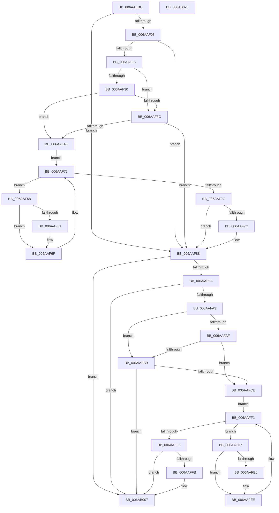

# DifDllInitializeWrapper

- RVA: `0x006AAEBC`–`0x006AB029` (길이 `365` bytes)
- VA: `0x00000001406AAEBC`
- 실행 섹션: `.text`
- PDB 이름 있음: `예`; PDB Function 태그: `아니요`
- unwind 정보 RVA: `0x0008A668`
- 디코드: `101`개 명령, `365/365` bytes 표시
- 미해석 바이트: `0` (있으면 어셈블리에 `.byte`로 보존)

> 이 문서는 커널 이미지의 기계어와 PDB 기호를 분석해 생성했습니다. 4번과 5번은 함수 원형과 자료형을 바이너리 사용 방식에서 추정한 C 해석이며 원본 소스 복구 결과는 아닙니다.

## 1. Dependencies

- 직접 호출 지점: **9**; 고유 호출 대상: **5**
- 직접 호출자로 확인된 함수: **1**
- RIP 상대 이미지 참조: **3**

### Outgoing calls
- `0x006AAEF2` → [VfTargetDriversGetVerifierData](../../pagevrfy/BB/VfTargetDriversGetVerifierData_function_00BB7E6C.md) (function, `0x00BB7E6C`)
- `0x006AAF08` → [DifGetAPIThunkContextById](../49/DifGetAPIThunkContextById_function_00495A34.md) (function, `0x00495A34`)
- `0x006AAF43` → [ExAcquireRundownProtection](../21/ExAcquireRundownProtection_function_00216620.md) (function, `0x00216620`)
- `0x006AAF6A` → [guard_dispatch_icall](../6B/guard_dispatch_icall_function_006BAAD0.md) (function, `0x006BAAD0`)
- `0x006AAF83` → [ExReleaseRundownProtection](../34/ExReleaseRundownProtection_function_00349E80.md) (function, `0x00349E80`)
- `0x006AAF8E` → [guard_dispatch_icall](../6B/guard_dispatch_icall_function_006BAAD0.md) (function, `0x006BAAD0`)
- `0x006AAFC2` → [ExAcquireRundownProtection](../21/ExAcquireRundownProtection_function_00216620.md) (function, `0x00216620`)
- `0x006AAFE9` → [guard_dispatch_icall](../6B/guard_dispatch_icall_function_006BAAD0.md) (function, `0x006BAAD0`)
- `0x006AB002` → [ExReleaseRundownProtection](../34/ExReleaseRundownProtection_function_00349E80.md) (function, `0x00349E80`)

### Direct callers
- [MiIssueDllInitializeCall](../../page/7F/MiIssueDllInitializeCall_function_007F8078.md) at `0x007F80F9`

### Static image references
- `0x006AAF1D` → RVA `0x00F048B8` (`.data`; read)
- `0x006AAF30` → RVA `0x00F04980` (`.data`; read)
- `0x006AAF3C` → RVA `0x00F03E80` (`.data`; read)

## 2. Other-region calls and transfers

- 다른 실행 섹션으로 향하는 call: **1**
  - `0x006AAEF2` → [VfTargetDriversGetVerifierData](../../pagevrfy/BB/VfTargetDriversGetVerifierData_function_00BB7E6C.md) (`.text` → `PAGEVRFY`)
- 별도 외부 분기/꼬리 이동을 확인하지 못했습니다.

## 3. Assembly (complete function range)

```asm
006AAEBC  48 8B C4                        mov rax, rsp
006AAEBF  48 89 58 08                     mov qword ptr [rax + 8], rbx
006AAEC3  48 89 68 10                     mov qword ptr [rax + 0x10], rbp
006AAEC7  48 89 70 18                     mov qword ptr [rax + 0x18], rsi
006AAECB  48 89 78 20                     mov qword ptr [rax + 0x20], rdi
006AAECF  41 54                           push r12
006AAED1  41 56                           push r14
006AAED3  41 57                           push r15
006AAED5  48 83 EC 40                     sub rsp, 0x40
006AAED9  0F 57 C0                        xorps xmm0, xmm0
006AAEDC  4C 8B F9                        mov r15, rcx
006AAEDF  49 8B C8                        mov rcx, r8
006AAEE2  4D 8B F0                        mov r14, r8
006AAEE5  0F 11 40 C8                     movups xmmword ptr [rax - 0x38], xmm0
006AAEE9  48 8B DA                        mov rbx, rdx
006AAEEC  33 F6                           xor esi, esi
006AAEEE  0F 11 40 D8                     movups xmmword ptr [rax - 0x28], xmm0
006AAEF2  E8 75 CF 50 00                  call 0x140bb7e6c
006AAEF7  4C 8B E0                        mov r12, rax
006AAEFA  48 85 C0                        test rax, rax
006AAEFD  0F 84 85 00 00 00               je 0x1406aaf88
006AAF03  B9 00 00 00 80                  mov ecx, 0x80000000
006AAF08  E8 27 AB DE FF                  call 0x140495a34
006AAF0D  48 8B F0                        mov rsi, rax
006AAF10  48 85 C0                        test rax, rax
006AAF13  74 73                           je 0x1406aaf88
006AAF15  40 32 ED                        xor bpl, bpl
006AAF18  4C 89 74 24 20                  mov qword ptr [rsp + 0x20], r14
006AAF1D  40 38 2D 94 99 85 00            cmp byte ptr [rip + 0x859994], bpl
006AAF24  4C 89 7C 24 28                  mov qword ptr [rsp + 0x28], r15
006AAF29  48 89 5C 24 30                  mov qword ptr [rsp + 0x30], rbx
006AAF2E  75 0C                           jne 0x1406aaf3c
006AAF30  F7 05 46 9A 85 00 00 08 00 00   test dword ptr [rip + 0x859a46], 0x800
006AAF3A  74 13                           je 0x1406aaf4f
006AAF3C  48 8D 0D 3D 8F 85 00            lea rcx, [rip + 0x858f3d]
006AAF43  E8 D8 B6 B6 FF                  call 0x140216620
006AAF48  40 8A E8                        mov bpl, al
006AAF4B  84 C0                           test al, al
006AAF4D  74 39                           je 0x1406aaf88
006AAF4F  48 8D 7E 20                     lea rdi, [rsi + 0x20]
006AAF53  48 8B 1F                        mov rbx, qword ptr [rdi]
006AAF56  EB 1A                           jmp 0x1406aaf72
006AAF58  48 8D 43 F0                     lea rax, [rbx - 0x10]
006AAF5C  48 85 C0                        test rax, rax
006AAF5F  74 0E                           je 0x1406aaf6f
006AAF61  48 8B 40 08                     mov rax, qword ptr [rax + 8]
006AAF65  48 8D 4C 24 20                  lea rcx, [rsp + 0x20]
006AAF6A  E8 61 FB 00 00                  call 0x1406baad0
006AAF6F  48 8B 1B                        mov rbx, qword ptr [rbx]
006AAF72  48 3B DF                        cmp rbx, rdi
006AAF75  75 E1                           jne 0x1406aaf58
006AAF77  40 84 ED                        test bpl, bpl
006AAF7A  74 0C                           je 0x1406aaf88
006AAF7C  48 8D 0D FD 8E 85 00            lea rcx, [rip + 0x858efd]
006AAF83  E8 F8 EE C9 FF                  call 0x140349e80
006AAF88  49 8B CF                        mov rcx, r15
006AAF8B  49 8B C6                        mov rax, r14
006AAF8E  E8 3D FB 00 00                  call 0x1406baad0
006AAF93  8B E8                           mov ebp, eax
006AAF95  4D 85 E4                        test r12, r12
006AAF98  74 6D                           je 0x1406ab007
006AAF9A  89 44 24 38                     mov dword ptr [rsp + 0x38], eax
006AAF9E  48 85 F6                        test rsi, rsi
006AAFA1  74 64                           je 0x1406ab007
006AAFA3  40 32 FF                        xor dil, dil
006AAFA6  40 38 3D 0B 99 85 00            cmp byte ptr [rip + 0x85990b], dil
006AAFAD  75 0C                           jne 0x1406aafbb
006AAFAF  F7 05 C7 99 85 00 00 08 00 00   test dword ptr [rip + 0x8599c7], 0x800
006AAFB9  74 13                           je 0x1406aafce
006AAFBB  48 8D 0D BE 8E 85 00            lea rcx, [rip + 0x858ebe]
006AAFC2  E8 59 B6 B6 FF                  call 0x140216620
006AAFC7  40 8A F8                        mov dil, al
006AAFCA  84 C0                           test al, al
006AAFCC  74 39                           je 0x1406ab007
006AAFCE  48 83 C6 30                     add rsi, 0x30
006AAFD2  48 8B 1E                        mov rbx, qword ptr [rsi]
006AAFD5  EB 1A                           jmp 0x1406aaff1
006AAFD7  48 8D 43 F0                     lea rax, [rbx - 0x10]
006AAFDB  48 85 C0                        test rax, rax
006AAFDE  74 0E                           je 0x1406aafee
006AAFE0  48 8B 40 08                     mov rax, qword ptr [rax + 8]
006AAFE4  48 8D 4C 24 20                  lea rcx, [rsp + 0x20]
006AAFE9  E8 E2 FA 00 00                  call 0x1406baad0
006AAFEE  48 8B 1B                        mov rbx, qword ptr [rbx]
006AAFF1  48 3B DE                        cmp rbx, rsi
006AAFF4  75 E1                           jne 0x1406aafd7
006AAFF6  40 84 FF                        test dil, dil
006AAFF9  74 0C                           je 0x1406ab007
006AAFFB  48 8D 0D 7E 8E 85 00            lea rcx, [rip + 0x858e7e]
006AB002  E8 79 EE C9 FF                  call 0x140349e80
006AB007  48 8B 5C 24 60                  mov rbx, qword ptr [rsp + 0x60]
006AB00C  8B C5                           mov eax, ebp
006AB00E  48 8B 6C 24 68                  mov rbp, qword ptr [rsp + 0x68]
006AB013  48 8B 74 24 70                  mov rsi, qword ptr [rsp + 0x70]
006AB018  48 8B 7C 24 78                  mov rdi, qword ptr [rsp + 0x78]
006AB01D  48 83 C4 40                     add rsp, 0x40
006AB021  41 5F                           pop r15
006AB023  41 5E                           pop r14
006AB025  41 5C                           pop r12
006AB027  C3                              ret
006AB028  CC                              int3
```

## 4. C-style interpretation (structured pseudocode)

```c
__int64 __fastcall DifDllInitializeWrapper(__int64 a1, __int64 a2, __int64 a3)
{
    __int64 result;
    __int64 v_rbp;
    __int64 v_rdi;
    __int64 v_rsi;
    __int64 v_rsp;
    unsigned int v_stack_m20;
    unsigned __int64 v_stack_m28;
    unsigned __int64 v_stack_m30;
    unsigned __int64 v_stack_m38;
    unsigned __int64 v_stack_p10;
    unsigned __int64 v_stack_p18;
    unsigned __int64 v_stack_p20;
    unsigned __int64 v_stack_p8;

    *(unsigned __int64 *)(v_rsp + 8) = v_rbx;
    *(unsigned __int64 *)(v_rsp + 16) = v_rbp;
    *(unsigned __int64 *)(v_rsp + 24) = v_rsi;
    *(unsigned __int64 *)(v_rsp + 32) = v_rdi;
    v_rsp = (v_rsp) - (64);
    *(unsigned __int64 *)(v_rsp - 56) = v_xmm0;
    v_rsi = 0;
    *(unsigned __int64 *)(v_rsp - 40) = v_xmm0;
    result = VfTargetDriversGetVerifierData(a3, a2, a3, a4);
    if (result == 0) goto loc_006AAF88;
    result = DifGetAPIThunkContextById((unsigned int)(0x80000000ULL), a2, a3, a4);
    if (result == 0) goto loc_006AAF88;
    v_rbp = 0;
    v_stack_m38 = a3;
    v_stack_m30 = a1;
    v_stack_m28 = a2;
    if ((*(unsigned __int8 *)(v_rip + 8755604)) != 0) goto loc_006AAF3C;
    if (((*(unsigned int *)(v_rip + 8755782)) & (0x800ULL)) == 0) goto loc_006AAF4F;
loc_006AAF3C:
    result = ExAcquireRundownProtection(v_rip + 8752957, a2, a3, a4);
    if ((unsigned __int8)(result) == 0) goto loc_006AAF88;
loc_006AAF4F:
    goto loc_006AAF72;
loc_006AAF58:
    result = *(unsigned __int64 *)(result + 32) - 16;
    if (*(unsigned __int64 *)(result + 32) - 16 != 0) {
        result = *(unsigned __int64 *)(*(unsigned __int64 *)(result + 32) - 16 + 8);
        a1 = v_stack_m38;
        result = guard_dispatch_icall(a1, a2, a3, a4);
    }
loc_006AAF72:
    if ((*(unsigned __int64 *)(*(unsigned __int64 *)(result + 32))) != (result + 32)) goto loc_006AAF58;
    if ((unsigned __int8)((unsigned __int8)(result)) != 0) {
        a1 = v_rip + 8752893;
        result = ExReleaseRundownProtection(a1, a2, a3, a4);
    }
    result = guard_dispatch_icall(a1, a2, a3, a4);
    if (result == 0) goto loc_006AB007;
    v_stack_m20 = (unsigned int)(result);
    if (result == 0) goto loc_006AB007;
    v_rdi = 0;
    if ((*(unsigned __int8 *)(v_rip + 8755467)) != 0) goto loc_006AAFBB;
    if (((*(unsigned int *)(v_rip + 8755655)) & (0x800ULL)) == 0) goto loc_006AAFCE;
loc_006AAFBB:
    result = ExAcquireRundownProtection(v_rip + 8752830, a2, a3, a4);
    if ((unsigned __int8)(result) == 0) goto loc_006AB007;
loc_006AAFCE:
    v_rsi = (result) + (48);
    goto loc_006AAFF1;
loc_006AAFD7:
    result = *(unsigned __int64 *)(v_rsi) - 16;
    if (*(unsigned __int64 *)(v_rsi) - 16 != 0) {
        result = *(unsigned __int64 *)(*(unsigned __int64 *)(v_rsi) - 16 + 8);
        a1 = v_stack_m38;
        result = guard_dispatch_icall(a1, a2, a3, a4);
    }
loc_006AAFF1:
    if ((*(unsigned __int64 *)(*(unsigned __int64 *)(v_rsi))) != v_rsi) goto loc_006AAFD7;
    if ((unsigned __int8)((unsigned __int8)(result)) != 0) {
        a1 = v_rip + 8752766;
        result = ExReleaseRundownProtection(a1, a2, a3, a4);
    }
    v_rsp = (v_rsp) + (64);
    return (unsigned int)((unsigned int)((unsigned int)((unsigned int)(result))));
}
```

## 5. (Beta) C Style

```c
int64_t DifDllInitializeWrapper(int64_t Arg1, int64_t Arg2, int64_t Arg3)
{
    int64_t result;
    int64_t local_rbp;
    int64_t local_rdi;
    int64_t local_rsi;
    int64_t local_rsp;
    uint32_t v_stack_m20;
    uint64_t v_stack_m28;
    uint64_t v_stack_m30;
    uint64_t v_stack_m38;
    uint64_t v_stack_p10;
    uint64_t v_stack_p18;
    uint64_t v_stack_p20;
    uint64_t v_stack_p8;

    *(uint64_t *)(local_rsp + 0x8) = local_rbx;
    *(uint64_t *)(local_rsp + 0x10) = local_rbp;
    *(uint64_t *)(local_rsp + 0x18) = local_rsi;
    *(uint64_t *)(local_rsp + 0x20) = local_rdi;
    local_rsp = (local_rsp) - (64);
    *(uint64_t *)(local_rsp - 0x38) = v_xmm0;
    local_rsi = 0;
    *(uint64_t *)(local_rsp - 0x28) = v_xmm0;
    result = VfTargetDriversGetVerifierData(Arg3, Arg2, Arg3, a4);
    if (result == 0) goto loc_006AAF88;
    result = DifGetAPIThunkContextById((uint32_t)(0x80000000ULL), Arg2, Arg3, a4);
    if (result == 0) goto loc_006AAF88;
    local_rbp = 0;
    v_stack_m38 = Arg3;
    v_stack_m30 = Arg1;
    v_stack_m28 = Arg2;
    if ((*(uint8_t *)(v_rip + 0x859994)) != 0) goto loc_006AAF3C;
    if (((*(uint32_t *)(v_rip + 0x859A46)) & (0x800ULL)) == 0) goto loc_006AAF4F;
loc_006AAF3C:
    result = ExAcquireRundownProtection(v_rip + 8752957, Arg2, Arg3, a4);
    if ((uint8_t)(result) == 0) goto loc_006AAF88;
loc_006AAF4F:
    goto loc_006AAF72;
loc_006AAF58:
    result = *(uint64_t *)(result + 0x20) - 16;
    if (*(uint64_t *)(result + 0x20) - 16 != 0) {
        result = *(uint64_t *)(*(uint64_t *)(result + 0x20) - 0x10 + 0x8);
        Arg1 = v_stack_m38;
        result = guard_dispatch_icall(Arg1, Arg2, Arg3, a4);
    }
loc_006AAF72:
    if ((*(uint64_t *)(*(uint64_t *)(result + 0x20))) != (result + 32)) goto loc_006AAF58;
    if ((uint8_t)((uint8_t)(result)) != 0) {
        Arg1 = v_rip + 8752893;
        result = ExReleaseRundownProtection(Arg1, Arg2, Arg3, a4);
    }
    result = guard_dispatch_icall(Arg1, Arg2, Arg3, a4);
    if (result == 0) goto loc_006AB007;
    v_stack_m20 = (uint32_t)(result);
    if (result == 0) goto loc_006AB007;
    local_rdi = 0;
    if ((*(uint8_t *)(v_rip + 0x85990B)) != 0) goto loc_006AAFBB;
    if (((*(uint32_t *)(v_rip + 0x8599C7)) & (0x800ULL)) == 0) goto loc_006AAFCE;
loc_006AAFBB:
    result = ExAcquireRundownProtection(v_rip + 8752830, Arg2, Arg3, a4);
    if ((uint8_t)(result) == 0) goto loc_006AB007;
loc_006AAFCE:
    local_rsi = (result) + (48);
    goto loc_006AAFF1;
loc_006AAFD7:
    result = *(uint64_t *)(local_rsi) - 16;
    if (*(uint64_t *)(local_rsi) - 16 != 0) {
        result = *(uint64_t *)(*(uint64_t *)(local_rsi) - 0x10 + 0x8);
        Arg1 = v_stack_m38;
        result = guard_dispatch_icall(Arg1, Arg2, Arg3, a4);
    }
loc_006AAFF1:
    if ((*(uint64_t *)(*(uint64_t *)(local_rsi))) != local_rsi) goto loc_006AAFD7;
    if ((uint8_t)((uint8_t)(result)) != 0) {
        Arg1 = v_rip + 8752766;
        result = ExReleaseRundownProtection(Arg1, Arg2, Arg3, a4);
    }
    local_rsp = (local_rsp) + (64);
    return (uint32_t)((uint32_t)((uint32_t)((uint32_t)(result))));
}
```

## 6. Execution-region graph

[열기: 2D/3D 그래프와 함수 탐색 컨트롤 패널](../../../control-panel.html?section=text&rva=0x006AAEBC&view=graph)

- 2D 그래프는 위에서 아래로 흐르고, 3D 그래프는 빈 공간을 드래그해 회전합니다. Shift+드래그는 이동, 휠은 확대·축소, 함수 노드 선택은 대상 보고서 이동입니다.

### Static fallback


