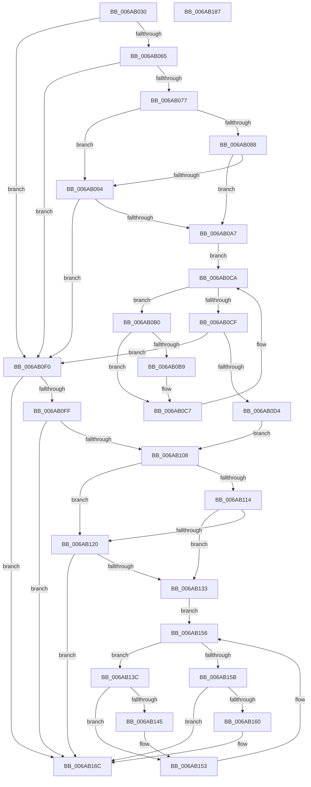

# DifDllUnloadWrapper

- RVA: `0x006AB030`–`0x006AB188` (길이 `344` bytes)
- VA: `0x00000001406AB030`
- 실행 섹션: `.text`
- PDB 이름 있음: `예`; PDB Function 태그: `아니요`
- unwind 정보 RVA: `0x0009F048`
- 디코드: `97`개 명령, `344/344` bytes 표시
- 미해석 바이트: `0` (있으면 어셈블리에 `.byte`로 보존)

> 이 문서는 커널 이미지의 기계어와 PDB 기호를 분석해 생성했습니다. 4번과 5번은 함수 원형과 자료형을 바이너리 사용 방식에서 추정한 C 해석이며 원본 소스 복구 결과는 아닙니다.

## 1. Dependencies

- 직접 호출 지점: **10**; 고유 호출 대상: **5**
- 직접 호출자로 확인된 함수: **1**
- RIP 상대 이미지 참조: **3**

### Outgoing calls
- `0x006AB054` → [VfTargetDriversGetVerifierData](../../pagevrfy/BB/VfTargetDriversGetVerifierData_function_00BB7E6C.md) (function, `0x00BB7E6C`)
- `0x006AB06A` → [DifGetAPIThunkContextById](../49/DifGetAPIThunkContextById_function_00495A34.md) (function, `0x00495A34`)
- `0x006AB09B` → [ExAcquireRundownProtection](../21/ExAcquireRundownProtection_function_00216620.md) (function, `0x00216620`)
- `0x006AB0C2` → [guard_dispatch_icall](../6B/guard_dispatch_icall_function_006BAAD0.md) (function, `0x006BAAD0`)
- `0x006AB0DB` → [ExReleaseRundownProtection](../34/ExReleaseRundownProtection_function_00349E80.md) (function, `0x00349E80`)
- `0x006AB0E3` → [guard_dispatch_icall](../6B/guard_dispatch_icall_function_006BAAD0.md) (function, `0x006BAAD0`)
- `0x006AB0F3` → [guard_dispatch_icall](../6B/guard_dispatch_icall_function_006BAAD0.md) (function, `0x006BAAD0`)
- `0x006AB127` → [ExAcquireRundownProtection](../21/ExAcquireRundownProtection_function_00216620.md) (function, `0x00216620`)
- `0x006AB14E` → [guard_dispatch_icall](../6B/guard_dispatch_icall_function_006BAAD0.md) (function, `0x006BAAD0`)
- `0x006AB167` → [ExReleaseRundownProtection](../34/ExReleaseRundownProtection_function_00349E80.md) (function, `0x00349E80`)

### Direct callers
- [MiUnloadApproved](../../page/7F/MiUnloadApproved_function_007F82A0.md) at `0x007F833A`

### Static image references
- `0x006AB07F` → RVA `0x00F048B8` (`.data`; read)
- `0x006AB088` → RVA `0x00F04980` (`.data`; read)
- `0x006AB094` → RVA `0x00F03E80` (`.data`; read)

## 2. Other-region calls and transfers

- 다른 실행 섹션으로 향하는 call: **1**
  - `0x006AB054` → [VfTargetDriversGetVerifierData](../../pagevrfy/BB/VfTargetDriversGetVerifierData_function_00BB7E6C.md) (`.text` → `PAGEVRFY`)
- 별도 외부 분기/꼬리 이동을 확인하지 못했습니다.

## 3. Assembly (complete function range)

```asm
006AB030  48 8B C4                        mov rax, rsp
006AB033  48 89 58 10                     mov qword ptr [rax + 0x10], rbx
006AB037  48 89 68 18                     mov qword ptr [rax + 0x18], rbp
006AB03B  48 89 70 20                     mov qword ptr [rax + 0x20], rsi
006AB03F  57                              push rdi
006AB040  41 56                           push r14
006AB042  41 57                           push r15
006AB044  48 83 EC 30                     sub rsp, 0x30
006AB048  0F 57 C0                        xorps xmm0, xmm0
006AB04B  4C 8B F1                        mov r14, rcx
006AB04E  0F 11 40 D8                     movups xmmword ptr [rax - 0x28], xmm0
006AB052  33 FF                           xor edi, edi
006AB054  E8 13 CE 50 00                  call 0x140bb7e6c
006AB059  4C 8B F8                        mov r15, rax
006AB05C  48 85 C0                        test rax, rax
006AB05F  0F 84 8B 00 00 00               je 0x1406ab0f0
006AB065  B9 01 00 00 80                  mov ecx, 0x80000001
006AB06A  E8 C5 A9 DE FF                  call 0x140495a34
006AB06F  48 8B F8                        mov rdi, rax
006AB072  48 85 C0                        test rax, rax
006AB075  74 79                           je 0x1406ab0f0
006AB077  40 32 ED                        xor bpl, bpl
006AB07A  4C 89 74 24 20                  mov qword ptr [rsp + 0x20], r14
006AB07F  40 38 2D 32 98 85 00            cmp byte ptr [rip + 0x859832], bpl
006AB086  75 0C                           jne 0x1406ab094
006AB088  F7 05 EE 98 85 00 00 08 00 00   test dword ptr [rip + 0x8598ee], 0x800
006AB092  74 13                           je 0x1406ab0a7
006AB094  48 8D 0D E5 8D 85 00            lea rcx, [rip + 0x858de5]
006AB09B  E8 80 B5 B6 FF                  call 0x140216620
006AB0A0  40 8A E8                        mov bpl, al
006AB0A3  84 C0                           test al, al
006AB0A5  74 49                           je 0x1406ab0f0
006AB0A7  48 8D 77 20                     lea rsi, [rdi + 0x20]
006AB0AB  48 8B 1E                        mov rbx, qword ptr [rsi]
006AB0AE  EB 1A                           jmp 0x1406ab0ca
006AB0B0  48 8D 43 F0                     lea rax, [rbx - 0x10]
006AB0B4  48 85 C0                        test rax, rax
006AB0B7  74 0E                           je 0x1406ab0c7
006AB0B9  48 8B 40 08                     mov rax, qword ptr [rax + 8]
006AB0BD  48 8D 4C 24 20                  lea rcx, [rsp + 0x20]
006AB0C2  E8 09 FA 00 00                  call 0x1406baad0
006AB0C7  48 8B 1B                        mov rbx, qword ptr [rbx]
006AB0CA  48 3B DE                        cmp rbx, rsi
006AB0CD  75 E1                           jne 0x1406ab0b0
006AB0CF  40 84 ED                        test bpl, bpl
006AB0D2  74 1C                           je 0x1406ab0f0
006AB0D4  48 8D 0D A5 8D 85 00            lea rcx, [rip + 0x858da5]
006AB0DB  E8 A0 ED C9 FF                  call 0x140349e80
006AB0E0  49 8B C6                        mov rax, r14
006AB0E3  E8 E8 F9 00 00                  call 0x1406baad0
006AB0E8  8B D8                           mov ebx, eax
006AB0EA  89 44 24 28                     mov dword ptr [rsp + 0x28], eax
006AB0EE  EB 18                           jmp 0x1406ab108
006AB0F0  49 8B C6                        mov rax, r14
006AB0F3  E8 D8 F9 00 00                  call 0x1406baad0
006AB0F8  8B D8                           mov ebx, eax
006AB0FA  4D 85 FF                        test r15, r15
006AB0FD  74 6D                           je 0x1406ab16c
006AB0FF  89 44 24 28                     mov dword ptr [rsp + 0x28], eax
006AB103  48 85 FF                        test rdi, rdi
006AB106  74 64                           je 0x1406ab16c
006AB108  40 32 F6                        xor sil, sil
006AB10B  40 38 35 A6 97 85 00            cmp byte ptr [rip + 0x8597a6], sil
006AB112  75 0C                           jne 0x1406ab120
006AB114  F7 05 62 98 85 00 00 08 00 00   test dword ptr [rip + 0x859862], 0x800
006AB11E  74 13                           je 0x1406ab133
006AB120  48 8D 0D 59 8D 85 00            lea rcx, [rip + 0x858d59]
006AB127  E8 F4 B4 B6 FF                  call 0x140216620
006AB12C  40 8A F0                        mov sil, al
006AB12F  84 C0                           test al, al
006AB131  74 39                           je 0x1406ab16c
006AB133  4C 8D 77 30                     lea r14, [rdi + 0x30]
006AB137  49 8B 3E                        mov rdi, qword ptr [r14]
006AB13A  EB 1A                           jmp 0x1406ab156
006AB13C  48 8D 47 F0                     lea rax, [rdi - 0x10]
006AB140  48 85 C0                        test rax, rax
006AB143  74 0E                           je 0x1406ab153
006AB145  48 8B 40 08                     mov rax, qword ptr [rax + 8]
006AB149  48 8D 4C 24 20                  lea rcx, [rsp + 0x20]
006AB14E  E8 7D F9 00 00                  call 0x1406baad0
006AB153  48 8B 3F                        mov rdi, qword ptr [rdi]
006AB156  49 3B FE                        cmp rdi, r14
006AB159  75 E1                           jne 0x1406ab13c
006AB15B  40 84 F6                        test sil, sil
006AB15E  74 0C                           je 0x1406ab16c
006AB160  48 8D 0D 19 8D 85 00            lea rcx, [rip + 0x858d19]
006AB167  E8 14 ED C9 FF                  call 0x140349e80
006AB16C  48 8B 6C 24 60                  mov rbp, qword ptr [rsp + 0x60]
006AB171  8B C3                           mov eax, ebx
006AB173  48 8B 5C 24 58                  mov rbx, qword ptr [rsp + 0x58]
006AB178  48 8B 74 24 68                  mov rsi, qword ptr [rsp + 0x68]
006AB17D  48 83 C4 30                     add rsp, 0x30
006AB181  41 5F                           pop r15
006AB183  41 5E                           pop r14
006AB185  5F                              pop rdi
006AB186  C3                              ret
006AB187  CC                              int3
```

## 4. C-style interpretation (structured pseudocode)

```c
__int64 __fastcall DifDllUnloadWrapper(__int64 a1)
{
    __int64 result;
    __int64 v_rbp;
    __int64 v_rdi;
    __int64 v_rsi;
    __int64 v_rsp;
    unsigned int v_stack_m20;
    unsigned __int64 v_stack_m28;
    unsigned __int64 v_stack_p10;
    unsigned __int64 v_stack_p18;
    unsigned __int64 v_stack_p20;

    *(unsigned __int64 *)(v_rsp + 16) = v_rbx;
    *(unsigned __int64 *)(v_rsp + 24) = v_rbp;
    *(unsigned __int64 *)(v_rsp + 32) = v_rsi;
    v_rsp = (v_rsp) - (48);
    *(unsigned __int64 *)(v_rsp - 40) = v_xmm0;
    v_rdi = 0;
    result = VfTargetDriversGetVerifierData(a1, a2, a3, a4);
    if (result == 0) goto loc_006AB0F0;
    result = DifGetAPIThunkContextById((unsigned int)(0x80000001ULL), a2, a3, a4);
    if (result == 0) goto loc_006AB0F0;
    v_rbp = 0;
    v_stack_m28 = a1;
    if ((*(unsigned __int8 *)(v_rip + 8755250)) != 0) goto loc_006AB094;
    if (((*(unsigned int *)(v_rip + 8755438)) & (0x800ULL)) == 0) goto loc_006AB0A7;
loc_006AB094:
    result = ExAcquireRundownProtection(v_rip + 8752613, a2, a3, a4);
    if ((unsigned __int8)(result) == 0) goto loc_006AB0F0;
loc_006AB0A7:
    goto loc_006AB0CA;
loc_006AB0B0:
    result = *(unsigned __int64 *)(result + 32) - 16;
    if (*(unsigned __int64 *)(result + 32) - 16 != 0) {
        result = *(unsigned __int64 *)(*(unsigned __int64 *)(result + 32) - 16 + 8);
        a1 = v_stack_m28;
        result = guard_dispatch_icall(a1, a2, a3, a4);
    }
loc_006AB0CA:
    if ((*(unsigned __int64 *)(*(unsigned __int64 *)(result + 32))) != (result + 32)) goto loc_006AB0B0;
    if ((unsigned __int8)((unsigned __int8)(result)) == 0) goto loc_006AB0F0;
    result = ExReleaseRundownProtection(v_rip + 8752549, a2, a3, a4);
    result = guard_dispatch_icall(v_rip + 8752549, a2, a3, a4);
    v_stack_m20 = (unsigned int)(result);
    goto loc_006AB108;
loc_006AB0F0:
    result = guard_dispatch_icall(v_rip + 8752549, a2, a3, a4);
    if (result == 0) goto loc_006AB16C;
    v_stack_m20 = (unsigned int)(result);
    if (result == 0) goto loc_006AB16C;
loc_006AB108:
    v_rsi = 0;
    if ((*(unsigned __int8 *)(v_rip + 8755110)) != 0) goto loc_006AB120;
    if (((*(unsigned int *)(v_rip + 8755298)) & (0x800ULL)) == 0) goto loc_006AB133;
loc_006AB120:
    result = ExAcquireRundownProtection(v_rip + 8752473, a2, a3, a4);
    if ((unsigned __int8)(result) == 0) goto loc_006AB16C;
loc_006AB133:
    goto loc_006AB156;
loc_006AB13C:
    result = *(unsigned __int64 *)(result + 48) - 16;
    if (*(unsigned __int64 *)(result + 48) - 16 != 0) {
        result = *(unsigned __int64 *)(*(unsigned __int64 *)(result + 48) - 16 + 8);
        a1 = v_stack_m28;
        result = guard_dispatch_icall(a1, a2, a3, a4);
    }
loc_006AB156:
    if ((*(unsigned __int64 *)(*(unsigned __int64 *)(result + 48))) != (result + 48)) goto loc_006AB13C;
    if ((unsigned __int8)((unsigned __int8)(result)) != 0) {
        a1 = v_rip + 8752409;
        result = ExReleaseRundownProtection(a1, a2, a3, a4);
    }
    v_rsp = (v_rsp) + (48);
    return (unsigned int)((unsigned int)((unsigned int)((unsigned int)(result))));
}
```

## 5. (Beta) C Style

```c
int64_t DifDllUnloadWrapper(int64_t Arg1)
{
    int64_t result;
    int64_t local_rbp;
    int64_t local_rdi;
    int64_t local_rsi;
    int64_t local_rsp;
    uint32_t v_stack_m20;
    uint64_t v_stack_m28;
    uint64_t v_stack_p10;
    uint64_t v_stack_p18;
    uint64_t v_stack_p20;

    *(uint64_t *)(local_rsp + 0x10) = local_rbx;
    *(uint64_t *)(local_rsp + 0x18) = local_rbp;
    *(uint64_t *)(local_rsp + 0x20) = local_rsi;
    local_rsp = (local_rsp) - (48);
    *(uint64_t *)(local_rsp - 0x28) = v_xmm0;
    local_rdi = 0;
    result = VfTargetDriversGetVerifierData(Arg1, a2, a3, a4);
    if (result == 0) goto loc_006AB0F0;
    result = DifGetAPIThunkContextById((uint32_t)(0x80000001ULL), a2, a3, a4);
    if (result == 0) goto loc_006AB0F0;
    local_rbp = 0;
    v_stack_m28 = Arg1;
    if ((*(uint8_t *)(v_rip + 0x859832)) != 0) goto loc_006AB094;
    if (((*(uint32_t *)(v_rip + 0x8598EE)) & (0x800ULL)) == 0) goto loc_006AB0A7;
loc_006AB094:
    result = ExAcquireRundownProtection(v_rip + 8752613, a2, a3, a4);
    if ((uint8_t)(result) == 0) goto loc_006AB0F0;
loc_006AB0A7:
    goto loc_006AB0CA;
loc_006AB0B0:
    result = *(uint64_t *)(result + 0x20) - 16;
    if (*(uint64_t *)(result + 0x20) - 16 != 0) {
        result = *(uint64_t *)(*(uint64_t *)(result + 0x20) - 0x10 + 0x8);
        Arg1 = v_stack_m28;
        result = guard_dispatch_icall(Arg1, a2, a3, a4);
    }
loc_006AB0CA:
    if ((*(uint64_t *)(*(uint64_t *)(result + 0x20))) != (result + 32)) goto loc_006AB0B0;
    if ((uint8_t)((uint8_t)(result)) == 0) goto loc_006AB0F0;
    result = ExReleaseRundownProtection(v_rip + 8752549, a2, a3, a4);
    result = guard_dispatch_icall(v_rip + 8752549, a2, a3, a4);
    v_stack_m20 = (uint32_t)(result);
    goto loc_006AB108;
loc_006AB0F0:
    result = guard_dispatch_icall(v_rip + 8752549, a2, a3, a4);
    if (result == 0) goto loc_006AB16C;
    v_stack_m20 = (uint32_t)(result);
    if (result == 0) goto loc_006AB16C;
loc_006AB108:
    local_rsi = 0;
    if ((*(uint8_t *)(v_rip + 0x8597A6)) != 0) goto loc_006AB120;
    if (((*(uint32_t *)(v_rip + 0x859862)) & (0x800ULL)) == 0) goto loc_006AB133;
loc_006AB120:
    result = ExAcquireRundownProtection(v_rip + 8752473, a2, a3, a4);
    if ((uint8_t)(result) == 0) goto loc_006AB16C;
loc_006AB133:
    goto loc_006AB156;
loc_006AB13C:
    result = *(uint64_t *)(result + 0x30) - 16;
    if (*(uint64_t *)(result + 0x30) - 16 != 0) {
        result = *(uint64_t *)(*(uint64_t *)(result + 0x30) - 0x10 + 0x8);
        Arg1 = v_stack_m28;
        result = guard_dispatch_icall(Arg1, a2, a3, a4);
    }
loc_006AB156:
    if ((*(uint64_t *)(*(uint64_t *)(result + 0x30))) != (result + 48)) goto loc_006AB13C;
    if ((uint8_t)((uint8_t)(result)) != 0) {
        Arg1 = v_rip + 8752409;
        result = ExReleaseRundownProtection(Arg1, a2, a3, a4);
    }
    local_rsp = (local_rsp) + (48);
    return (uint32_t)((uint32_t)((uint32_t)((uint32_t)(result))));
}
```

## 6. Execution-region graph

[열기: 2D/3D 그래프와 함수 탐색 컨트롤 패널](../../../control-panel.html?section=text&rva=0x006AB030&view=graph)

- 2D 그래프는 위에서 아래로 흐르고, 3D 그래프는 빈 공간을 드래그해 회전합니다. Shift+드래그는 이동, 휠은 확대·축소, 함수 노드 선택은 대상 보고서 이동입니다.

### Static fallback


