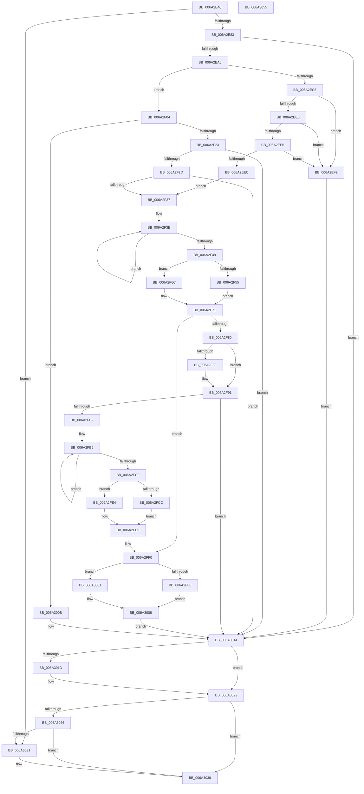

# DrvDbGetConfigurationSubKeyCallback

- RVA: `0x006A2E40`–`0x006A3056` (길이 `534` bytes)
- VA: `0x00000001406A2E40`
- 실행 섹션: `.text`
- PDB 이름 있음: `예`; PDB Function 태그: `아니요`
- unwind 정보 RVA: `0x000DABA0`
- 디코드: `158`개 명령, `534/534` bytes 표시
- 미해석 바이트: `0` (있으면 어셈블리에 `.byte`로 보존)

> 이 문서는 커널 이미지의 기계어와 PDB 기호를 분석해 생성했습니다. 4번과 5번은 함수 원형과 자료형을 바이너리 사용 방식에서 추정한 C 해석이며 원본 소스 복구 결과는 아닙니다.

## 1. Dependencies

- 직접 호출 지점: **8**; 고유 호출 대상: **6**
- 직접 호출자로 확인된 함수: **0**
- RIP 상대 이미지 참조: **4**

### Outgoing calls
- `0x006A2E97` → [PnpCtxRegOpenKey](../../page/8E/PnpCtxRegOpenKey_function_008EF7B8.md) (function, `0x008EF7B8`)
- `0x006A2ED5` → [PnpCtxRegQueryValue](../../page/99/PnpCtxRegQueryValue_function_009940FC.md) (function, `0x009940FC`)
- `0x006A2F14` → [PnpCtxRegQueryValue](../../page/99/PnpCtxRegQueryValue_function_009940FC.md) (function, `0x009940FC`)
- `0x006A2F65` → [memcpy](../6C/memcpy_function_006C6840.md) (function, `0x006C6840`)
- `0x006A2FA7` → [RtlStringCchPrintfW](../48/RtlStringCchPrintfW_function_00482D5C.md) (function, `0x00482D5C`)
- `0x006A2FDD` → [memcpy](../6C/memcpy_function_006C6840.md) (function, `0x006C6840`)
- `0x006A301D` → [PnpCtxRegCloseKey](../../page/A2/PnpCtxRegCloseKey_function_00A22E0C.md) (function, `0x00A22E0C`)
- `0x006A303F` → [_security_check_cookie](_security_check_cookie_function_006AC640.md) (function, `0x006AC640`)

### Direct callers
- 이 함수 시작 RVA로 연결되는 직접 call은 확인되지 않았습니다. 간접 호출은 완전히 역산할 수 없습니다.

### Static image references
- `0x006A2E54` → RVA `0x00E0A740` (`.data`; read)
- `0x006A2EC9` → RVA `0x006D13D0` (` ?? ::FNODOBFM::`string'`; read)
- `0x006A2F08` → RVA `0x006D1160` (` ?? ::FNODOBFM::`string'`; read)
- `0x006A2F94` → RVA `0x006D13F0` (` ?? ::FNODOBFM::`string'`; read)

## 2. Other-region calls and transfers

- 다른 실행 섹션으로 향하는 call: **4**
  - `0x006A2E97` → [PnpCtxRegOpenKey](../../page/8E/PnpCtxRegOpenKey_function_008EF7B8.md) (`.text` → `PAGE`)
  - `0x006A2ED5` → [PnpCtxRegQueryValue](../../page/99/PnpCtxRegQueryValue_function_009940FC.md) (`.text` → `PAGE`)
  - `0x006A2F14` → [PnpCtxRegQueryValue](../../page/99/PnpCtxRegQueryValue_function_009940FC.md) (`.text` → `PAGE`)
  - `0x006A301D` → [PnpCtxRegCloseKey](../../page/A2/PnpCtxRegCloseKey_function_00A22E0C.md) (`.text` → `PAGE`)
- 별도 외부 분기/꼬리 이동을 확인하지 못했습니다.

## 3. Assembly (complete function range)

```asm
006A2E40  40 55                           push rbp
006A2E42  53                              push rbx
006A2E43  56                              push rsi
006A2E44  57                              push rdi
006A2E45  41 54                           push r12
006A2E47  41 55                           push r13
006A2E49  41 56                           push r14
006A2E4B  41 57                           push r15
006A2E4D  48 8B EC                        mov rbp, rsp
006A2E50  48 83 EC 78                     sub rsp, 0x78
006A2E54  48 8B 05 E5 78 76 00            mov rax, qword ptr [rip + 0x7678e5]
006A2E5B  48 33 C4                        xor rax, rsp
006A2E5E  48 89 45 F0                     mov qword ptr [rbp - 0x10], rax
006A2E62  33 F6                           xor esi, esi
006A2E64  49 8B F9                        mov rdi, r9
006A2E67  48 89 75 C8                     mov qword ptr [rbp - 0x38], rsi
006A2E6B  4D 8B E8                        mov r13, r8
006A2E6E  89 75 C0                        mov dword ptr [rbp - 0x40], esi
006A2E71  44 8B E6                        mov r12d, esi
006A2E74  89 75 D0                        mov dword ptr [rbp - 0x30], esi
006A2E77  89 75 B8                        mov dword ptr [rbp - 0x48], esi
006A2E7A  4D 85 C9                        test r9, r9
006A2E7D  0F 84 AE 01 00 00               je 0x1406a3031
006A2E83  48 8D 45 C8                     lea rax, [rbp - 0x38]
006A2E87  45 33 C9                        xor r9d, r9d
006A2E8A  48 89 44 24 28                  mov qword ptr [rsp + 0x28], rax
006A2E8F  C7 44 24 20 01 00 00 00         mov dword ptr [rsp + 0x20], 1
006A2E97  E8 1C C9 24 00                  call 0x1408ef7b8
006A2E9C  8B D8                           mov ebx, eax
006A2E9E  85 C0                           test eax, eax
006A2EA0  0F 88 6E 01 00 00               js 0x1406a3014
006A2EA6  44 8D 76 04                     lea r14d, [rsi + 4]
006A2EAA  48 8B 55 C8                     mov rdx, qword ptr [rbp - 0x38]
006A2EAE  48 8D 45 BC                     lea rax, [rbp - 0x44]
006A2EB2  44 89 75 BC                     mov dword ptr [rbp - 0x44], r14d
006A2EB6  4C 8D 4D B8                     lea r9, [rbp - 0x48]
006A2EBA  48 89 44 24 28                  mov qword ptr [rsp + 0x28], rax
006A2EBF  40 38 77 10                     cmp byte ptr [rdi + 0x10], sil
006A2EC3  74 3F                           je 0x1406a2f04
006A2EC5  48 8D 45 C0                     lea rax, [rbp - 0x40]
006A2EC9  4C 8D 05 00 E5 02 00            lea r8, [rip + 0x2e500]
006A2ED0  48 89 44 24 20                  mov qword ptr [rsp + 0x20], rax
006A2ED5  E8 22 12 2F 00                  call 0x1409940fc
006A2EDA  8B D8                           mov ebx, eax
006A2EDC  85 C0                           test eax, eax
006A2EDE  78 12                           js 0x1406a2ef2
006A2EE0  44 39 75 B8                     cmp dword ptr [rbp - 0x48], r14d
006A2EE4  75 0C                           jne 0x1406a2ef2
006A2EE6  44 39 75 BC                     cmp dword ptr [rbp - 0x44], r14d
006A2EEA  75 06                           jne 0x1406a2ef2
006A2EEC  44 8B 65 C0                     mov r12d, dword ptr [rbp - 0x40]
006A2EF0  EB 45                           jmp 0x1406a2f37
006A2EF2  81 FB 34 00 00 C0               cmp ebx, 0xc0000034
006A2EF8  8B C6                           mov eax, esi
006A2EFA  0F 45 C3                        cmovne eax, ebx
006A2EFD  8B D8                           mov ebx, eax
006A2EFF  E9 10 01 00 00                  jmp 0x1406a3014
006A2F04  48 8D 45 D0                     lea rax, [rbp - 0x30]
006A2F08  4C 8D 05 51 E2 02 00            lea r8, [rip + 0x2e251]
006A2F0F  48 89 44 24 20                  mov qword ptr [rsp + 0x20], rax
006A2F14  E8 E3 11 2F 00                  call 0x1409940fc
006A2F19  8B D8                           mov ebx, eax
006A2F1B  85 C0                           test eax, eax
006A2F1D  0F 88 E8 00 00 00               js 0x1406a300b
006A2F23  44 39 75 B8                     cmp dword ptr [rbp - 0x48], r14d
006A2F27  0F 85 E7 00 00 00               jne 0x1406a3014
006A2F2D  44 39 75 BC                     cmp dword ptr [rbp - 0x44], r14d
006A2F31  0F 85 DD 00 00 00               jne 0x1406a3014
006A2F37  49 83 CE FF                     or r14, 0xffffffffffffffff
006A2F3B  4D 8B FE                        mov r15, r14
006A2F3E  49 FF C7                        inc r15
006A2F41  66 43 39 74 7D 00               cmp word ptr [r13 + r15*2], si
006A2F47  75 F5                           jne 0x1406a2f3e
006A2F49  8B 4F 0C                        mov ecx, dword ptr [rdi + 0xc]
006A2F4C  42 8D 04 39                     lea eax, [rcx + r15]
006A2F50  39 47 08                        cmp dword ptr [rdi + 8], eax
006A2F53  72 17                           jb 0x1406a2f6c
006A2F55  48 8B 07                        mov rax, qword ptr [rdi]
006A2F58  49 8B D5                        mov rdx, r13
006A2F5B  45 8B C7                        mov r8d, r15d
006A2F5E  4D 03 C0                        add r8, r8
006A2F61  48 8D 0C 48                     lea rcx, [rax + rcx*2]
006A2F65  E8 D6 38 02 00                  call 0x1406c6840
006A2F6A  EB 05                           jmp 0x1406a2f71
006A2F6C  BB 23 00 00 C0                  mov ebx, 0xc0000023
006A2F71  8B 4F 0C                        mov ecx, dword ptr [rdi + 0xc]
006A2F74  41 03 CF                        add ecx, r15d
006A2F77  89 4F 0C                        mov dword ptr [rdi + 0xc], ecx
006A2F7A  40 38 77 10                     cmp byte ptr [rdi + 0x10], sil
006A2F7E  74 70                           je 0x1406a2ff0
006A2F80  8D 41 01                        lea eax, [rcx + 1]
006A2F83  39 47 08                        cmp dword ptr [rdi + 8], eax
006A2F86  72 09                           jb 0x1406a2f91
006A2F88  48 8B 07                        mov rax, qword ptr [rdi]
006A2F8B  66 C7 04 48 3A 00               mov word ptr [rax + rcx*2], 0x3a
006A2F91  FF 47 0C                        inc dword ptr [rdi + 0xc]
006A2F94  4C 8D 05 55 E4 02 00            lea r8, [rip + 0x2e455]
006A2F9B  45 8B CC                        mov r9d, r12d
006A2F9E  48 8D 4D D8                     lea rcx, [rbp - 0x28]
006A2FA2  BA 09 00 00 00                  mov edx, 9
006A2FA7  E8 B0 FD DD FF                  call 0x140482d5c
006A2FAC  8B D8                           mov ebx, eax
006A2FAE  85 C0                           test eax, eax
006A2FB0  78 62                           js 0x1406a3014
006A2FB2  48 8D 45 D8                     lea rax, [rbp - 0x28]
006A2FB6  49 FF C6                        inc r14
006A2FB9  66 42 39 34 70                  cmp word ptr [rax + r14*2], si
006A2FBE  75 F6                           jne 0x1406a2fb6
006A2FC0  8B 4F 0C                        mov ecx, dword ptr [rdi + 0xc]
006A2FC3  42 8D 04 31                     lea eax, [rcx + r14]
006A2FC7  39 47 08                        cmp dword ptr [rdi + 8], eax
006A2FCA  72 18                           jb 0x1406a2fe4
006A2FCC  48 8B 07                        mov rax, qword ptr [rdi]
006A2FCF  48 8D 55 D8                     lea rdx, [rbp - 0x28]
006A2FD3  45 8B C6                        mov r8d, r14d
006A2FD6  4D 03 C0                        add r8, r8
006A2FD9  48 8D 0C 48                     lea rcx, [rax + rcx*2]
006A2FDD  E8 5E 38 02 00                  call 0x1406c6840
006A2FE2  EB 05                           jmp 0x1406a2fe9
006A2FE4  BB 23 00 00 C0                  mov ebx, 0xc0000023
006A2FE9  44 01 77 0C                     add dword ptr [rdi + 0xc], r14d
006A2FED  8B 4F 0C                        mov ecx, dword ptr [rdi + 0xc]
006A2FF0  8D 41 01                        lea eax, [rcx + 1]
006A2FF3  39 47 08                        cmp dword ptr [rdi + 8], eax
006A2FF6  72 09                           jb 0x1406a3001
006A2FF8  48 8B 07                        mov rax, qword ptr [rdi]
006A2FFB  66 89 34 48                     mov word ptr [rax + rcx*2], si
006A2FFF  EB 05                           jmp 0x1406a3006
006A3001  BB 23 00 00 C0                  mov ebx, 0xc0000023
006A3006  FF 47 0C                        inc dword ptr [rdi + 0xc]
006A3009  EB 09                           jmp 0x1406a3014
006A300B  81 FB 34 00 00 C0               cmp ebx, 0xc0000034
006A3011  0F 44 DE                        cmove ebx, esi
006A3014  48 8B 55 C8                     mov rdx, qword ptr [rbp - 0x38]
006A3018  48 85 D2                        test rdx, rdx
006A301B  74 05                           je 0x1406a3022
006A301D  E8 EA FD 37 00                  call 0x140a22e0c
006A3022  85 DB                           test ebx, ebx
006A3024  79 10                           jns 0x1406a3036
006A3026  89 5F 14                        mov dword ptr [rdi + 0x14], ebx
006A3029  81 FB 23 00 00 C0               cmp ebx, 0xc0000023
006A302F  74 05                           je 0x1406a3036
006A3031  BE 03 00 00 00                  mov esi, 3
006A3036  8B C6                           mov eax, esi
006A3038  48 8B 4D F0                     mov rcx, qword ptr [rbp - 0x10]
006A303C  48 33 CC                        xor rcx, rsp
006A303F  E8 FC 95 00 00                  call 0x1406ac640
006A3044  48 83 C4 78                     add rsp, 0x78
006A3048  41 5F                           pop r15
006A304A  41 5E                           pop r14
006A304C  41 5D                           pop r13
006A304E  41 5C                           pop r12
006A3050  5F                              pop rdi
006A3051  5E                              pop rsi
006A3052  5B                              pop rbx
006A3053  5D                              pop rbp
006A3054  C3                              ret
006A3055  CC                              int3
```

## 4. C-style interpretation (structured pseudocode)

```c
__int64 __fastcall DrvDbGetConfigurationSubKeyCallback(__int64 a1, __int64 a2, __int64 a3, __int64 a4)
{
    __int64 result;
    __int64 v_r14;
    __int64 v_r15;
    __int64 v_rbx;
    __int64 v_rsi;
    __int64 v_rsp;
    unsigned __int64 v_stack_m50;
    unsigned __int64 v_stack_m68;
    unsigned int v_stack_m70;
    unsigned __int64 v_stack_m78;
    unsigned int v_stack_m80;
    unsigned __int64 v_stack_m84;
    unsigned int v_stack_m88;
    unsigned __int64 v_stack_m90;
    unsigned int v_stack_m98;

    v_rsp = (v_rsp) - (120);
    result = (*(unsigned __int64 *)(v_rip + 7764197)) ^ (v_rsp);
    v_stack_m50 = result;
    v_rsi = 0;
    v_stack_m78 = 0;
    v_stack_m80 = 0;
    v_stack_m70 = 0;
    v_stack_m88 = 0;
    if (a4 == 0) goto loc_006A3031;
    a4 = 0;
    v_stack_m90 = v_stack_m78;
    v_stack_m98 = 1;
    result = PnpCtxRegOpenKey(a1, a2, a3, a4);
    if (sign_flag) goto loc_006A3014;
    v_stack_m84 = (unsigned int)(v_rsi + 4);
    v_stack_m90 = v_stack_m84;
    if ((*(unsigned __int8 *)(a4 + 16)) == 0) goto loc_006A2F04;
    v_stack_m98 = v_stack_m80;
    result = PnpCtxRegQueryValue(a1, v_stack_m78, v_rip + 189696, v_stack_m88);
    if (sign_flag) goto loc_006A2EF2;
    if (v_stack_m88 != ((unsigned int)(v_rsi + 4))) goto loc_006A2EF2;
    if (v_stack_m84 != ((unsigned int)(v_rsi + 4))) goto loc_006A2EF2;
    goto loc_006A2F37;
loc_006A2EF2:
    result = 0;
    if (((unsigned int)((unsigned int)((unsigned int)(result)))) != 0xC0000034ULL) { result = (unsigned int)((unsigned int)((unsigned int)(result))); }
    goto loc_006A3014;
loc_006A2F04:
    v_stack_m98 = v_stack_m70;
    result = PnpCtxRegQueryValue(a1, v_stack_m78, v_rip + 189009, v_stack_m88);
    if (sign_flag) goto loc_006A300B;
    if (v_stack_m88 != ((unsigned int)(v_rsi + 4))) goto loc_006A3014;
    if (v_stack_m84 != ((unsigned int)(v_rsi + 4))) goto loc_006A3014;
loc_006A2F37:
    v_r14 = (v_rsi + 4) | (-1);
loc_006A2F3E:
    v_r15 = (v_r14) + 1;
    if ((*(unsigned __int16 *)(a3 + v_r15 * 2)) != 0) goto loc_006A2F3E;
    if ((*(unsigned int *)(a4 + 8)) < ((unsigned int)((unsigned int)(*(unsigned int *)(a4 + 12)) + v_r15 * 1))) goto loc_006A2F6C;
    a3 = ((unsigned int)((unsigned int)(v_r15))) + ((unsigned int)((unsigned int)(v_r15)));
    result = memcpy(*(unsigned __int64 *)(a4) + (unsigned int)(*(unsigned int *)(a4 + 12)) * 2, a3, a3, v_stack_m88);
    goto loc_006A2F71;
loc_006A2F6C:
loc_006A2F71:
    a1 = (unsigned int)(((unsigned int)(*(unsigned int *)(a4 + 12))) + ((unsigned int)(v_r15)));
    *(unsigned int *)(a4 + 12) = (unsigned int)(a1);
    if ((*(unsigned __int8 *)(a4 + 16)) == 0) goto loc_006A2FF0;
    result = a1 + 1;
    if ((*(unsigned int *)(a4 + 8)) >= ((unsigned int)(a1 + 1))) {
        result = *(unsigned __int64 *)(a4);
        *(unsigned __int16 *)(result + a1 * 2) = 58;
    }
    result = RtlStringCchPrintfW(v_stack_m68, 9, v_rip + 189525, (unsigned int)((unsigned int)((unsigned int)(v_stack_m80))));
    if (sign_flag) goto loc_006A3014;
loc_006A2FB6:
    v_r14 = (v_r14) + 1;
    if ((*(unsigned __int16 *)(v_stack_m68 + v_r14 * 2)) != 0) goto loc_006A2FB6;
    if ((*(unsigned int *)(a4 + 8)) < ((unsigned int)((unsigned int)(*(unsigned int *)(a4 + 12)) + v_r14 * 1))) goto loc_006A2FE4;
    a3 = ((unsigned int)((unsigned int)(v_r14))) + ((unsigned int)((unsigned int)(v_r14)));
    result = memcpy(*(unsigned __int64 *)(a4) + (unsigned int)(*(unsigned int *)(a4 + 12)) * 2, v_stack_m68, a3, (unsigned int)((unsigned int)((unsigned int)(v_stack_m80))));
    goto loc_006A2FE9;
loc_006A2FE4:
loc_006A2FE9:
loc_006A2FF0:
    if ((*(unsigned int *)(a4 + 8)) < ((unsigned int)((unsigned int)(*(unsigned int *)(a4 + 12)) + 1))) goto loc_006A3001;
    *(unsigned __int16 *)(*(unsigned __int64 *)(a4) + (unsigned int)(*(unsigned int *)(a4 + 12)) * 2) = 0;
    goto loc_006A3006;
loc_006A3001:
loc_006A3006:
    goto loc_006A3014;
loc_006A300B:
    v_rbx = (unsigned int)(0xC0000023ULL);
    if (((unsigned int)((unsigned int)(0xC0000023ULL))) == 0xC0000034ULL) { v_rbx = 0; }
loc_006A3014:
    result = *(unsigned __int64 *)(a4);
    if (v_stack_m78 != 0) {
        result = PnpCtxRegCloseKey((unsigned int)(*(unsigned int *)(a4 + 12)), v_stack_m78, a3, (unsigned int)((unsigned int)((unsigned int)(v_stack_m80))));
    }
    if (!sign_flag) goto loc_006A3036;
    *(unsigned int *)(a4 + 20) = (unsigned int)(v_rbx);
    if (((unsigned int)(v_rbx)) != 0xC0000023ULL) {
        v_rsi = 3;
    }
    a1 = (v_stack_m50) ^ (v_rsp);
    result = _security_check_cookie(a1, v_stack_m78, a3, (unsigned int)((unsigned int)((unsigned int)(v_stack_m80))));
    v_rsp = (v_rsp) + (120);
    return result;
}
```

## 5. (Beta) C Style

```c
int64_t DrvDbGetConfigurationSubKeyCallback(int64_t Arg1, int64_t Arg2, void *Arg3, void *Arg4)
{
    uint8_t *arg3 = (uint8_t *)Arg3;
    uint8_t *arg4 = (uint8_t *)Arg4;

    int64_t result;
    int64_t local_r14;
    int64_t local_r15;
    int64_t local_rbx;
    int64_t local_rsi;
    int64_t local_rsp;
    uint64_t v_stack_m50;
    uint64_t v_stack_m68;
    uint32_t v_stack_m70;
    uint64_t v_stack_m78;
    uint32_t v_stack_m80;
    uint64_t v_stack_m84;
    uint32_t v_stack_m88;
    uint64_t v_stack_m90;
    uint32_t v_stack_m98;

    local_rsp = (local_rsp) - (120);
    result = (*(uint64_t *)(v_rip + 0x7678E5)) ^ (local_rsp);
    v_stack_m50 = result;
    local_rsi = 0;
    v_stack_m78 = 0;
    v_stack_m80 = 0;
    v_stack_m70 = 0;
    v_stack_m88 = 0;
    if (Arg4 == NULL) goto loc_006A3031;
    Arg4 = 0;
    v_stack_m90 = v_stack_m78;
    v_stack_m98 = 1;
    result = PnpCtxRegOpenKey(Arg1, Arg2, Arg3, Arg4);
    if (sign_flag) goto loc_006A3014;
    v_stack_m84 = (uint32_t)(local_rsi + 4);
    v_stack_m90 = v_stack_m84;
    if ((*(uint8_t *)(arg4 + 0x10)) == 0) goto loc_006A2F04;
    v_stack_m98 = v_stack_m80;
    result = PnpCtxRegQueryValue(Arg1, v_stack_m78, v_rip + 189696, v_stack_m88);
    if (sign_flag) goto loc_006A2EF2;
    if (v_stack_m88 != ((uint32_t)(local_rsi + 4))) goto loc_006A2EF2;
    if (v_stack_m84 != ((uint32_t)(local_rsi + 4))) goto loc_006A2EF2;
    goto loc_006A2F37;
loc_006A2EF2:
    result = 0;
    if (((uint32_t)((uint32_t)((uint32_t)(result)))) != 0xC0000034ULL) { result = (uint32_t)((uint32_t)((uint32_t)(result))); }
    goto loc_006A3014;
loc_006A2F04:
    v_stack_m98 = v_stack_m70;
    result = PnpCtxRegQueryValue(Arg1, v_stack_m78, v_rip + 189009, v_stack_m88);
    if (sign_flag) goto loc_006A300B;
    if (v_stack_m88 != ((uint32_t)(local_rsi + 4))) goto loc_006A3014;
    if (v_stack_m84 != ((uint32_t)(local_rsi + 4))) goto loc_006A3014;
loc_006A2F37:
    local_r14 = (local_rsi + 4) | (-1);
loc_006A2F3E:
    local_r15 = (local_r14) + 1;
    if ((*(uint16_t *)(arg3 + local_r15 * 2)) != 0) goto loc_006A2F3E;
    if ((*(uint32_t *)(arg4 + 0x8)) < ((uint32_t)((uint32_t)(*(uint32_t *)(arg4 + 0xC)) + local_r15 * 1))) goto loc_006A2F6C;
    Arg3 = ((uint32_t)((uint32_t)(local_r15))) + ((uint32_t)((uint32_t)(local_r15)));
    result = memcpy(*(uint64_t *)(arg4) + (uint32_t)(*(uint32_t *)(arg4 + 0xC)) * 2, Arg3, Arg3, v_stack_m88);
    goto loc_006A2F71;
loc_006A2F6C:
loc_006A2F71:
    Arg1 = (uint32_t)(((uint32_t)(*(uint32_t *)(arg4 + 0xC))) + ((uint32_t)(local_r15)));
    *(uint32_t *)(arg4 + 0xC) = (uint32_t)(Arg1);
    if ((*(uint8_t *)(arg4 + 0x10)) == 0) goto loc_006A2FF0;
    result = Arg1 + 1;
    if ((*(uint32_t *)(arg4 + 0x8)) >= ((uint32_t)(Arg1 + 1))) {
        result = *(uint64_t *)(arg4);
        *(uint16_t *)(result + Arg1 * 2) = 58;
    }
    result = RtlStringCchPrintfW(v_stack_m68, 9, v_rip + 189525, (uint32_t)((uint32_t)((uint32_t)(v_stack_m80))));
    if (sign_flag) goto loc_006A3014;
loc_006A2FB6:
    local_r14 = (local_r14) + 1;
    if ((*(uint16_t *)(v_stack_m68 + local_r14 * 2)) != 0) goto loc_006A2FB6;
    if ((*(uint32_t *)(arg4 + 0x8)) < ((uint32_t)((uint32_t)(*(uint32_t *)(arg4 + 0xC)) + local_r14 * 1))) goto loc_006A2FE4;
    Arg3 = ((uint32_t)((uint32_t)(local_r14))) + ((uint32_t)((uint32_t)(local_r14)));
    result = memcpy(*(uint64_t *)(arg4) + (uint32_t)(*(uint32_t *)(arg4 + 0xC)) * 2, v_stack_m68, Arg3, (uint32_t)((uint32_t)((uint32_t)(v_stack_m80))));
    goto loc_006A2FE9;
loc_006A2FE4:
loc_006A2FE9:
loc_006A2FF0:
    if ((*(uint32_t *)(arg4 + 0x8)) < ((uint32_t)((uint32_t)(*(uint32_t *)(arg4 + 0xC)) + 1))) goto loc_006A3001;
    *(uint16_t *)(*(uint64_t *)(arg4) + (uint32_t)(*(uint32_t *)(arg4 + 0xC)) * 2) = 0;
    goto loc_006A3006;
loc_006A3001:
loc_006A3006:
    goto loc_006A3014;
loc_006A300B:
    local_rbx = (uint32_t)(0xC0000023ULL);
    if (((uint32_t)((uint32_t)(0xC0000023ULL))) == 0xC0000034ULL) { local_rbx = 0; }
loc_006A3014:
    result = *(uint64_t *)(arg4);
    if (v_stack_m78 != 0) {
        result = PnpCtxRegCloseKey((uint32_t)(*(uint32_t *)(arg4 + 0xC)), v_stack_m78, Arg3, (uint32_t)((uint32_t)((uint32_t)(v_stack_m80))));
    }
    if (!sign_flag) goto loc_006A3036;
    *(uint32_t *)(arg4 + 0x14) = (uint32_t)(local_rbx);
    if (((uint32_t)(local_rbx)) != 0xC0000023ULL) {
        local_rsi = 3;
    }
    Arg1 = (v_stack_m50) ^ (local_rsp);
    result = _security_check_cookie(Arg1, v_stack_m78, Arg3, (uint32_t)((uint32_t)((uint32_t)(v_stack_m80))));
    local_rsp = (local_rsp) + (120);
    return result;
}
```

### 관측된 메모리 오프셋

구조체 형식이 확인되지 않은 접근은 인자 기준의 오프셋으로만 기록했습니다.

| 기준 인자 | 오프셋 표현 | 폭 (bit) | 접근 |
|---|---:|---:|---|
| `Arg3` | `+ 0x0 + r15*2` | `16` | `R` |
| `Arg4` | `+ 0x0` | `64` | `R` |
| `Arg4` | `+ 0x8` | `32` | `R` |
| `Arg4` | `+ 0xC` | `32` | `R` |
| `Arg4` | `+ 0xC` | `32` | `R/W` |
| `Arg4` | `+ 0xC` | `32` | `W` |
| `Arg4` | `+ 0x10` | `8` | `R` |
| `Arg4` | `+ 0x14` | `32` | `W` |

## 6. Execution-region graph

[열기: 2D/3D 그래프와 함수 탐색 컨트롤 패널](../../../control-panel.html?section=text&rva=0x006A2E40&view=graph)

- 2D 그래프는 위에서 아래로 흐르고, 3D 그래프는 빈 공간을 드래그해 회전합니다. Shift+드래그는 이동, 휠은 확대·축소, 함수 노드 선택은 대상 보고서 이동입니다.

### Static fallback


