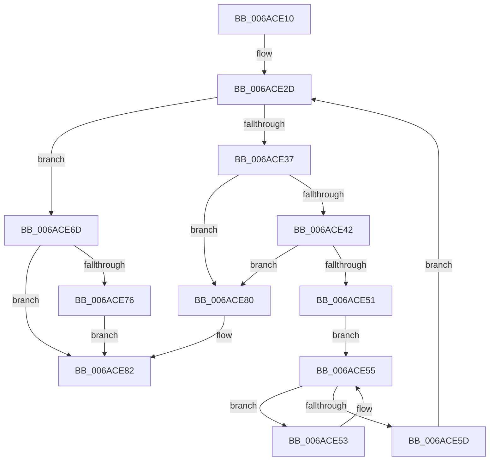

# HaliSaveProcessorContextAndSleep

- RVA: `0x006ACE10`–`0x006ACE9C` (길이 `140` bytes)
- VA: `0x00000001406ACE10`
- 실행 섹션: `.text`
- PDB 이름 있음: `예`; PDB Function 태그: `아니요`
- unwind 정보 RVA: `0x000BFDC8`
- 디코드: `49`개 명령, `140/140` bytes 표시
- 미해석 바이트: `0` (있으면 어셈블리에 `.byte`로 보존)

> 이 문서는 커널 이미지의 기계어와 PDB 기호를 분석해 생성했습니다. 4번과 5번은 함수 원형과 자료형을 바이너리 사용 방식에서 추정한 C 해석이며 원본 소스 복구 결과는 아닙니다.

## 1. Dependencies

- 직접 호출 지점: **3**; 고유 호출 대상: **3**
- 직접 호출자로 확인된 함수: **1**
- RIP 상대 이미지 참조: **3**

### Outgoing calls
- `0x006ACE2D` → `indirect target` (indirect, 간접 대상)
- `0x006ACE60` → [guard_check_icall](../6B/guard_check_icall_function_006BAA80.md) (function, `0x006BAA80`)
- `0x006ACE8B` → [HaliCompleteAcpiAPSleep](../56/HaliCompleteAcpiAPSleep_function_0056B320.md) (function, `0x0056B320`)

### Direct callers
- [HaliAcpiSleep](../56/HaliAcpiSleep_function_0056AD60.md) at `0x0056B28F`

### Static image references
- `0x006ACE23` → RVA `0x006ACBD0` (`HalpSaveProcessorState`; read)
- `0x006ACE45` → RVA `0x00F8F9AC` (`.data`; read/write)
- `0x006ACE55` → RVA `0x00F8F9AC` (`.data`; read)

## 2. Other-region calls and transfers

- 다른 실행 섹션으로 향하는 call: **0**
- 별도 외부 분기/꼬리 이동을 확인하지 못했습니다.

## 3. Assembly (complete function range)

```asm
006ACE10  48 53                           push rbx
006ACE12  41 54                           push r12
006ACE14  56                              push rsi
006ACE15  57                              push rdi
006ACE16  48 83 EC 28                     sub rsp, 0x28
006ACE1A  48 8B DA                        mov rbx, rdx
006ACE1D  49 8B F0                        mov rsi, r8
006ACE20  49 8B F9                        mov rdi, r9
006ACE23  48 8D 05 A6 FD FF FF            lea rax, [rip - 0x25a]
006ACE2A  45 33 E4                        xor r12d, r12d
006ACE2D  FF D0                           call rax
006ACE2F  0F 1F 00                        nop dword ptr [rax]
006ACE32  45 85 E4                        test r12d, r12d
006ACE35  75 36                           jne 0x1406ace6d
006ACE37  48 8B 54 24 70                  mov rdx, qword ptr [rsp + 0x70]
006ACE3C  88 02                           mov byte ptr [rdx], al
006ACE3E  84 C0                           test al, al
006ACE40  75 3E                           jne 0x1406ace80
006ACE42  41 FF C4                        inc r12d
006ACE45  F0 FF 05 60 2B 8E 00            lock inc dword ptr [rip + 0x8e2b60]
006ACE4C  48 85 DB                        test rbx, rbx
006ACE4F  74 2F                           je 0x1406ace80
006ACE51  EB 02                           jmp 0x1406ace55
006ACE53  F3 90                           pause
006ACE55  39 3D 51 2B 8E 00               cmp dword ptr [rip + 0x8e2b51], edi
006ACE5B  75 F6                           jne 0x1406ace53
006ACE5D  48 8B CB                        mov rcx, rbx
006ACE60  E8 1B DC 00 00                  call 0x1406baa80
006ACE65  48 8B C3                        mov rax, rbx
006ACE68  48 8B CE                        mov rcx, rsi
006ACE6B  EB C0                           jmp 0x1406ace2d
006ACE6D  B9 94 02 00 40                  mov ecx, 0x40000294
006ACE72  3B C1                           cmp eax, ecx
006ACE74  75 0C                           jne 0x1406ace82
006ACE76  48 8B 54 24 70                  mov rdx, qword ptr [rsp + 0x70]
006ACE7B  C6 02 01                        mov byte ptr [rdx], 1
006ACE7E  EB 02                           jmp 0x1406ace82
006ACE80  33 C0                           xor eax, eax
006ACE82  8B F0                           mov esi, eax
006ACE84  48 8B 44 24 70                  mov rax, qword ptr [rsp + 0x70]
006ACE89  8A 08                           mov cl, byte ptr [rax]
006ACE8B  E8 90 E4 EB FF                  call 0x14056b320
006ACE90  8B C6                           mov eax, esi
006ACE92  48 83 C4 28                     add rsp, 0x28
006ACE96  5F                              pop rdi
006ACE97  5E                              pop rsi
006ACE98  41 5C                           pop r12
006ACE9A  5B                              pop rbx
006ACE9B  C3                              ret
```

## 4. C-style interpretation (structured pseudocode)

```c
__int64 __fastcall HaliSaveProcessorContextAndSleep(__int64 a1, __int64 a2, __int64 a3, __int64 a4, __int64 a5)
{
    __int64 result;
    __int64 v_r12;
    __int64 v_rsp;

    v_rsp = (v_rsp) - (40);
    v_r12 = 0;
loc_006ACE2D:
    result = kernel_indirect_call(a1, a2, a3, a4);
    if (0 != 0) goto loc_006ACE6D;
    *(unsigned __int8 *)(a5) = (unsigned __int8)(result);
    if ((unsigned __int8)(result) != 0) goto loc_006ACE80;
    v_r12 = (unsigned int)((v_r12) + 1);
    if (a2 == 0) goto loc_006ACE80;
    goto loc_006ACE55;
loc_006ACE53:
loc_006ACE55:
    if ((*(unsigned int *)(v_rip + 9317201)) != ((unsigned int)(a4))) goto loc_006ACE53;
    result = guard_check_icall(a2, a5, a3, a4);
    goto loc_006ACE2D;
loc_006ACE6D:
    if (((unsigned int)(a2)) != ((unsigned int)((unsigned int)(0x40000294ULL)))) goto loc_006ACE82;
    *(unsigned __int8 *)(a5) = 1;
    goto loc_006ACE82;
loc_006ACE80:
    result = 0;
loc_006ACE82:
    result = HaliCompleteAcpiAPSleep(*(unsigned __int8 *)(a5), a5, a3, a4);
    v_rsp = (v_rsp) + (40);
    return 0;
}
```

## 5. (Beta) C Style

```c
int64_t HaliSaveProcessorContextAndSleep(int64_t Arg1, int64_t Arg2, int64_t Arg3, int64_t Arg4, void *Arg5)
{
    uint8_t *arg5 = (uint8_t *)Arg5;

    int64_t result;
    int64_t local_r12;
    int64_t local_rsp;

    local_rsp = (local_rsp) - (40);
    local_r12 = 0;
loc_006ACE2D:
    result = kernel_indirect_call(Arg1, Arg2, Arg3, Arg4);
    if (0 != 0) goto loc_006ACE6D;
    *(uint8_t *)(arg5) = (uint8_t)(result);
    if ((uint8_t)(result) != 0) goto loc_006ACE80;
    local_r12 = (uint32_t)((local_r12) + 1);
    if (Arg2 == 0) goto loc_006ACE80;
    goto loc_006ACE55;
loc_006ACE53:
loc_006ACE55:
    if ((*(uint32_t *)(v_rip + 0x8E2B51)) != ((uint32_t)(Arg4))) goto loc_006ACE53;
    result = guard_check_icall(Arg2, Arg5, Arg3, Arg4);
    goto loc_006ACE2D;
loc_006ACE6D:
    if (((uint32_t)(Arg2)) != ((uint32_t)((uint32_t)(0x40000294ULL)))) goto loc_006ACE82;
    *(uint8_t *)(arg5) = 1;
    goto loc_006ACE82;
loc_006ACE80:
    result = 0;
loc_006ACE82:
    result = HaliCompleteAcpiAPSleep(*(uint8_t *)(arg5), Arg5, Arg3, Arg4);
    local_rsp = (local_rsp) + (40);
    return 0;
}
```

### 관측된 메모리 오프셋

구조체 형식이 확인되지 않은 접근은 인자 기준의 오프셋으로만 기록했습니다.

| 기준 인자 | 오프셋 표현 | 폭 (bit) | 접근 |
|---|---:|---:|---|
| `Arg5` | `+ 0x0` | `8` | `R` |
| `Arg5` | `+ 0x0` | `8` | `W` |

## 6. Execution-region graph

[열기: 2D/3D 그래프와 함수 탐색 컨트롤 패널](../../../control-panel.html?section=text&rva=0x006ACE10&view=graph)

- 2D 그래프는 위에서 아래로 흐르고, 3D 그래프는 빈 공간을 드래그해 회전합니다. Shift+드래그는 이동, 휠은 확대·축소, 함수 노드 선택은 대상 보고서 이동입니다.

### Static fallback


