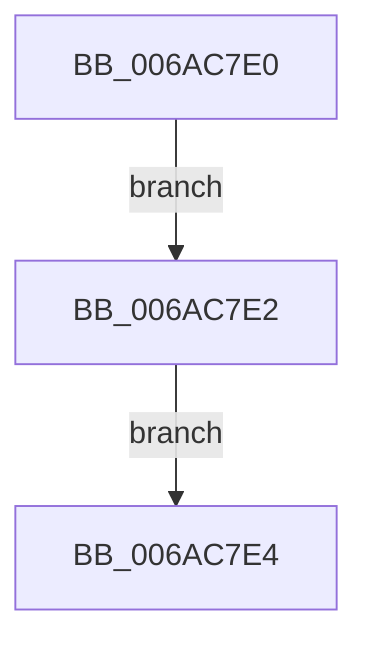

# HalpIoDelay

- RVA: `0x006AC7E0`–`0x006AC7E5` (길이 `5` bytes)
- VA: `0x00000001406AC7E0`
- 실행 섹션: `.text`
- PDB 이름 있음: `예`; PDB Function 태그: `아니요`
- unwind 정보 RVA: `0x000BFAEC`
- 디코드: `3`개 명령, `5/5` bytes 표시
- 미해석 바이트: `0` (있으면 어셈블리에 `.byte`로 보존)

> 이 문서는 커널 이미지의 기계어와 PDB 기호를 분석해 생성했습니다. 4번과 5번은 함수 원형과 자료형을 바이너리 사용 방식에서 추정한 C 해석이며 원본 소스 복구 결과는 아닙니다.

## 1. Dependencies

- 직접 호출 지점: **0**; 고유 호출 대상: **0**
- 직접 호출자로 확인된 함수: **8**
- RIP 상대 이미지 참조: **0**

### Outgoing calls
- 직접 디코드된 call 명령이 없습니다.

### Direct callers
- [HalMakeBeep](../54/HalMakeBeep_function_00545B80.md) at `0x00545BB0`
- [HalMakeBeep](../54/HalMakeBeep_function_00545B80.md) at `0x00545BC2`
- [HalMakeBeep](../54/HalMakeBeep_function_00545B80.md) at `0x00545BEC`
- [HalMakeBeep](../54/HalMakeBeep_function_00545B80.md) at `0x00545C01`
- [HalMakeBeep](../54/HalMakeBeep_function_00545B80.md) at `0x00545C10`
- [HalMakeBeep](../54/HalMakeBeep_function_00545B80.md) at `0x00545C22`
- [WRITE_PORT_USHORT_PAIR](../54/WRITE_PORT_USHORT_PAIR_function_00545C48.md) at `0x00545C62`
- [HalpECmosReadByte](../55/HalpECmosReadByte_function_00553BD0.md) at `0x00553BE7`
- [HalpECmosReadByte](../55/HalpECmosReadByte_function_00553BD0.md) at `0x00553BF6`
- [HalpECmosWriteByte](../55/HalpECmosWriteByte_function_00553C10.md) at `0x00553C29`
- [HalpECmosWriteByte](../55/HalpECmosWriteByte_function_00553C10.md) at `0x00553C38`
- [HalpPicSetLineState](../56/HalpPicSetLineState_function_0056AA90.md) at `0x0056AB37`
- [HalpPicSetLineState](../56/HalpPicSetLineState_function_0056AA90.md) at `0x0056AB60`
- [HalpPicWriteEndOfInterrupt](../56/HalpPicWriteEndOfInterrupt_function_0056AB90.md) at `0x0056ABA9`
- [READ_PORT_USHORT_PAIR](../56/READ_PORT_USHORT_PAIR_function_0056ABBC.md) at `0x0056ABD2`
- [HalpRestoreLegacyDmaControllerState](../../pagelk/B5/HalpRestoreLegacyDmaControllerState_function_00B5EAE8.md) at `0x00B5EB06`
- [HalpRestoreLegacyDmaControllerState](../../pagelk/B5/HalpRestoreLegacyDmaControllerState_function_00B5EAE8.md) at `0x00B5EB1D`
- [HalpRestoreLegacyDmaControllerState](../../pagelk/B5/HalpRestoreLegacyDmaControllerState_function_00B5EAE8.md) at `0x00B5EB63`

### Static image references
- 디코드된 RIP-relative 메모리 참조가 없습니다.

## 2. Other-region calls and transfers

- 다른 실행 섹션으로 향하는 call: **0**
- 별도 외부 분기/꼬리 이동을 확인하지 못했습니다.

## 3. Assembly (complete function range)

```asm
006AC7E0  EB 00                           jmp 0x1406ac7e2
006AC7E2  EB 00                           jmp 0x1406ac7e4
006AC7E4  C3                              ret
```

## 4. C-style interpretation (structured pseudocode)

```c
void __fastcall HalpIoDelay(void)
{
    goto loc_006AC7E2;
loc_006AC7E2:
    goto loc_006AC7E4;
loc_006AC7E4:
    return;
}
```

## 5. (Beta) C Style

```c
void HalpIoDelay(void)
{
    goto loc_006AC7E2;
loc_006AC7E2:
    goto loc_006AC7E4;
loc_006AC7E4:
    return;
}
```

## 6. Execution-region graph

[열기: 2D/3D 그래프와 함수 탐색 컨트롤 패널](../../../control-panel.html?section=text&rva=0x006AC7E0&view=graph)

- 2D 그래프는 위에서 아래로 흐르고, 3D 그래프는 빈 공간을 드래그해 회전합니다. Shift+드래그는 이동, 휠은 확대·축소, 함수 노드 선택은 대상 보고서 이동입니다.

### Static fallback


