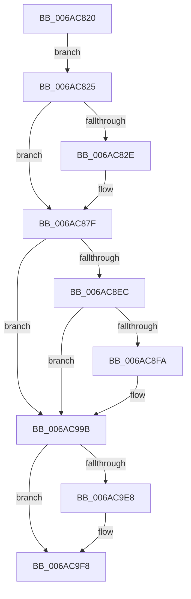

# HalpLMStub

- RVA: `0x006AC820`–`0x006ACAB4` (길이 `660` bytes)
- VA: `0x00000001406AC820`
- 실행 섹션: `.text`
- PDB 이름 있음: `예`; PDB Function 태그: `아니요`
- unwind 정보 RVA: `0x000BFAF8`
- 디코드: `139`개 명령, `660/660` bytes 표시
- 미해석 바이트: `0` (있으면 어셈블리에 `.byte`로 보존)

> 이 문서는 커널 이미지의 기계어와 PDB 기호를 분석해 생성했습니다. 4번과 5번은 함수 원형과 자료형을 바이너리 사용 방식에서 추정한 C 해석이며 원본 소스 복구 결과는 아닙니다.

## 1. Dependencies

- 직접 호출 지점: **1**; 고유 호출 대상: **1**
- 직접 호출자로 확인된 함수: **0**
- RIP 상대 이미지 참조: **1**

### Outgoing calls
- `0x006AC9EF` → [HalpInterruptCheckProcessorCacheDomainSharing](../55/HalpInterruptCheckProcessorCacheDomainSharing_function_0055A680.md) (function, `0x0055A680`)

### Direct callers
- 이 함수 시작 RVA로 연결되는 직접 call은 확인되지 않았습니다. 간접 호출은 완전히 역산할 수 없습니다.

### Static image references
- `0x006AC8EC` → RVA `0x00FC3E19` (`.data`; read)

## 2. Other-region calls and transfers

- 다른 실행 섹션으로 향하는 call: **0**
- 별도 외부 분기/꼬리 이동을 확인하지 못했습니다.

## 3. Assembly (complete function range)

```asm
006AC820  0F 22 D8                        mov cr3, rax
006AC823  EB 00                           jmp 0x1406ac825
006AC825  F7 47 08 08 00 00 00            test dword ptr [rdi + 8], 8
006AC82C  75 51                           jne 0x1406ac87f
006AC82E  0F 20 E1                        mov rcx, cr4
006AC831  48 81 F1 80 00 00 00            xor rcx, 0x80
006AC838  0F 22 E1                        mov cr4, rcx
006AC83B  0F 20 D8                        mov rax, cr3
006AC83E  0F 22 D8                        mov cr3, rax
006AC841  48 81 F1 80 00 00 00            xor rcx, 0x80
006AC848  0F 22 E1                        mov cr4, rcx
006AC84B  8B 87 80 00 00 00               mov eax, dword ptr [rdi + 0x80]
006AC851  8B 97 84 00 00 00               mov edx, dword ptr [rdi + 0x84]
006AC857  B9 77 02 00 00                  mov ecx, 0x277
006AC85C  0F 09                           wbinvd
006AC85E  0F 30                           wrmsr
006AC860  0F 09                           wbinvd
006AC862  0F 20 E1                        mov rcx, cr4
006AC865  48 81 F1 80 00 00 00            xor rcx, 0x80
006AC86C  0F 22 E1                        mov cr4, rcx
006AC86F  0F 20 D8                        mov rax, cr3
006AC872  0F 22 D8                        mov cr3, rax
006AC875  48 81 F1 80 00 00 00            xor rcx, 0x80
006AC87C  0F 22 E1                        mov cr4, rcx
006AC87F  0F 01 97 E6 00 00 00            lgdt [rdi + 0xe6]
006AC886  0F 01 9F F6 00 00 00            lidt [rdi + 0xf6]
006AC88D  66 8B 87 02 01 00 00            mov ax, word ptr [rdi + 0x102]
006AC894  0F 00 D0                        lldt ax
006AC897  48 8B 87 E8 00 00 00            mov rax, qword ptr [rdi + 0xe8]
006AC89E  8A 48 55                        mov cl, byte ptr [rax + 0x55]
006AC8A1  80 48 55 80                     or byte ptr [rax + 0x55], 0x80
006AC8A5  8E 9F BA 01 00 00               mov ds, word ptr [rdi + 0x1ba]
006AC8AB  8E 87 BC 01 00 00               mov es, word ptr [rdi + 0x1bc]
006AC8B1  8E A7 BE 01 00 00               mov fs, word ptr [rdi + 0x1be]
006AC8B7  8E AF C0 01 00 00               mov gs, word ptr [rdi + 0x1c0]
006AC8BD  8E 97 C2 01 00 00               mov ss, word ptr [rdi + 0x1c2]
006AC8C3  88 48 55                        mov byte ptr [rax + 0x55], cl
006AC8C6  0F B7 87 00 01 00 00            movzx eax, word ptr [rdi + 0x100]
006AC8CD  48 03 87 E8 00 00 00            add rax, qword ptr [rdi + 0xe8]
006AC8D4  80 60 05 FD                     and byte ptr [rax + 5], 0xfd
006AC8D8  0F 00 9F 00 01 00 00            ltr word ptr [rdi + 0x100]
006AC8DF  F7 47 08 04 00 00 00            test dword ptr [rdi + 8], 4
006AC8E6  0F 85 AF 00 00 00               jne 0x1406ac99b
006AC8EC  8A 05 27 75 91 00               mov al, byte ptr [rip + 0x917527]
006AC8F2  3C 00                           cmp al, 0
006AC8F4  0F 84 A1 00 00 00               je 0x1406ac99b
006AC8FA  48 8B 87 30 01 00 00            mov rax, qword ptr [rdi + 0x130]
006AC901  44 0F 22 C0                     mov cr8, rax
006AC905  48 8B 87 A8 00 00 00            mov rax, qword ptr [rdi + 0xa8]
006AC90C  0F 22 E0                        mov cr4, rax
006AC90F  48 8B 97 38 01 00 00            mov rdx, qword ptr [rdi + 0x138]
006AC916  8B C2                           mov eax, edx
006AC918  48 C1 EA 20                     shr rdx, 0x20
006AC91C  B9 01 01 00 C0                  mov ecx, 0xc0000101
006AC921  0F 30                           wrmsr
006AC923  48 8B 97 40 01 00 00            mov rdx, qword ptr [rdi + 0x140]
006AC92A  8B C2                           mov eax, edx
006AC92C  48 C1 EA 20                     shr rdx, 0x20
006AC930  B9 02 01 00 C0                  mov ecx, 0xc0000102
006AC935  0F 30                           wrmsr
006AC937  48 8B 97 48 01 00 00            mov rdx, qword ptr [rdi + 0x148]
006AC93E  8B C2                           mov eax, edx
006AC940  48 C1 EA 20                     shr rdx, 0x20
006AC944  B9 81 00 00 C0                  mov ecx, 0xc0000081
006AC949  0F 30                           wrmsr
006AC94B  48 8B 97 50 01 00 00            mov rdx, qword ptr [rdi + 0x150]
006AC952  8B C2                           mov eax, edx
006AC954  48 C1 EA 20                     shr rdx, 0x20
006AC958  B9 82 00 00 C0                  mov ecx, 0xc0000082
006AC95D  0F 30                           wrmsr
006AC95F  48 8B 97 58 01 00 00            mov rdx, qword ptr [rdi + 0x158]
006AC966  8B C2                           mov eax, edx
006AC968  48 C1 EA 20                     shr rdx, 0x20
006AC96C  B9 83 00 00 C0                  mov ecx, 0xc0000083
006AC971  0F 30                           wrmsr
006AC973  48 8B 97 60 01 00 00            mov rdx, qword ptr [rdi + 0x160]
006AC97A  8B C2                           mov eax, edx
006AC97C  48 C1 EA 20                     shr rdx, 0x20
006AC980  B9 84 00 00 C0                  mov ecx, 0xc0000084
006AC985  0F 30                           wrmsr
006AC987  48 8B 97 70 01 00 00            mov rdx, qword ptr [rdi + 0x170]
006AC98E  8B C2                           mov eax, edx
006AC990  48 C1 EA 20                     shr rdx, 0x20
006AC994  B9 00 01 00 C0                  mov ecx, 0xc0000100
006AC999  0F 30                           wrmsr
006AC99B  33 C0                           xor eax, eax
006AC99D  0F 23 F8                        mov dr7, rax
006AC9A0  48 8D B7 B0 00 00 00            lea rsi, [rdi + 0xb0]
006AC9A7  48 AD                           lodsq rax, qword ptr [rsi]
006AC9A9  0F 23 C0                        mov dr0, rax
006AC9AC  48 AD                           lodsq rax, qword ptr [rsi]
006AC9AE  0F 23 C8                        mov dr1, rax
006AC9B1  48 AD                           lodsq rax, qword ptr [rsi]
006AC9B3  0F 23 D0                        mov dr2, rax
006AC9B6  48 AD                           lodsq rax, qword ptr [rsi]
006AC9B8  0F 23 D8                        mov dr3, rax
006AC9BB  48 AD                           lodsq rax, qword ptr [rsi]
006AC9BD  0F 23 F0                        mov dr6, rax
006AC9C0  48 AD                           lodsq rax, qword ptr [rsi]
006AC9C2  0F 23 F8                        mov dr7, rax
006AC9C5  48 8B A7 18 02 00 00            mov rsp, qword ptr [rdi + 0x218]
006AC9CC  FF B7 C4 01 00 00               push qword ptr [rdi + 0x1c4]
006AC9D2  9D                              popfq
006AC9D3  FF B7 78 02 00 00               push qword ptr [rdi + 0x278]
006AC9D9  FF B7 30 02 00 00               push qword ptr [rdi + 0x230]
006AC9DF  F7 47 08 08 00 00 00            test dword ptr [rdi + 8], 8
006AC9E6  74 10                           je 0x1406ac9f8
006AC9E8  48 83 EC 28                     sub rsp, 0x28
006AC9EC  48 8B CF                        mov rcx, rdi
006AC9EF  E8 8C DC EA FF                  call 0x14055a680
006AC9F4  48 83 C4 28                     add rsp, 0x28
006AC9F8  48 8B 87 F8 01 00 00            mov rax, qword ptr [rdi + 0x1f8]
006AC9FF  48 8B 9F 10 02 00 00            mov rbx, qword ptr [rdi + 0x210]
006ACA06  48 8B 8F 00 02 00 00            mov rcx, qword ptr [rdi + 0x200]
006ACA0D  48 8B 97 08 02 00 00            mov rdx, qword ptr [rdi + 0x208]
006ACA14  48 8B B7 28 02 00 00            mov rsi, qword ptr [rdi + 0x228]
006ACA1B  48 8B AF 20 02 00 00            mov rbp, qword ptr [rdi + 0x220]
006ACA22  4C 8B 87 38 02 00 00            mov r8, qword ptr [rdi + 0x238]
006ACA29  4C 8B 8F 40 02 00 00            mov r9, qword ptr [rdi + 0x240]
006ACA30  4C 8B 97 48 02 00 00            mov r10, qword ptr [rdi + 0x248]
006ACA37  4C 8B 9F 50 02 00 00            mov r11, qword ptr [rdi + 0x250]
006ACA3E  4C 8B A7 58 02 00 00            mov r12, qword ptr [rdi + 0x258]
006ACA45  4C 8B AF 60 02 00 00            mov r13, qword ptr [rdi + 0x260]
006ACA4C  4C 8B B7 68 02 00 00            mov r14, qword ptr [rdi + 0x268]
006ACA53  4C 8B BF 70 02 00 00            mov r15, qword ptr [rdi + 0x270]
006ACA5A  0F AE 8F 80 02 00 00            fxrstor [rdi + 0x280]
006ACA61  0F 28 B7 80 03 00 00            movaps xmm6, xmmword ptr [rdi + 0x380]
006ACA68  0F 28 BF 90 03 00 00            movaps xmm7, xmmword ptr [rdi + 0x390]
006ACA6F  44 0F 28 87 A0 03 00 00         movaps xmm8, xmmword ptr [rdi + 0x3a0]
006ACA77  44 0F 28 8F B0 03 00 00         movaps xmm9, xmmword ptr [rdi + 0x3b0]
006ACA7F  44 0F 28 97 C0 03 00 00         movaps xmm10, xmmword ptr [rdi + 0x3c0]
006ACA87  44 0F 28 9F D0 03 00 00         movaps xmm11, xmmword ptr [rdi + 0x3d0]
006ACA8F  44 0F 28 A7 E0 03 00 00         movaps xmm12, xmmword ptr [rdi + 0x3e0]
006ACA97  44 0F 28 AF F0 03 00 00         movaps xmm13, xmmword ptr [rdi + 0x3f0]
006ACA9F  44 0F 28 B7 00 04 00 00         movaps xmm14, xmmword ptr [rdi + 0x400]
006ACAA7  44 0F 28 BF 10 04 00 00         movaps xmm15, xmmword ptr [rdi + 0x410]
006ACAAF  FF 47 04                        inc dword ptr [rdi + 4]
006ACAB2  5F                              pop rdi
006ACAB3  C3                              ret
```

## 4. C-style interpretation (structured pseudocode)

```c
__int64 __fastcall HalpLMStub(void)
{
    __int64 result;
    __int64 v_cr3;
    __int64 v_cr4;
    __int64 v_cr8;
    __int64 v_rsp;

    goto loc_006AC825;
loc_006AC825:
    v_cr3 = result;
    if (((*(unsigned int *)(v_rdi + 8)) & (8)) == 0) {
        a1 = v_cr4;
        a1 = (a1) ^ (128);
        v_cr4 = a1;
        result = result;
        v_cr3 = result;
        a1 = (a1) ^ (128);
        v_cr4 = a1;
        result = *(unsigned int *)(v_rdi + 128);
        a2 = *(unsigned int *)(v_rdi + 132);
        a1 = 631;
        a1 = v_cr4;
        a1 = (a1) ^ (128);
        v_cr4 = a1;
        result = v_cr3;
        v_cr3 = result;
        a1 = (a1) ^ (128);
        v_cr4 = a1;
    }
    *(unsigned __int8 *)(*(unsigned __int64 *)(v_rdi + 232) + 85) = (unsigned __int8)(*(unsigned __int8 *)(*(unsigned __int64 *)(v_rdi + 232) + 85));
    result = (*(unsigned __int16 *)(v_rdi + 256)) + (*(unsigned __int64 *)(v_rdi + 232));
    if (((*(unsigned int *)(v_rdi + 8)) & (4)) != 0) goto loc_006AC99B;
    result = *(unsigned __int8 *)(v_rip + 9532711);
    if (((unsigned __int8)(*(unsigned __int8 *)(v_rip + 9532711))) != 0) {
        result = *(unsigned __int64 *)(v_rdi + 304);
        v_cr8 = result;
        result = *(unsigned __int64 *)(v_rdi + 168);
        v_cr4 = result;
        a2 = *(unsigned __int64 *)(v_rdi + 312);
        result = (unsigned int)(a2);
        a2 = (a2) >> (32);
        a1 = 0xC0000101ULL;
        a2 = *(unsigned __int64 *)(v_rdi + 320);
        result = (unsigned int)(a2);
        a2 = (a2) >> (32);
        a1 = 0xC0000102ULL;
        a2 = *(unsigned __int64 *)(v_rdi + 328);
        result = (unsigned int)(a2);
        a2 = (a2) >> (32);
        a1 = 0xC0000081ULL;
        a2 = *(unsigned __int64 *)(v_rdi + 336);
        result = (unsigned int)(a2);
        a2 = (a2) >> (32);
        a1 = 0xC0000082ULL;
        a2 = *(unsigned __int64 *)(v_rdi + 344);
        result = (unsigned int)(a2);
        a2 = (a2) >> (32);
        a1 = 0xC0000083ULL;
        a2 = *(unsigned __int64 *)(v_rdi + 352);
        result = (unsigned int)(a2);
        a2 = (a2) >> (32);
        a1 = 0xC0000084ULL;
        a2 = *(unsigned __int64 *)(v_rdi + 368);
        result = (unsigned int)(a2);
        a2 = (a2) >> (32);
        a1 = 0xC0000100ULL;
    }
    result = 0;
    v_rsp = *(unsigned __int64 *)(v_rdi + 536);
    if (((*(unsigned int *)(v_rdi + 8)) & (8)) != 0) {
        v_rsp = (*(unsigned __int64 *)(v_rdi + 536)) - (40);
        a1 = v_rdi;
        result = HalpInterruptCheckProcessorCacheDomainSharing(a1, a2, a3, a4);
        v_rsp = (v_rsp) + (40);
    }
    return *(unsigned __int64 *)(v_rdi + 504);
}
```

## 5. (Beta) C Style

```c
void HalpLMStub(void)
{
    int64_t result;
    int64_t v_cr3;
    int64_t v_cr4;
    int64_t v_cr8;
    int64_t local_rsp;

    goto loc_006AC825;
loc_006AC825:
    v_cr3 = result;
    if (((*(uint32_t *)(local_rdi + 0x8)) & (8)) == 0) {
        a1 = v_cr4;
        a1 = (a1) ^ (128);
        v_cr4 = a1;
        result = result;
        v_cr3 = result;
        a1 = (a1) ^ (128);
        v_cr4 = a1;
        result = *(uint32_t *)(local_rdi + 0x80);
        a2 = *(uint32_t *)(local_rdi + 0x84);
        a1 = 631;
        a1 = v_cr4;
        a1 = (a1) ^ (128);
        v_cr4 = a1;
        result = v_cr3;
        v_cr3 = result;
        a1 = (a1) ^ (128);
        v_cr4 = a1;
    }
    *(uint8_t *)(*(uint64_t *)(local_rdi + 0xE8) + 0x55) = (uint8_t)(*(uint8_t *)(*(uint64_t *)(local_rdi + 0xE8) + 0x55));
    result = (*(uint16_t *)(local_rdi + 0x100)) + (*(uint64_t *)(local_rdi + 0xE8));
    if (((*(uint32_t *)(local_rdi + 0x8)) & (4)) != 0) goto loc_006AC99B;
    result = *(uint8_t *)(v_rip + 0x917527);
    if (((uint8_t)(*(uint8_t *)(v_rip + 0x917527))) != 0) {
        result = *(uint64_t *)(local_rdi + 0x130);
        v_cr8 = result;
        result = *(uint64_t *)(local_rdi + 0xA8);
        v_cr4 = result;
        a2 = *(uint64_t *)(local_rdi + 0x138);
        result = (uint32_t)(a2);
        a2 = (a2) >> (32);
        a1 = 0xC0000101ULL;
        a2 = *(uint64_t *)(local_rdi + 0x140);
        result = (uint32_t)(a2);
        a2 = (a2) >> (32);
        a1 = 0xC0000102ULL;
        a2 = *(uint64_t *)(local_rdi + 0x148);
        result = (uint32_t)(a2);
        a2 = (a2) >> (32);
        a1 = 0xC0000081ULL;
        a2 = *(uint64_t *)(local_rdi + 0x150);
        result = (uint32_t)(a2);
        a2 = (a2) >> (32);
        a1 = 0xC0000082ULL;
        a2 = *(uint64_t *)(local_rdi + 0x158);
        result = (uint32_t)(a2);
        a2 = (a2) >> (32);
        a1 = 0xC0000083ULL;
        a2 = *(uint64_t *)(local_rdi + 0x160);
        result = (uint32_t)(a2);
        a2 = (a2) >> (32);
        a1 = 0xC0000084ULL;
        a2 = *(uint64_t *)(local_rdi + 0x170);
        result = (uint32_t)(a2);
        a2 = (a2) >> (32);
        a1 = 0xC0000100ULL;
    }
    result = 0;
    local_rsp = *(uint64_t *)(local_rdi + 0x218);
    if (((*(uint32_t *)(local_rdi + 0x8)) & (8)) != 0) {
        local_rsp = (*(uint64_t *)(local_rdi + 0x218)) - (40);
        a1 = local_rdi;
        result = HalpInterruptCheckProcessorCacheDomainSharing(a1, a2, a3, a4);
        local_rsp = (local_rsp) + (40);
    }
    return *(uint64_t *)(local_rdi + 0x1F8);
}
```

## 6. Execution-region graph

[열기: 2D/3D 그래프와 함수 탐색 컨트롤 패널](../../../control-panel.html?section=text&rva=0x006AC820&view=graph)

- 2D 그래프는 위에서 아래로 흐르고, 3D 그래프는 빈 공간을 드래그해 회전합니다. Shift+드래그는 이동, 휠은 확대·축소, 함수 노드 선택은 대상 보고서 이동입니다.

### Static fallback


