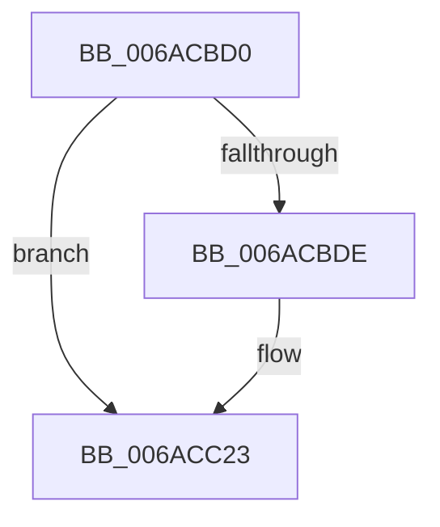

# HalpSaveProcessorState

- RVA: `0x006ACBD0`–`0x006ACC2A` (길이 `90` bytes)
- VA: `0x00000001406ACBD0`
- 실행 섹션: `.text`
- PDB 이름 있음: `예`; PDB Function 태그: `아니요`
- unwind 정보 RVA: `0x000BFDA0`
- 디코드: `19`개 명령, `90/90` bytes 표시
- 미해석 바이트: `0` (있으면 어셈블리에 `.byte`로 보존)

> 이 문서는 커널 이미지의 기계어와 PDB 기호를 분석해 생성했습니다. 4번과 5번은 함수 원형과 자료형을 바이너리 사용 방식에서 추정한 C 해석이며 원본 소스 복구 결과는 아닙니다.

## 1. Dependencies

- 직접 호출 지점: **2**; 고유 호출 대상: **2**
- 직접 호출자로 확인된 함수: **0**
- RIP 상대 이미지 참조: **0**

### Outgoing calls
- `0x006ACBDE` → [KeSaveStateForHibernate](../6B/KeSaveStateForHibernate_function_006B1A50.md) (function, `0x006B1A50`)
- `0x006ACBE3` → [KasanHibernationGetStackLow](../5A/KasanHibernationGetStackLow_function_005AAC30.md) (function, `0x005AAC30`)

### Direct callers
- 이 함수 시작 RVA로 연결되는 직접 call은 확인되지 않았습니다. 간접 호출은 완전히 역산할 수 없습니다.

### Static image references
- 디코드된 RIP-relative 메모리 참조가 없습니다.

## 2. Other-region calls and transfers

- 다른 실행 섹션으로 향하는 call: **0**
- 별도 외부 분기/꼬리 이동을 확인하지 못했습니다.

## 3. Assembly (complete function range)

```asm
006ACBD0  48 89 4C 24 08                  mov qword ptr [rsp + 8], rcx
006ACBD5  48 83 EC 28                     sub rsp, 0x28
006ACBD9  48 85 C9                        test rcx, rcx
006ACBDC  74 45                           je 0x1406acc23
006ACBDE  E8 6D 4E 00 00                  call 0x1406b1a50
006ACBE3  E8 48 E0 EF FF                  call 0x1405aac30
006ACBE8  4C 8B C8                        mov r9, rax
006ACBEB  48 8B 44 24 30                  mov rax, qword ptr [rsp + 0x30]
006ACBF0  48 05 F0 00 00 00               add rax, 0xf0
006ACBF6  49 B8 E0 CD 6A 40 01 00 00 00   movabs r8, 0x1406acde0
006ACC00  4C 89 80 F8 00 00 00            mov qword ptr [rax + 0xf8], r8
006ACC07  4C 8D 44 24 30                  lea r8, [rsp + 0x30]
006ACC0C  4C 89 80 98 00 00 00            mov qword ptr [rax + 0x98], r8
006ACC13  4C 8B 44 24 28                  mov r8, qword ptr [rsp + 0x28]
006ACC18  4C 89 40 78                     mov qword ptr [rax + 0x78], r8
006ACC1C  4C 89 88 80 00 00 00            mov qword ptr [rax + 0x80], r9
006ACC23  33 C0                           xor eax, eax
006ACC25  48 83 C4 28                     add rsp, 0x28
006ACC29  C3                              ret
```

## 4. C-style interpretation (structured pseudocode)

```c
__int64 __fastcall HalpSaveProcessorState(__int64 a1)
{
    __int64 result;
    __int64 v_rsp;
    unsigned __int64 v_stack_p0;
    unsigned __int64 v_stack_p8;

    v_stack_p8 = a1;
    v_rsp = (v_rsp) - (40);
    if (a1 != 0) {
        result = KeSaveStateForHibernate(a1, a2, a3, a4);
        result = KasanHibernationGetStackLow(a1, a2, a3, a4);
        a4 = result;
        result = v_stack_p8;
        result = (result) + (240);
        *(unsigned __int64 *)(result + 248) = a3;
        a3 = v_stack_p8;
        *(unsigned __int64 *)(result + 152) = a3;
        a3 = v_stack_p0;
        *(unsigned __int64 *)(result + 120) = a3;
        *(unsigned __int64 *)(result + 128) = a4;
    }
    result = 0;
    v_rsp = (v_rsp) + (40);
    return result;
}
```

## 5. (Beta) C Style

```c
int64_t HalpSaveProcessorState(int64_t Arg1)
{
    int64_t result;
    int64_t local_rsp;
    uint64_t v_stack_p0;
    uint64_t v_stack_p8;

    v_stack_p8 = Arg1;
    local_rsp = (local_rsp) - (40);
    if (Arg1 != 0) {
        result = KeSaveStateForHibernate(Arg1, a2, a3, a4);
        result = KasanHibernationGetStackLow(Arg1, a2, a3, a4);
        a4 = result;
        result = v_stack_p8;
        result = (result) + (240);
        *(uint64_t *)(result + 0xF8) = a3;
        a3 = v_stack_p8;
        *(uint64_t *)(result + 0x98) = a3;
        a3 = v_stack_p0;
        *(uint64_t *)(result + 0x78) = a3;
        *(uint64_t *)(result + 0x80) = a4;
    }
    result = 0;
    local_rsp = (local_rsp) + (40);
    return result;
}
```

## 6. Execution-region graph

[열기: 2D/3D 그래프와 함수 탐색 컨트롤 패널](../../../control-panel.html?section=text&rva=0x006ACBD0&view=graph)

- 2D 그래프는 위에서 아래로 흐르고, 3D 그래프는 빈 공간을 드래그해 회전합니다. Shift+드래그는 이동, 휠은 확대·축소, 함수 노드 선택은 대상 보고서 이동입니다.

### Static fallback


