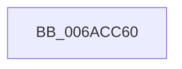

# HalpSetupRealModeResume

- RVA: `0x006ACC60`–`0x006ACCDD` (길이 `125` bytes)
- VA: `0x00000001406ACC60`
- 실행 섹션: `.text`
- PDB 이름 있음: `예`; PDB Function 태그: `아니요`
- unwind 정보 RVA: `0x000BFDB0`
- 디코드: `25`개 명령, `125/125` bytes 표시
- 미해석 바이트: `0` (있으면 어셈블리에 `.byte`로 보존)

> 이 문서는 커널 이미지의 기계어와 PDB 기호를 분석해 생성했습니다. 4번과 5번은 함수 원형과 자료형을 바이너리 사용 방식에서 추정한 C 해석이며 원본 소스 복구 결과는 아닙니다.

## 1. Dependencies

- 직접 호출 지점: **3**; 고유 호출 대상: **3**
- 직접 호출자로 확인된 함수: **1**
- RIP 상대 이미지 참조: **1**

### Outgoing calls
- `0x006ACC83` → [HalpInterruptSetProcessorStartContext](../54/HalpInterruptSetProcessorStartContext_function_00543A90.md) (function, `0x00543A90`)
- `0x006ACC94` → [KeSaveStateForHibernate](../6B/KeSaveStateForHibernate_function_006B1A50.md) (function, `0x006B1A50`)
- `0x006ACC99` → [KasanHibernationGetStackLow](../5A/KasanHibernationGetStackLow_function_005AAC30.md) (function, `0x005AAC30`)

### Direct callers
- [HaliAcpiSleep](../56/HaliAcpiSleep_function_0056AD60.md) at `0x0056AEB5`

### Static image references
- `0x006ACC69` → RVA `0x00FC1AB8` (`.data`; read)

## 2. Other-region calls and transfers

- 다른 실행 섹션으로 향하는 call: **0**
- 별도 외부 분기/꼬리 이동을 확인하지 못했습니다.

## 3. Assembly (complete function range)

```asm
006ACC60  48 89 4C 24 08                  mov qword ptr [rsp + 8], rcx
006ACC65  48 83 EC 28                     sub rsp, 0x28
006ACC69  48 8B 05 48 4E 91 00            mov rax, qword ptr [rip + 0x914e48]
006ACC70  89 10                           mov dword ptr [rax], edx
006ACC72  33 C9                           xor ecx, ecx
006ACC74  33 D2                           xor edx, edx
006ACC76  4D 33 C0                        xor r8, r8
006ACC79  49 B9 FF FF FF FF 00 00 00 00   movabs r9, 0xffffffff
006ACC83  E8 08 6E E9 FF                  call 0x140543a90
006ACC88  48 8B 4C 24 30                  mov rcx, qword ptr [rsp + 0x30]
006ACC8D  48 81 C1 90 00 00 00            add rcx, 0x90
006ACC94  E8 B7 4D 00 00                  call 0x1406b1a50
006ACC99  E8 92 DF EF FF                  call 0x1405aac30
006ACC9E  4C 8B C8                        mov r9, rax
006ACCA1  48 8B 44 24 30                  mov rax, qword ptr [rsp + 0x30]
006ACCA6  49 B8 E0 CD 6A 40 01 00 00 00   movabs r8, 0x1406acde0
006ACCB0  4C 89 80 78 02 00 00            mov qword ptr [rax + 0x278], r8
006ACCB7  4C 8D 44 24 30                  lea r8, [rsp + 0x30]
006ACCBC  4C 89 80 18 02 00 00            mov qword ptr [rax + 0x218], r8
006ACCC3  4C 8B 44 24 28                  mov r8, qword ptr [rsp + 0x28]
006ACCC8  4C 89 80 F8 01 00 00            mov qword ptr [rax + 0x1f8], r8
006ACCCF  4C 89 88 00 02 00 00            mov qword ptr [rax + 0x200], r9
006ACCD6  33 C0                           xor eax, eax
006ACCD8  48 83 C4 28                     add rsp, 0x28
006ACCDC  C3                              ret
```

## 4. C-style interpretation (structured pseudocode)

```c
__int64 __fastcall HalpSetupRealModeResume(__int64 a1, int a2, __int64 a3)
{
    __int64 result;
    __int64 v_rsp;
    unsigned __int64 v_stack_p0;
    unsigned __int64 v_stack_p8;

    v_stack_p8 = a1;
    v_rsp = (v_rsp) - (40);
    *(unsigned int *)(*(unsigned __int64 *)(v_rip + 9522760)) = a2;
    a1 = 0;
    a2 = 0;
    a3 = 0;
    result = HalpInterruptSetProcessorStartContext(a1, a2, a3, a4);
    a1 = (v_stack_p8) + (144);
    result = KeSaveStateForHibernate(a1, a2, a3, a4);
    result = KasanHibernationGetStackLow(a1, a2, a3, a4);
    *(unsigned __int64 *)(v_stack_p8 + 632) = 0;
    *(unsigned __int64 *)(v_stack_p8 + 536) = v_stack_p8;
    *(unsigned __int64 *)(v_stack_p8 + 504) = v_stack_p0;
    *(unsigned __int64 *)(v_stack_p8 + 512) = result;
    result = 0;
    v_rsp = (v_rsp) + (40);
    return result;
}
```

## 5. (Beta) C Style

```c
int64_t HalpSetupRealModeResume(int64_t Arg1, int32_t Arg2, int64_t Arg3)
{
    int64_t result;
    int64_t local_rsp;
    uint64_t v_stack_p0;
    uint64_t v_stack_p8;

    v_stack_p8 = Arg1;
    local_rsp = (local_rsp) - (40);
    *(uint32_t *)(*(uint64_t *)(v_rip + 0x914E48)) = Arg2;
    Arg1 = 0;
    Arg2 = 0;
    Arg3 = 0;
    result = HalpInterruptSetProcessorStartContext(Arg1, Arg2, Arg3, a4);
    Arg1 = (v_stack_p8) + (144);
    result = KeSaveStateForHibernate(Arg1, Arg2, Arg3, a4);
    result = KasanHibernationGetStackLow(Arg1, Arg2, Arg3, a4);
    *(uint64_t *)(v_stack_p8 + 0x278) = 0;
    *(uint64_t *)(v_stack_p8 + 0x218) = v_stack_p8;
    *(uint64_t *)(v_stack_p8 + 0x1F8) = v_stack_p0;
    *(uint64_t *)(v_stack_p8 + 0x200) = result;
    result = 0;
    local_rsp = (local_rsp) + (40);
    return result;
}
```

## 6. Execution-region graph

[열기: 2D/3D 그래프와 함수 탐색 컨트롤 패널](../../../control-panel.html?section=text&rva=0x006ACC60&view=graph)

- 2D 그래프는 위에서 아래로 흐르고, 3D 그래프는 빈 공간을 드래그해 회전합니다. Shift+드래그는 이동, 휠은 확대·축소, 함수 노드 선택은 대상 보고서 이동입니다.

### Static fallback


