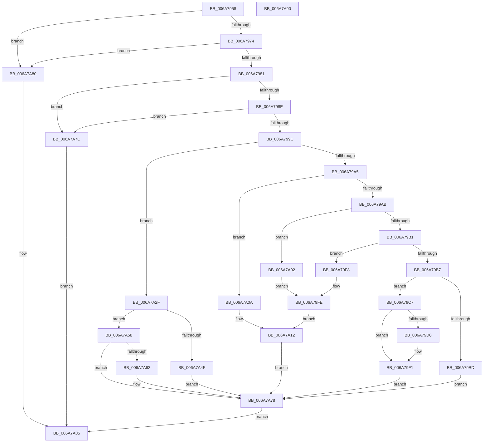

# HvlConfigureDynamicMemory

- RVA: `0x006A7958`–`0x006A7A91` (길이 `313` bytes)
- VA: `0x00000001406A7958`
- 실행 섹션: `.text`
- PDB 이름 있음: `예`; PDB Function 태그: `아니요`
- unwind 정보 RVA: `0x0008A658`
- 디코드: `87`개 명령, `313/313` bytes 표시
- 미해석 바이트: `0` (있으면 어셈블리에 `.byte`로 보존)

> 이 문서는 커널 이미지의 기계어와 PDB 기호를 분석해 생성했습니다. 4번과 5번은 함수 원형과 자료형을 바이너리 사용 방식에서 추정한 C 해석이며 원본 소스 복구 결과는 아닙니다.

## 1. Dependencies

- 직접 호출 지점: **4**; 고유 호출 대상: **1**
- 직접 호출자로 확인된 함수: **1**
- RIP 상대 이미지 참조: **4**

### Outgoing calls
- `0x006A79E5` → [HvlpAddRemovePhysicalMemory](HvlpAddRemovePhysicalMemory_function_006A7A98.md) (function, `0x006A7A98`)
- `0x006A7A1F` → [HvlpAddRemovePhysicalMemory](HvlpAddRemovePhysicalMemory_function_006A7A98.md) (function, `0x006A7A98`)
- `0x006A7A44` → [HvlpAddRemovePhysicalMemory](HvlpAddRemovePhysicalMemory_function_006A7A98.md) (function, `0x006A7A98`)
- `0x006A7A73` → [HvlpAddRemovePhysicalMemory](HvlpAddRemovePhysicalMemory_function_006A7A98.md) (function, `0x006A7A98`)

### Direct callers
- [KeConfigureDynamicMemory](../5B/KeConfigureDynamicMemory_function_005B8C9C.md) at `0x005B8CF3`
- [KeConfigureDynamicMemory](../5B/KeConfigureDynamicMemory_function_005B8C9C.md) at `0x005B8D23`
- [KeConfigureDynamicMemory](../5B/KeConfigureDynamicMemory_function_005B8C9C.md) at `0x005B8D2D`
- [KeConfigureDynamicMemory](../5B/KeConfigureDynamicMemory_function_005B8C9C.md) at `0x005B8D60`

### Static image references
- `0x006A7981` → RVA `0x00FC6A97` (`ALMOSTRO`; read)
- `0x006A798E` → RVA `0x00FC6A90` (`ALMOSTRO`; read)
- `0x006A79C7` → RVA `0x00EF0040` (`.data`; read)
- `0x006A79EA` → RVA `0x00EF0040` (`.data`; write)

## 2. Other-region calls and transfers

- 다른 실행 섹션으로 향하는 call: **0**
- 별도 외부 분기/꼬리 이동을 확인하지 못했습니다.

## 3. Assembly (complete function range)

```asm
006A7958  48 89 5C 24 10                  mov qword ptr [rsp + 0x10], rbx
006A795D  57                              push rdi
006A795E  48 83 EC 30                     sub rsp, 0x30
006A7962  48 83 64 24 40 00               and qword ptr [rsp + 0x40], 0
006A7968  48 8B F9                        mov rdi, rcx
006A796B  48 3B CA                        cmp rcx, rdx
006A796E  0F 87 0C 01 00 00               ja 0x1406a7a80
006A7974  48 2B D1                        sub rdx, rcx
006A7977  48 83 FA FF                     cmp rdx, -1
006A797B  0F 84 FF 00 00 00               je 0x1406a7a80
006A7981  80 3D 0F F1 91 00 00            cmp byte ptr [rip + 0x91f10f], 0
006A7988  0F 84 EE 00 00 00               je 0x1406a7a7c
006A798E  8B 05 FC F0 91 00               mov eax, dword ptr [rip + 0x91f0fc]
006A7994  A8 02                           test al, 2
006A7996  0F 84 E0 00 00 00               je 0x1406a7a7c
006A799C  45 85 C0                        test r8d, r8d
006A799F  0F 84 8A 00 00 00               je 0x1406a7a2f
006A79A5  41 83 E8 01                     sub r8d, 1
006A79A9  74 5F                           je 0x1406a7a0a
006A79AB  41 83 E8 01                     sub r8d, 1
006A79AF  74 51                           je 0x1406a7a02
006A79B1  41 83 E8 02                     sub r8d, 2
006A79B5  74 41                           je 0x1406a79f8
006A79B7  41 83 F8 04                     cmp r8d, 4
006A79BB  74 0A                           je 0x1406a79c7
006A79BD  BB 0D 00 00 C0                  mov ebx, 0xc000000d
006A79C2  E9 B1 00 00 00                  jmp 0x1406a7a78
006A79C7  80 3D 72 86 84 00 00            cmp byte ptr [rip + 0x848672], 0
006A79CE  74 21                           je 0x1406a79f1
006A79D0  4C 8D 4A 01                     lea r9, [rdx + 1]
006A79D4  4C 8B C7                        mov r8, rdi
006A79D7  48 8D 44 24 40                  lea rax, [rsp + 0x40]
006A79DC  33 D2                           xor edx, edx
006A79DE  33 C9                           xor ecx, ecx
006A79E0  48 89 44 24 20                  mov qword ptr [rsp + 0x20], rax
006A79E5  E8 AE 00 00 00                  call 0x1406a7a98
006A79EA  C6 05 4F 86 84 00 00            mov byte ptr [rip + 0x84864f], 0
006A79F1  33 DB                           xor ebx, ebx
006A79F3  E9 80 00 00 00                  jmp 0x1406a7a78
006A79F8  4C 8D 4A 01                     lea r9, [rdx + 1]
006A79FC  33 D2                           xor edx, edx
006A79FE  33 C9                           xor ecx, ecx
006A7A00  EB 10                           jmp 0x1406a7a12
006A7A02  4C 8D 4A 01                     lea r9, [rdx + 1]
006A7A06  B2 01                           mov dl, 1
006A7A08  EB F4                           jmp 0x1406a79fe
006A7A0A  4C 8D 4A 01                     lea r9, [rdx + 1]
006A7A0E  B1 01                           mov cl, 1
006A7A10  33 D2                           xor edx, edx
006A7A12  48 8D 44 24 40                  lea rax, [rsp + 0x40]
006A7A17  4C 8B C7                        mov r8, rdi
006A7A1A  48 89 44 24 20                  mov qword ptr [rsp + 0x20], rax
006A7A1F  E8 74 00 00 00                  call 0x1406a7a98
006A7A24  8B D8                           mov ebx, eax
006A7A26  C6 05 13 86 84 00 00            mov byte ptr [rip + 0x848613], 0
006A7A2D  EB 49                           jmp 0x1406a7a78
006A7A2F  4C 8D 4A 01                     lea r9, [rdx + 1]
006A7A33  4C 8B C7                        mov r8, rdi
006A7A36  B2 01                           mov dl, 1
006A7A38  48 8D 44 24 40                  lea rax, [rsp + 0x40]
006A7A3D  8A CA                           mov cl, dl
006A7A3F  48 89 44 24 20                  mov qword ptr [rsp + 0x20], rax
006A7A44  E8 4F 00 00 00                  call 0x1406a7a98
006A7A49  8B D8                           mov ebx, eax
006A7A4B  85 C0                           test eax, eax
006A7A4D  78 09                           js 0x1406a7a58
006A7A4F  C6 05 EA 85 84 00 01            mov byte ptr [rip + 0x8485ea], 1
006A7A56  EB 20                           jmp 0x1406a7a78
006A7A58  4C 8B 4C 24 40                  mov r9, qword ptr [rsp + 0x40]
006A7A5D  4D 85 C9                        test r9, r9
006A7A60  74 16                           je 0x1406a7a78
006A7A62  48 8D 44 24 40                  lea rax, [rsp + 0x40]
006A7A67  4C 8B C7                        mov r8, rdi
006A7A6A  33 D2                           xor edx, edx
006A7A6C  48 89 44 24 20                  mov qword ptr [rsp + 0x20], rax
006A7A71  33 C9                           xor ecx, ecx
006A7A73  E8 20 00 00 00                  call 0x1406a7a98
006A7A78  8B C3                           mov eax, ebx
006A7A7A  EB 09                           jmp 0x1406a7a85
006A7A7C  33 C0                           xor eax, eax
006A7A7E  EB 05                           jmp 0x1406a7a85
006A7A80  B8 0D 00 00 C0                  mov eax, 0xc000000d
006A7A85  48 8B 5C 24 48                  mov rbx, qword ptr [rsp + 0x48]
006A7A8A  48 83 C4 30                     add rsp, 0x30
006A7A8E  5F                              pop rdi
006A7A8F  C3                              ret
006A7A90  CC                              int3
```

## 4. C-style interpretation (structured pseudocode)

```c
__int64 __fastcall HvlConfigureDynamicMemory(__int64 a1, __int64 a2, int a3)
{
    __int64 result;
    __int64 v_rbx;
    __int64 v_rsp;
    unsigned __int64 v_stack_m18;
    unsigned __int64 v_stack_p10;
    unsigned __int64 v_stack_p8;

    v_stack_p10 = v_rbx;
    v_rsp = (v_rsp) - (48);
    if (a1 > a2) goto loc_006A7A80;
    a2 = (a2) - (a1);
    if (a2 == -1) goto loc_006A7A80;
    if ((*(unsigned __int8 *)(v_rip + 9564431)) == 0) goto loc_006A7A7C;
    if ((((unsigned __int8)((unsigned int)(*(unsigned int *)(v_rip + 9564412)))) & (2)) == 0) goto loc_006A7A7C;
    if (a3 == 0) goto loc_006A7A2F;
    a3 = (unsigned int)((a3) - (1));
    if (condition_is_equal) goto loc_006A7A0A;
    a3 = (unsigned int)((a3) - (1));
    if (condition_is_equal) goto loc_006A7A02;
    a3 = (unsigned int)((a3) - (2));
    if (condition_is_equal) goto loc_006A79F8;
    if (a3 == 4) goto loc_006A79C7;
    goto loc_006A7A78;
loc_006A79C7:
    result = (unsigned int)(*(unsigned int *)(v_rip + 9564412));
    if ((*(unsigned __int8 *)(v_rip + 8685170)) != 0) {
        a4 = a2 + 1;
        a3 = a1;
        result = v_stack_p8;
        a2 = 0;
        a1 = 0;
        v_stack_m18 = result;
        result = HvlpAddRemovePhysicalMemory(a1, a2, a3, a4);
        *(unsigned __int8 *)(v_rip + 8685135) = 0;
    }
    v_rbx = 0;
    goto loc_006A7A78;
loc_006A79F8:
    a2 = 0;
loc_006A79FE:
    a1 = 0;
    goto loc_006A7A12;
loc_006A7A02:
    goto loc_006A79FE;
loc_006A7A0A:
    a2 = 0;
loc_006A7A12:
    v_stack_m18 = v_stack_p8;
    result = HvlpAddRemovePhysicalMemory(1, a2, 0, 1 + 1);
    *(unsigned __int8 *)(v_rip + 8685075) = 0;
    goto loc_006A7A78;
loc_006A7A2F:
    v_stack_m18 = v_stack_p8;
    result = HvlpAddRemovePhysicalMemory(1, 1, 0, a2 + 1);
    if (sign_flag) goto loc_006A7A58;
    *(unsigned __int8 *)(v_rip + 8685034) = 1;
    goto loc_006A7A78;
loc_006A7A58:
    if (v_stack_p8 != 0) {
        result = v_stack_p8;
        a3 = 0;
        a2 = 0;
        v_stack_m18 = result;
        a1 = 0;
        result = HvlpAddRemovePhysicalMemory(a1, a2, a3, v_stack_p8);
    }
    goto loc_006A7A85;
loc_006A7A7C:
    result = 0;
    goto loc_006A7A85;
loc_006A7A80:
loc_006A7A85:
    v_rsp = (v_rsp) + (48);
    return (unsigned int)(0xC000000DULL);
}
```

## 5. (Beta) C Style

```c
int64_t HvlConfigureDynamicMemory(int64_t Arg1, int64_t Arg2, int32_t Arg3)
{
    int64_t result;
    int64_t local_rbx;
    int64_t local_rsp;
    uint64_t v_stack_m18;
    uint64_t v_stack_p10;
    uint64_t v_stack_p8;

    v_stack_p10 = local_rbx;
    local_rsp = (local_rsp) - (48);
    if (Arg1 > Arg2) goto loc_006A7A80;
    Arg2 = (Arg2) - (Arg1);
    if (Arg2 == -1) goto loc_006A7A80;
    if ((*(uint8_t *)(v_rip + 0x91F10F)) == 0) goto loc_006A7A7C;
    if ((((uint8_t)((uint32_t)(*(uint32_t *)(v_rip + 0x91F0FC)))) & (2)) == 0) goto loc_006A7A7C;
    if (Arg3 == 0) goto loc_006A7A2F;
    Arg3 = (uint32_t)((Arg3) - (1));
    if (condition_is_equal) goto loc_006A7A0A;
    Arg3 = (uint32_t)((Arg3) - (1));
    if (condition_is_equal) goto loc_006A7A02;
    Arg3 = (uint32_t)((Arg3) - (2));
    if (condition_is_equal) goto loc_006A79F8;
    if (Arg3 == 4) goto loc_006A79C7;
    goto loc_006A7A78;
loc_006A79C7:
    result = (uint32_t)(*(uint32_t *)(v_rip + 0x91F0FC));
    if ((*(uint8_t *)(v_rip + 0x848672)) != 0) {
        a4 = Arg2 + 1;
        Arg3 = Arg1;
        result = v_stack_p8;
        Arg2 = 0;
        Arg1 = 0;
        v_stack_m18 = result;
        result = HvlpAddRemovePhysicalMemory(Arg1, Arg2, Arg3, a4);
        *(uint8_t *)(v_rip + 0x84864F) = 0;
    }
    local_rbx = 0;
    goto loc_006A7A78;
loc_006A79F8:
    Arg2 = 0;
loc_006A79FE:
    Arg1 = 0;
    goto loc_006A7A12;
loc_006A7A02:
    goto loc_006A79FE;
loc_006A7A0A:
    Arg2 = 0;
loc_006A7A12:
    v_stack_m18 = v_stack_p8;
    result = HvlpAddRemovePhysicalMemory(1, Arg2, 0, 1 + 1);
    *(uint8_t *)(v_rip + 0x848613) = 0;
    goto loc_006A7A78;
loc_006A7A2F:
    v_stack_m18 = v_stack_p8;
    result = HvlpAddRemovePhysicalMemory(1, 1, 0, Arg2 + 1);
    if (sign_flag) goto loc_006A7A58;
    *(uint8_t *)(v_rip + 0x8485EA) = 1;
    goto loc_006A7A78;
loc_006A7A58:
    if (v_stack_p8 != 0) {
        result = v_stack_p8;
        Arg3 = 0;
        Arg2 = 0;
        v_stack_m18 = result;
        Arg1 = 0;
        result = HvlpAddRemovePhysicalMemory(Arg1, Arg2, Arg3, v_stack_p8);
    }
    goto loc_006A7A85;
loc_006A7A7C:
    result = 0;
    goto loc_006A7A85;
loc_006A7A80:
loc_006A7A85:
    local_rsp = (local_rsp) + (48);
    return (uint32_t)(0xC000000DULL);
}
```

## 6. Execution-region graph

[열기: 2D/3D 그래프와 함수 탐색 컨트롤 패널](../../../control-panel.html?section=text&rva=0x006A7958&view=graph)

- 2D 그래프는 위에서 아래로 흐르고, 3D 그래프는 빈 공간을 드래그해 회전합니다. Shift+드래그는 이동, 휠은 확대·축소, 함수 노드 선택은 대상 보고서 이동입니다.

### Static fallback


