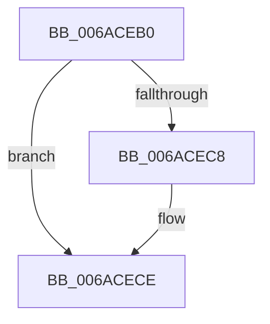

# HvlEndSystemInterrupt

- RVA: `0x006ACEB0`–`0x006ACED2` (길이 `34` bytes)
- VA: `0x00000001406ACEB0`
- 실행 섹션: `.text`
- PDB 이름 있음: `예`; PDB Function 태그: `아니요`
- unwind 정보 RVA: `0x000BFDE0`
- 디코드: `14`개 명령, `34/34` bytes 표시
- 미해석 바이트: `0` (있으면 어셈블리에 `.byte`로 보존)

> 이 문서는 커널 이미지의 기계어와 PDB 기호를 분석해 생성했습니다. 4번과 5번은 함수 원형과 자료형을 바이너리 사용 방식에서 추정한 C 해석이며 원본 소스 복구 결과는 아닙니다.

## 1. Dependencies

- 직접 호출 지점: **0**; 고유 호출 대상: **0**
- 직접 호출자로 확인된 함수: **0**
- RIP 상대 이미지 참조: **0**

### Outgoing calls
- 직접 디코드된 call 명령이 없습니다.

### Direct callers
- 이 함수 시작 RVA로 연결되는 직접 call은 확인되지 않았습니다. 간접 호출은 완전히 역산할 수 없습니다.

### Static image references
- 디코드된 RIP-relative 메모리 참조가 없습니다.

## 2. Other-region calls and transfers

- 다른 실행 섹션으로 향하는 call: **0**
- 별도 외부 분기/꼬리 이동을 확인하지 못했습니다.

## 3. Assembly (complete function range)

```asm
006ACEB0  48 51                           push rcx
006ACEB2  50                              push rax
006ACEB3  52                              push rdx
006ACEB4  65 48 8B 14 25 88 8D 00 00      mov rdx, qword ptr gs:[0x8d88]
006ACEBD  B9 70 00 00 40                  mov ecx, 0x40000070
006ACEC2  0F BA 32 00                     btr dword ptr [rdx], 0
006ACEC6  72 06                           jb 0x1406acece
006ACEC8  33 C0                           xor eax, eax
006ACECA  8B D0                           mov edx, eax
006ACECC  0F 30                           wrmsr
006ACECE  5A                              pop rdx
006ACECF  58                              pop rax
006ACED0  59                              pop rcx
006ACED1  C3                              ret
```

## 4. C-style interpretation (structured pseudocode)

```c
__int64 __fastcall HvlEndSystemInterrupt(__int64 a1, __int64 a2)
{
    __int64 result;

    if (!(condition_is_below)) {
        result = 0;
        a2 = 0;
    }
    return result;
}
```

## 5. (Beta) C Style

```c
int64_t HvlEndSystemInterrupt(int64_t Arg1, int64_t Arg2)
{
    int64_t result;

    if (!(condition_is_below)) {
        result = 0;
        Arg2 = 0;
    }
    return result;
}
```

## 6. Execution-region graph

[열기: 2D/3D 그래프와 함수 탐색 컨트롤 패널](../../../control-panel.html?section=text&rva=0x006ACEB0&view=graph)

- 2D 그래프는 위에서 아래로 흐르고, 3D 그래프는 빈 공간을 드래그해 회전합니다. Shift+드래그는 이동, 휠은 확대·축소, 함수 노드 선택은 대상 보고서 이동입니다.

### Static fallback


