# HvlNotifyPageHeat

- RVA: `0x006A7E60`–`0x006A812B` (길이 `715` bytes)
- VA: `0x00000001406A7E60`
- 실행 섹션: `.text`
- PDB 이름 있음: `예`; PDB Function 태그: `아니요`
- unwind 정보 RVA: `0x000DB1AC`
- 디코드: `200`개 명령, `715/715` bytes 표시
- 미해석 바이트: `0` (있으면 어셈블리에 `.byte`로 보존)

> 이 문서는 커널 이미지의 기계어와 PDB 기호를 분석해 생성했습니다. 4번과 5번은 함수 원형과 자료형을 바이너리 사용 방식에서 추정한 C 해석이며 원본 소스 복구 결과는 아닙니다.

## 1. Dependencies

- 직접 호출 지점: **10**; 고유 호출 대상: **8**
- 직접 호출자로 확인된 함수: **1**
- RIP 상대 이미지 참조: **4**

### Outgoing calls
- `0x006A7F07` → [HvlpAcquireHypercallPage](../47/HvlpAcquireHypercallPage_function_00471410.md) (function, `0x00471410`)
- `0x006A7F37` → [HvlpAcquireHypercallPage](../47/HvlpAcquireHypercallPage_function_00471410.md) (function, `0x00471410`)
- `0x006A8006` → [HvcallInitiateHypercall](../31/HvcallInitiateHypercall_function_00313630.md) (function, `0x00313630`)
- `0x006A806E` → [HvlpReleaseHypercallPage](../31/HvlpReleaseHypercallPage_function_00313480.md) (function, `0x00313480`)
- `0x006A807F` → [HvlpReleaseHypercallPage](../31/HvlpReleaseHypercallPage_function_00313480.md) (function, `0x00313480`)
- `0x006A8091` → [HvlpHvToNtStatus](../30/HvlpHvToNtStatus_function_00307BD8.md) (function, `0x00307BD8`)
- `0x006A80CE` → [KiRaiseIrqlProcessIrqlFlags](../4F/KiRaiseIrqlProcessIrqlFlags_function_004F56FC.md) (function, `0x004F56FC`)
- `0x006A80D3` → [KiEpfDrainCompletionQueue](../5C/KiEpfDrainCompletionQueue_function_005C4A6C.md) (function, `0x005C4A6C`)
- `0x006A80DB` → [KiEpfStart](../5C/KiEpfStart_function_005C4B14.md) (function, `0x005C4B14`)
- `0x006A80EF` → [KiLowerIrqlProcessIrqlFlags](../4F/KiLowerIrqlProcessIrqlFlags_function_004F5698.md) (function, `0x004F5698`)

### Direct callers
- [MiIssuePageHeatList](../44/MiIssuePageHeatList_function_0044615C.md) at `0x004462A0`

### Static image references
- `0x006A7EBA` → RVA `0x00FC6AB8` (`ALMOSTRO`; read)
- `0x006A7EEE` → RVA `0x00FC6A90` (`ALMOSTRO`; read)
- `0x006A80B2` → RVA `0x00F10DDC` (`.data`; read/write)
- `0x006A80C0` → RVA `0x00FC6D20` (`ALMOSTRO`; read)

## 2. Other-region calls and transfers

- 다른 실행 섹션으로 향하는 call: **0**
- 별도 외부 분기/꼬리 이동을 확인하지 못했습니다.

## 3. Assembly (complete function range)

```asm
006A7E60  48 8B C4                        mov rax, rsp
006A7E63  48 89 58 08                     mov qword ptr [rax + 8], rbx
006A7E67  48 89 70 10                     mov qword ptr [rax + 0x10], rsi
006A7E6B  48 89 78 20                     mov qword ptr [rax + 0x20], rdi
006A7E6F  44 89 40 18                     mov dword ptr [rax + 0x18], r8d
006A7E73  55                              push rbp
006A7E74  41 54                           push r12
006A7E76  41 55                           push r13
006A7E78  41 56                           push r14
006A7E7A  41 57                           push r15
006A7E7C  48 8B EC                        mov rbp, rsp
006A7E7F  48 81 EC 80 00 00 00            sub rsp, 0x80
006A7E86  33 C0                           xor eax, eax
006A7E88  0F 57 C0                        xorps xmm0, xmm0
006A7E8B  45 33 E4                        xor r12d, r12d
006A7E8E  48 89 45 E8                     mov qword ptr [rbp - 0x18], rax
006A7E92  89 45 F0                        mov dword ptr [rbp - 0x10], eax
006A7E95  4D 8B E9                        mov r13, r9
006A7E98  48 89 45 C8                     mov qword ptr [rbp - 0x38], rax
006A7E9C  89 45 D0                        mov dword ptr [rbp - 0x30], eax
006A7E9F  0F 11 45 D8                     movups xmmword ptr [rbp - 0x28], xmm0
006A7EA3  0F 11 45 B8                     movups xmmword ptr [rbp - 0x48], xmm0
006A7EA7  85 C9                           test ecx, ecx
006A7EA9  74 24                           je 0x1406a7ecf
006A7EAB  83 F9 01                        cmp ecx, 1
006A7EAE  74 0A                           je 0x1406a7eba
006A7EB0  B8 0D 00 00 C0                  mov eax, 0xc000000d
006A7EB5  E9 4F 02 00 00                  jmp 0x1406a8109
006A7EBA  0F BA 25 F6 EB 91 00 15         bt dword ptr [rip + 0x91ebf6], 0x15
006A7EC2  0F 83 3C 02 00 00               jae 0x1406a8104
006A7EC8  BF 01 00 00 00                  mov edi, 1
006A7ECD  EB 13                           jmp 0x1406a7ee2
006A7ECF  F7 05 DF EB 91 00 00 00 40 00   test dword ptr [rip + 0x91ebdf], 0x400000
006A7ED9  0F 84 25 02 00 00               je 0x1406a8104
006A7EDF  49 8B FC                        mov rdi, r12
006A7EE2  41 8B F4                        mov esi, r12d
006A7EE5  B9 02 00 00 00                  mov ecx, 2
006A7EEA  84 D2                           test dl, dl
006A7EEC  74 28                           je 0x1406a7f16
006A7EEE  0F BA 25 9A EB 91 00 15         bt dword ptr [rip + 0x91eb9a], 0x15
006A7EF6  73 1E                           jae 0x1406a7f16
006A7EF8  8B D1                           mov edx, ecx
006A7EFA  45 33 C9                        xor r9d, r9d
006A7EFD  48 8D 4D B8                     lea rcx, [rbp - 0x48]
006A7F01  45 33 C0                        xor r8d, r8d
006A7F04  4D 8B FD                        mov r15, r13
006A7F07  E8 04 95 DC FF                  call 0x140471410
006A7F0C  4C 8B F0                        mov r14, rax
006A7F0F  BB 06 80 00 00                  mov ebx, 0x8006
006A7F14  EB 13                           jmp 0x1406a7f29
006A7F16  4D 8B FC                        mov r15, r12
006A7F19  4D 8B F4                        mov r14, r12
006A7F1C  0F 11 45 B8                     movups xmmword ptr [rbp - 0x48], xmm0
006A7F20  BB 03 80 00 00                  mov ebx, 0x8003
006A7F25  0F 11 45 C8                     movups xmmword ptr [rbp - 0x38], xmm0
006A7F29  45 33 C9                        xor r9d, r9d
006A7F2C  48 8D 4D D8                     lea rcx, [rbp - 0x28]
006A7F30  45 33 C0                        xor r8d, r8d
006A7F33  41 8D 51 01                     lea edx, [r9 + 1]
006A7F37  E8 D4 94 DC FF                  call 0x140471410
006A7F3C  8B 55 40                        mov edx, dword ptr [rbp + 0x40]
006A7F3F  48 8B C8                        mov rcx, rax
006A7F42  48 89 45 B0                     mov qword ptr [rbp - 0x50], rax
006A7F46  45 33 DB                        xor r11d, r11d
006A7F49  48 89 5D A0                     mov qword ptr [rbp - 0x60], rbx
006A7F4D  48 89 38                        mov qword ptr [rax], rdi
006A7F50  B8 FF 01 00 00                  mov eax, 0x1ff
006A7F55  3B D0                           cmp edx, eax
006A7F57  45 8B CB                        mov r9d, r11d
006A7F5A  0F 43 D0                        cmovae edx, eax
006A7F5D  48 C1 EB 20                     shr rbx, 0x20
006A7F61  8B C3                           mov eax, ebx
006A7F63  33 C2                           xor eax, edx
006A7F65  25 FF 0F 00 00                  and eax, 0xfff
006A7F6A  33 C3                           xor eax, ebx
006A7F6C  89 45 A4                        mov dword ptr [rbp - 0x5c], eax
006A7F6F  85 D2                           test edx, edx
006A7F71  0F 84 80 00 00 00               je 0x1406a7ff7
006A7F77  48 83 C1 08                     add rcx, 8
006A7F7B  43 8D 04 21                     lea eax, [r9 + r12]
006A7F7F  4C 89 19                        mov qword ptr [rcx], r11
006A7F82  4D 8B 44 C5 00                  mov r8, qword ptr [r13 + rax*8]
006A7F87  41 81 E0 FF 03 00 00            and r8d, 0x3ff
006A7F8E  44 8B D0                        mov r10d, eax
006A7F91  4C 89 01                        mov qword ptr [rcx], r8
006A7F94  49 8B 44 C5 00                  mov rax, qword ptr [r13 + rax*8]
006A7F99  48 A9 00 0C 00 00               test rax, 0xc00
006A7F9F  75 0B                           jne 0x1406a7fac
006A7FA1  48 25 00 F0 FF FF               and rax, 0xfffffffffffff000
006A7FA7  49 0B C0                        or rax, r8
006A7FAA  EB 3C                           jmp 0x1406a7fe8
006A7FAC  49 0F BA E8 0B                  bts r8, 0xb
006A7FB1  4C 89 01                        mov qword ptr [rcx], r8
006A7FB4  4B 8B 44 D5 00                  mov rax, qword ptr [r13 + r10*8]
006A7FB9  48 25 00 00 E0 FF               and rax, 0xffffffffffe00000
006A7FBF  49 0B C0                        or rax, r8
006A7FC2  48 89 01                        mov qword ptr [rcx], rax
006A7FC5  4F 8B 44 D5 00                  mov r8, qword ptr [r13 + r10*8]
006A7FCA  41 81 E0 00 0C 00 00            and r8d, 0xc00
006A7FD1  49 81 F8 00 04 00 00            cmp r8, 0x400
006A7FD8  74 11                           je 0x1406a7feb
006A7FDA  49 81 F8 00 08 00 00            cmp r8, 0x800
006A7FE1  75 08                           jne 0x1406a7feb
006A7FE3  48 0F BA E8 0C                  bts rax, 0xc
006A7FE8  48 89 01                        mov qword ptr [rcx], rax
006A7FEB  41 FF C1                        inc r9d
006A7FEE  48 83 C1 08                     add rcx, 8
006A7FF2  44 3B CA                        cmp r9d, edx
006A7FF5  72 84                           jb 0x1406a7f7b
006A7FF7  48 8B 5D A0                     mov rbx, qword ptr [rbp - 0x60]
006A7FFB  4C 8B 45 D0                     mov r8, qword ptr [rbp - 0x30]
006A7FFF  48 8B CB                        mov rcx, rbx
006A8002  48 8B 55 F0                     mov rdx, qword ptr [rbp - 0x10]
006A8006  E8 25 B6 C6 FF                  call 0x140313630
006A800B  45 33 DB                        xor r11d, r11d
006A800E  48 89 45 A8                     mov qword ptr [rbp - 0x58], rax
006A8012  48 8B F8                        mov rdi, rax
006A8015  66 85 C0                        test ax, ax
006A8018  75 50                           jne 0x1406a806a
006A801A  4D 85 F6                        test r14, r14
006A801D  74 2B                           je 0x1406a804a
006A801F  48 C1 E8 20                     shr rax, 0x20
006A8023  25 FF 0F 00 00                  and eax, 0xfff
006A8028  76 20                           jbe 0x1406a804a
006A802A  49 8B CE                        mov rcx, r14
006A802D  44 8B C0                        mov r8d, eax
006A8030  48 8B 11                        mov rdx, qword ptr [rcx]
006A8033  48 85 D2                        test rdx, rdx
006A8036  74 08                           je 0x1406a8040
006A8038  8B C6                           mov eax, esi
006A803A  FF C6                           inc esi
006A803C  49 89 14 C7                     mov qword ptr [r15 + rax*8], rdx
006A8040  48 83 C1 08                     add rcx, 8
006A8044  49 83 E8 01                     sub r8, 1
006A8048  75 E6                           jne 0x1406a8030
006A804A  8B 45 AC                        mov eax, dword ptr [rbp - 0x54]
006A804D  8B 55 40                        mov edx, dword ptr [rbp + 0x40]
006A8050  25 FF 0F 00 00                  and eax, 0xfff
006A8055  48 8B 4D B0                     mov rcx, qword ptr [rbp - 0x50]
006A8059  44 03 E0                        add r12d, eax
006A805C  B8 FF 01 00 00                  mov eax, 0x1ff
006A8061  41 2B D4                        sub edx, r12d
006A8064  0F 85 EB FE FF FF               jne 0x1406a7f55
006A806A  48 8D 4D D8                     lea rcx, [rbp - 0x28]
006A806E  E8 0D B4 C6 FF                  call 0x140313480
006A8073  45 33 E4                        xor r12d, r12d
006A8076  4D 85 F6                        test r14, r14
006A8079  74 09                           je 0x1406a8084
006A807B  48 8D 4D B8                     lea rcx, [rbp - 0x48]
006A807F  E8 FC B3 C6 FF                  call 0x140313480
006A8084  66 85 FF                        test di, di
006A8087  75 05                           jne 0x1406a808e
006A8089  45 8B F4                        mov r14d, r12d
006A808C  EB 0B                           jmp 0x1406a8099
006A808E  0F B7 CF                        movzx ecx, di
006A8091  E8 42 FB C5 FF                  call 0x140307bd8
006A8096  44 8B F0                        mov r14d, eax
006A8099  85 F6                           test esi, esi
006A809B  74 62                           je 0x1406a80ff
006A809D  8B CE                           mov ecx, esi
006A809F  41 BD 02 00 00 00               mov r13d, 2
006A80A5  49 8D 3C CF                     lea rdi, [r15 + rcx*8]
006A80A9  48 8D 7F F8                     lea rdi, [rdi - 8]
006A80AD  FF CE                           dec esi
006A80AF  4C 8B 3F                        mov r15, qword ptr [rdi]
006A80B2  FF 05 24 8D 86 00               inc dword ptr [rip + 0x868d24]
006A80B8  44 0F 20 C3                     mov rbx, cr8
006A80BC  45 0F 22 C5                     mov cr8, r13
006A80C0  44 39 25 59 EC 91 00            cmp dword ptr [rip + 0x91ec59], r12d
006A80C7  74 0A                           je 0x1406a80d3
006A80C9  41 8A D5                        mov dl, r13b
006A80CC  8A CB                           mov cl, bl
006A80CE  E8 29 D6 E4 FF                  call 0x1404f56fc
006A80D3  E8 94 C9 F1 FF                  call 0x1405c4a6c
006A80D8  49 8B CF                        mov rcx, r15
006A80DB  E8 34 CA F1 FF                  call 0x1405c4b14
006A80E0  44 39 25 39 EC 91 00            cmp dword ptr [rip + 0x91ec39], r12d
006A80E7  74 0B                           je 0x1406a80f4
006A80E9  44 0F 20 C1                     mov rcx, cr8
006A80ED  8A D3                           mov dl, bl
006A80EF  E8 A4 D5 E4 FF                  call 0x1404f5698
006A80F4  0F B6 C3                        movzx eax, bl
006A80F7  44 0F 22 C0                     mov cr8, rax
006A80FB  85 F6                           test esi, esi
006A80FD  75 AA                           jne 0x1406a80a9
006A80FF  41 8B C6                        mov eax, r14d
006A8102  EB 05                           jmp 0x1406a8109
006A8104  B8 BB 00 00 C0                  mov eax, 0xc00000bb
006A8109  4C 8D 9C 24 80 00 00 00         lea r11, [rsp + 0x80]
006A8111  49 8B 5B 30                     mov rbx, qword ptr [r11 + 0x30]
006A8115  49 8B 73 38                     mov rsi, qword ptr [r11 + 0x38]
006A8119  49 8B 7B 48                     mov rdi, qword ptr [r11 + 0x48]
006A811D  49 8B E3                        mov rsp, r11
006A8120  41 5F                           pop r15
006A8122  41 5E                           pop r14
006A8124  41 5D                           pop r13
006A8126  41 5C                           pop r12
006A8128  5D                              pop rbp
006A8129  C3                              ret
006A812A  CC                              int3
```

## 4. C-style interpretation (structured pseudocode)

```c
__int64 __fastcall HvlNotifyPageHeat(int a1, unsigned __int8 a2, int a3, __int64 a4)
{
    __int64 result;
    __int64 v_r11;
    __int64 v_r12;
    __int64 v_rbx;
    __int64 v_rsi;
    __int64 v_rsp;
    unsigned __int64 v_stack_m28;
    unsigned int v_stack_m38;
    unsigned __int64 v_stack_m40;
    unsigned __int64 v_stack_m50;
    unsigned int v_stack_m58;
    unsigned __int64 v_stack_m60;
    unsigned __int64 v_stack_m70;
    unsigned __int64 v_stack_m78;
    unsigned int v_stack_m7C;
    unsigned __int64 v_stack_m80;
    unsigned int v_stack_m84;
    unsigned __int64 v_stack_m88;
    unsigned int v_stack_p18;

    *(unsigned __int64 *)(v_rsp + 8) = v_rbx;
    *(unsigned __int64 *)(v_rsp + 16) = v_rsi;
    *(unsigned __int64 *)(v_rsp + 32) = v_rdi;
    *(unsigned int *)(v_rsp + 24) = a3;
    v_rsp = (v_rsp) - (128);
    result = 0;
    v_r12 = 0;
    v_stack_m40 = 0;
    v_stack_m38 = 0;
    v_stack_m60 = 0;
    v_stack_m58 = 0;
    v_stack_m50 = v_xmm0;
    v_stack_m70 = v_xmm0;
    if (a1 == 0) goto loc_006A7ECF;
    if (a1 == 1) goto loc_006A7EBA;
    goto loc_006A8109;
loc_006A7EBA:
    if (a1 >= 1) goto loc_006A8104;
    goto loc_006A7EE2;
loc_006A7ECF:
    if (((*(unsigned int *)(v_rip + 9563103)) & (0x400000ULL)) == 0) goto loc_006A8104;
loc_006A7EE2:
    if (a2 == 0) goto loc_006A7F16;
    if (condition_is_above_or_equal) goto loc_006A7F16;
    a4 = 0;
    a3 = 0;
    result = HvlpAcquireHypercallPage(v_stack_m70, 2, a3, a4);
    goto loc_006A7F29;
loc_006A7F16:
    v_stack_m70 = v_xmm0;
    v_stack_m60 = v_xmm0;
loc_006A7F29:
    a4 = 0;
    a3 = 0;
    result = HvlpAcquireHypercallPage(v_stack_m50, a4 + 1, a3, a4);
    v_stack_m78 = result;
    v_r11 = 0;
    v_stack_m88 = (unsigned int)(0x8003ULL);
    *(unsigned __int64 *)(result) = 0;
loc_006A7F55:
    a2 = (unsigned int)(v_stack_p18);
    if (((unsigned int)((unsigned int)(v_stack_p18))) >= 511) { a2 = 511; }
    v_rbx = ((unsigned int)(0x8003ULL)) >> (32);
    result = (unsigned int)(((unsigned int)((unsigned int)(v_rbx))) ^ (a2));
    result = (unsigned int)((result) & (0xFFFULL));
    result = (unsigned int)((result) ^ ((unsigned int)(v_rbx)));
    v_stack_m84 = (unsigned int)(result);
    if (a2 == 0) goto loc_006A7FF7;
    a1 = (result) + (8);
loc_006A7F7B:
    *(unsigned __int64 *)(a1) = 0;
    a3 = (unsigned int)((*(unsigned __int64 *)(a4 + 0 + v_r12 * 1 * 8)) & (0x3FFULL));
    *(unsigned __int64 *)(a1) = a3;
    if (((*(unsigned __int64 *)(a4 + 0 + v_r12 * 1 * 8)) & (0xC00ULL)) != 0) goto loc_006A7FAC;
    result = (*(unsigned __int64 *)(a4 + 0 + v_r12 * 1 * 8)) & (0xFFFFFFFFFFFFF000ULL);
    result = (result) | (a3);
    goto loc_006A7FE8;
loc_006A7FAC:
    *(unsigned __int64 *)(a1) = a3;
    result = (*(unsigned __int64 *)(a4 + (unsigned int)((unsigned int)(0 + v_r12 * 1)) * 8)) & (0xFFFFFFFFFFE00000ULL);
    result = (result) | (a3);
    *(unsigned __int64 *)(a1) = result;
    a3 = (unsigned int)((*(unsigned __int64 *)(a4 + (unsigned int)((unsigned int)(0 + v_r12 * 1)) * 8)) & (0xC00ULL));
    if (a3 == 0x400ULL) goto loc_006A7FEB;
    if (a3 != 0x800ULL) goto loc_006A7FEB;
loc_006A7FE8:
    *(unsigned __int64 *)(a1) = result;
loc_006A7FEB:
    a4 = (unsigned int)((0) + 1);
    a1 = (a1) + (8);
    if (((unsigned int)(a4)) < a2) goto loc_006A7F7B;
loc_006A7FF7:
    result = HvcallInitiateHypercall(v_stack_m88, v_stack_m38, v_stack_m58, a4);
    v_r11 = 0;
    v_stack_m80 = result;
    if ((unsigned __int16)(result) != 0) goto loc_006A806A;
    if (0 == 0) goto loc_006A804A;
    result = (result) >> (32);
    result = (unsigned int)((result) & (0xFFFULL));
    if (condition_is_below_or_equal) goto loc_006A804A;
loc_006A8030:
    v_rsi = 0;
    if (*(unsigned __int64 *)(0) != 0) {
        result = 0;
        v_rsi = (unsigned int)((0) + 1);
        *(unsigned __int64 *)(0 + result * 8) = *(unsigned __int64 *)(0);
    }
    a1 = (0) + (8);
    a3 = ((unsigned int)((unsigned int)(result))) - (1);
    if (condition_is_not_equal) goto loc_006A8030;
loc_006A804A:
    result = (unsigned int)(((unsigned int)(v_stack_m7C)) & (0xFFFULL));
    v_r12 = (unsigned int)((v_r12) + ((unsigned int)(result)));
    a2 = (unsigned int)(((unsigned int)(v_stack_p18)) - ((unsigned int)(v_r12)));
    if (condition_is_not_equal) goto loc_006A7F55;
loc_006A806A:
    result = HvlpReleaseHypercallPage(v_stack_m50, a2, a3, a4);
    v_r12 = 0;
    if (0 != 0) {
        a1 = v_stack_m70;
        result = HvlpReleaseHypercallPage(a1, a2, a3, a4);
    }
    if ((unsigned __int16)(result) != 0) goto loc_006A808E;
    goto loc_006A8099;
loc_006A808E:
    result = HvlpHvToNtStatus((unsigned __int16)(result), a2, a3, a4);
loc_006A8099:
    if ((unsigned int)(v_rsi) == 0) goto loc_006A80FF;
loc_006A80A9:
    v_rsi = (unsigned int)((v_rsi) - 1);
    if ((*(unsigned int *)(v_rip + 9563225)) != 0) {
        a2 = 2;
        a1 = (unsigned __int8)(v_cr8);
        result = KiRaiseIrqlProcessIrqlFlags(a1, a2, a3, a4);
    }
    result = KiEpfDrainCompletionQueue(a1, a2, a3, a4);
    result = KiEpfStart(*(unsigned __int64 *)(0 + (unsigned int)((unsigned int)(v_rsi)) * 8 - 8), a2, a3, a4);
    if ((*(unsigned int *)(v_rip + 9563193)) != 0) {
        a1 = 2;
        a2 = (unsigned __int8)(v_cr8);
        result = KiLowerIrqlProcessIrqlFlags(a1, a2, a3, a4);
    }
    if ((unsigned int)(v_rsi) != 0) goto loc_006A80A9;
loc_006A80FF:
    goto loc_006A8109;
loc_006A8104:
loc_006A8109:
    return (unsigned int)(0xC00000BBULL);
}
```

## 5. (Beta) C Style

```c
int64_t HvlNotifyPageHeat(int32_t Arg1, uint8_t Arg2, int32_t Arg3, void *Arg4)
{
    uint8_t *arg4 = (uint8_t *)Arg4;

    int64_t result;
    int64_t local_r11;
    int64_t local_r12;
    int64_t local_rbx;
    int64_t local_rsi;
    int64_t local_rsp;
    uint64_t v_stack_m28;
    uint32_t v_stack_m38;
    uint64_t v_stack_m40;
    uint64_t v_stack_m50;
    uint32_t v_stack_m58;
    uint64_t v_stack_m60;
    uint64_t v_stack_m70;
    uint64_t v_stack_m78;
    uint32_t v_stack_m7C;
    uint64_t v_stack_m80;
    uint32_t v_stack_m84;
    uint64_t v_stack_m88;
    uint32_t v_stack_p18;

    *(uint64_t *)(local_rsp + 0x8) = local_rbx;
    *(uint64_t *)(local_rsp + 0x10) = local_rsi;
    *(uint64_t *)(local_rsp + 0x20) = local_rdi;
    *(uint32_t *)(local_rsp + 0x18) = Arg3;
    local_rsp = (local_rsp) - (128);
    result = 0;
    local_r12 = 0;
    v_stack_m40 = 0;
    v_stack_m38 = 0;
    v_stack_m60 = 0;
    v_stack_m58 = 0;
    v_stack_m50 = v_xmm0;
    v_stack_m70 = v_xmm0;
    if (Arg1 == 0) goto loc_006A7ECF;
    if (Arg1 == 1) goto loc_006A7EBA;
    goto loc_006A8109;
loc_006A7EBA:
    if (Arg1 >= 1) goto loc_006A8104;
    goto loc_006A7EE2;
loc_006A7ECF:
    if (((*(uint32_t *)(v_rip + 0x91EBDF)) & (0x400000ULL)) == 0) goto loc_006A8104;
loc_006A7EE2:
    if (Arg2 == 0) goto loc_006A7F16;
    if (condition_is_above_or_equal) goto loc_006A7F16;
    Arg4 = 0;
    Arg3 = 0;
    result = HvlpAcquireHypercallPage(v_stack_m70, 2, Arg3, Arg4);
    goto loc_006A7F29;
loc_006A7F16:
    v_stack_m70 = v_xmm0;
    v_stack_m60 = v_xmm0;
loc_006A7F29:
    Arg4 = 0;
    Arg3 = 0;
    result = HvlpAcquireHypercallPage(v_stack_m50, Arg4 + 1, Arg3, Arg4);
    v_stack_m78 = result;
    local_r11 = 0;
    v_stack_m88 = (uint32_t)(0x8003ULL);
    *(uint64_t *)(result) = 0;
loc_006A7F55:
    Arg2 = (uint32_t)(v_stack_p18);
    if (((uint32_t)((uint32_t)(v_stack_p18))) >= 511) { Arg2 = 511; }
    local_rbx = ((uint32_t)(0x8003ULL)) >> (32);
    result = (uint32_t)(((uint32_t)((uint32_t)(local_rbx))) ^ (Arg2));
    result = (uint32_t)((result) & (0xFFFULL));
    result = (uint32_t)((result) ^ ((uint32_t)(local_rbx)));
    v_stack_m84 = (uint32_t)(result);
    if (Arg2 == 0) goto loc_006A7FF7;
    Arg1 = (result) + (8);
loc_006A7F7B:
    *(uint64_t *)(Arg1) = 0;
    Arg3 = (uint32_t)((*(uint64_t *)(arg4 + 0x0 + local_r12 * 1 * 8)) & (0x3FFULL));
    *(uint64_t *)(Arg1) = Arg3;
    if (((*(uint64_t *)(arg4 + 0x0 + local_r12 * 1 * 8)) & (0xC00ULL)) != 0) goto loc_006A7FAC;
    result = (*(uint64_t *)(arg4 + 0x0 + local_r12 * 1 * 8)) & (0xFFFFFFFFFFFFF000ULL);
    result = (result) | (Arg3);
    goto loc_006A7FE8;
loc_006A7FAC:
    *(uint64_t *)(Arg1) = Arg3;
    result = (*(uint64_t *)(arg4 + (uint32_t)((uint32_t)(0 + local_r12 * 1)) * 8)) & (0xFFFFFFFFFFE00000ULL);
    result = (result) | (Arg3);
    *(uint64_t *)(Arg1) = result;
    Arg3 = (uint32_t)((*(uint64_t *)(arg4 + (uint32_t)((uint32_t)(0 + local_r12 * 1)) * 8)) & (0xC00ULL));
    if (Arg3 == 0x400ULL) goto loc_006A7FEB;
    if (Arg3 != 0x800ULL) goto loc_006A7FEB;
loc_006A7FE8:
    *(uint64_t *)(Arg1) = result;
loc_006A7FEB:
    Arg4 = (uint32_t)((0) + 1);
    Arg1 = (Arg1) + (8);
    if (((uint32_t)(Arg4)) < Arg2) goto loc_006A7F7B;
loc_006A7FF7:
    result = HvcallInitiateHypercall(v_stack_m88, v_stack_m38, v_stack_m58, Arg4);
    local_r11 = 0;
    v_stack_m80 = result;
    if ((uint16_t)(result) != 0) goto loc_006A806A;
    if (0 == 0) goto loc_006A804A;
    result = (result) >> (32);
    result = (uint32_t)((result) & (0xFFFULL));
    if (condition_is_below_or_equal) goto loc_006A804A;
loc_006A8030:
    local_rsi = 0;
    if (*(uint64_t *)(0) != 0) {
        result = 0;
        local_rsi = (uint32_t)((0) + 1);
        *(uint64_t *)(0 + result * 8) = *(uint64_t *)(0);
    }
    Arg1 = (0) + (8);
    Arg3 = ((uint32_t)((uint32_t)(result))) - (1);
    if (condition_is_not_equal) goto loc_006A8030;
loc_006A804A:
    result = (uint32_t)(((uint32_t)(v_stack_m7C)) & (0xFFFULL));
    local_r12 = (uint32_t)((local_r12) + ((uint32_t)(result)));
    Arg2 = (uint32_t)(((uint32_t)(v_stack_p18)) - ((uint32_t)(local_r12)));
    if (condition_is_not_equal) goto loc_006A7F55;
loc_006A806A:
    result = HvlpReleaseHypercallPage(v_stack_m50, Arg2, Arg3, Arg4);
    local_r12 = 0;
    if (0 != 0) {
        Arg1 = v_stack_m70;
        result = HvlpReleaseHypercallPage(Arg1, Arg2, Arg3, Arg4);
    }
    if ((uint16_t)(result) != 0) goto loc_006A808E;
    goto loc_006A8099;
loc_006A808E:
    result = HvlpHvToNtStatus((uint16_t)(result), Arg2, Arg3, Arg4);
loc_006A8099:
    if ((uint32_t)(local_rsi) == 0) goto loc_006A80FF;
loc_006A80A9:
    local_rsi = (uint32_t)((local_rsi) - 1);
    if ((*(uint32_t *)(v_rip + 0x91EC59)) != 0) {
        Arg2 = 2;
        Arg1 = (uint8_t)(v_cr8);
        result = KiRaiseIrqlProcessIrqlFlags(Arg1, Arg2, Arg3, Arg4);
    }
    result = KiEpfDrainCompletionQueue(Arg1, Arg2, Arg3, Arg4);
    result = KiEpfStart(*(uint64_t *)(0 + (uint32_t)((uint32_t)(local_rsi)) * 8 - 0x8), Arg2, Arg3, Arg4);
    if ((*(uint32_t *)(v_rip + 0x91EC39)) != 0) {
        Arg1 = 2;
        Arg2 = (uint8_t)(v_cr8);
        result = KiLowerIrqlProcessIrqlFlags(Arg1, Arg2, Arg3, Arg4);
    }
    if ((uint32_t)(local_rsi) != 0) goto loc_006A80A9;
loc_006A80FF:
    goto loc_006A8109;
loc_006A8104:
loc_006A8109:
    return (uint32_t)(0xC00000BBULL);
}
```

### 관측된 메모리 오프셋

구조체 형식이 확인되지 않은 접근은 인자 기준의 오프셋으로만 기록했습니다.

| 기준 인자 | 오프셋 표현 | 폭 (bit) | 접근 |
|---|---:|---:|---|
| `Arg4` | `+ 0x0 + r10*8` | `64` | `R` |
| `Arg4` | `+ 0x0 + rax*8` | `64` | `R` |

## 6. Execution-region graph

[열기: 2D/3D 그래프와 함수 탐색 컨트롤 패널](../../../control-panel.html?section=text&rva=0x006A7E60&view=graph)

- 2D 그래프는 위에서 아래로 흐르고, 3D 그래프는 빈 공간을 드래그해 회전합니다. Shift+드래그는 이동, 휠은 확대·축소, 함수 노드 선택은 대상 보고서 이동입니다.

### Static fallback

```mermaid
flowchart TD
  bb_006A7E60[BB_006A7E60]
  bb_006A7EAB[BB_006A7EAB]
  bb_006A7EB0[BB_006A7EB0]
  bb_006A7EBA[BB_006A7EBA]
  bb_006A7EC8[BB_006A7EC8]
  bb_006A7ECF[BB_006A7ECF]
  bb_006A7EDF[BB_006A7EDF]
  bb_006A7EE2[BB_006A7EE2]
  bb_006A7EEE[BB_006A7EEE]
  bb_006A7EF8[BB_006A7EF8]
  bb_006A7F16[BB_006A7F16]
  bb_006A7F29[BB_006A7F29]
  bb_006A7F55[BB_006A7F55]
  bb_006A7F77[BB_006A7F77]
  bb_006A7F7B[BB_006A7F7B]
  bb_006A7FA1[BB_006A7FA1]
  bb_006A7FAC[BB_006A7FAC]
  bb_006A7FDA[BB_006A7FDA]
  bb_006A7FE3[BB_006A7FE3]
  bb_006A7FE8[BB_006A7FE8]
  bb_006A7FEB[BB_006A7FEB]
  bb_006A7FF7[BB_006A7FF7]
  bb_006A801A[BB_006A801A]
  bb_006A801F[BB_006A801F]
  bb_006A802A[BB_006A802A]
  bb_006A8030[BB_006A8030]
  bb_006A8038[BB_006A8038]
  bb_006A8040[BB_006A8040]
  bb_006A804A[BB_006A804A]
  bb_006A806A[BB_006A806A]
  bb_006A807B[BB_006A807B]
  bb_006A8084[BB_006A8084]
  bb_006A8089[BB_006A8089]
  bb_006A808E[BB_006A808E]
  bb_006A8099[BB_006A8099]
  bb_006A809D[BB_006A809D]
  bb_006A80A9[BB_006A80A9]
  bb_006A80C9[BB_006A80C9]
  bb_006A80D3[BB_006A80D3]
  bb_006A80E9[BB_006A80E9]
  bb_006A80F4[BB_006A80F4]
  bb_006A80FF[BB_006A80FF]
  bb_006A8104[BB_006A8104]
  bb_006A8109[BB_006A8109]
  bb_006A812A[BB_006A812A]
  bb_006A7E60 -->|branch| bb_006A7ECF
  bb_006A7E60 -->|fallthrough| bb_006A7EAB
  bb_006A7EAB -->|branch| bb_006A7EBA
  bb_006A7EAB -->|fallthrough| bb_006A7EB0
  bb_006A7EB0 -->|branch| bb_006A8109
  bb_006A7EBA -->|branch| bb_006A8104
  bb_006A7EBA -->|fallthrough| bb_006A7EC8
  bb_006A7EC8 -->|branch| bb_006A7EE2
  bb_006A7ECF -->|branch| bb_006A8104
  bb_006A7ECF -->|fallthrough| bb_006A7EDF
  bb_006A7EDF -->|flow| bb_006A7EE2
  bb_006A7EE2 -->|branch| bb_006A7F16
  bb_006A7EE2 -->|fallthrough| bb_006A7EEE
  bb_006A7EEE -->|branch| bb_006A7F16
  bb_006A7EEE -->|fallthrough| bb_006A7EF8
  bb_006A7EF8 -->|branch| bb_006A7F29
  bb_006A7F16 -->|flow| bb_006A7F29
  bb_006A7F29 -->|flow| bb_006A7F55
  bb_006A7F55 -->|branch| bb_006A7FF7
  bb_006A7F55 -->|fallthrough| bb_006A7F77
  bb_006A7F77 -->|flow| bb_006A7F7B
  bb_006A7F7B -->|branch| bb_006A7FAC
  bb_006A7F7B -->|fallthrough| bb_006A7FA1
  bb_006A7FA1 -->|branch| bb_006A7FE8
  bb_006A7FAC -->|branch| bb_006A7FEB
  bb_006A7FAC -->|fallthrough| bb_006A7FDA
  bb_006A7FDA -->|branch| bb_006A7FEB
  bb_006A7FDA -->|fallthrough| bb_006A7FE3
  bb_006A7FE3 -->|flow| bb_006A7FE8
  bb_006A7FE8 -->|flow| bb_006A7FEB
  bb_006A7FEB -->|branch| bb_006A7F7B
  bb_006A7FEB -->|fallthrough| bb_006A7FF7
  bb_006A7FF7 -->|branch| bb_006A806A
  bb_006A7FF7 -->|fallthrough| bb_006A801A
  bb_006A801A -->|branch| bb_006A804A
  bb_006A801A -->|fallthrough| bb_006A801F
  bb_006A801F -->|branch| bb_006A804A
  bb_006A801F -->|fallthrough| bb_006A802A
  bb_006A802A -->|flow| bb_006A8030
  bb_006A8030 -->|branch| bb_006A8040
  bb_006A8030 -->|fallthrough| bb_006A8038
  bb_006A8038 -->|flow| bb_006A8040
  bb_006A8040 -->|branch| bb_006A8030
  bb_006A8040 -->|fallthrough| bb_006A804A
  bb_006A804A -->|branch| bb_006A7F55
  bb_006A804A -->|fallthrough| bb_006A806A
  bb_006A806A -->|branch| bb_006A8084
  bb_006A806A -->|fallthrough| bb_006A807B
  bb_006A807B -->|flow| bb_006A8084
  bb_006A8084 -->|branch| bb_006A808E
  bb_006A8084 -->|fallthrough| bb_006A8089
  bb_006A8089 -->|branch| bb_006A8099
  bb_006A808E -->|flow| bb_006A8099
  bb_006A8099 -->|branch| bb_006A80FF
  bb_006A8099 -->|fallthrough| bb_006A809D
  bb_006A809D -->|flow| bb_006A80A9
  bb_006A80A9 -->|branch| bb_006A80D3
  bb_006A80A9 -->|fallthrough| bb_006A80C9
  bb_006A80C9 -->|flow| bb_006A80D3
  bb_006A80D3 -->|branch| bb_006A80F4
  bb_006A80D3 -->|fallthrough| bb_006A80E9
  bb_006A80E9 -->|flow| bb_006A80F4
  bb_006A80F4 -->|branch| bb_006A80A9
  bb_006A80F4 -->|fallthrough| bb_006A80FF
  bb_006A80FF -->|branch| bb_006A8109
  bb_006A8104 -->|flow| bb_006A8109
```


