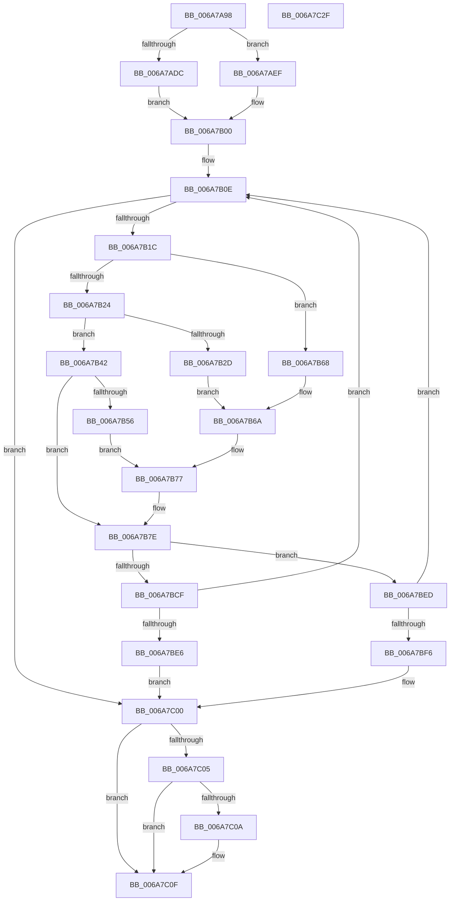

# HvlpAddRemovePhysicalMemory

- RVA: `0x006A7A98`–`0x006A7C30` (길이 `408` bytes)
- VA: `0x00000001406A7A98`
- 실행 섹션: `.text`
- PDB 이름 있음: `예`; PDB Function 태그: `예`
- unwind 정보 RVA: `0x000AC264`
- 디코드: `115`개 명령, `408/408` bytes 표시
- 미해석 바이트: `0` (있으면 어셈블리에 `.byte`로 보존)

> 이 문서는 커널 이미지의 기계어와 PDB 기호를 분석해 생성했습니다. 4번과 5번은 함수 원형과 자료형을 바이너리 사용 방식에서 추정한 C 해석이며 원본 소스 복구 결과는 아닙니다.

## 1. Dependencies

- 직접 호출 지점: **4**; 고유 호출 대상: **4**
- 직접 호출자로 확인된 함수: **1**
- RIP 상대 이미지 참조: **0**

### Outgoing calls
- `0x006A7BA1` → [HvcallFastExtended](../31/HvcallFastExtended_function_003130E0.md) (function, `0x003130E0`)
- `0x006A7BD7` → [HvlpDepositPages](../58/HvlpDepositPages_function_00585474.md) (function, `0x00585474`)
- `0x006A7BF9` → [HvlpHvToNtStatus](../30/HvlpHvToNtStatus_function_00307BD8.md) (function, `0x00307BD8`)
- `0x006A7C0A` → [HvlpWithdrawPages](../58/HvlpWithdrawPages_function_00586C90.md) (function, `0x00586C90`)

### Direct callers
- [HvlConfigureDynamicMemory](HvlConfigureDynamicMemory_function_006A7958.md) at `0x006A79E5`
- [HvlConfigureDynamicMemory](HvlConfigureDynamicMemory_function_006A7958.md) at `0x006A7A1F`
- [HvlConfigureDynamicMemory](HvlConfigureDynamicMemory_function_006A7958.md) at `0x006A7A44`
- [HvlConfigureDynamicMemory](HvlConfigureDynamicMemory_function_006A7958.md) at `0x006A7A73`

### Static image references
- 디코드된 RIP-relative 메모리 참조가 없습니다.

## 2. Other-region calls and transfers

- 다른 실행 섹션으로 향하는 call: **0**
- 별도 외부 분기/꼬리 이동을 확인하지 못했습니다.

## 3. Assembly (complete function range)

```asm
006A7A98  48 8B C4                        mov rax, rsp
006A7A9B  48 89 58 08                     mov qword ptr [rax + 8], rbx
006A7A9F  48 89 68 10                     mov qword ptr [rax + 0x10], rbp
006A7AA3  48 89 70 18                     mov qword ptr [rax + 0x18], rsi
006A7AA7  57                              push rdi
006A7AA8  41 54                           push r12
006A7AAA  41 55                           push r13
006A7AAC  41 56                           push r14
006A7AAE  41 57                           push r15
006A7AB0  48 83 EC 40                     sub rsp, 0x40
006A7AB4  4C 8B B4 24 90 00 00 00         mov r14, qword ptr [rsp + 0x90]
006A7ABC  45 33 ED                        xor r13d, r13d
006A7ABF  0F 57 C0                        xorps xmm0, xmm0
006A7AC2  49 8B F1                        mov rsi, r9
006A7AC5  49 8B E8                        mov rbp, r8
006A7AC8  44 8A F9                        mov r15b, cl
006A7ACB  41 8B FD                        mov edi, r13d
006A7ACE  4D 89 2E                        mov qword ptr [r14], r13
006A7AD1  0F 11 40 C8                     movups xmmword ptr [rax - 0x38], xmm0
006A7AD5  88 50 C8                        mov byte ptr [rax - 0x38], dl
006A7AD8  84 C9                           test cl, cl
006A7ADA  74 13                           je 0x1406a7aef
006A7ADC  48 C7 84 24 90 00 00 00 BC 00 00 00  mov qword ptr [rsp + 0x90], 0xbc
006A7AE8  B8 BC 00 01 00                  mov eax, 0x100bc
006A7AED  EB 11                           jmp 0x1406a7b00
006A7AEF  48 C7 84 24 90 00 00 00 F7 00 00 00  mov qword ptr [rsp + 0x90], 0xf7
006A7AFB  B8 F7 00 01 00                  mov eax, 0x100f7
006A7B00  8B 9C 24 94 00 00 00            mov ebx, dword ptr [rsp + 0x94]
006A7B07  89 84 24 90 00 00 00            mov dword ptr [rsp + 0x90], eax
006A7B0E  BA FF 0F 00 00                  mov edx, 0xfff
006A7B13  48 85 F6                        test rsi, rsi
006A7B16  0F 84 E4 00 00 00               je 0x1406a7c00
006A7B1C  45 8A E5                        mov r12b, r13b
006A7B1F  48 3B F2                        cmp rsi, rdx
006A7B22  76 44                           jbe 0x1406a7b68
006A7B24  48 F7 C5 FF 01 00 00            test rbp, 0x1ff
006A7B2B  75 15                           jne 0x1406a7b42
006A7B2D  48 8B C6                        mov rax, rsi
006A7B30  8B CA                           mov ecx, edx
006A7B32  48 C1 E8 09                     shr rax, 9
006A7B36  41 B4 01                        mov r12b, 1
006A7B39  48 3B C2                        cmp rax, rdx
006A7B3C  48 0F 42 C8                     cmovb rcx, rax
006A7B40  EB 28                           jmp 0x1406a7b6a
006A7B42  0B DA                           or ebx, edx
006A7B44  89 9C 24 94 00 00 00            mov dword ptr [rsp + 0x94], ebx
006A7B4B  8B C3                           mov eax, ebx
006A7B4D  48 81 FE FE 1F 00 00            cmp rsi, 0x1ffe
006A7B54  76 28                           jbe 0x1406a7b7e
006A7B56  8B DD                           mov ebx, ebp
006A7B58  81 E3 FF 01 00 00               and ebx, 0x1ff
006A7B5E  F7 D3                           not ebx
006A7B60  33 D8                           xor ebx, eax
006A7B62  23 DA                           and ebx, edx
006A7B64  33 D8                           xor ebx, eax
006A7B66  EB 0F                           jmp 0x1406a7b77
006A7B68  8B CE                           mov ecx, esi
006A7B6A  8B C3                           mov eax, ebx
006A7B6C  23 CA                           and ecx, edx
006A7B6E  25 00 F0 FF FF                  and eax, 0xfffff000
006A7B73  8B D9                           mov ebx, ecx
006A7B75  0B D8                           or ebx, eax
006A7B77  89 9C 24 94 00 00 00            mov dword ptr [rsp + 0x94], ebx
006A7B7E  48 8B 8C 24 90 00 00 00         mov rcx, qword ptr [rsp + 0x90]
006A7B86  48 8D 54 24 30                  lea rdx, [rsp + 0x30]
006A7B8B  45 33 C9                        xor r9d, r9d
006A7B8E  48 89 6C 24 38                  mov qword ptr [rsp + 0x38], rbp
006A7B93  44 88 64 24 31                  mov byte ptr [rsp + 0x31], r12b
006A7B98  44 89 6C 24 20                  mov dword ptr [rsp + 0x20], r13d
006A7B9D  45 8D 41 10                     lea r8d, [r9 + 0x10]
006A7BA1  E8 3A B5 C6 FF                  call 0x1403130e0
006A7BA6  48 8B D0                        mov rdx, rax
006A7BA9  48 C1 EA 20                     shr rdx, 0x20
006A7BAD  81 E2 FF 0F 00 00               and edx, 0xfff
006A7BB3  8B CA                           mov ecx, edx
006A7BB5  48 C1 E1 09                     shl rcx, 9
006A7BB9  45 84 E4                        test r12b, r12b
006A7BBC  48 0F 44 CA                     cmove rcx, rdx
006A7BC0  49 01 0E                        add qword ptr [r14], rcx
006A7BC3  48 2B F1                        sub rsi, rcx
006A7BC6  48 03 E9                        add rbp, rcx
006A7BC9  66 83 F8 0B                     cmp ax, 0xb
006A7BCD  75 1E                           jne 0x1406a7bed
006A7BCF  33 C9                           xor ecx, ecx
006A7BD1  45 33 C9                        xor r9d, r9d
006A7BD4  45 33 C0                        xor r8d, r8d
006A7BD7  E8 98 D8 ED FF                  call 0x140585474
006A7BDC  8B F8                           mov edi, eax
006A7BDE  85 C0                           test eax, eax
006A7BE0  0F 89 28 FF FF FF               jns 0x1406a7b0e
006A7BE6  BF 9A 00 00 C0                  mov edi, 0xc000009a
006A7BEB  EB 13                           jmp 0x1406a7c00
006A7BED  66 85 C0                        test ax, ax
006A7BF0  0F 84 18 FF FF FF               je 0x1406a7b0e
006A7BF6  0F B7 C8                        movzx ecx, ax
006A7BF9  E8 DA FF C5 FF                  call 0x140307bd8
006A7BFE  8B F8                           mov edi, eax
006A7C00  45 84 FF                        test r15b, r15b
006A7C03  75 0A                           jne 0x1406a7c0f
006A7C05  4D 39 2E                        cmp qword ptr [r14], r13
006A7C08  76 05                           jbe 0x1406a7c0f
006A7C0A  E8 81 F0 ED FF                  call 0x140586c90
006A7C0F  4C 8D 5C 24 40                  lea r11, [rsp + 0x40]
006A7C14  8B C7                           mov eax, edi
006A7C16  49 8B 5B 30                     mov rbx, qword ptr [r11 + 0x30]
006A7C1A  49 8B 6B 38                     mov rbp, qword ptr [r11 + 0x38]
006A7C1E  49 8B 73 40                     mov rsi, qword ptr [r11 + 0x40]
006A7C22  49 8B E3                        mov rsp, r11
006A7C25  41 5F                           pop r15
006A7C27  41 5E                           pop r14
006A7C29  41 5D                           pop r13
006A7C2B  41 5C                           pop r12
006A7C2D  5F                              pop rdi
006A7C2E  C3                              ret
006A7C2F  CC                              int3
```

## 4. C-style interpretation (structured pseudocode)

```c
__int64 __fastcall HvlpAddRemovePhysicalMemory(unsigned __int8 a1, unsigned __int8 a2, __int64 a3, __int64 a4, __int64 a5)
{
    __int64 result;
    __int64 v_r13;
    __int64 v_rbp;
    __int64 v_rbx;
    __int64 v_rsi;
    __int64 v_rsp;
    unsigned __int64 v_stack_m28;
    unsigned __int64 v_stack_m30;
    unsigned __int8 v_stack_m37;
    unsigned __int64 v_stack_m38;
    unsigned int v_stack_m48;
    unsigned __int64 v_stack_p28;
    unsigned int v_stack_p2C;

    *(unsigned __int64 *)(v_rsp + 8) = v_rbx;
    *(unsigned __int64 *)(v_rsp + 16) = v_rbp;
    *(unsigned __int64 *)(v_rsp + 24) = v_rsi;
    v_rsp = (v_rsp) - (64);
    v_r13 = 0;
    *(unsigned __int64 *)(a5) = 0;
    *(unsigned __int64 *)(v_rsp - 56) = v_xmm0;
    *(unsigned __int8 *)(v_rsp - 56) = a2;
    if (a1 == 0) goto loc_006A7AEF;
    v_stack_p28 = 188;
    goto loc_006A7B00;
loc_006A7AEF:
    v_stack_p28 = 247;
loc_006A7B00:
    v_stack_p28 = (unsigned int)((unsigned int)(0x100F7ULL));
loc_006A7B0E:
    if (a4 == 0) goto loc_006A7C00;
    if (a4 <= ((unsigned int)(0xFFFULL))) goto loc_006A7B68;
    if (((a3) & (511)) != 0) goto loc_006A7B42;
    result = (a4) >> (9);
    a1 = (unsigned int)((unsigned int)((unsigned int)(0xFFFULL)));
    if (result < ((unsigned int)(0xFFFULL))) { a1 = result; }
    goto loc_006A7B6A;
loc_006A7B42:
    v_rbx = (unsigned int)(((unsigned int)(v_stack_p2C)) | ((unsigned int)((unsigned int)(0xFFFULL))));
    v_stack_p2C = (unsigned int)(v_rbx);
    if (a4 <= 0x1FFEULL) goto loc_006A7B7E;
    v_rbx = (unsigned int)(((unsigned int)((unsigned int)(a3))) & (511));
    v_rbx = (unsigned int)(~(v_rbx));
    v_rbx = (unsigned int)((v_rbx) ^ ((unsigned int)((unsigned int)((unsigned int)(v_rbx)))));
    v_rbx = (unsigned int)((v_rbx) & ((unsigned int)((unsigned int)(0xFFFULL))));
    v_rbx = (unsigned int)((v_rbx) ^ ((unsigned int)((unsigned int)((unsigned int)(v_rbx)))));
    goto loc_006A7B77;
loc_006A7B68:
loc_006A7B6A:
    a1 = (unsigned int)(((unsigned int)((unsigned int)(a4))) & ((unsigned int)((unsigned int)(0xFFFULL))));
    result = (unsigned int)(((unsigned int)((unsigned int)(v_rbx))) & (0xFFFFF000ULL));
    v_rbx = (unsigned int)(((unsigned int)(a1)) | ((unsigned int)(result)));
loc_006A7B77:
    v_stack_p2C = (unsigned int)(v_rbx);
loc_006A7B7E:
    a4 = 0;
    v_stack_m30 = a3;
    v_stack_m37 = 1;
    v_stack_m48 = 0;
    result = HvcallFastExtended(a5, v_stack_m38, a4 + 16, a4);
    a2 = (result) >> (32);
    a2 = (unsigned int)((a2) & (0xFFFULL));
    a1 = ((unsigned int)(a2)) << (9);
    if (1 == 0) { a1 = a2; }
    v_rsi = (a4) - (a1);
    v_rbp = (a3) + (a1);
    if (((unsigned __int16)(result)) != 11) goto loc_006A7BED;
    a1 = 0;
    a4 = 0;
    a3 = 0;
    result = HvlpDepositPages(a1, a2, a3, a4);
    if (!sign_flag) goto loc_006A7B0E;
    goto loc_006A7C00;
loc_006A7BED:
    if ((unsigned __int16)(result) == 0) goto loc_006A7B0E;
    result = HvlpHvToNtStatus((unsigned __int16)(result), a2, a3, a4);
loc_006A7C00:
    if (0 != 0) goto loc_006A7C0F;
    if ((*(unsigned __int64 *)(a5)) >= = 0) {
        result = HvlpWithdrawPages((unsigned __int16)(result), a2, a3, a4);
    }
    return (unsigned int)((unsigned int)((unsigned int)((unsigned int)(result))));
}
```

## 5. (Beta) C Style

```c
int64_t HvlpAddRemovePhysicalMemory(uint8_t Arg1, uint8_t Arg2, int64_t Arg3, int64_t Arg4, void *Arg5)
{
    uint8_t *arg5 = (uint8_t *)Arg5;

    int64_t result;
    int64_t local_r13;
    int64_t local_rbp;
    int64_t local_rbx;
    int64_t local_rsi;
    int64_t local_rsp;
    uint64_t v_stack_m28;
    uint64_t v_stack_m30;
    uint8_t v_stack_m37;
    uint64_t v_stack_m38;
    uint32_t v_stack_m48;
    uint64_t v_stack_p28;
    uint32_t v_stack_p2C;

    *(uint64_t *)(local_rsp + 0x8) = local_rbx;
    *(uint64_t *)(local_rsp + 0x10) = local_rbp;
    *(uint64_t *)(local_rsp + 0x18) = local_rsi;
    local_rsp = (local_rsp) - (64);
    local_r13 = 0;
    *(uint64_t *)(arg5) = 0;
    *(uint64_t *)(local_rsp - 0x38) = v_xmm0;
    *(uint8_t *)(local_rsp - 0x38) = Arg2;
    if (Arg1 == 0) goto loc_006A7AEF;
    v_stack_p28 = 188;
    goto loc_006A7B00;
loc_006A7AEF:
    v_stack_p28 = 247;
loc_006A7B00:
    v_stack_p28 = (uint32_t)((uint32_t)(0x100F7ULL));
loc_006A7B0E:
    if (Arg4 == 0) goto loc_006A7C00;
    if (Arg4 <= ((uint32_t)(0xFFFULL))) goto loc_006A7B68;
    if (((Arg3) & (511)) != 0) goto loc_006A7B42;
    result = (Arg4) >> (9);
    Arg1 = (uint32_t)((uint32_t)((uint32_t)(0xFFFULL)));
    if (result < ((uint32_t)(0xFFFULL))) { Arg1 = result; }
    goto loc_006A7B6A;
loc_006A7B42:
    local_rbx = (uint32_t)(((uint32_t)(v_stack_p2C)) | ((uint32_t)((uint32_t)(0xFFFULL))));
    v_stack_p2C = (uint32_t)(local_rbx);
    if (Arg4 <= 0x1FFEULL) goto loc_006A7B7E;
    local_rbx = (uint32_t)(((uint32_t)((uint32_t)(Arg3))) & (511));
    local_rbx = (uint32_t)(~(local_rbx));
    local_rbx = (uint32_t)((local_rbx) ^ ((uint32_t)((uint32_t)((uint32_t)(local_rbx)))));
    local_rbx = (uint32_t)((local_rbx) & ((uint32_t)((uint32_t)(0xFFFULL))));
    local_rbx = (uint32_t)((local_rbx) ^ ((uint32_t)((uint32_t)((uint32_t)(local_rbx)))));
    goto loc_006A7B77;
loc_006A7B68:
loc_006A7B6A:
    Arg1 = (uint32_t)(((uint32_t)((uint32_t)(Arg4))) & ((uint32_t)((uint32_t)(0xFFFULL))));
    result = (uint32_t)(((uint32_t)((uint32_t)(local_rbx))) & (0xFFFFF000ULL));
    local_rbx = (uint32_t)(((uint32_t)(Arg1)) | ((uint32_t)(result)));
loc_006A7B77:
    v_stack_p2C = (uint32_t)(local_rbx);
loc_006A7B7E:
    Arg4 = 0;
    v_stack_m30 = Arg3;
    v_stack_m37 = 1;
    v_stack_m48 = 0;
    result = HvcallFastExtended(Arg5, v_stack_m38, Arg4 + 16, Arg4);
    Arg2 = (result) >> (32);
    Arg2 = (uint32_t)((Arg2) & (0xFFFULL));
    Arg1 = ((uint32_t)(Arg2)) << (9);
    if (1 == 0) { Arg1 = Arg2; }
    local_rsi = (Arg4) - (Arg1);
    local_rbp = (Arg3) + (Arg1);
    if (((uint16_t)(result)) != 11) goto loc_006A7BED;
    Arg1 = 0;
    Arg4 = 0;
    Arg3 = 0;
    result = HvlpDepositPages(Arg1, Arg2, Arg3, Arg4);
    if (!sign_flag) goto loc_006A7B0E;
    goto loc_006A7C00;
loc_006A7BED:
    if ((uint16_t)(result) == 0) goto loc_006A7B0E;
    result = HvlpHvToNtStatus((uint16_t)(result), Arg2, Arg3, Arg4);
loc_006A7C00:
    if (0 != 0) goto loc_006A7C0F;
    if ((*(uint64_t *)(arg5)) >= = 0) {
        result = HvlpWithdrawPages((uint16_t)(result), Arg2, Arg3, Arg4);
    }
    return (uint32_t)((uint32_t)((uint32_t)((uint32_t)(result))));
}
```

### 관측된 메모리 오프셋

구조체 형식이 확인되지 않은 접근은 인자 기준의 오프셋으로만 기록했습니다.

| 기준 인자 | 오프셋 표현 | 폭 (bit) | 접근 |
|---|---:|---:|---|
| `Arg5` | `+ 0x0` | `64` | `R` |
| `Arg5` | `+ 0x0` | `64` | `R/W` |
| `Arg5` | `+ 0x0` | `64` | `W` |

## 6. Execution-region graph

[열기: 2D/3D 그래프와 함수 탐색 컨트롤 패널](../../../control-panel.html?section=text&rva=0x006A7A98&view=graph)

- 2D 그래프는 위에서 아래로 흐르고, 3D 그래프는 빈 공간을 드래그해 회전합니다. Shift+드래그는 이동, 휠은 확대·축소, 함수 노드 선택은 대상 보고서 이동입니다.

### Static fallback


