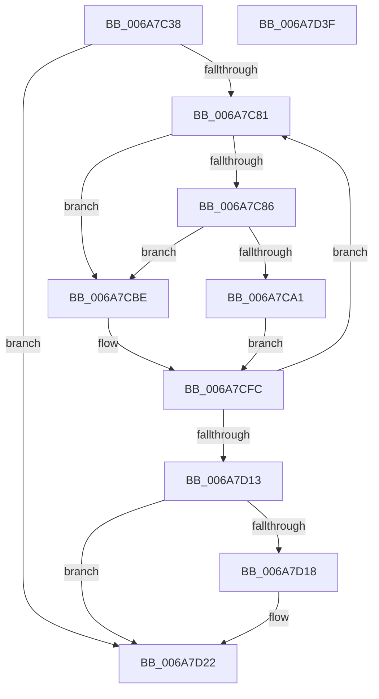

# HvlpSecureFlushLargeRangeList

- RVA: `0x006A7C38`–`0x006A7D40` (길이 `264` bytes)
- VA: `0x00000001406A7C38`
- 실행 섹션: `.text`
- PDB 이름 있음: `예`; PDB Function 태그: `아니요`
- unwind 정보 RVA: `0x000C7B88`
- 디코드: `79`개 명령, `264/264` bytes 표시
- 미해석 바이트: `0` (있으면 어셈블리에 `.byte`로 보존)

> 이 문서는 커널 이미지의 기계어와 PDB 기호를 분석해 생성했습니다. 4번과 5번은 함수 원형과 자료형을 바이너리 사용 방식에서 추정한 C 해석이며 원본 소스 복구 결과는 아닙니다.

## 1. Dependencies

- 직접 호출 지점: **5**; 고유 호출 대상: **5**
- 직접 호출자로 확인된 함수: **2**
- RIP 상대 이미지 참조: **0**

### Outgoing calls
- `0x006A7C94` → [HvlpAcquireHypercallPage](../47/HvlpAcquireHypercallPage_function_00471410.md) (function, `0x00471410`)
- `0x006A7CB7` → [VslFastFlushSecureRangeList](../46/VslFastFlushSecureRangeList_function_00462168.md) (function, `0x00462168`)
- `0x006A7CD5` → [memcpy](../6C/memcpy_function_006C6840.md) (function, `0x006C6840`)
- `0x006A7CF7` → [VslSlowFlushSecureRangeList](../31/VslSlowFlushSecureRangeList_function_00314D44.md) (function, `0x00314D44`)
- `0x006A7D1D` → [HvlpReleaseHypercallPage](../31/HvlpReleaseHypercallPage_function_00313480.md) (function, `0x00313480`)

### Direct callers
- [sub_00313017](../31/Unknown_function_00313017.md) at `0x003130C4`
- [HvlpSlowFlushListTbEx](../4A/HvlpSlowFlushListTbEx_function_004AFCF8.md) at `0x004AFF83`

### Static image references
- 디코드된 RIP-relative 메모리 참조가 없습니다.

## 2. Other-region calls and transfers

- 다른 실행 섹션으로 향하는 call: **0**
- 별도 외부 분기/꼬리 이동을 확인하지 못했습니다.

## 3. Assembly (complete function range)

```asm
006A7C38  4C 8B DC                        mov r11, rsp
006A7C3B  49 89 5B 08                     mov qword ptr [r11 + 8], rbx
006A7C3F  49 89 6B 18                     mov qword ptr [r11 + 0x18], rbp
006A7C43  49 89 73 20                     mov qword ptr [r11 + 0x20], rsi
006A7C47  57                              push rdi
006A7C48  41 56                           push r14
006A7C4A  41 57                           push r15
006A7C4C  48 83 EC 50                     sub rsp, 0x50
006A7C50  33 C0                           xor eax, eax
006A7C52  C6 44 24 78 00                  mov byte ptr [rsp + 0x78], 0
006A7C57  89 44 24 34                     mov dword ptr [rsp + 0x34], eax
006A7C5B  0F 57 C0                        xorps xmm0, xmm0
006A7C5E  49 21 43 C8                     and qword ptr [r11 - 0x38], rax
006A7C62  33 FF                           xor edi, edi
006A7C64  F3 0F 7F 44 24 38               movdqu xmmword ptr [rsp + 0x38], xmm0
006A7C6A  49 21 43 E0                     and qword ptr [r11 - 0x20], rax
006A7C6E  4D 8B F0                        mov r14, r8
006A7C71  8B F2                           mov esi, edx
006A7C73  44 8B F9                        mov r15d, ecx
006A7C76  40 B5 01                        mov bpl, 1
006A7C79  85 D2                           test edx, edx
006A7C7B  0F 84 A1 00 00 00               je 0x1406a7d22
006A7C81  48 85 FF                        test rdi, rdi
006A7C84  75 38                           jne 0x1406a7cbe
006A7C86  45 33 C9                        xor r9d, r9d
006A7C89  8D 57 05                        lea edx, [rdi + 5]
006A7C8C  45 33 C0                        xor r8d, r8d
006A7C8F  48 8D 4C 24 30                  lea rcx, [rsp + 0x30]
006A7C94  E8 77 97 DC FF                  call 0x140471410
006A7C99  48 8B F8                        mov rdi, rax
006A7C9C  48 85 C0                        test rax, rax
006A7C9F  75 1D                           jne 0x1406a7cbe
006A7CA1  8D 58 0B                        lea ebx, [rax + 0xb]
006A7CA4  49 8B D6                        mov rdx, r14
006A7CA7  3B F3                           cmp esi, ebx
006A7CA9  4C 8D 4C 24 78                  lea r9, [rsp + 0x78]
006A7CAE  41 8B CF                        mov ecx, r15d
006A7CB1  0F 42 DE                        cmovb ebx, esi
006A7CB4  44 8B C3                        mov r8d, ebx
006A7CB7  E8 AC A4 DB FF                  call 0x140462168
006A7CBC  EB 3E                           jmp 0x1406a7cfc
006A7CBE  BB 00 02 00 00                  mov ebx, 0x200
006A7CC3  49 8B D6                        mov rdx, r14
006A7CC6  3B F3                           cmp esi, ebx
006A7CC8  48 8B CF                        mov rcx, rdi
006A7CCB  0F 42 DE                        cmovb ebx, esi
006A7CCE  44 8B C3                        mov r8d, ebx
006A7CD1  49 C1 E0 03                     shl r8, 3
006A7CD5  E8 66 EB 01 00                  call 0x1406c6840
006A7CDA  48 8B 4C 24 48                  mov rcx, qword ptr [rsp + 0x48]
006A7CDF  48 8D 44 24 78                  lea rax, [rsp + 0x78]
006A7CE4  48 89 44 24 28                  mov qword ptr [rsp + 0x28], rax
006A7CE9  44 8B CB                        mov r9d, ebx
006A7CEC  83 64 24 20 00                  and dword ptr [rsp + 0x20], 0
006A7CF1  45 8B C7                        mov r8d, r15d
006A7CF4  48 8B D7                        mov rdx, rdi
006A7CF7  E8 48 D0 C6 FF                  call 0x140314d44
006A7CFC  8A 44 24 78                     mov al, byte ptr [rsp + 0x78]
006A7D00  4D 8D 34 DE                     lea r14, [r14 + rbx*8]
006A7D04  F6 D8                           neg al
006A7D06  1A C9                           sbb cl, cl
006A7D08  40 22 E9                        and bpl, cl
006A7D0B  2B F3                           sub esi, ebx
006A7D0D  0F 85 6E FF FF FF               jne 0x1406a7c81
006A7D13  48 85 FF                        test rdi, rdi
006A7D16  74 0A                           je 0x1406a7d22
006A7D18  48 8D 4C 24 30                  lea rcx, [rsp + 0x30]
006A7D1D  E8 5E B7 C6 FF                  call 0x140313480
006A7D22  4C 8D 5C 24 50                  lea r11, [rsp + 0x50]
006A7D27  40 8A C5                        mov al, bpl
006A7D2A  49 8B 5B 20                     mov rbx, qword ptr [r11 + 0x20]
006A7D2E  49 8B 6B 30                     mov rbp, qword ptr [r11 + 0x30]
006A7D32  49 8B 73 38                     mov rsi, qword ptr [r11 + 0x38]
006A7D36  49 8B E3                        mov rsp, r11
006A7D39  41 5F                           pop r15
006A7D3B  41 5E                           pop r14
006A7D3D  5F                              pop rdi
006A7D3E  C3                              ret
006A7D3F  CC                              int3
```

## 4. C-style interpretation (structured pseudocode)

```c
__int64 __fastcall HvlpSecureFlushLargeRangeList(int a1, int a2, __int64 a3, int a4)
{
    __int64 result;
    __int64 v_rbp;
    __int64 v_rbx;
    __int64 v_rdi;
    __int64 v_rsi;
    __int64 v_rsp;
    unsigned __int64 v_stack_m18;
    unsigned __int64 v_stack_m20;
    unsigned __int64 v_stack_m30;
    unsigned int v_stack_m34;
    unsigned __int64 v_stack_m38;
    unsigned __int64 v_stack_m40;
    unsigned int v_stack_m48;
    unsigned __int8 v_stack_p10;

    *(unsigned __int64 *)(v_rsp + 8) = v_rbx;
    *(unsigned __int64 *)(v_rsp + 24) = v_rbp;
    *(unsigned __int64 *)(v_rsp + 32) = v_rsi;
    v_rsp = (v_rsp) - (80);
    result = 0;
    v_stack_p10 = 0;
    v_stack_m34 = 0;
    v_rdi = 0;
    v_stack_m30 = v_xmm0;
    if (a2 == 0) goto loc_006A7D22;
loc_006A7C81:
    if (0 != 0) goto loc_006A7CBE;
    a4 = 0;
    a3 = 0;
    result = HvlpAcquireHypercallPage(v_stack_m38, v_rdi + 5, a3, a4);
    if (result != 0) goto loc_006A7CBE;
    v_rbx = result + 11;
    if (((unsigned int)((unsigned int)(a2))) < ((unsigned int)(result + 11))) { v_rbx = (unsigned int)((unsigned int)(a2)); }
    result = VslFastFlushSecureRangeList((unsigned int)((unsigned int)((unsigned int)(a1))), 0, (unsigned int)((unsigned int)(v_rbx)), v_stack_p10);
    goto loc_006A7CFC;
loc_006A7CBE:
    v_rbx = 512;
    if (((unsigned int)((unsigned int)(a2))) < 512) { v_rbx = (unsigned int)((unsigned int)(a2)); }
    a3 = ((unsigned int)((unsigned int)(v_rbx))) << (3);
    result = memcpy(result, 0, a3, v_stack_p10);
    v_stack_m40 = v_stack_p10;
    result = VslSlowFlushSecureRangeList(v_stack_m20, result, (unsigned int)((unsigned int)((unsigned int)(a1))), (unsigned int)((unsigned int)(v_rbx)));
loc_006A7CFC:
    result = (unsigned __int8)(-(v_stack_p10));
    v_rbp = (unsigned __int8)((1) & ((unsigned __int8)(v_stack_m20)));
    v_rsi = (unsigned int)(((unsigned int)(a2)) - ((unsigned int)(v_rbx)));
    if (condition_is_not_equal) goto loc_006A7C81;
    if (result != 0) {
        a1 = v_stack_m38;
        result = HvlpReleaseHypercallPage(a1, result, (unsigned int)((unsigned int)((unsigned int)(a1))), (unsigned int)((unsigned int)(v_rbx)));
    }
    return (unsigned __int8)(v_rbp);
}
```

## 5. (Beta) C Style

```c
int64_t HvlpSecureFlushLargeRangeList(int32_t Arg1, int32_t Arg2, void *Arg3, int32_t Arg4)
{
    uint8_t *arg3 = (uint8_t *)Arg3;

    int64_t result;
    int64_t local_rbp;
    int64_t local_rbx;
    int64_t local_rdi;
    int64_t local_rsi;
    int64_t local_rsp;
    uint64_t v_stack_m18;
    uint64_t v_stack_m20;
    uint64_t v_stack_m30;
    uint32_t v_stack_m34;
    uint64_t v_stack_m38;
    uint64_t v_stack_m40;
    uint32_t v_stack_m48;
    uint8_t v_stack_p10;

    *(uint64_t *)(local_rsp + 0x8) = local_rbx;
    *(uint64_t *)(local_rsp + 0x18) = local_rbp;
    *(uint64_t *)(local_rsp + 0x20) = local_rsi;
    local_rsp = (local_rsp) - (80);
    result = 0;
    v_stack_p10 = 0;
    v_stack_m34 = 0;
    local_rdi = 0;
    v_stack_m30 = v_xmm0;
    if (Arg2 == 0) goto loc_006A7D22;
loc_006A7C81:
    if (0 != 0) goto loc_006A7CBE;
    Arg4 = 0;
    Arg3 = 0;
    result = HvlpAcquireHypercallPage(v_stack_m38, local_rdi + 5, Arg3, Arg4);
    if (result != 0) goto loc_006A7CBE;
    local_rbx = result + 11;
    if (((uint32_t)((uint32_t)(Arg2))) < ((uint32_t)(result + 11))) { local_rbx = (uint32_t)((uint32_t)(Arg2)); }
    result = VslFastFlushSecureRangeList((uint32_t)((uint32_t)((uint32_t)(Arg1))), 0, (uint32_t)((uint32_t)(local_rbx)), v_stack_p10);
    goto loc_006A7CFC;
loc_006A7CBE:
    local_rbx = 512;
    if (((uint32_t)((uint32_t)(Arg2))) < 512) { local_rbx = (uint32_t)((uint32_t)(Arg2)); }
    Arg3 = ((uint32_t)((uint32_t)(local_rbx))) << (3);
    result = memcpy(result, 0, Arg3, v_stack_p10);
    v_stack_m40 = v_stack_p10;
    result = VslSlowFlushSecureRangeList(v_stack_m20, result, (uint32_t)((uint32_t)((uint32_t)(Arg1))), (uint32_t)((uint32_t)(local_rbx)));
loc_006A7CFC:
    result = (uint8_t)(-(v_stack_p10));
    local_rbp = (uint8_t)((1) & ((uint8_t)(v_stack_m20)));
    local_rsi = (uint32_t)(((uint32_t)(Arg2)) - ((uint32_t)(local_rbx)));
    if (condition_is_not_equal) goto loc_006A7C81;
    if (result != 0) {
        Arg1 = v_stack_m38;
        result = HvlpReleaseHypercallPage(Arg1, result, (uint32_t)((uint32_t)((uint32_t)(Arg1))), (uint32_t)((uint32_t)(local_rbx)));
    }
    return (uint8_t)(local_rbp);
}
```

### 관측된 메모리 오프셋

구조체 형식이 확인되지 않은 접근은 인자 기준의 오프셋으로만 기록했습니다.

| 기준 인자 | 오프셋 표현 | 폭 (bit) | 접근 |
|---|---:|---:|---|
| `Arg3` | `+ 0x0 + rbx*8` | `64` | `R` |

## 6. Execution-region graph

[열기: 2D/3D 그래프와 함수 탐색 컨트롤 패널](../../../control-panel.html?section=text&rva=0x006A7C38&view=graph)

- 2D 그래프는 위에서 아래로 흐르고, 3D 그래프는 빈 공간을 드래그해 회전합니다. Shift+드래그는 이동, 휠은 확대·축소, 함수 노드 선택은 대상 보고서 이동입니다.

### Static fallback


