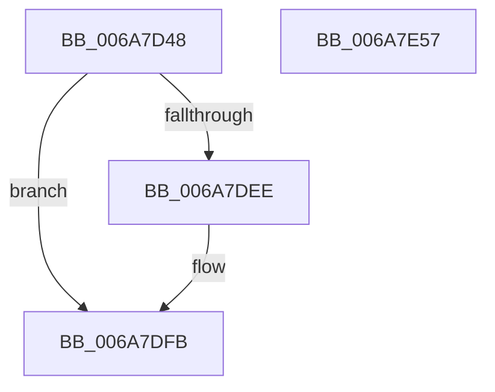

# HvlpSlowFlushAddressSpaceTbEx

- RVA: `0x006A7D48`–`0x006A7E58` (길이 `272` bytes)
- VA: `0x00000001406A7D48`
- 실행 섹션: `.text`
- PDB 이름 있음: `예`; PDB Function 태그: `아니요`
- unwind 정보 RVA: `0x000DB18C`
- 디코드: `69`개 명령, `272/272` bytes 표시
- 미해석 바이트: `0` (있으면 어셈블리에 `.byte`로 보존)

> 이 문서는 커널 이미지의 기계어와 PDB 기호를 분석해 생성했습니다. 4번과 5번은 함수 원형과 자료형을 바이너리 사용 방식에서 추정한 C 해석이며 원본 소스 복구 결과는 아닙니다.

## 1. Dependencies

- 직접 호출 지점: **6**; 고유 호출 대상: **5**
- 직접 호출자로 확인된 함수: **3**
- RIP 상대 이미지 참조: **1**

### Outgoing calls
- `0x006A7D99` → [HvlpAcquireHypercallPage](../47/HvlpAcquireHypercallPage_function_00471410.md) (function, `0x00471410`)
- `0x006A7DE4` → [HvlpAffinityToHvProcessorSet](../30/HvlpAffinityToHvProcessorSet_function_003068F4.md) (function, `0x003068F4`)
- `0x006A7DF6` → [HvlpAffinityToHvProcessorSet](../30/HvlpAffinityToHvProcessorSet_function_003068F4.md) (function, `0x003068F4`)
- `0x006A7E23` → [HvcallInitiateHypercall](../31/HvcallInitiateHypercall_function_00313630.md) (function, `0x00313630`)
- `0x006A7E2D` → [HvlpReleaseHypercallPage](../31/HvlpReleaseHypercallPage_function_00313480.md) (function, `0x00313480`)
- `0x006A7E3D` → [_security_check_cookie](_security_check_cookie_function_006AC640.md) (function, `0x006AC640`)

### Direct callers
- [KiFlushAddressSpaceTb](../30/KiFlushAddressSpaceTb_function_00308F50.md) at `0x0030905B`
- [KeFlushCurrentTbOnly](../31/KeFlushCurrentTbOnly_function_003134EC.md) at `0x003135CD`
- [sub_00314667](../31/Unknown_function_00314667.md) at `0x0031472C`

### Static image references
- `0x006A7D5A` → RVA `0x00E0A740` (`.data`; read)

## 2. Other-region calls and transfers

- 다른 실행 섹션으로 향하는 call: **0**
- 별도 외부 분기/꼬리 이동을 확인하지 못했습니다.

## 3. Assembly (complete function range)

```asm
006A7D48  48 89 5C 24 08                  mov qword ptr [rsp + 8], rbx
006A7D4D  48 89 74 24 18                  mov qword ptr [rsp + 0x18], rsi
006A7D52  57                              push rdi
006A7D53  48 81 EC 10 01 00 00            sub rsp, 0x110
006A7D5A  48 8B 05 DF 29 76 00            mov rax, qword ptr [rip + 0x7629df]
006A7D61  48 33 C4                        xor rax, rsp
006A7D64  48 89 84 24 08 01 00 00         mov qword ptr [rsp + 0x108], rax
006A7D6C  33 C0                           xor eax, eax
006A7D6E  41 8A D8                        mov bl, r8b
006A7D71  48 8B F2                        mov rsi, rdx
006A7D74  48 89 44 24 38                  mov qword ptr [rsp + 0x38], rax
006A7D79  48 8B F9                        mov rdi, rcx
006A7D7C  89 44 24 40                     mov dword ptr [rsp + 0x40], eax
006A7D80  0F 57 C0                        xorps xmm0, xmm0
006A7D83  4C 8D 44 24 48                  lea r8, [rsp + 0x48]
006A7D88  44 8D 48 60                     lea r9d, [rax + 0x60]
006A7D8C  8D 50 01                        lea edx, [rax + 1]
006A7D8F  48 8D 4C 24 28                  lea rcx, [rsp + 0x28]
006A7D94  0F 11 44 24 28                  movups xmmword ptr [rsp + 0x28], xmm0
006A7D99  E8 72 96 DC FF                  call 0x140471410
006A7D9E  4C 8B C8                        mov r9, rax
006A7DA1  F6 DB                           neg bl
006A7DA3  48 8B CE                        mov rcx, rsi
006A7DA6  45 1B C0                        sbb r8d, r8d
006A7DA9  48 89 38                        mov qword ptr [rax], rdi
006A7DAC  41 F7 D0                        not r8d
006A7DAF  41 83 E0 04                     and r8d, 4
006A7DB3  49 8D 59 10                     lea rbx, [r9 + 0x10]
006A7DB7  41 8B C0                        mov eax, r8d
006A7DBA  48 8B D3                        mov rdx, rbx
006A7DBD  83 C8 02                        or eax, 2
006A7DC0  48 85 FF                        test rdi, rdi
006A7DC3  41 0F 45 C0                     cmovne eax, r8d
006A7DC7  49 89 41 08                     mov qword ptr [r9 + 8], rax
006A7DCB  8B 44 24 28                     mov eax, dword ptr [rsp + 0x28]
006A7DCF  24 02                           and al, 2
006A7DD1  F6 D8                           neg al
006A7DD3  45 1B C0                        sbb r8d, r8d
006A7DD6  41 81 E0 60 F0 FF FF            and r8d, 0xfffff060
006A7DDD  41 81 C0 E0 0F 00 00            add r8d, 0xfe0
006A7DE4  E8 0B EB C5 FF                  call 0x1403068f4
006A7DE9  83 F8 FF                        cmp eax, -1
006A7DEC  75 0D                           jne 0x1406a7dfb
006A7DEE  45 33 C0                        xor r8d, r8d
006A7DF1  48 8B D3                        mov rdx, rbx
006A7DF4  33 C9                           xor ecx, ecx
006A7DF6  E8 F9 EA C5 FF                  call 0x1403068f4
006A7DFB  48 8B 54 24 40                  mov rdx, qword ptr [rsp + 0x40]
006A7E00  83 C0 07                        add eax, 7
006A7E03  C1 E0 0E                        shl eax, 0xe
006A7E06  45 33 C0                        xor r8d, r8d
006A7E09  25 00 00 FE 03                  and eax, 0x3fe0000
006A7E0E  48 C7 44 24 20 13 00 00 00      mov qword ptr [rsp + 0x20], 0x13
006A7E17  83 C8 13                        or eax, 0x13
006A7E1A  89 44 24 20                     mov dword ptr [rsp + 0x20], eax
006A7E1E  48 8B 4C 24 20                  mov rcx, qword ptr [rsp + 0x20]
006A7E23  E8 08 B8 C6 FF                  call 0x140313630
006A7E28  48 8D 4C 24 28                  lea rcx, [rsp + 0x28]
006A7E2D  E8 4E B6 C6 FF                  call 0x140313480
006A7E32  48 8B 8C 24 08 01 00 00         mov rcx, qword ptr [rsp + 0x108]
006A7E3A  48 33 CC                        xor rcx, rsp
006A7E3D  E8 FE 47 00 00                  call 0x1406ac640
006A7E42  4C 8D 9C 24 10 01 00 00         lea r11, [rsp + 0x110]
006A7E4A  49 8B 5B 10                     mov rbx, qword ptr [r11 + 0x10]
006A7E4E  49 8B 73 20                     mov rsi, qword ptr [r11 + 0x20]
006A7E52  49 8B E3                        mov rsp, r11
006A7E55  5F                              pop rdi
006A7E56  C3                              ret
006A7E57  CC                              int3
```

## 4. C-style interpretation (structured pseudocode)

```c
__int64 __fastcall HvlpSlowFlushAddressSpaceTbEx(__int64 a1, __int64 a2, unsigned __int8 a3)
{
    __int64 result;
    __int64 v_rbx;
    __int64 v_rsp;
    unsigned __int64 v_stack_m10;
    unsigned __int64 v_stack_m8;
    unsigned __int64 v_stack_mD0;
    unsigned int v_stack_mD8;
    unsigned __int64 v_stack_mE0;
    unsigned __int64 v_stack_mF0;
    unsigned __int64 v_stack_mF8;
    unsigned __int64 v_stack_p18;
    unsigned __int64 v_stack_p8;

    v_stack_p8 = v_rbx;
    v_stack_p18 = v_rsi;
    v_rsp = (v_rsp) - (272);
    result = (*(unsigned __int64 *)(v_rip + 7743967)) ^ (v_rsp);
    v_stack_m10 = result;
    result = 0;
    v_stack_mE0 = 0;
    v_stack_mD8 = 0;
    v_stack_mF0 = v_xmm0;
    result = HvlpAcquireHypercallPage(v_stack_mF0, result + 1, v_stack_mD0, result + 96);
    v_rbx = (unsigned __int8)(-(a3));
    *(unsigned __int64 *)(result) = a1;
    a3 = (unsigned int)(~(v_stack_mD0));
    a3 = (unsigned int)((a3) & (4));
    result = (unsigned int)(((unsigned int)(a3)) | (2));
    if (a1 != 0) { result = a3; }
    *(unsigned __int64 *)(result + 8) = result;
    result = (unsigned __int8)(((unsigned int)(v_stack_mF0)) & (2));
    result = (unsigned __int8)(-(result));
    a3 = (unsigned int)((a3) & (0xFFFFF060ULL));
    a3 = (unsigned int)((a3) + (0xFE0ULL));
    result = HvlpAffinityToHvProcessorSet(a2, result + 16, a3, result);
    if (((unsigned int)(result)) == -1) {
        a3 = 0;
        a2 = result + 16;
        a1 = 0;
        result = HvlpAffinityToHvProcessorSet(a1, a2, a3, result);
    }
    result = (unsigned int)((result) + (7));
    result = (unsigned int)((result) << (14));
    a3 = 0;
    result = (unsigned int)((result) & (0x3FE0000ULL));
    v_stack_mF8 = 19;
    result = (unsigned int)((result) | (19));
    v_stack_mF8 = (unsigned int)(result);
    result = HvcallInitiateHypercall(v_stack_mF8, v_stack_mD8, a3, result);
    result = HvlpReleaseHypercallPage(v_stack_mF0, v_stack_mD8, a3, result);
    a1 = (v_stack_m10) ^ (v_rsp);
    result = _security_check_cookie(a1, v_stack_mD8, a3, result);
    return result;
}
```

## 5. (Beta) C Style

```c
int64_t HvlpSlowFlushAddressSpaceTbEx(int64_t Arg1, int64_t Arg2, uint8_t Arg3)
{
    int64_t result;
    int64_t local_rbx;
    int64_t local_rsp;
    uint64_t v_stack_m10;
    uint64_t v_stack_m8;
    uint64_t v_stack_mD0;
    uint32_t v_stack_mD8;
    uint64_t v_stack_mE0;
    uint64_t v_stack_mF0;
    uint64_t v_stack_mF8;
    uint64_t v_stack_p18;
    uint64_t v_stack_p8;

    v_stack_p8 = local_rbx;
    v_stack_p18 = local_rsi;
    local_rsp = (local_rsp) - (272);
    result = (*(uint64_t *)(v_rip + 0x7629DF)) ^ (local_rsp);
    v_stack_m10 = result;
    result = 0;
    v_stack_mE0 = 0;
    v_stack_mD8 = 0;
    v_stack_mF0 = v_xmm0;
    result = HvlpAcquireHypercallPage(v_stack_mF0, result + 1, v_stack_mD0, result + 96);
    local_rbx = (uint8_t)(-(Arg3));
    *(uint64_t *)(result) = Arg1;
    Arg3 = (uint32_t)(~(v_stack_mD0));
    Arg3 = (uint32_t)((Arg3) & (4));
    result = (uint32_t)(((uint32_t)(Arg3)) | (2));
    if (Arg1 != 0) { result = Arg3; }
    *(uint64_t *)(result + 0x8) = result;
    result = (uint8_t)(((uint32_t)(v_stack_mF0)) & (2));
    result = (uint8_t)(-(result));
    Arg3 = (uint32_t)((Arg3) & (0xFFFFF060ULL));
    Arg3 = (uint32_t)((Arg3) + (0xFE0ULL));
    result = HvlpAffinityToHvProcessorSet(Arg2, result + 16, Arg3, result);
    if (((uint32_t)(result)) == -1) {
        Arg3 = 0;
        Arg2 = result + 16;
        Arg1 = 0;
        result = HvlpAffinityToHvProcessorSet(Arg1, Arg2, Arg3, result);
    }
    result = (uint32_t)((result) + (7));
    result = (uint32_t)((result) << (14));
    Arg3 = 0;
    result = (uint32_t)((result) & (0x3FE0000ULL));
    v_stack_mF8 = 19;
    result = (uint32_t)((result) | (19));
    v_stack_mF8 = (uint32_t)(result);
    result = HvcallInitiateHypercall(v_stack_mF8, v_stack_mD8, Arg3, result);
    result = HvlpReleaseHypercallPage(v_stack_mF0, v_stack_mD8, Arg3, result);
    Arg1 = (v_stack_m10) ^ (local_rsp);
    result = _security_check_cookie(Arg1, v_stack_mD8, Arg3, result);
    return result;
}
```

## 6. Execution-region graph

[열기: 2D/3D 그래프와 함수 탐색 컨트롤 패널](../../../control-panel.html?section=text&rva=0x006A7D48&view=graph)

- 2D 그래프는 위에서 아래로 흐르고, 3D 그래프는 빈 공간을 드래그해 회전합니다. Shift+드래그는 이동, 휠은 확대·축소, 함수 노드 선택은 대상 보고서 이동입니다.

### Static fallback


