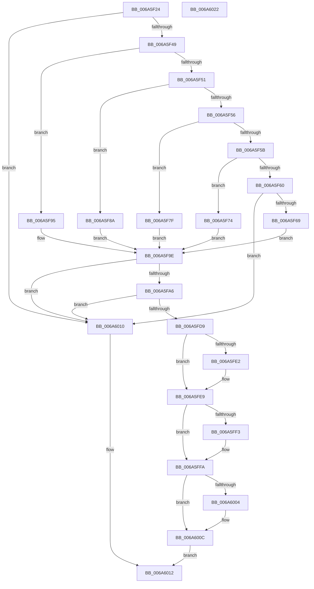

# I_MinCryptIsCertificateHashRevokedV2

- RVA: `0x006A5F24`–`0x006A6023` (길이 `255` bytes)
- VA: `0x00000001406A5F24`
- 실행 섹션: `.text`
- PDB 이름 있음: `예`; PDB Function 태그: `예`
- unwind 정보 RVA: `0x000794E0`
- 디코드: `75`개 명령, `255/255` bytes 표시
- 미해석 바이트: `0` (있으면 어셈블리에 `.byte`로 보존)

> 이 문서는 커널 이미지의 기계어와 PDB 기호를 분석해 생성했습니다. 4번과 5번은 함수 원형과 자료형을 바이너리 사용 방식에서 추정한 C 해석이며 원본 소스 복구 결과는 아닙니다.

## 1. Dependencies

- 직접 호출 지점: **1**; 고유 호출 대상: **1**
- 직접 호출자로 확인된 함수: **2**
- RIP 상대 이미지 참조: **2**

### Outgoing calls
- `0x006A5FCF` → [bsearch_s](../50/bsearch_s_function_00500540.md) (function, `0x00500540`)

### Direct callers
- [MinCryptVerifyCertificateWithPolicy2](../../page/83/MinCryptVerifyCertificateWithPolicy2_function_008368A8.md) at `0x00836E98`
- [MincryptIsTimestampBeforeRevocation](../../page/83/MincryptIsTimestampBeforeRevocation_function_00837A68.md) at `0x00837ADE`

### Static image references
- `0x006A5F33` → RVA `0x00FD8098` (`PAGEDATA`; read)
- `0x006A5FBE` → RVA `0x008376F0` (`I_MinCryptHashSearchCompare`; read)

## 2. Other-region calls and transfers

- 다른 실행 섹션으로 향하는 call: **0**
- 별도 외부 분기/꼬리 이동을 확인하지 못했습니다.

## 3. Assembly (complete function range)

```asm
006A5F24  48 89 5C 24 08                  mov qword ptr [rsp + 8], rbx
006A5F29  48 89 74 24 10                  mov qword ptr [rsp + 0x10], rsi
006A5F2E  57                              push rdi
006A5F2F  48 83 EC 30                     sub rsp, 0x30
006A5F33  4C 8B 1D 5E 21 93 00            mov r11, qword ptr [rip + 0x93215e]
006A5F3A  49 8B F9                        mov rdi, r9
006A5F3D  48 8B F2                        mov rsi, rdx
006A5F40  4D 85 DB                        test r11, r11
006A5F43  0F 84 C7 00 00 00               je 0x1406a6010
006A5F49  81 E9 03 80 00 00               sub ecx, 0x8003
006A5F4F  74 44                           je 0x1406a5f95
006A5F51  83 E9 01                        sub ecx, 1
006A5F54  74 34                           je 0x1406a5f8a
006A5F56  83 E9 08                        sub ecx, 8
006A5F59  74 24                           je 0x1406a5f7f
006A5F5B  83 E9 01                        sub ecx, 1
006A5F5E  74 14                           je 0x1406a5f74
006A5F60  83 F9 01                        cmp ecx, 1
006A5F63  0F 85 A7 00 00 00               jne 0x1406a6010
006A5F69  B8 90 00 00 00                  mov eax, 0x90
006A5F6E  44 8D 50 08                     lea r10d, [rax + 8]
006A5F72  EB 2A                           jmp 0x1406a5f9e
006A5F74  B8 80 00 00 00                  mov eax, 0x80
006A5F79  44 8D 50 08                     lea r10d, [rax + 8]
006A5F7D  EB 1F                           jmp 0x1406a5f9e
006A5F7F  B8 70 00 00 00                  mov eax, 0x70
006A5F84  44 8D 50 08                     lea r10d, [rax + 8]
006A5F88  EB 14                           jmp 0x1406a5f9e
006A5F8A  B8 60 00 00 00                  mov eax, 0x60
006A5F8F  44 8D 50 08                     lea r10d, [rax + 8]
006A5F93  EB 09                           jmp 0x1406a5f9e
006A5F95  B8 50 00 00 00                  mov eax, 0x50
006A5F9A  44 8D 50 08                     lea r10d, [rax + 8]
006A5F9E  42 8B 04 18                     mov eax, dword ptr [rax + r11]
006A5FA2  85 C0                           test eax, eax
006A5FA4  74 6A                           je 0x1406a6010
006A5FA6  41 8D 48 0C                     lea ecx, [r8 + 0xc]
006A5FAA  41 8B D8                        mov ebx, r8d
006A5FAD  33 D2                           xor edx, edx
006A5FAF  44 8B C9                        mov r9d, ecx
006A5FB2  F7 F1                           div ecx
006A5FB4  4B 8B 14 1A                     mov rdx, qword ptr [r10 + r11]
006A5FB8  48 8B CE                        mov rcx, rsi
006A5FBB  44 8B C0                        mov r8d, eax
006A5FBE  48 8D 05 2B 17 19 00            lea rax, [rip + 0x19172b]
006A5FC5  48 89 5C 24 28                  mov qword ptr [rsp + 0x28], rbx
006A5FCA  48 89 44 24 20                  mov qword ptr [rsp + 0x20], rax
006A5FCF  E8 6C A5 E5 FF                  call 0x140500540
006A5FD4  48 85 C0                        test rax, rax
006A5FD7  74 37                           je 0x1406a6010
006A5FD9  8B 4C 03 08                     mov ecx, dword ptr [rbx + rax + 8]
006A5FDD  48 85 FF                        test rdi, rdi
006A5FE0  74 07                           je 0x1406a5fe9
006A5FE2  48 8B 04 03                     mov rax, qword ptr [rbx + rax]
006A5FE6  48 89 07                        mov qword ptr [rdi], rax
006A5FE9  48 8B 54 24 60                  mov rdx, qword ptr [rsp + 0x60]
006A5FEE  48 85 D2                        test rdx, rdx
006A5FF1  74 07                           je 0x1406a5ffa
006A5FF3  8B C1                           mov eax, ecx
006A5FF5  C1 E8 1F                        shr eax, 0x1f
006A5FF8  88 02                           mov byte ptr [rdx], al
006A5FFA  48 8B 44 24 68                  mov rax, qword ptr [rsp + 0x68]
006A5FFF  48 85 C0                        test rax, rax
006A6002  74 08                           je 0x1406a600c
006A6004  81 E1 FF FF FF 0F               and ecx, 0xfffffff
006A600A  89 08                           mov dword ptr [rax], ecx
006A600C  B0 01                           mov al, 1
006A600E  EB 02                           jmp 0x1406a6012
006A6010  32 C0                           xor al, al
006A6012  48 8B 5C 24 40                  mov rbx, qword ptr [rsp + 0x40]
006A6017  48 8B 74 24 48                  mov rsi, qword ptr [rsp + 0x48]
006A601C  48 83 C4 30                     add rsp, 0x30
006A6020  5F                              pop rdi
006A6021  C3                              ret
006A6022  CC                              int3
```

## 4. C-style interpretation (structured pseudocode)

```c
__int64 __fastcall I_MinCryptIsCertificateHashRevokedV2(int a1, __int64 a2, __int64 a3, __int64 a4, __int64 a5, __int64 a6)
{
    __int64 result;
    __int64 v_rsp;
    unsigned __int64 v_stack_m10;
    unsigned __int64 v_stack_m18;
    unsigned __int64 v_stack_p10;
    unsigned __int64 v_stack_p8;

    v_stack_p8 = v_rbx;
    v_stack_p10 = v_rsi;
    v_rsp = (v_rsp) - (48);
    if (*(unsigned __int64 *)(v_rip + 9642334) == 0) goto loc_006A6010;
    a1 = (unsigned int)((a1) - (0x8003ULL));
    if (condition_is_equal) goto loc_006A5F95;
    a1 = (unsigned int)((a1) - (1));
    if (condition_is_equal) goto loc_006A5F8A;
    a1 = (unsigned int)((a1) - (8));
    if (condition_is_equal) goto loc_006A5F7F;
    a1 = (unsigned int)((a1) - (1));
    if (condition_is_equal) goto loc_006A5F74;
    if (a1 != 1) goto loc_006A6010;
    goto loc_006A5F9E;
loc_006A5F74:
    goto loc_006A5F9E;
loc_006A5F7F:
    goto loc_006A5F9E;
loc_006A5F8A:
    goto loc_006A5F9E;
loc_006A5F95:
loc_006A5F9E:
    if ((unsigned int)((unsigned int)(*(unsigned int *)(80 + *(unsigned __int64 *)(v_rip + 9642334) * 1))) == 0) goto loc_006A6010;
    a2 = 0;
    v_stack_m10 = (unsigned int)((unsigned int)(a3));
    v_stack_m18 = v_rip + 1644331;
    result = bsearch_s(0, *(unsigned __int64 *)(80 + 8 + *(unsigned __int64 *)(v_rip + 9642334) * 1), (unsigned int)((unsigned int)((unsigned int)(*(unsigned int *)(80 + *(unsigned __int64 *)(v_rip + 9642334) * 1)))), (unsigned int)((unsigned int)(a3 + 12)));
    if (result == 0) goto loc_006A6010;
    if (a4 != 0) {
        result = *(unsigned __int64 *)((unsigned int)((unsigned int)(a3)) + result * 1);
        *(unsigned __int64 *)(a4) = result;
    }
    if (a5 != 0) {
        result = (unsigned int)((unsigned int)(*(unsigned int *)((unsigned int)((unsigned int)(a3)) + result * 1 + 8)));
        result = (unsigned int)((result) >> (31));
        *(unsigned __int8 *)(a5) = (unsigned __int8)(result);
    }
    if (a6 != 0) {
        a1 = (unsigned int)(((unsigned int)(*(unsigned int *)((unsigned int)((unsigned int)(a3)) + result * 1 + 8))) & (0xFFFFFFFULL));
        *(unsigned int *)(a6) = a1;
    }
    goto loc_006A6012;
loc_006A6010:
    result = 0;
loc_006A6012:
    v_rsp = (v_rsp) + (48);
    return result;
}
```

## 5. (Beta) C Style

```c
int64_t I_MinCryptIsCertificateHashRevokedV2(int32_t Arg1, int64_t Arg2, void *Arg3, int64_t Arg4, int64_t Arg5, int64_t Arg6)
{
    uint8_t *arg3 = (uint8_t *)Arg3;

    int64_t result;
    int64_t local_rsp;
    uint64_t v_stack_m10;
    uint64_t v_stack_m18;
    uint64_t v_stack_p10;
    uint64_t v_stack_p8;

    v_stack_p8 = local_rbx;
    v_stack_p10 = local_rsi;
    local_rsp = (local_rsp) - (48);
    if (*(uint64_t *)(v_rip + 0x93215E) == 0) goto loc_006A6010;
    Arg1 = (uint32_t)((Arg1) - (0x8003ULL));
    if (condition_is_equal) goto loc_006A5F95;
    Arg1 = (uint32_t)((Arg1) - (1));
    if (condition_is_equal) goto loc_006A5F8A;
    Arg1 = (uint32_t)((Arg1) - (8));
    if (condition_is_equal) goto loc_006A5F7F;
    Arg1 = (uint32_t)((Arg1) - (1));
    if (condition_is_equal) goto loc_006A5F74;
    if (Arg1 != 1) goto loc_006A6010;
    goto loc_006A5F9E;
loc_006A5F74:
    goto loc_006A5F9E;
loc_006A5F7F:
    goto loc_006A5F9E;
loc_006A5F8A:
    goto loc_006A5F9E;
loc_006A5F95:
loc_006A5F9E:
    if ((uint32_t)((uint32_t)(*(uint32_t *)(80 + *(uint64_t *)(v_rip + 0x93215E) * 1))) == 0) goto loc_006A6010;
    Arg2 = 0;
    v_stack_m10 = (uint32_t)((uint32_t)(Arg3));
    v_stack_m18 = v_rip + 1644331;
    result = bsearch_s(0, *(uint64_t *)(80 + 0x8 + *(uint64_t *)(v_rip + 0x93215E) * 1), (uint32_t)((uint32_t)((uint32_t)(*(uint32_t *)(80 + *(uint64_t *)(v_rip + 0x93215E) * 1)))), (uint32_t)((uint32_t)(Arg3 + 12)));
    if (result == 0) goto loc_006A6010;
    if (Arg4 != 0) {
        result = *(uint64_t *)((uint32_t)((uint32_t)(arg3)) + result * 1);
        *(uint64_t *)(Arg4) = result;
    }
    if (Arg5 != 0) {
        result = (uint32_t)((uint32_t)(*(uint32_t *)((uint32_t)((uint32_t)(arg3)) + result * 1 + 0x8)));
        result = (uint32_t)((result) >> (31));
        *(uint8_t *)(Arg5) = (uint8_t)(result);
    }
    if (Arg6 != 0) {
        Arg1 = (uint32_t)(((uint32_t)(*(uint32_t *)((uint32_t)((uint32_t)(arg3)) + result * 1 + 0x8))) & (0xFFFFFFFULL));
        *(uint32_t *)(Arg6) = Arg1;
    }
    goto loc_006A6012;
loc_006A6010:
    result = 0;
loc_006A6012:
    local_rsp = (local_rsp) + (48);
    return result;
}
```

### 관측된 메모리 오프셋

구조체 형식이 확인되지 않은 접근은 인자 기준의 오프셋으로만 기록했습니다.

| 기준 인자 | 오프셋 표현 | 폭 (bit) | 접근 |
|---|---:|---:|---|
| `Arg3` | `+ 0x0 + rax*1` | `64` | `R` |
| `Arg3` | `+ 0x8 + rax*1` | `32` | `R` |
| `Arg3` | `+ 0xC` | `32` | `R` |

## 6. Execution-region graph

[열기: 2D/3D 그래프와 함수 탐색 컨트롤 패널](../../../control-panel.html?section=text&rva=0x006A5F24&view=graph)

- 2D 그래프는 위에서 아래로 흐르고, 3D 그래프는 빈 공간을 드래그해 회전합니다. Shift+드래그는 이동, 휠은 확대·축소, 함수 노드 선택은 대상 보고서 이동입니다.

### Static fallback


