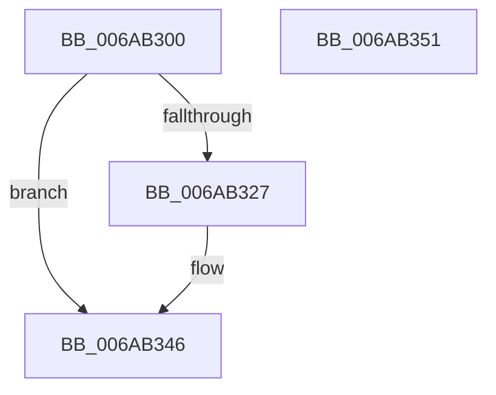

# IaLpssInitializePort

- RVA: `0x006AB300`–`0x006AB352` (길이 `82` bytes)
- VA: `0x00000001406AB300`
- 실행 섹션: `.text`
- PDB 이름 있음: `예`; PDB Function 태그: `아니요`
- unwind 정보 RVA: `0x0006E5F8`
- 디코드: `22`개 명령, `82/82` bytes 표시
- 미해석 바이트: `0` (있으면 어셈블리에 `.byte`로 보존)

> 이 문서는 커널 이미지의 기계어와 PDB 기호를 분석해 생성했습니다. 4번과 5번은 함수 원형과 자료형을 바이너리 사용 방식에서 추정한 C 해석이며 원본 소스 복구 결과는 아닙니다.

## 1. Dependencies

- 직접 호출 지점: **1**; 고유 호출 대상: **1**
- 직접 호출자로 확인된 함수: **0**
- RIP 상대 이미지 참조: **2**

### Outgoing calls
- `0x006AB31E` → [Uart16550InitializePortCommon](Uart16550InitializePortCommon_function_006AB8C4.md) (function, `0x006AB8C4`)

### Direct callers
- 이 함수 시작 RVA로 연결되는 직접 call은 확인되지 않았습니다. 간접 호출은 완전히 역산할 수 없습니다.

### Static image references
- `0x006AB331` → RVA `0x00EF00F8` (`.data`; write)
- `0x006AB33F` → RVA `0x00EF0100` (`.data`; write)

## 2. Other-region calls and transfers

- 다른 실행 섹션으로 향하는 call: **0**
- 별도 외부 분기/꼬리 이동을 확인하지 못했습니다.

## 3. Assembly (complete function range)

```asm
006AB300  48 89 5C 24 08                  mov qword ptr [rsp + 8], rbx
006AB305  57                              push rdi
006AB306  48 83 EC 30                     sub rsp, 0x30
006AB30A  41 B1 01                        mov r9b, 1
006AB30D  C6 44 24 20 08                  mov byte ptr [rsp + 0x20], 8
006AB312  33 FF                           xor edi, edi
006AB314  45 8A C1                        mov r8b, r9b
006AB317  48 8B DA                        mov rbx, rdx
006AB31A  66 89 7A 0C                     mov word ptr [rdx + 0xc], di
006AB31E  E8 A1 05 00 00                  call 0x1406ab8c4
006AB323  84 C0                           test al, al
006AB325  74 1F                           je 0x1406ab346
006AB327  48 8B 13                        mov rdx, qword ptr [rbx]
006AB32A  48 8D 8A 84 10 00 00            lea rcx, [rdx + 0x1084]
006AB331  48 89 0D C0 4D 84 00            mov qword ptr [rip + 0x844dc0], rcx
006AB338  48 8D 8A 04 10 00 00            lea rcx, [rdx + 0x1004]
006AB33F  48 89 0D BA 4D 84 00            mov qword ptr [rip + 0x844dba], rcx
006AB346  48 8B 5C 24 40                  mov rbx, qword ptr [rsp + 0x40]
006AB34B  48 83 C4 30                     add rsp, 0x30
006AB34F  5F                              pop rdi
006AB350  C3                              ret
006AB351  CC                              int3
```

## 4. C-style interpretation (structured pseudocode)

```c
__int64 __fastcall IaLpssInitializePort(__int64 a1, __int64 a2)
{
    __int64 result;
    __int64 v_rdi;
    __int64 v_rsp;
    unsigned __int8 v_stack_m18;
    unsigned __int64 v_stack_p8;

    v_stack_p8 = v_rbx;
    v_rsp = (v_rsp) - (48);
    v_stack_m18 = 8;
    v_rdi = 0;
    *(unsigned __int16 *)(a2 + 12) = 0;
    result = Uart16550InitializePortCommon(a1, a2, 1, 1);
    if ((unsigned __int8)(result) != 0) {
        a2 = *(unsigned __int64 *)(a2);
        a1 = a2 + 4228;
        *(unsigned __int64 *)(v_rip + 8670656) = a1;
        a1 = a2 + 4100;
        *(unsigned __int64 *)(v_rip + 8670650) = a1;
    }
    v_rsp = (v_rsp) + (48);
    return result;
}
```

## 5. (Beta) C Style

```c
int64_t IaLpssInitializePort(int64_t Arg1, void *Arg2)
{
    uint8_t *arg2 = (uint8_t *)Arg2;

    int64_t result;
    int64_t local_rdi;
    int64_t local_rsp;
    uint8_t v_stack_m18;
    uint64_t v_stack_p8;

    v_stack_p8 = local_rbx;
    local_rsp = (local_rsp) - (48);
    v_stack_m18 = 8;
    local_rdi = 0;
    *(uint16_t *)(arg2 + 0xC) = 0;
    result = Uart16550InitializePortCommon(Arg1, Arg2, 1, 1);
    if ((uint8_t)(result) != 0) {
        Arg2 = *(uint64_t *)(arg2);
        Arg1 = Arg2 + 4228;
        *(uint64_t *)(v_rip + 0x844DC0) = Arg1;
        Arg1 = Arg2 + 4100;
        *(uint64_t *)(v_rip + 0x844DBA) = Arg1;
    }
    local_rsp = (local_rsp) + (48);
    return result;
}
```

### 관측된 메모리 오프셋

구조체 형식이 확인되지 않은 접근은 인자 기준의 오프셋으로만 기록했습니다.

| 기준 인자 | 오프셋 표현 | 폭 (bit) | 접근 |
|---|---:|---:|---|
| `Arg2` | `+ 0x0` | `64` | `R` |
| `Arg2` | `+ 0xC` | `16` | `W` |

## 6. Execution-region graph

[열기: 2D/3D 그래프와 함수 탐색 컨트롤 패널](../../../control-panel.html?section=text&rva=0x006AB300&view=graph)

- 2D 그래프는 위에서 아래로 흐르고, 3D 그래프는 빈 공간을 드래그해 회전합니다. Shift+드래그는 이동, 휠은 확대·축소, 함수 노드 선택은 대상 보고서 이동입니다.

### Static fallback


