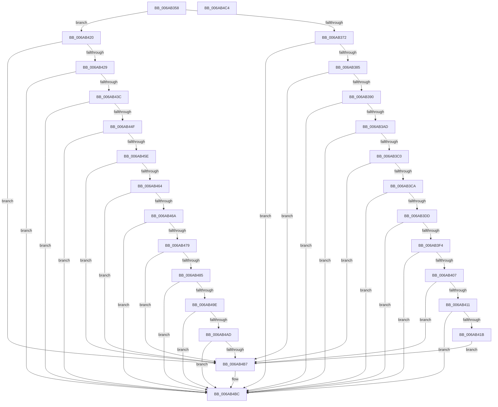

# IaLpssPciSetPower

- RVA: `0x006AB358`–`0x006AB4C5` (길이 `365` bytes)
- VA: `0x00000001406AB358`
- 실행 섹션: `.text`
- PDB 이름 있음: `예`; PDB Function 태그: `아니요`
- unwind 정보 RVA: `0x000B515C`
- 디코드: `106`개 명령, `365/365` bytes 표시
- 미해석 바이트: `0` (있으면 어셈블리에 `.byte`로 보존)

> 이 문서는 커널 이미지의 기계어와 PDB 기호를 분석해 생성했습니다. 4번과 5번은 함수 원형과 자료형을 바이너리 사용 방식에서 추정한 C 해석이며 원본 소스 복구 결과는 아닙니다.

## 1. Dependencies

- 직접 호출 지점: **12**; 고유 호출 대상: **4**
- 직접 호출자로 확인된 함수: **2**
- RIP 상대 이미지 참조: **0**

### Outgoing calls
- `0x006AB376` → [IaLpssReadPmcsr](IaLpssReadPmcsr_function_006AB530.md) (function, `0x006AB530`)
- `0x006AB39E` → [IaLpssWritePmcsr](IaLpssWritePmcsr_function_006AB748.md) (function, `0x006AB748`)
- `0x006AB3B1` → [IaLpssReadPmcsr](IaLpssReadPmcsr_function_006AB530.md) (function, `0x006AB530`)
- `0x006AB3CE` → [IaLpssReadCmdStatus](IaLpssReadCmdStatus_function_006AB4F0.md) (function, `0x006AB4F0`)
- `0x006AB3E5` → [IaLpssWriteCmdStatus](IaLpssWriteCmdStatus_function_006AB70C.md) (function, `0x006AB70C`)
- `0x006AB3F8` → [IaLpssReadCmdStatus](IaLpssReadCmdStatus_function_006AB4F0.md) (function, `0x006AB4F0`)
- `0x006AB42D` → [IaLpssReadCmdStatus](IaLpssReadCmdStatus_function_006AB4F0.md) (function, `0x006AB4F0`)
- `0x006AB444` → [IaLpssWriteCmdStatus](IaLpssWriteCmdStatus_function_006AB70C.md) (function, `0x006AB70C`)
- `0x006AB453` → [IaLpssReadCmdStatus](IaLpssReadCmdStatus_function_006AB4F0.md) (function, `0x006AB4F0`)
- `0x006AB46E` → [IaLpssReadPmcsr](IaLpssReadPmcsr_function_006AB530.md) (function, `0x006AB530`)
- `0x006AB493` → [IaLpssWritePmcsr](IaLpssWritePmcsr_function_006AB748.md) (function, `0x006AB748`)
- `0x006AB4A2` → [IaLpssReadPmcsr](IaLpssReadPmcsr_function_006AB530.md) (function, `0x006AB530`)

### Direct callers
- [IaLpssSetPowerD0](IaLpssSetPowerD0_function_006AB5A0.md) at `0x006AB5BB`
- [IaLpssSetPowerD3](IaLpssSetPowerD3_function_006AB650.md) at `0x006AB6CA`

### Static image references
- 디코드된 RIP-relative 메모리 참조가 없습니다.

## 2. Other-region calls and transfers

- 다른 실행 섹션으로 향하는 call: **0**
- 별도 외부 분기/꼬리 이동을 확인하지 못했습니다.

## 3. Assembly (complete function range)

```asm
006AB358  40 55                           push rbp
006AB35A  48 8B EC                        mov rbp, rsp
006AB35D  48 83 EC 20                     sub rsp, 0x20
006AB361  83 65 10 00                     and dword ptr [rbp + 0x10], 0
006AB365  48 83 65 18 00                  and qword ptr [rbp + 0x18], 0
006AB36A  85 C9                           test ecx, ecx
006AB36C  0F 85 AE 00 00 00               jne 0x1406ab420
006AB372  48 8D 4D 18                     lea rcx, [rbp + 0x18]
006AB376  E8 B5 01 00 00                  call 0x1406ab530
006AB37B  8B C8                           mov ecx, eax
006AB37D  85 C0                           test eax, eax
006AB37F  0F 85 37 01 00 00               jne 0x1406ab4bc
006AB385  8B 45 18                        mov eax, dword ptr [rbp + 0x18]
006AB388  A8 03                           test al, 3
006AB38A  0F 84 27 01 00 00               je 0x1406ab4b7
006AB390  83 E0 FC                        and eax, 0xfffffffc
006AB393  48 8D 4D 18                     lea rcx, [rbp + 0x18]
006AB397  0F BA E8 0F                     bts eax, 0xf
006AB39B  89 45 18                        mov dword ptr [rbp + 0x18], eax
006AB39E  E8 A5 03 00 00                  call 0x1406ab748
006AB3A3  8B C8                           mov ecx, eax
006AB3A5  85 C0                           test eax, eax
006AB3A7  0F 85 0F 01 00 00               jne 0x1406ab4bc
006AB3AD  48 8D 4D 18                     lea rcx, [rbp + 0x18]
006AB3B1  E8 7A 01 00 00                  call 0x1406ab530
006AB3B6  8B C8                           mov ecx, eax
006AB3B8  85 C0                           test eax, eax
006AB3BA  0F 85 FC 00 00 00               jne 0x1406ab4bc
006AB3C0  F6 45 18 03                     test byte ptr [rbp + 0x18], 3
006AB3C4  0F 85 ED 00 00 00               jne 0x1406ab4b7
006AB3CA  48 8D 4D 10                     lea rcx, [rbp + 0x10]
006AB3CE  E8 1D 01 00 00                  call 0x1406ab4f0
006AB3D3  8B C8                           mov ecx, eax
006AB3D5  85 C0                           test eax, eax
006AB3D7  0F 85 DF 00 00 00               jne 0x1406ab4bc
006AB3DD  83 4D 10 06                     or dword ptr [rbp + 0x10], 6
006AB3E1  48 8D 4D 10                     lea rcx, [rbp + 0x10]
006AB3E5  E8 22 03 00 00                  call 0x1406ab70c
006AB3EA  8B C8                           mov ecx, eax
006AB3EC  85 C0                           test eax, eax
006AB3EE  0F 85 C8 00 00 00               jne 0x1406ab4bc
006AB3F4  48 8D 4D 10                     lea rcx, [rbp + 0x10]
006AB3F8  E8 F3 00 00 00                  call 0x1406ab4f0
006AB3FD  8B C8                           mov ecx, eax
006AB3FF  85 C0                           test eax, eax
006AB401  0F 85 B5 00 00 00               jne 0x1406ab4bc
006AB407  F6 45 10 04                     test byte ptr [rbp + 0x10], 4
006AB40B  0F 84 A6 00 00 00               je 0x1406ab4b7
006AB411  F6 45 10 02                     test byte ptr [rbp + 0x10], 2
006AB415  0F 85 A1 00 00 00               jne 0x1406ab4bc
006AB41B  E9 97 00 00 00                  jmp 0x1406ab4b7
006AB420  83 F9 01                        cmp ecx, 1
006AB423  0F 85 8E 00 00 00               jne 0x1406ab4b7
006AB429  48 8D 4D 10                     lea rcx, [rbp + 0x10]
006AB42D  E8 BE 00 00 00                  call 0x1406ab4f0
006AB432  8B C8                           mov ecx, eax
006AB434  85 C0                           test eax, eax
006AB436  0F 85 80 00 00 00               jne 0x1406ab4bc
006AB43C  83 65 10 F9                     and dword ptr [rbp + 0x10], 0xfffffff9
006AB440  48 8D 4D 10                     lea rcx, [rbp + 0x10]
006AB444  E8 C3 02 00 00                  call 0x1406ab70c
006AB449  8B C8                           mov ecx, eax
006AB44B  85 C0                           test eax, eax
006AB44D  75 6D                           jne 0x1406ab4bc
006AB44F  48 8D 4D 10                     lea rcx, [rbp + 0x10]
006AB453  E8 98 00 00 00                  call 0x1406ab4f0
006AB458  8B C8                           mov ecx, eax
006AB45A  85 C0                           test eax, eax
006AB45C  75 5E                           jne 0x1406ab4bc
006AB45E  F6 45 10 04                     test byte ptr [rbp + 0x10], 4
006AB462  75 53                           jne 0x1406ab4b7
006AB464  F6 45 10 02                     test byte ptr [rbp + 0x10], 2
006AB468  75 4D                           jne 0x1406ab4b7
006AB46A  48 8D 4D 18                     lea rcx, [rbp + 0x18]
006AB46E  E8 BD 00 00 00                  call 0x1406ab530
006AB473  8B C8                           mov ecx, eax
006AB475  85 C0                           test eax, eax
006AB477  75 43                           jne 0x1406ab4bc
006AB479  8B 4D 18                        mov ecx, dword ptr [rbp + 0x18]
006AB47C  8B C1                           mov eax, ecx
006AB47E  83 E0 03                        and eax, 3
006AB481  3C 03                           cmp al, 3
006AB483  74 32                           je 0x1406ab4b7
006AB485  0F BA F1 0F                     btr ecx, 0xf
006AB489  83 C9 03                        or ecx, 3
006AB48C  89 4D 18                        mov dword ptr [rbp + 0x18], ecx
006AB48F  48 8D 4D 18                     lea rcx, [rbp + 0x18]
006AB493  E8 B0 02 00 00                  call 0x1406ab748
006AB498  8B C8                           mov ecx, eax
006AB49A  85 C0                           test eax, eax
006AB49C  75 1E                           jne 0x1406ab4bc
006AB49E  48 8D 4D 18                     lea rcx, [rbp + 0x18]
006AB4A2  E8 89 00 00 00                  call 0x1406ab530
006AB4A7  8B C8                           mov ecx, eax
006AB4A9  85 C0                           test eax, eax
006AB4AB  75 0F                           jne 0x1406ab4bc
006AB4AD  8B 45 18                        mov eax, dword ptr [rbp + 0x18]
006AB4B0  83 E0 03                        and eax, 3
006AB4B3  3C 03                           cmp al, 3
006AB4B5  74 05                           je 0x1406ab4bc
006AB4B7  B9 02 00 00 00                  mov ecx, 2
006AB4BC  8B C1                           mov eax, ecx
006AB4BE  48 83 C4 20                     add rsp, 0x20
006AB4C2  5D                              pop rbp
006AB4C3  C3                              ret
006AB4C4  CC                              int3
```

## 4. C-style interpretation (structured pseudocode)

```c
__int64 __fastcall IaLpssPciSetPower(int a1)
{
    __int64 result;
    __int64 v_rsp;
    unsigned __int64 v_stack_p10;
    unsigned int v_stack_p8;

    v_rsp = (v_rsp) - (32);
    if (a1 != 0) goto loc_006AB420;
    result = IaLpssReadPmcsr(v_stack_p10, a2, a3, a4);
    if ((unsigned int)(result) != 0) goto loc_006AB4BC;
    if ((((unsigned __int8)((unsigned int)(v_stack_p10))) & (3)) == 0) goto loc_006AB4B7;
    result = (unsigned int)(((unsigned int)(v_stack_p10)) & (0xFFFFFFFCULL));
    v_stack_p10 = (unsigned int)(result);
    result = IaLpssWritePmcsr(v_stack_p10, a2, a3, a4);
    if ((unsigned int)(result) != 0) goto loc_006AB4BC;
    result = IaLpssReadPmcsr(v_stack_p10, a2, a3, a4);
    if ((unsigned int)(result) != 0) goto loc_006AB4BC;
    if (((v_stack_p10) & (3)) != 0) goto loc_006AB4B7;
    result = IaLpssReadCmdStatus(v_stack_p8, a2, a3, a4);
    if ((unsigned int)(result) != 0) goto loc_006AB4BC;
    result = IaLpssWriteCmdStatus(v_stack_p8, a2, a3, a4);
    if ((unsigned int)(result) != 0) goto loc_006AB4BC;
    result = IaLpssReadCmdStatus(v_stack_p8, a2, a3, a4);
    if ((unsigned int)(result) != 0) goto loc_006AB4BC;
    if (((v_stack_p8) & (4)) == 0) goto loc_006AB4B7;
    if (((v_stack_p8) & (2)) != 0) goto loc_006AB4BC;
    goto loc_006AB4B7;
loc_006AB420:
    if (((unsigned int)((unsigned int)((unsigned int)(result)))) != 1) goto loc_006AB4B7;
    result = IaLpssReadCmdStatus(v_stack_p8, a2, a3, a4);
    if ((unsigned int)(result) != 0) goto loc_006AB4BC;
    result = IaLpssWriteCmdStatus(v_stack_p8, a2, a3, a4);
    if ((unsigned int)(result) != 0) goto loc_006AB4BC;
    result = IaLpssReadCmdStatus(v_stack_p8, a2, a3, a4);
    if ((unsigned int)(result) != 0) goto loc_006AB4BC;
    if (((v_stack_p8) & (4)) != 0) goto loc_006AB4B7;
    if (((v_stack_p8) & (2)) != 0) goto loc_006AB4B7;
    result = IaLpssReadPmcsr(v_stack_p10, a2, a3, a4);
    if ((unsigned int)(result) != 0) goto loc_006AB4BC;
    result = (unsigned int)(((unsigned int)((unsigned int)((unsigned int)(v_stack_p10)))) & (3));
    if (((unsigned __int8)(result)) == 3) goto loc_006AB4B7;
    a1 = (unsigned int)(((unsigned int)(v_stack_p10)) | (3));
    v_stack_p10 = a1;
    result = IaLpssWritePmcsr(v_stack_p10, a2, a3, a4);
    if ((unsigned int)(result) != 0) goto loc_006AB4BC;
    result = IaLpssReadPmcsr(v_stack_p10, a2, a3, a4);
    if ((unsigned int)(result) != 0) goto loc_006AB4BC;
    result = (unsigned int)(((unsigned int)(v_stack_p10)) & (3));
    if (((unsigned __int8)(result)) != 3) {
        a1 = 2;
    }
    v_rsp = (v_rsp) + (32);
    return (unsigned int)(a1);
}
```

## 5. (Beta) C Style

```c
int64_t IaLpssPciSetPower(int32_t Arg1)
{
    int64_t result;
    int64_t local_rsp;
    uint64_t v_stack_p10;
    uint32_t v_stack_p8;

    local_rsp = (local_rsp) - (32);
    if (Arg1 != 0) goto loc_006AB420;
    result = IaLpssReadPmcsr(v_stack_p10, a2, a3, a4);
    if ((uint32_t)(result) != 0) goto loc_006AB4BC;
    if ((((uint8_t)((uint32_t)(v_stack_p10))) & (3)) == 0) goto loc_006AB4B7;
    result = (uint32_t)(((uint32_t)(v_stack_p10)) & (0xFFFFFFFCULL));
    v_stack_p10 = (uint32_t)(result);
    result = IaLpssWritePmcsr(v_stack_p10, a2, a3, a4);
    if ((uint32_t)(result) != 0) goto loc_006AB4BC;
    result = IaLpssReadPmcsr(v_stack_p10, a2, a3, a4);
    if ((uint32_t)(result) != 0) goto loc_006AB4BC;
    if (((v_stack_p10) & (3)) != 0) goto loc_006AB4B7;
    result = IaLpssReadCmdStatus(v_stack_p8, a2, a3, a4);
    if ((uint32_t)(result) != 0) goto loc_006AB4BC;
    result = IaLpssWriteCmdStatus(v_stack_p8, a2, a3, a4);
    if ((uint32_t)(result) != 0) goto loc_006AB4BC;
    result = IaLpssReadCmdStatus(v_stack_p8, a2, a3, a4);
    if ((uint32_t)(result) != 0) goto loc_006AB4BC;
    if (((v_stack_p8) & (4)) == 0) goto loc_006AB4B7;
    if (((v_stack_p8) & (2)) != 0) goto loc_006AB4BC;
    goto loc_006AB4B7;
loc_006AB420:
    if (((uint32_t)((uint32_t)((uint32_t)(result)))) != 1) goto loc_006AB4B7;
    result = IaLpssReadCmdStatus(v_stack_p8, a2, a3, a4);
    if ((uint32_t)(result) != 0) goto loc_006AB4BC;
    result = IaLpssWriteCmdStatus(v_stack_p8, a2, a3, a4);
    if ((uint32_t)(result) != 0) goto loc_006AB4BC;
    result = IaLpssReadCmdStatus(v_stack_p8, a2, a3, a4);
    if ((uint32_t)(result) != 0) goto loc_006AB4BC;
    if (((v_stack_p8) & (4)) != 0) goto loc_006AB4B7;
    if (((v_stack_p8) & (2)) != 0) goto loc_006AB4B7;
    result = IaLpssReadPmcsr(v_stack_p10, a2, a3, a4);
    if ((uint32_t)(result) != 0) goto loc_006AB4BC;
    result = (uint32_t)(((uint32_t)((uint32_t)((uint32_t)(v_stack_p10)))) & (3));
    if (((uint8_t)(result)) == 3) goto loc_006AB4B7;
    Arg1 = (uint32_t)(((uint32_t)(v_stack_p10)) | (3));
    v_stack_p10 = Arg1;
    result = IaLpssWritePmcsr(v_stack_p10, a2, a3, a4);
    if ((uint32_t)(result) != 0) goto loc_006AB4BC;
    result = IaLpssReadPmcsr(v_stack_p10, a2, a3, a4);
    if ((uint32_t)(result) != 0) goto loc_006AB4BC;
    result = (uint32_t)(((uint32_t)(v_stack_p10)) & (3));
    if (((uint8_t)(result)) != 3) {
        Arg1 = 2;
    }
    local_rsp = (local_rsp) + (32);
    return (uint32_t)(Arg1);
}
```

## 6. Execution-region graph

[열기: 2D/3D 그래프와 함수 탐색 컨트롤 패널](../../../control-panel.html?section=text&rva=0x006AB358&view=graph)

- 2D 그래프는 위에서 아래로 흐르고, 3D 그래프는 빈 공간을 드래그해 회전합니다. Shift+드래그는 이동, 휠은 확대·축소, 함수 노드 선택은 대상 보고서 이동입니다.

### Static fallback


