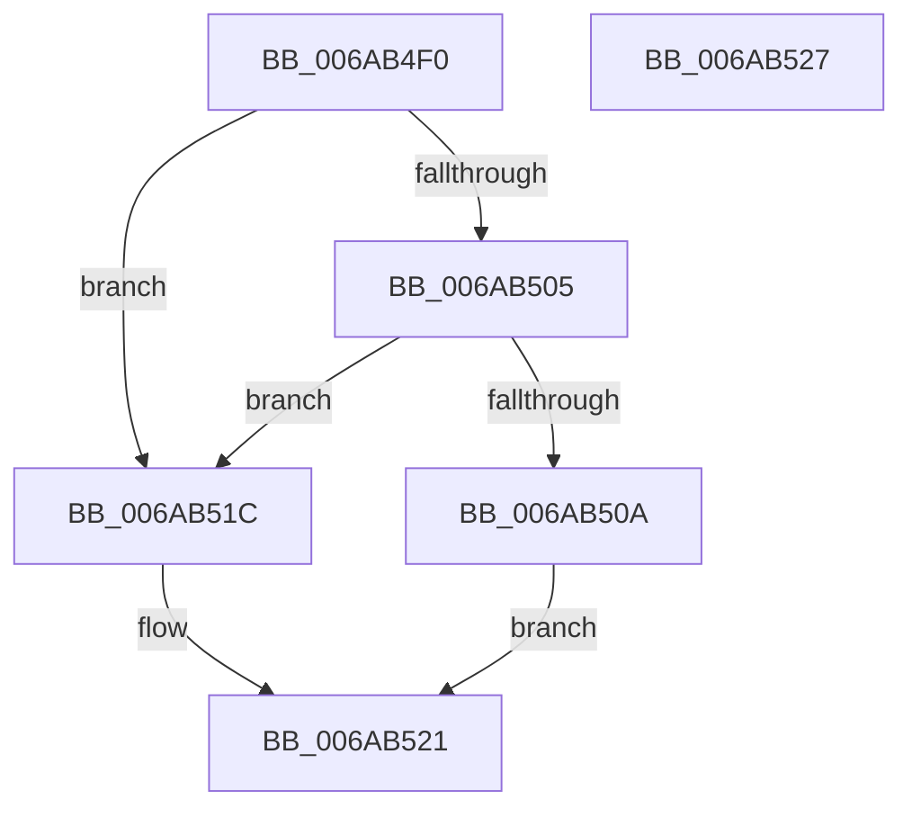

# IaLpssReadCmdStatus

- RVA: `0x006AB4F0`–`0x006AB528` (길이 `56` bytes)
- VA: `0x00000001406AB4F0`
- 실행 섹션: `.text`
- PDB 이름 있음: `예`; PDB Function 태그: `아니요`
- unwind 정보 RVA: `0x0005CF00`
- 디코드: `18`개 명령, `56/56` bytes 표시
- 미해석 바이트: `0` (있으면 어셈블리에 `.byte`로 보존)

> 이 문서는 커널 이미지의 기계어와 PDB 기호를 분석해 생성했습니다. 4번과 5번은 함수 원형과 자료형을 바이너리 사용 방식에서 추정한 C 해석이며 원본 소스 복구 결과는 아닙니다.

## 1. Dependencies

- 직접 호출 지점: **1**; 고유 호출 대상: **1**
- 직접 호출자로 확인된 함수: **1**
- RIP 상대 이미지 참조: **2**

### Outgoing calls
- `0x006AB511` → [guard_dispatch_icall](../6B/guard_dispatch_icall_function_006BAAD0.md) (function, `0x006BAAD0`)

### Direct callers
- [IaLpssPciSetPower](IaLpssPciSetPower_function_006AB358.md) at `0x006AB3CE`
- [IaLpssPciSetPower](IaLpssPciSetPower_function_006AB358.md) at `0x006AB3F8`
- [IaLpssPciSetPower](IaLpssPciSetPower_function_006AB358.md) at `0x006AB42D`
- [IaLpssPciSetPower](IaLpssPciSetPower_function_006AB358.md) at `0x006AB453`

### Static image references
- `0x006AB4F9` → RVA `0x00EF0100` (`.data`; read)
- `0x006AB50A` → RVA `0x00E039E0` (`.data`; read)

## 2. Other-region calls and transfers

- 다른 실행 섹션으로 향하는 call: **0**
- 별도 외부 분기/꼬리 이동을 확인하지 못했습니다.

## 3. Assembly (complete function range)

```asm
006AB4F0  40 53                           push rbx
006AB4F2  48 83 EC 20                     sub rsp, 0x20
006AB4F6  48 8B D9                        mov rbx, rcx
006AB4F9  48 8B 0D 00 4C 84 00            mov rcx, qword ptr [rip + 0x844c00]
006AB500  48 85 C9                        test rcx, rcx
006AB503  74 17                           je 0x1406ab51c
006AB505  48 85 DB                        test rbx, rbx
006AB508  74 12                           je 0x1406ab51c
006AB50A  48 8B 05 CF 84 75 00            mov rax, qword ptr [rip + 0x7584cf]
006AB511  E8 BA F5 00 00                  call 0x1406baad0
006AB516  89 03                           mov dword ptr [rbx], eax
006AB518  33 C0                           xor eax, eax
006AB51A  EB 05                           jmp 0x1406ab521
006AB51C  B8 02 00 00 00                  mov eax, 2
006AB521  48 83 C4 20                     add rsp, 0x20
006AB525  5B                              pop rbx
006AB526  C3                              ret
006AB527  CC                              int3
```

## 4. C-style interpretation (structured pseudocode)

```c
__int64 __fastcall IaLpssReadCmdStatus(__int64 a1)
{
    __int64 result;
    __int64 v_rsp;

    v_rsp = (v_rsp) - (32);
    if (*(unsigned __int64 *)(v_rip + 8670208) == 0) goto loc_006AB51C;
    if (a1 == 0) goto loc_006AB51C;
    result = guard_dispatch_icall(*(unsigned __int64 *)(v_rip + 8670208), a2, a3, a4);
    *(unsigned int *)(a1) = (unsigned int)(result);
    result = 0;
    goto loc_006AB521;
loc_006AB51C:
loc_006AB521:
    v_rsp = (v_rsp) + (32);
    return 2;
}
```

## 5. (Beta) C Style

```c
int64_t IaLpssReadCmdStatus(int64_t Arg1)
{
    int64_t result;
    int64_t local_rsp;

    local_rsp = (local_rsp) - (32);
    if (*(uint64_t *)(v_rip + 0x844C00) == 0) goto loc_006AB51C;
    if (Arg1 == 0) goto loc_006AB51C;
    result = guard_dispatch_icall(*(uint64_t *)(v_rip + 0x844C00), a2, a3, a4);
    *(uint32_t *)(Arg1) = (uint32_t)(result);
    result = 0;
    goto loc_006AB521;
loc_006AB51C:
loc_006AB521:
    local_rsp = (local_rsp) + (32);
    return 2;
}
```

## 6. Execution-region graph

[열기: 2D/3D 그래프와 함수 탐색 컨트롤 패널](../../../control-panel.html?section=text&rva=0x006AB4F0&view=graph)

- 2D 그래프는 위에서 아래로 흐르고, 3D 그래프는 빈 공간을 드래그해 회전합니다. Shift+드래그는 이동, 휠은 확대·축소, 함수 노드 선택은 대상 보고서 이동입니다.

### Static fallback


