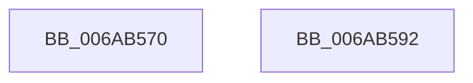

# IaLpssReadResetRegister

- RVA: `0x006AB570`–`0x006AB593` (길이 `35` bytes)
- VA: `0x00000001406AB570`
- 실행 섹션: `.text`
- PDB 이름 있음: `예`; PDB Function 태그: `아니요`
- unwind 정보 RVA: `0x0005C788`
- 디코드: `9`개 명령, `35/35` bytes 표시
- 미해석 바이트: `0` (있으면 어셈블리에 `.byte`로 보존)

> 이 문서는 커널 이미지의 기계어와 PDB 기호를 분석해 생성했습니다. 4번과 5번은 함수 원형과 자료형을 바이너리 사용 방식에서 추정한 C 해석이며 원본 소스 복구 결과는 아닙니다.

## 1. Dependencies

- 직접 호출 지점: **1**; 고유 호출 대상: **1**
- 직접 호출자로 확인된 함수: **2**
- RIP 상대 이미지 참조: **1**

### Outgoing calls
- `0x006AB585` → [guard_dispatch_icall](../6B/guard_dispatch_icall_function_006BAAD0.md) (function, `0x006BAAD0`)

### Direct callers
- [IaLpssSetPowerD0](IaLpssSetPowerD0_function_006AB5A0.md) at `0x006AB5C9`
- [IaLpssSetPowerD3](IaLpssSetPowerD3_function_006AB650.md) at `0x006AB672`

### Static image references
- `0x006AB577` → RVA `0x00E039C0` (`.data`; read)

## 2. Other-region calls and transfers

- 다른 실행 섹션으로 향하는 call: **0**
- 별도 외부 분기/꼬리 이동을 확인하지 못했습니다.

## 3. Assembly (complete function range)

```asm
006AB570  48 83 EC 28                     sub rsp, 0x28
006AB574  48 8B 09                        mov rcx, qword ptr [rcx]
006AB577  48 8B 05 42 84 75 00            mov rax, qword ptr [rip + 0x758442]
006AB57E  48 81 C1 81 00 00 00            add rcx, 0x81
006AB585  E8 46 F5 00 00                  call 0x1406baad0
006AB58A  0F B6 C0                        movzx eax, al
006AB58D  48 83 C4 28                     add rsp, 0x28
006AB591  C3                              ret
006AB592  CC                              int3
```

## 4. C-style interpretation (structured pseudocode)

```c
__int64 __fastcall IaLpssReadResetRegister(__int64 a1)
{
    __int64 result;
    __int64 v_rsp;

    v_rsp = (v_rsp) - (40);
    a1 = (*(unsigned __int64 *)(a1)) + (129);
    result = guard_dispatch_icall(a1, a2, a3, a4);
    v_rsp = (v_rsp) + (40);
    return (unsigned __int8)(result);
}
```

## 5. (Beta) C Style

```c
int64_t IaLpssReadResetRegister(void *Arg1)
{
    uint8_t *arg1 = (uint8_t *)Arg1;

    int64_t result;
    int64_t local_rsp;

    local_rsp = (local_rsp) - (40);
    Arg1 = (*(uint64_t *)(arg1)) + (129);
    result = guard_dispatch_icall(Arg1, a2, a3, a4);
    local_rsp = (local_rsp) + (40);
    return (uint8_t)(result);
}
```

### 관측된 메모리 오프셋

구조체 형식이 확인되지 않은 접근은 인자 기준의 오프셋으로만 기록했습니다.

| 기준 인자 | 오프셋 표현 | 폭 (bit) | 접근 |
|---|---:|---:|---|
| `Arg1` | `+ 0x0` | `64` | `R` |

## 6. Execution-region graph

[열기: 2D/3D 그래프와 함수 탐색 컨트롤 패널](../../../control-panel.html?section=text&rva=0x006AB570&view=graph)

- 2D 그래프는 위에서 아래로 흐르고, 3D 그래프는 빈 공간을 드래그해 회전합니다. Shift+드래그는 이동, 휠은 확대·축소, 함수 노드 선택은 대상 보고서 이동입니다.

### Static fallback


