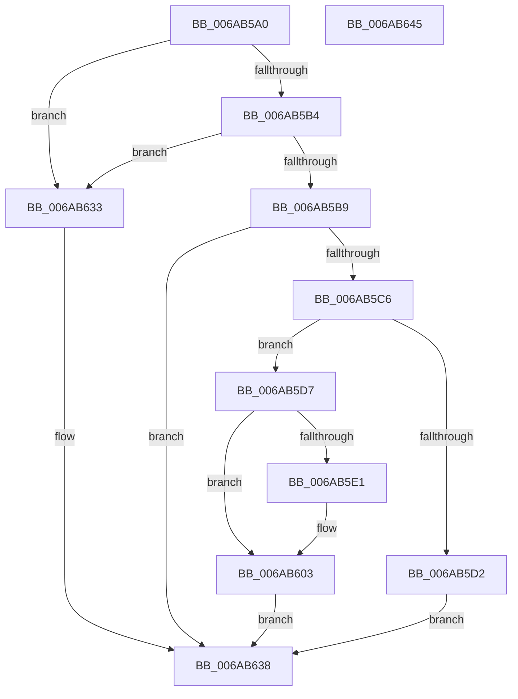

# IaLpssSetPowerD0

- RVA: `0x006AB5A0`–`0x006AB646` (길이 `166` bytes)
- VA: `0x00000001406AB5A0`
- 실행 섹션: `.text`
- PDB 이름 있음: `예`; PDB Function 태그: `아니요`
- unwind 정보 RVA: `0x0006E5F8`
- 디코드: `54`개 명령, `166/166` bytes 표시
- 미해석 바이트: `0` (있으면 어셈블리에 `.byte`로 보존)

> 이 문서는 커널 이미지의 기계어와 PDB 기호를 분석해 생성했습니다. 4번과 5번은 함수 원형과 자료형을 바이너리 사용 방식에서 추정한 C 해석이며 원본 소스 복구 결과는 아닙니다.

## 1. Dependencies

- 직접 호출 지점: **7**; 고유 호출 대상: **6**
- 직접 호출자로 확인된 함수: **0**
- RIP 상대 이미지 참조: **1**

### Outgoing calls
- `0x006AB5BB` → [IaLpssPciSetPower](IaLpssPciSetPower_function_006AB358.md) (function, `0x006AB358`)
- `0x006AB5C9` → [IaLpssReadResetRegister](IaLpssReadResetRegister_function_006AB570.md) (function, `0x006AB570`)
- `0x006AB5E8` → [IaLpssWriteClockParams](IaLpssWriteClockParams_function_006AB6E8.md) (function, `0x006AB6E8`)
- `0x006AB5F0` → [IaLpssReadClockParams](IaLpssReadClockParams_function_006AB4CC.md) (function, `0x006AB4CC`)
- `0x006AB5FE` → [IaLpssWriteClockParams](IaLpssWriteClockParams_function_006AB6E8.md) (function, `0x006AB6E8`)
- `0x006AB608` → [IaLpssWriteResetRegister](IaLpssWriteResetRegister_function_006AB784.md) (function, `0x006AB784`)
- `0x006AB61F` → [Uart16550InitializePortCommon](Uart16550InitializePortCommon_function_006AB8C4.md) (function, `0x006AB8C4`)

### Direct callers
- 이 함수 시작 RVA로 연결되는 직접 call은 확인되지 않았습니다. 간접 호출은 완전히 역산할 수 없습니다.

### Static image references
- `0x006AB5D7` → RVA `0x00EF0108` (`.data`; read)

## 2. Other-region calls and transfers

- 다른 실행 섹션으로 향하는 call: **0**
- 별도 외부 분기/꼬리 이동을 확인하지 못했습니다.

## 3. Assembly (complete function range)

```asm
006AB5A0  48 89 5C 24 08                  mov qword ptr [rsp + 8], rbx
006AB5A5  57                              push rdi
006AB5A6  48 83 EC 30                     sub rsp, 0x30
006AB5AA  33 FF                           xor edi, edi
006AB5AC  48 8B D9                        mov rbx, rcx
006AB5AF  48 85 C9                        test rcx, rcx
006AB5B2  74 7F                           je 0x1406ab633
006AB5B4  48 39 39                        cmp qword ptr [rcx], rdi
006AB5B7  74 7A                           je 0x1406ab633
006AB5B9  33 C9                           xor ecx, ecx
006AB5BB  E8 98 FD FF FF                  call 0x1406ab358
006AB5C0  8B D0                           mov edx, eax
006AB5C2  85 C0                           test eax, eax
006AB5C4  75 72                           jne 0x1406ab638
006AB5C6  48 8B CB                        mov rcx, rbx
006AB5C9  E8 A2 FF FF FF                  call 0x1406ab570
006AB5CE  A8 07                           test al, 7
006AB5D0  74 05                           je 0x1406ab5d7
006AB5D2  8D 57 02                        lea edx, [rdi + 2]
006AB5D5  EB 61                           jmp 0x1406ab638
006AB5D7  8B 15 2B 4B 84 00               mov edx, dword ptr [rip + 0x844b2b]
006AB5DD  85 D2                           test edx, edx
006AB5DF  74 22                           je 0x1406ab603
006AB5E1  0F BA EA 1F                     bts edx, 0x1f
006AB5E5  48 8B CB                        mov rcx, rbx
006AB5E8  E8 FB 00 00 00                  call 0x1406ab6e8
006AB5ED  48 8B CB                        mov rcx, rbx
006AB5F0  E8 D7 FE FF FF                  call 0x1406ab4cc
006AB5F5  0F BA F0 1F                     btr eax, 0x1f
006AB5F9  48 8B CB                        mov rcx, rbx
006AB5FC  8B D0                           mov edx, eax
006AB5FE  E8 E5 00 00 00                  call 0x1406ab6e8
006AB603  B2 07                           mov dl, 7
006AB605  48 8B CB                        mov rcx, rbx
006AB608  E8 77 01 00 00                  call 0x1406ab784
006AB60D  41 B1 01                        mov r9b, 1
006AB610  66 89 7B 0C                     mov word ptr [rbx + 0xc], di
006AB614  45 8A C1                        mov r8b, r9b
006AB617  C6 44 24 20 08                  mov byte ptr [rsp + 0x20], 8
006AB61C  48 8B D3                        mov rdx, rbx
006AB61F  E8 A0 02 00 00                  call 0x1406ab8c4
006AB624  FE C8                           dec al
006AB626  BA 02 00 00 00                  mov edx, 2
006AB62B  F6 D8                           neg al
006AB62D  1B C0                           sbb eax, eax
006AB62F  23 D0                           and edx, eax
006AB631  EB 05                           jmp 0x1406ab638
006AB633  BA 03 00 00 00                  mov edx, 3
006AB638  48 8B 5C 24 40                  mov rbx, qword ptr [rsp + 0x40]
006AB63D  8B C2                           mov eax, edx
006AB63F  48 83 C4 30                     add rsp, 0x30
006AB643  5F                              pop rdi
006AB644  C3                              ret
006AB645  CC                              int3
```

## 4. C-style interpretation (structured pseudocode)

```c
__int64 __fastcall IaLpssSetPowerD0(__int64 a1)
{
    __int64 result;
    __int64 v_rdi;
    __int64 v_rsp;
    unsigned __int8 v_stack_m18;
    unsigned __int64 v_stack_p8;

    v_stack_p8 = v_rbx;
    v_rsp = (v_rsp) - (48);
    v_rdi = 0;
    if (a1 == 0) goto loc_006AB633;
    if ((*(unsigned __int64 *)(a1)) == 0) goto loc_006AB633;
    a1 = 0;
    result = IaLpssPciSetPower(a1, a2, a3, a4);
    if ((unsigned int)(result) != 0) goto loc_006AB638;
    result = IaLpssReadResetRegister(0, (unsigned int)((unsigned int)(result)), a3, a4);
    if ((((unsigned __int8)(result)) & (7)) == 0) goto loc_006AB5D7;
    goto loc_006AB638;
loc_006AB5D7:
    if ((unsigned int)((unsigned int)(*(unsigned int *)(v_rip + 8669995))) != 0) {
        a1 = 0;
        result = IaLpssWriteClockParams(a1, (unsigned int)(*(unsigned int *)(v_rip + 8669995)), a3, a4);
        a1 = a1;
        result = IaLpssReadClockParams(a1, (unsigned int)(*(unsigned int *)(v_rip + 8669995)), a3, a4);
        a1 = a1;
        a2 = (unsigned int)(result);
        result = IaLpssWriteClockParams(a1, a2, a3, a4);
    }
    result = IaLpssWriteResetRegister(a1, 7, a3, a4);
    *(unsigned __int16 *)(a1 + 12) = 0;
    v_stack_m18 = 8;
    result = Uart16550InitializePortCommon(a1, a1, 1, 1);
    result = (unsigned __int8)((result) - 1);
    result = (unsigned __int8)(-(result));
    a2 = (unsigned int)((2) & ((unsigned int)(result)));
    goto loc_006AB638;
loc_006AB633:
loc_006AB638:
    v_rsp = (v_rsp) + (48);
    return 3;
}
```

## 5. (Beta) C Style

```c
int64_t IaLpssSetPowerD0(void *Arg1)
{
    uint8_t *arg1 = (uint8_t *)Arg1;

    int64_t result;
    int64_t local_rdi;
    int64_t local_rsp;
    uint8_t v_stack_m18;
    uint64_t v_stack_p8;

    v_stack_p8 = local_rbx;
    local_rsp = (local_rsp) - (48);
    local_rdi = 0;
    if (Arg1 == NULL) goto loc_006AB633;
    if ((*(uint64_t *)(arg1)) == 0) goto loc_006AB633;
    Arg1 = 0;
    result = IaLpssPciSetPower(Arg1, a2, a3, a4);
    if ((uint32_t)(result) != 0) goto loc_006AB638;
    result = IaLpssReadResetRegister(0, (uint32_t)((uint32_t)(result)), a3, a4);
    if ((((uint8_t)(result)) & (7)) == 0) goto loc_006AB5D7;
    goto loc_006AB638;
loc_006AB5D7:
    if ((uint32_t)((uint32_t)(*(uint32_t *)(v_rip + 0x844B2B))) != 0) {
        Arg1 = 0;
        result = IaLpssWriteClockParams(Arg1, (uint32_t)(*(uint32_t *)(v_rip + 0x844B2B)), a3, a4);
        Arg1 = Arg1;
        result = IaLpssReadClockParams(Arg1, (uint32_t)(*(uint32_t *)(v_rip + 0x844B2B)), a3, a4);
        Arg1 = Arg1;
        a2 = (uint32_t)(result);
        result = IaLpssWriteClockParams(Arg1, a2, a3, a4);
    }
    result = IaLpssWriteResetRegister(Arg1, 7, a3, a4);
    *(uint16_t *)(arg1 + 0xC) = 0;
    v_stack_m18 = 8;
    result = Uart16550InitializePortCommon(Arg1, Arg1, 1, 1);
    result = (uint8_t)((result) - 1);
    result = (uint8_t)(-(result));
    a2 = (uint32_t)((2) & ((uint32_t)(result)));
    goto loc_006AB638;
loc_006AB633:
loc_006AB638:
    local_rsp = (local_rsp) + (48);
    return 3;
}
```

### 관측된 메모리 오프셋

구조체 형식이 확인되지 않은 접근은 인자 기준의 오프셋으로만 기록했습니다.

| 기준 인자 | 오프셋 표현 | 폭 (bit) | 접근 |
|---|---:|---:|---|
| `Arg1` | `+ 0xC` | `16` | `W` |

## 6. Execution-region graph

[열기: 2D/3D 그래프와 함수 탐색 컨트롤 패널](../../../control-panel.html?section=text&rva=0x006AB5A0&view=graph)

- 2D 그래프는 위에서 아래로 흐르고, 3D 그래프는 빈 공간을 드래그해 회전합니다. Shift+드래그는 이동, 휠은 확대·축소, 함수 노드 선택은 대상 보고서 이동입니다.

### Static fallback


