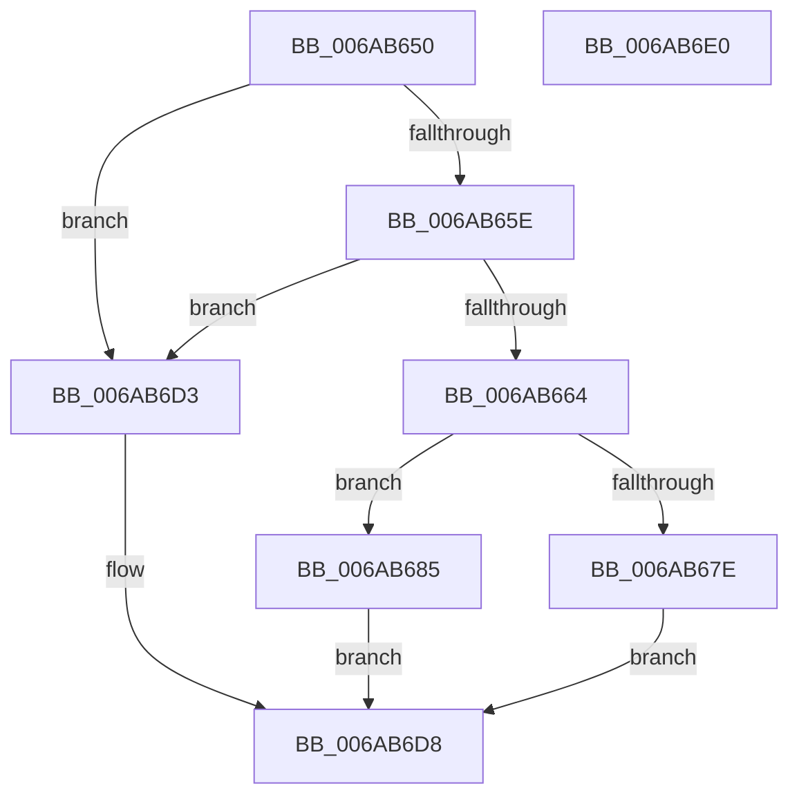

# IaLpssSetPowerD3

- RVA: `0x006AB650`–`0x006AB6E1` (길이 `145` bytes)
- VA: `0x00000001406AB650`
- 실행 섹션: `.text`
- PDB 이름 있음: `예`; PDB Function 태그: `아니요`
- unwind 정보 RVA: `0x0005CF00`
- 디코드: `44`개 명령, `145/145` bytes 표시
- 미해석 바이트: `0` (있으면 어셈블리에 `.byte`로 보존)

> 이 문서는 커널 이미지의 기계어와 PDB 기호를 분석해 생성했습니다. 4번과 5번은 함수 원형과 자료형을 바이너리 사용 방식에서 추정한 C 해석이며 원본 소스 복구 결과는 아닙니다.

## 1. Dependencies

- 직접 호출 지점: **7**; 고유 호출 대상: **5**
- 직접 호출자로 확인된 함수: **0**
- RIP 상대 이미지 참조: **1**

### Outgoing calls
- `0x006AB664` → [IaLpssReadClockParams](IaLpssReadClockParams_function_006AB4CC.md) (function, `0x006AB4CC`)
- `0x006AB672` → [IaLpssReadResetRegister](IaLpssReadResetRegister_function_006AB570.md) (function, `0x006AB570`)
- `0x006AB68E` → [guard_dispatch_icall](../6B/guard_dispatch_icall_function_006BAAD0.md) (function, `0x006BAAD0`)
- `0x006AB6A3` → [guard_dispatch_icall](../6B/guard_dispatch_icall_function_006BAAD0.md) (function, `0x006BAAD0`)
- `0x006AB6B6` → [guard_dispatch_icall](../6B/guard_dispatch_icall_function_006BAAD0.md) (function, `0x006BAAD0`)
- `0x006AB6C0` → [IaLpssWriteResetRegister](IaLpssWriteResetRegister_function_006AB784.md) (function, `0x006AB784`)
- `0x006AB6CA` → [IaLpssPciSetPower](IaLpssPciSetPower_function_006AB358.md) (function, `0x006AB358`)

### Direct callers
- 이 함수 시작 RVA로 연결되는 직접 call은 확인되지 않았습니다. 간접 호출은 완전히 역산할 수 없습니다.

### Static image references
- `0x006AB66C` → RVA `0x00EF0108` (`.data`; write)

## 2. Other-region calls and transfers

- 다른 실행 섹션으로 향하는 call: **0**
- 별도 외부 분기/꼬리 이동을 확인하지 못했습니다.

## 3. Assembly (complete function range)

```asm
006AB650  40 53                           push rbx
006AB652  48 83 EC 20                     sub rsp, 0x20
006AB656  48 8B D9                        mov rbx, rcx
006AB659  48 85 C9                        test rcx, rcx
006AB65C  74 75                           je 0x1406ab6d3
006AB65E  48 83 39 00                     cmp qword ptr [rcx], 0
006AB662  74 6F                           je 0x1406ab6d3
006AB664  E8 63 FE FF FF                  call 0x1406ab4cc
006AB669  48 8B CB                        mov rcx, rbx
006AB66C  89 05 96 4A 84 00               mov dword ptr [rip + 0x844a96], eax
006AB672  E8 F9 FE FF FF                  call 0x1406ab570
006AB677  83 E0 07                        and eax, 7
006AB67A  3C 07                           cmp al, 7
006AB67C  74 07                           je 0x1406ab685
006AB67E  B9 02 00 00 00                  mov ecx, 2
006AB683  EB 53                           jmp 0x1406ab6d8
006AB685  48 8B 43 10                     mov rax, qword ptr [rbx + 0x10]
006AB689  B2 04                           mov dl, 4
006AB68B  48 8B CB                        mov rcx, rbx
006AB68E  E8 3D F4 00 00                  call 0x1406baad0
006AB693  44 8A C0                        mov r8b, al
006AB696  B2 04                           mov dl, 4
006AB698  48 8B 43 18                     mov rax, qword ptr [rbx + 0x18]
006AB69C  41 80 E0 F7                     and r8b, 0xf7
006AB6A0  48 8B CB                        mov rcx, rbx
006AB6A3  E8 28 F4 00 00                  call 0x1406baad0
006AB6A8  48 8B 43 18                     mov rax, qword ptr [rbx + 0x18]
006AB6AC  45 33 C0                        xor r8d, r8d
006AB6AF  48 8B CB                        mov rcx, rbx
006AB6B2  41 8D 50 02                     lea edx, [r8 + 2]
006AB6B6  E8 15 F4 00 00                  call 0x1406baad0
006AB6BB  33 D2                           xor edx, edx
006AB6BD  48 8B CB                        mov rcx, rbx
006AB6C0  E8 BF 00 00 00                  call 0x1406ab784
006AB6C5  B9 01 00 00 00                  mov ecx, 1
006AB6CA  E8 89 FC FF FF                  call 0x1406ab358
006AB6CF  8B C8                           mov ecx, eax
006AB6D1  EB 05                           jmp 0x1406ab6d8
006AB6D3  B9 03 00 00 00                  mov ecx, 3
006AB6D8  8B C1                           mov eax, ecx
006AB6DA  48 83 C4 20                     add rsp, 0x20
006AB6DE  5B                              pop rbx
006AB6DF  C3                              ret
006AB6E0  CC                              int3
```

## 4. C-style interpretation (structured pseudocode)

```c
__int64 __fastcall IaLpssSetPowerD3(__int64 a1)
{
    __int64 result;
    __int64 v_rsp;

    v_rsp = (v_rsp) - (32);
    if (a1 == 0) goto loc_006AB6D3;
    if ((*(unsigned __int64 *)(a1)) == 0) goto loc_006AB6D3;
    result = IaLpssReadClockParams(a1, a2, a3, a4);
    *(unsigned int *)(v_rip + 8669846) = (unsigned int)(result);
    result = IaLpssReadResetRegister(a1, a2, a3, a4);
    result = (unsigned int)((result) & (7));
    if (((unsigned __int8)(result)) == 7) goto loc_006AB685;
    goto loc_006AB6D8;
loc_006AB685:
    result = guard_dispatch_icall(a1, 4, a3, a4);
    a3 = (unsigned __int8)(((unsigned __int8)(result)) & (247));
    result = guard_dispatch_icall(a1, 4, a3, a4);
    a3 = 0;
    result = guard_dispatch_icall(a1, a3 + 2, a3, a4);
    a2 = 0;
    result = IaLpssWriteResetRegister(a1, a2, a3, a4);
    result = IaLpssPciSetPower(1, a2, a3, a4);
    goto loc_006AB6D8;
loc_006AB6D3:
loc_006AB6D8:
    v_rsp = (v_rsp) + (32);
    return 3;
}
```

## 5. (Beta) C Style

```c
int64_t IaLpssSetPowerD3(void *Arg1)
{
    uint8_t *arg1 = (uint8_t *)Arg1;

    int64_t result;
    int64_t local_rsp;

    local_rsp = (local_rsp) - (32);
    if (Arg1 == NULL) goto loc_006AB6D3;
    if ((*(uint64_t *)(arg1)) == 0) goto loc_006AB6D3;
    result = IaLpssReadClockParams(Arg1, a2, a3, a4);
    *(uint32_t *)(v_rip + 0x844A96) = (uint32_t)(result);
    result = IaLpssReadResetRegister(Arg1, a2, a3, a4);
    result = (uint32_t)((result) & (7));
    if (((uint8_t)(result)) == 7) goto loc_006AB685;
    goto loc_006AB6D8;
loc_006AB685:
    result = guard_dispatch_icall(Arg1, 4, a3, a4);
    a3 = (uint8_t)(((uint8_t)(result)) & (247));
    result = guard_dispatch_icall(Arg1, 4, a3, a4);
    a3 = 0;
    result = guard_dispatch_icall(Arg1, a3 + 2, a3, a4);
    a2 = 0;
    result = IaLpssWriteResetRegister(Arg1, a2, a3, a4);
    result = IaLpssPciSetPower(1, a2, a3, a4);
    goto loc_006AB6D8;
loc_006AB6D3:
loc_006AB6D8:
    local_rsp = (local_rsp) + (32);
    return 3;
}
```

### 관측된 메모리 오프셋

구조체 형식이 확인되지 않은 접근은 인자 기준의 오프셋으로만 기록했습니다.

| 기준 인자 | 오프셋 표현 | 폭 (bit) | 접근 |
|---|---:|---:|---|
| `Arg1` | `+ 0x10` | `64` | `R` |
| `Arg1` | `+ 0x18` | `64` | `R` |

## 6. Execution-region graph

[열기: 2D/3D 그래프와 함수 탐색 컨트롤 패널](../../../control-panel.html?section=text&rva=0x006AB650&view=graph)

- 2D 그래프는 위에서 아래로 흐르고, 3D 그래프는 빈 공간을 드래그해 회전합니다. Shift+드래그는 이동, 휠은 확대·축소, 함수 노드 선택은 대상 보고서 이동입니다.

### Static fallback


