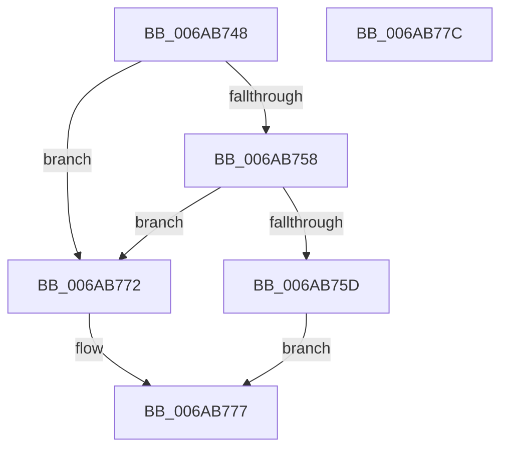

# IaLpssWritePmcsr

- RVA: `0x006AB748`–`0x006AB77D` (길이 `53` bytes)
- VA: `0x00000001406AB748`
- 실행 섹션: `.text`
- PDB 이름 있음: `예`; PDB Function 태그: `아니요`
- unwind 정보 RVA: `0x0005C788`
- 디코드: `16`개 명령, `53/53` bytes 표시
- 미해석 바이트: `0` (있으면 어셈블리에 `.byte`로 보존)

> 이 문서는 커널 이미지의 기계어와 PDB 기호를 분석해 생성했습니다. 4번과 5번은 함수 원형과 자료형을 바이너리 사용 방식에서 추정한 C 해석이며 원본 소스 복구 결과는 아닙니다.

## 1. Dependencies

- 직접 호출 지점: **1**; 고유 호출 대상: **1**
- 직접 호출자로 확인된 함수: **1**
- RIP 상대 이미지 참조: **2**

### Outgoing calls
- `0x006AB769` → [guard_dispatch_icall](../6B/guard_dispatch_icall_function_006BAAD0.md) (function, `0x006BAAD0`)

### Direct callers
- [IaLpssPciSetPower](IaLpssPciSetPower_function_006AB358.md) at `0x006AB39E`
- [IaLpssPciSetPower](IaLpssPciSetPower_function_006AB358.md) at `0x006AB493`

### Static image references
- `0x006AB74C` → RVA `0x00EF00F8` (`.data`; read)
- `0x006AB762` → RVA `0x00E039E8` (`.data`; read)

## 2. Other-region calls and transfers

- 다른 실행 섹션으로 향하는 call: **0**
- 별도 외부 분기/꼬리 이동을 확인하지 못했습니다.

## 3. Assembly (complete function range)

```asm
006AB748  48 83 EC 28                     sub rsp, 0x28
006AB74C  4C 8B 05 A5 49 84 00            mov r8, qword ptr [rip + 0x8449a5]
006AB753  4D 85 C0                        test r8, r8
006AB756  74 1A                           je 0x1406ab772
006AB758  48 85 C9                        test rcx, rcx
006AB75B  74 15                           je 0x1406ab772
006AB75D  8B 11                           mov edx, dword ptr [rcx]
006AB75F  49 8B C8                        mov rcx, r8
006AB762  48 8B 05 7F 82 75 00            mov rax, qword ptr [rip + 0x75827f]
006AB769  E8 62 F3 00 00                  call 0x1406baad0
006AB76E  33 C0                           xor eax, eax
006AB770  EB 05                           jmp 0x1406ab777
006AB772  B8 02 00 00 00                  mov eax, 2
006AB777  48 83 C4 28                     add rsp, 0x28
006AB77B  C3                              ret
006AB77C  CC                              int3
```

## 4. C-style interpretation (structured pseudocode)

```c
__int64 __fastcall IaLpssWritePmcsr(__int64 a1)
{
    __int64 result;
    __int64 v_rsp;

    v_rsp = (v_rsp) - (40);
    if (*(unsigned __int64 *)(v_rip + 8669605) == 0) goto loc_006AB772;
    if (a1 == 0) goto loc_006AB772;
    result = guard_dispatch_icall(*(unsigned __int64 *)(v_rip + 8669605), (unsigned int)(*(unsigned int *)(a1)), *(unsigned __int64 *)(v_rip + 8669605), a4);
    result = 0;
    goto loc_006AB777;
loc_006AB772:
loc_006AB777:
    v_rsp = (v_rsp) + (40);
    return 2;
}
```

## 5. (Beta) C Style

```c
int64_t IaLpssWritePmcsr(int64_t Arg1)
{
    int64_t result;
    int64_t local_rsp;

    local_rsp = (local_rsp) - (40);
    if (*(uint64_t *)(v_rip + 0x8449A5) == 0) goto loc_006AB772;
    if (Arg1 == 0) goto loc_006AB772;
    result = guard_dispatch_icall(*(uint64_t *)(v_rip + 0x8449A5), (uint32_t)(*(uint32_t *)(Arg1)), *(uint64_t *)(v_rip + 0x8449A5), a4);
    result = 0;
    goto loc_006AB777;
loc_006AB772:
loc_006AB777:
    local_rsp = (local_rsp) + (40);
    return 2;
}
```

## 6. Execution-region graph

[열기: 2D/3D 그래프와 함수 탐색 컨트롤 패널](../../../control-panel.html?section=text&rva=0x006AB748&view=graph)

- 2D 그래프는 위에서 아래로 흐르고, 3D 그래프는 빈 공간을 드래그해 회전합니다. Shift+드래그는 이동, 휠은 확대·축소, 함수 노드 선택은 대상 보고서 이동입니다.

### Static fallback


