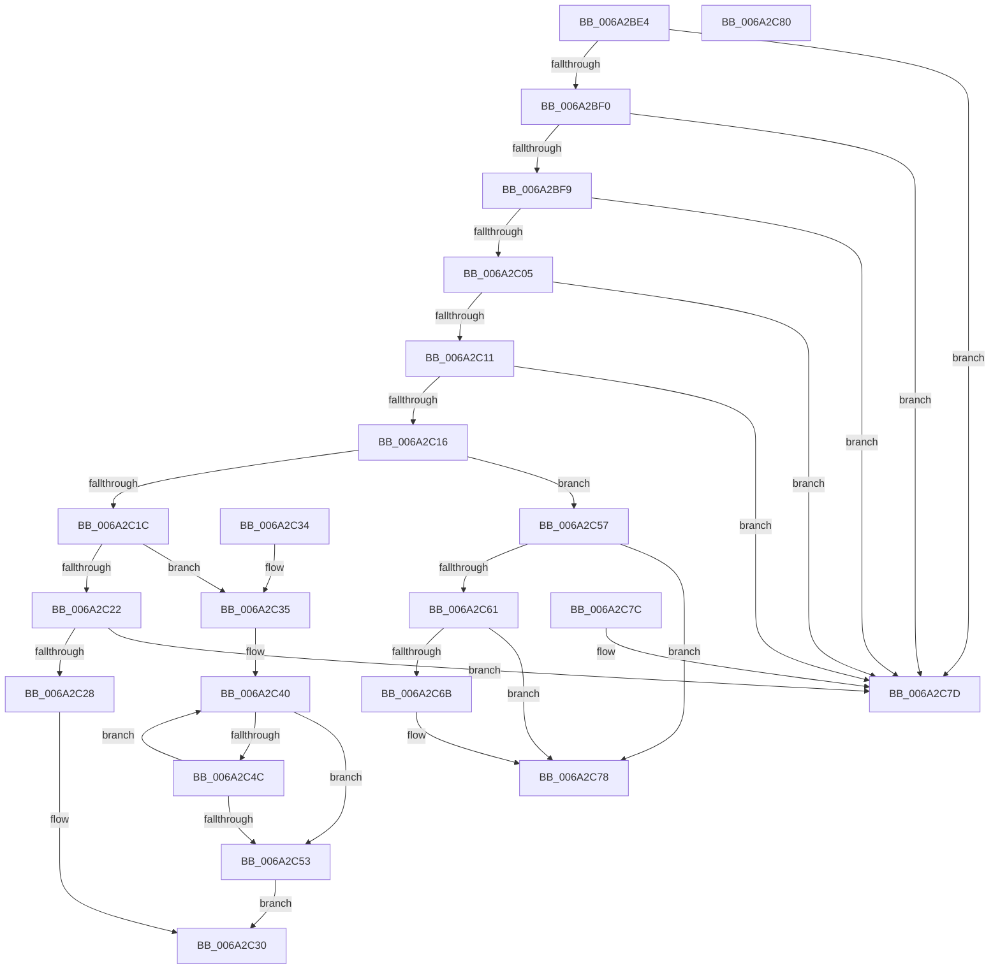

# IidAreIdsStrictlyEqual

- RVA: `0x006A2BE4`–`0x006A2C81` (길이 `157` bytes)
- VA: `0x00000001406A2BE4`
- 실행 섹션: `.text`
- PDB 이름 있음: `예`; PDB Function 태그: `아니요`
- unwind 정보 RVA: `0x000DB714`
- 디코드: `54`개 명령, `157/157` bytes 표시
- 미해석 바이트: `0` (있으면 어셈블리에 `.byte`로 보존)

> 이 문서는 커널 이미지의 기계어와 PDB 기호를 분석해 생성했습니다. 4번과 5번은 함수 원형과 자료형을 바이너리 사용 방식에서 추정한 C 해석이며 원본 소스 복구 결과는 아닙니다.

## 1. Dependencies

- 직접 호출 지점: **0**; 고유 호출 대상: **0**
- 직접 호출자로 확인된 함수: **6**
- RIP 상대 이미지 참조: **0**

### Outgoing calls
- 직접 디코드된 call 명령이 없습니다.

### Direct callers
- [HalpDmaFindAdapterByDeviceId](../53/HalpDmaFindAdapterByDeviceId_function_0053E0CC.md) at `0x0053E126`
- [HalpIommuCreateDevice](../54/HalpIommuCreateDevice_function_0054ED60.md) at `0x0054EE4E`
- [HalpIommuDeleteDevice](../54/HalpIommuDeleteDevice_function_0054F368.md) at `0x0054F405`
- [HalpIommuCreateIncreaseAliasTrack](../55/HalpIommuCreateIncreaseAliasTrack_function_00554CB0.md) at `0x00554CE9`
- [HalpIommuDecreaseAliasTrack](../55/HalpIommuDecreaseAliasTrack_function_00554DBC.md) at `0x00554DEA`
- [HalpIommuGetReservedRanges](../55/HalpIommuGetReservedRanges_function_005552A4.md) at `0x005552FF`

### Static image references
- 디코드된 RIP-relative 메모리 참조가 없습니다.

## 2. Other-region calls and transfers

- 다른 실행 섹션으로 향하는 call: **0**
- 별도 외부 분기/꼬리 이동을 확인하지 못했습니다.

## 3. Assembly (complete function range)

```asm
006A2BE4  45 33 C9                        xor r9d, r9d
006A2BE7  48 85 C9                        test rcx, rcx
006A2BEA  0F 84 8D 00 00 00               je 0x1406a2c7d
006A2BF0  48 85 D2                        test rdx, rdx
006A2BF3  0F 84 84 00 00 00               je 0x1406a2c7d
006A2BF9  44 8B 01                        mov r8d, dword ptr [rcx]
006A2BFC  41 8D 40 FF                     lea eax, [r8 - 1]
006A2C00  83 F8 04                        cmp eax, 4
006A2C03  77 78                           ja 0x1406a2c7d
006A2C05  44 8B 12                        mov r10d, dword ptr [rdx]
006A2C08  41 8D 42 FF                     lea eax, [r10 - 1]
006A2C0C  83 F8 04                        cmp eax, 4
006A2C0F  77 6C                           ja 0x1406a2c7d
006A2C11  45 3B C2                        cmp r8d, r10d
006A2C14  75 67                           jne 0x1406a2c7d
006A2C16  41 83 E8 01                     sub r8d, 1
006A2C1A  74 3B                           je 0x1406a2c57
006A2C1C  41 83 E8 01                     sub r8d, 1
006A2C20  74 13                           je 0x1406a2c35
006A2C22  41 83 F8 03                     cmp r8d, 3
006A2C26  75 55                           jne 0x1406a2c7d
006A2C28  48 8B 42 08                     mov rax, qword ptr [rdx + 8]
006A2C2C  48 39 41 08                     cmp qword ptr [rcx + 8], rax
006A2C30  0F 94 C0                        sete al
006A2C33  C3                              ret
006A2C34  CC                              int3
006A2C35  48 8B 41 08                     mov rax, qword ptr [rcx + 8]
006A2C39  4C 8B 42 08                     mov r8, qword ptr [rdx + 8]
006A2C3D  4C 2B C0                        sub r8, rax
006A2C40  0F B6 08                        movzx ecx, byte ptr [rax]
006A2C43  42 0F B6 14 00                  movzx edx, byte ptr [rax + r8]
006A2C48  2B CA                           sub ecx, edx
006A2C4A  75 07                           jne 0x1406a2c53
006A2C4C  48 FF C0                        inc rax
006A2C4F  85 D2                           test edx, edx
006A2C51  75 ED                           jne 0x1406a2c40
006A2C53  85 C9                           test ecx, ecx
006A2C55  EB D9                           jmp 0x1406a2c30
006A2C57  0F B7 42 08                     movzx eax, word ptr [rdx + 8]
006A2C5B  66 39 41 08                     cmp word ptr [rcx + 8], ax
006A2C5F  75 17                           jne 0x1406a2c78
006A2C61  0F B7 42 0C                     movzx eax, word ptr [rdx + 0xc]
006A2C65  66 39 41 0C                     cmp word ptr [rcx + 0xc], ax
006A2C69  75 0D                           jne 0x1406a2c78
006A2C6B  8A 49 0A                        mov cl, byte ptr [rcx + 0xa]
006A2C6E  32 4A 0A                        xor cl, byte ptr [rdx + 0xa]
006A2C71  F6 C1 03                        test cl, 3
006A2C74  41 0F 94 C1                     sete r9b
006A2C78  41 8A C1                        mov al, r9b
006A2C7B  C3                              ret
006A2C7C  CC                              int3
006A2C7D  32 C0                           xor al, al
006A2C7F  C3                              ret
006A2C80  CC                              int3
```

## 4. C-style interpretation (structured pseudocode)

```c
__int64 __fastcall IidAreIdsStrictlyEqual(__int64 a1, __int64 a2, __int64 a3, int a4)
{
    __int64 result;

    a4 = 0;
    if (a1 == 0) goto loc_006A2C7D;
    if (a2 == 0) goto loc_006A2C7D;
    if (((unsigned int)((unsigned int)(*(unsigned int *)(a1)) - 1)) > 4) goto loc_006A2C7D;
    if (((unsigned int)((unsigned int)(*(unsigned int *)(a2)) - 1)) > 4) goto loc_006A2C7D;
    if (((unsigned int)((unsigned int)(*(unsigned int *)(a1)))) != ((unsigned int)((unsigned int)(*(unsigned int *)(a2))))) goto loc_006A2C7D;
    a3 = (unsigned int)(((unsigned int)(*(unsigned int *)(a1))) - (1));
    if (condition_is_equal) goto loc_006A2C57;
    a3 = (unsigned int)((a3) - (1));
    if (condition_is_equal) goto loc_006A2C35;
    if (((unsigned int)(a3)) != 3) goto loc_006A2C7D;
loc_006A2C30:
    result = ((*(unsigned __int64 *)(a1 + 8)) == (*(unsigned __int64 *)(a2 + 8))) ? 1 : 0;
    return result;
loc_006A2C35:
    a3 = (*(unsigned __int64 *)(a2 + 8)) - (*(unsigned __int64 *)(a1 + 8));
loc_006A2C40:
    a1 = (unsigned int)((*(unsigned __int8 *)(*(unsigned __int64 *)(a1 + 8))) - ((unsigned int)(*(unsigned __int8 *)(*(unsigned __int64 *)(a1 + 8) + a3 * 1))));
    if (condition_is_not_equal) goto loc_006A2C53;
    result = (*(unsigned __int64 *)(a1 + 8)) + 1;
    if ((unsigned int)(*(unsigned __int8 *)(*(unsigned __int64 *)(a1 + 8) + a3 * 1)) != 0) goto loc_006A2C40;
loc_006A2C53:
    goto loc_006A2C30;
loc_006A2C57:
    if ((*(unsigned __int16 *)(a1 + 8)) != ((unsigned __int16)(*(unsigned __int16 *)(*(unsigned __int8 *)(*(unsigned __int64 *)(a1 + 8) + a3 * 1) + 8)))) goto loc_006A2C78;
    if ((*(unsigned __int16 *)(a1 + 12)) == ((unsigned __int16)(*(unsigned __int16 *)(*(unsigned __int8 *)(*(unsigned __int64 *)(a1 + 8) + a3 * 1) + 12)))) {
        a1 = *(unsigned __int8 *)(a1 + 10);
        a1 = (unsigned __int8)((a1) ^ (*(unsigned __int8 *)(*(unsigned __int8 *)(*(unsigned __int64 *)(a1 + 8) + a3 * 1) + 10)));
        a4 = ((((unsigned __int8)(a1)) & (3)) == 0) ? 1 : 0;
    }
    return (unsigned __int8)(a4);
loc_006A2C7D:
    result = 0;
    return result;
}
```

## 5. (Beta) C Style

```c
int64_t IidAreIdsStrictlyEqual(int64_t Arg1, int64_t Arg2, int64_t Arg3, int32_t Arg4)
{
    int64_t result;

    Arg4 = 0;
    if (Arg1 == 0) goto loc_006A2C7D;
    if (Arg2 == 0) goto loc_006A2C7D;
    if (((uint32_t)((uint32_t)(*(uint32_t *)(Arg1)) - 1)) > 4) goto loc_006A2C7D;
    if (((uint32_t)((uint32_t)(*(uint32_t *)(Arg2)) - 1)) > 4) goto loc_006A2C7D;
    if (((uint32_t)((uint32_t)(*(uint32_t *)(Arg1)))) != ((uint32_t)((uint32_t)(*(uint32_t *)(Arg2))))) goto loc_006A2C7D;
    Arg3 = (uint32_t)(((uint32_t)(*(uint32_t *)(Arg1))) - (1));
    if (condition_is_equal) goto loc_006A2C57;
    Arg3 = (uint32_t)((Arg3) - (1));
    if (condition_is_equal) goto loc_006A2C35;
    if (((uint32_t)(Arg3)) != 3) goto loc_006A2C7D;
loc_006A2C30:
    result = ((*(uint64_t *)(Arg1 + 0x8)) == (*(uint64_t *)(Arg2 + 0x8))) ? 1 : 0;
    return result;
loc_006A2C35:
    Arg3 = (*(uint64_t *)(Arg2 + 0x8)) - (*(uint64_t *)(Arg1 + 0x8));
loc_006A2C40:
    Arg1 = (uint32_t)((*(uint8_t *)(*(uint64_t *)(Arg1 + 0x8))) - ((uint32_t)(*(uint8_t *)(*(uint64_t *)(Arg1 + 0x8) + Arg3 * 1))));
    if (condition_is_not_equal) goto loc_006A2C53;
    result = (*(uint64_t *)(Arg1 + 0x8)) + 1;
    if ((uint32_t)(*(uint8_t *)(*(uint64_t *)(Arg1 + 0x8) + Arg3 * 1)) != 0) goto loc_006A2C40;
loc_006A2C53:
    goto loc_006A2C30;
loc_006A2C57:
    if ((*(uint16_t *)(Arg1 + 0x8)) != ((uint16_t)(*(uint16_t *)(*(uint8_t *)(*(uint64_t *)(Arg1 + 0x8) + Arg3 * 1) + 0x8)))) goto loc_006A2C78;
    if ((*(uint16_t *)(Arg1 + 0xC)) == ((uint16_t)(*(uint16_t *)(*(uint8_t *)(*(uint64_t *)(Arg1 + 0x8) + Arg3 * 1) + 0xC)))) {
        Arg1 = *(uint8_t *)(Arg1 + 0xA);
        Arg1 = (uint8_t)((Arg1) ^ (*(uint8_t *)(*(uint8_t *)(*(uint64_t *)(Arg1 + 0x8) + Arg3 * 1) + 0xA)));
        Arg4 = ((((uint8_t)(Arg1)) & (3)) == 0) ? 1 : 0;
    }
    return (uint8_t)(Arg4);
loc_006A2C7D:
    result = 0;
    return result;
}
```

## 6. Execution-region graph

[열기: 2D/3D 그래프와 함수 탐색 컨트롤 패널](../../../control-panel.html?section=text&rva=0x006A2BE4&view=graph)

- 2D 그래프는 위에서 아래로 흐르고, 3D 그래프는 빈 공간을 드래그해 회전합니다. Shift+드래그는 이동, 휠은 확대·축소, 함수 노드 선택은 대상 보고서 이동입니다.

### Static fallback


