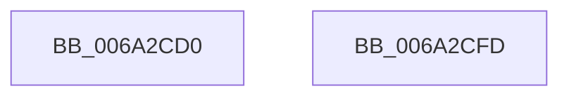

# IidCloneDeviceIdPci

- RVA: `0x006A2CD0`–`0x006A2CFE` (길이 `46` bytes)
- VA: `0x00000001406A2CD0`
- 실행 섹션: `.text`
- PDB 이름 있음: `예`; PDB Function 태그: `아니요`
- unwind 정보 RVA: `0x0005C788`
- 디코드: `14`개 명령, `46/46` bytes 표시
- 미해석 바이트: `0` (있으면 어셈블리에 `.byte`로 보존)

> 이 문서는 커널 이미지의 기계어와 PDB 기호를 분석해 생성했습니다. 4번과 5번은 함수 원형과 자료형을 바이너리 사용 방식에서 추정한 C 해석이며 원본 소스 복구 결과는 아닙니다.

## 1. Dependencies

- 직접 호출 지점: **1**; 고유 호출 대상: **1**
- 직접 호출자로 확인된 함수: **1**
- RIP 상대 이미지 참조: **0**

### Outgoing calls
- `0x006A2CF1` → [memcpy](../6C/memcpy_function_006C6840.md) (function, `0x006C6840`)

### Direct callers
- [IidCloneDeviceId](../../page/82/IidCloneDeviceId_function_008289F8.md) at `0x00828A46`

### Static image references
- 디코드된 RIP-relative 메모리 참조가 없습니다.

## 2. Other-region calls and transfers

- 다른 실행 섹션으로 향하는 call: **0**
- 별도 외부 분기/꼬리 이동을 확인하지 못했습니다.

## 3. Assembly (complete function range)

```asm
006A2CD0  48 83 EC 28                     sub rsp, 0x28
006A2CD4  0F 10 01                        movups xmm0, xmmword ptr [rcx]
006A2CD7  48 8B C1                        mov rax, rcx
006A2CDA  48 8D 4A 18                     lea rcx, [rdx + 0x18]
006A2CDE  0F 11 02                        movups xmmword ptr [rdx], xmm0
006A2CE1  48 89 4A 10                     mov qword ptr [rdx + 0x10], rcx
006A2CE5  44 0F B7 40 0E                  movzx r8d, word ptr [rax + 0xe]
006A2CEA  48 8B 50 10                     mov rdx, qword ptr [rax + 0x10]
006A2CEE  4D 03 C0                        add r8, r8
006A2CF1  E8 4A 3B 02 00                  call 0x1406c6840
006A2CF6  33 C0                           xor eax, eax
006A2CF8  48 83 C4 28                     add rsp, 0x28
006A2CFC  C3                              ret
006A2CFD  CC                              int3
```

## 4. C-style interpretation (structured pseudocode)

```c
__int64 __fastcall IidCloneDeviceIdPci(__int64 a1, __int64 a2)
{
    __int64 result;
    __int64 v_rsp;

    v_rsp = (v_rsp) - (40);
    *(unsigned __int64 *)(a2) = v_xmm0;
    *(unsigned __int64 *)(a2 + 16) = a2 + 24;
    a3 = (*(unsigned __int16 *)(a1 + 14)) + (*(unsigned __int16 *)(a1 + 14));
    result = memcpy(a2 + 24, *(unsigned __int64 *)(a1 + 16), a3, a4);
    result = 0;
    v_rsp = (v_rsp) + (40);
    return result;
}
```

## 5. (Beta) C Style

```c
int64_t IidCloneDeviceIdPci(void *Arg1, void *Arg2)
{
    uint8_t *arg1 = (uint8_t *)Arg1;
    uint8_t *arg2 = (uint8_t *)Arg2;

    int64_t result;
    int64_t local_rsp;

    local_rsp = (local_rsp) - (40);
    *(uint64_t *)(arg2) = v_xmm0;
    *(void **)(arg2 + 0x10) = Arg2 + 24;
    a3 = (*(uint16_t *)(arg1 + 0xE)) + (*(uint16_t *)(arg1 + 0xE));
    result = memcpy(Arg2 + 24, *(uint64_t *)(arg1 + 0x10), a3, a4);
    result = 0;
    local_rsp = (local_rsp) + (40);
    return result;
}
```

### 관측된 메모리 오프셋

구조체 형식이 확인되지 않은 접근은 인자 기준의 오프셋으로만 기록했습니다.

| 기준 인자 | 오프셋 표현 | 폭 (bit) | 접근 |
|---|---:|---:|---|
| `Arg1` | `+ 0x0` | `128` | `R` |
| `Arg1` | `+ 0xE` | `16` | `R` |
| `Arg1` | `+ 0x10` | `64` | `R` |
| `Arg2` | `+ 0x0` | `128` | `R` |
| `Arg2` | `+ 0x10` | `64` | `W` |
| `Arg2` | `+ 0x18` | `64` | `R` |

## 6. Execution-region graph

[열기: 2D/3D 그래프와 함수 탐색 컨트롤 패널](../../../control-panel.html?section=text&rva=0x006A2CD0&view=graph)

- 2D 그래프는 위에서 아래로 흐르고, 3D 그래프는 빈 공간을 드래그해 회전합니다. Shift+드래그는 이동, 휠은 확대·축소, 함수 노드 선택은 대상 보고서 이동입니다.

### Static fallback


