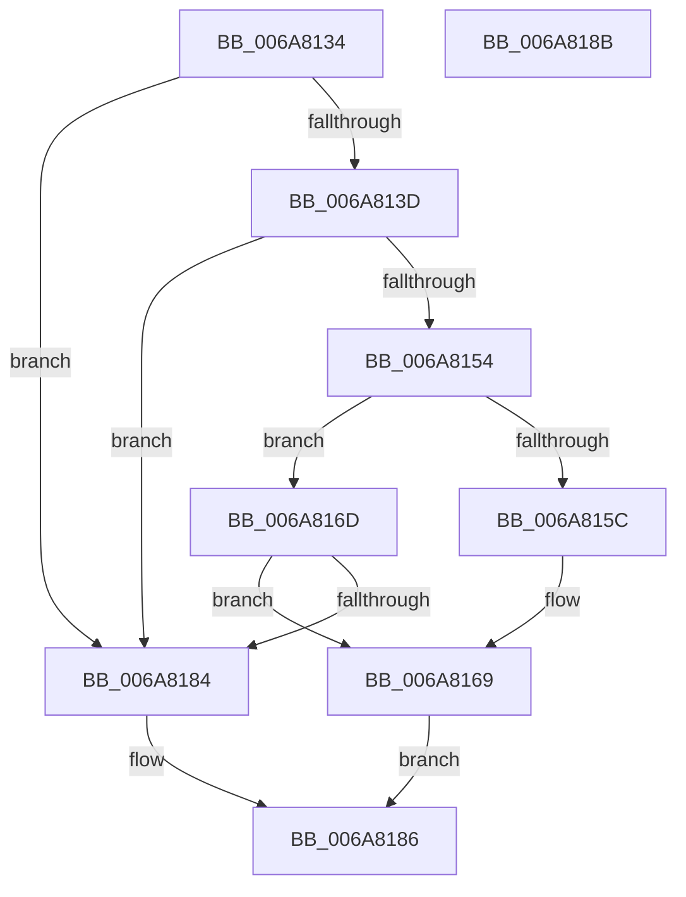

# InbvPortGetByte

- RVA: `0x006A8134`–`0x006A818C` (길이 `88` bytes)
- VA: `0x00000001406A8134`
- 실행 섹션: `.text`
- PDB 이름 있음: `예`; PDB Function 태그: `아니요`
- unwind 정보 RVA: `0x0005C788`
- 디코드: `26`개 명령, `88/88` bytes 표시
- 미해석 바이트: `0` (있으면 어셈블리에 `.byte`로 보존)

> 이 문서는 커널 이미지의 기계어와 PDB 기호를 분석해 생성했습니다. 4번과 5번은 함수 원형과 자료형을 바이너리 사용 방식에서 추정한 C 해석이며 원본 소스 복구 결과는 아닙니다.

## 1. Dependencies

- 직접 호출 지점: **1**; 고유 호출 대상: **1**
- 직접 호출자로 확인된 함수: **2**
- RIP 상대 이미지 참조: **2**

### Outgoing calls
- `0x006A817B` → [guard_dispatch_icall](../6B/guard_dispatch_icall_function_006BAAD0.md) (function, `0x006BAAD0`)

### Direct callers
- [HdlspDispatch](../../pagehdls/BB/HdlspDispatch_function_00BBD320.md) at `0x00BBD5DC`
- [HdlspGetLine](../../pagehdls/BB/HdlspGetLine_function_00BBDAA4.md) at `0x00BBDB41`

### Static image references
- `0x006A813F` → RVA `0x00EF0050` (`.data`; read)
- `0x006A816D` → RVA `0x00EF0298` (`.data`; read)

## 2. Other-region calls and transfers

- 다른 실행 섹션으로 향하는 call: **0**
- 별도 외부 분기/꼬리 이동을 확인하지 못했습니다.

## 3. Assembly (complete function range)

```asm
006A8134  48 83 EC 28                     sub rsp, 0x28
006A8138  83 F9 04                        cmp ecx, 4
006A813B  73 47                           jae 0x1406a8184
006A813D  8B C1                           mov eax, ecx
006A813F  4C 8D 0D 0A 7F 84 00            lea r9, [rip + 0x847f0a]
006A8146  48 8D 0C 80                     lea rcx, [rax + rax*4]
006A814A  4D 8D 04 C9                     lea r8, [r9 + rcx*8]
006A814E  49 83 38 00                     cmp qword ptr [r8], 0
006A8152  74 30                           je 0x1406a8184
006A8154  41 80 7C C9 21 00               cmp byte ptr [r9 + rcx*8 + 0x21], 0
006A815A  74 11                           je 0x1406a816d
006A815C  41 8A 44 C9 20                  mov al, byte ptr [r9 + rcx*8 + 0x20]
006A8161  88 02                           mov byte ptr [rdx], al
006A8163  41 C6 44 C9 21 00               mov byte ptr [r9 + rcx*8 + 0x21], 0
006A8169  B0 01                           mov al, 1
006A816B  EB 19                           jmp 0x1406a8186
006A816D  48 8B 05 24 81 84 00            mov rax, qword ptr [rip + 0x848124]
006A8174  49 8B C8                        mov rcx, r8
006A8177  48 8B 40 10                     mov rax, qword ptr [rax + 0x10]
006A817B  E8 50 29 01 00                  call 0x1406baad0
006A8180  85 C0                           test eax, eax
006A8182  74 E5                           je 0x1406a8169
006A8184  32 C0                           xor al, al
006A8186  48 83 C4 28                     add rsp, 0x28
006A818A  C3                              ret
006A818B  CC                              int3
```

## 4. C-style interpretation (structured pseudocode)

```c
__int64 __fastcall InbvPortGetByte(int a1, __int64 a2)
{
    __int64 result;
    __int64 v_rsp;

    v_rsp = (v_rsp) - (40);
    if (a1 >= 4) goto loc_006A8184;
    if ((*(unsigned __int64 *)(v_rip + 8683274 + (unsigned int)(a1) + (unsigned int)(a1) * 4 * 8)) == 0) goto loc_006A8184;
    if ((*(unsigned __int8 *)(v_rip + 8683274 + (unsigned int)(a1) + (unsigned int)(a1) * 4 * 8 + 33)) == 0) goto loc_006A816D;
    *(unsigned __int8 *)(a2) = (unsigned __int8)(*(unsigned __int8 *)(v_rip + 8683274 + (unsigned int)(a1) + (unsigned int)(a1) * 4 * 8 + 32));
    *(unsigned __int8 *)(v_rip + 8683274 + (unsigned int)(a1) + (unsigned int)(a1) * 4 * 8 + 33) = 0;
loc_006A8169:
    goto loc_006A8186;
loc_006A816D:
    result = guard_dispatch_icall(v_rip + 8683274 + (unsigned int)(a1) + (unsigned int)(a1) * 4 * 8, a2, v_rip + 8683274 + (unsigned int)(a1) + (unsigned int)(a1) * 4 * 8, v_rip + 8683274);
    if ((unsigned int)(result) == 0) goto loc_006A8169;
loc_006A8184:
    result = 0;
loc_006A8186:
    v_rsp = (v_rsp) + (40);
    return result;
}
```

## 5. (Beta) C Style

```c
int64_t InbvPortGetByte(int32_t Arg1, void *Arg2)
{
    uint8_t *arg2 = (uint8_t *)Arg2;

    int64_t result;
    int64_t local_rsp;

    local_rsp = (local_rsp) - (40);
    if (Arg1 >= 4) goto loc_006A8184;
    if ((*(uint64_t *)(v_rip + 0x847F0A + (uint32_t)(Arg1) + (uint32_t)(Arg1) * 4 * 8)) == 0) goto loc_006A8184;
    if ((*(uint8_t *)(v_rip + 0x847F0A + (uint32_t)(Arg1) + (uint32_t)(Arg1) * 4 * 8 + 0x21)) == 0) goto loc_006A816D;
    *(uint8_t *)(arg2) = (uint8_t)(*(uint8_t *)(v_rip + 0x847F0A + (uint32_t)(Arg1) + (uint32_t)(Arg1) * 4 * 8 + 0x20));
    *(uint8_t *)(v_rip + 0x847F0A + (uint32_t)(Arg1) + (uint32_t)(Arg1) * 4 * 8 + 0x21) = 0;
loc_006A8169:
    goto loc_006A8186;
loc_006A816D:
    result = guard_dispatch_icall(v_rip + 8683274 + (uint32_t)(Arg1) + (uint32_t)(Arg1) * 4 * 8, Arg2, v_rip + 8683274 + (uint32_t)(Arg1) + (uint32_t)(Arg1) * 4 * 8, v_rip + 8683274);
    if ((uint32_t)(result) == 0) goto loc_006A8169;
loc_006A8184:
    result = 0;
loc_006A8186:
    local_rsp = (local_rsp) + (40);
    return result;
}
```

### 관측된 메모리 오프셋

구조체 형식이 확인되지 않은 접근은 인자 기준의 오프셋으로만 기록했습니다.

| 기준 인자 | 오프셋 표현 | 폭 (bit) | 접근 |
|---|---:|---:|---|
| `Arg2` | `+ 0x0` | `8` | `W` |

## 6. Execution-region graph

[열기: 2D/3D 그래프와 함수 탐색 컨트롤 패널](../../../control-panel.html?section=text&rva=0x006A8134&view=graph)

- 2D 그래프는 위에서 아래로 흐르고, 3D 그래프는 빈 공간을 드래그해 회전합니다. Shift+드래그는 이동, 휠은 확대·축소, 함수 노드 선택은 대상 보고서 이동입니다.

### Static fallback


