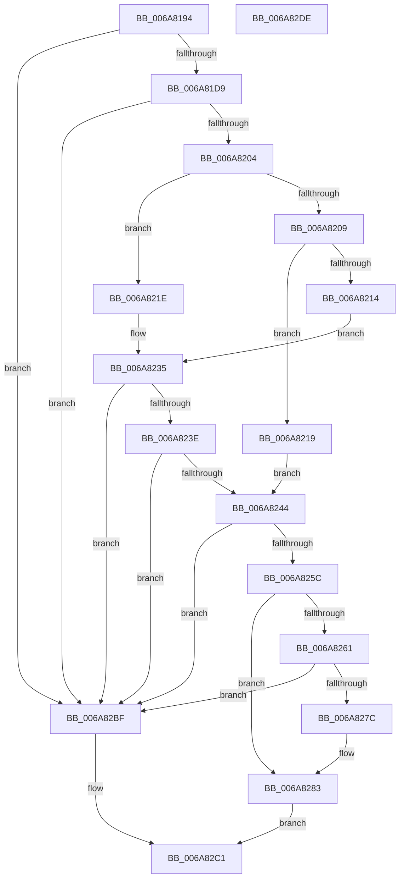

# InbvPortInitialize

- RVA: `0x006A8194`–`0x006A82DF` (길이 `331` bytes)
- VA: `0x00000001406A8194`
- 실행 섹션: `.text`
- PDB 이름 있음: `예`; PDB Function 태그: `아니요`
- unwind 정보 RVA: `0x0008C20C`
- 디코드: `86`개 명령, `331/331` bytes 표시
- 미해석 바이트: `0` (있으면 어셈블리에 `.byte`로 보존)

> 이 문서는 커널 이미지의 기계어와 PDB 기호를 분석해 생성했습니다. 4번과 5번은 함수 원형과 자료형을 바이너리 사용 방식에서 추정한 C 해석이며 원본 소스 복구 결과는 아닙니다.

## 1. Dependencies

- 직접 호출 지점: **2**; 고유 호출 대상: **2**
- 직접 호출자로 확인된 함수: **1**
- RIP 상대 이미지 참조: **3**

### Outgoing calls
- `0x006A826F` → [MmMapIoSpaceEx](../32/MmMapIoSpaceEx_function_00327830.md) (function, `0x00327830`)
- `0x006A82B8` → [guard_dispatch_icall](../6B/guard_dispatch_icall_function_006BAAD0.md) (function, `0x006BAAD0`)

### Direct callers
- [HdlspEnableTerminal](../../pagehdls/BB/HdlspEnableTerminal_function_00BBD9D4.md) at `0x00BBDA31`

### Static image references
- `0x006A81E8` → RVA `0x00000000` (`image boundary/outside`; read)
- `0x006A8250` → RVA `0x00EF0298` (`.data`; write)
- `0x006A82A5` → RVA `0x00EF0298` (`.data`; read)

## 2. Other-region calls and transfers

- 다른 실행 섹션으로 향하는 call: **0**
- 별도 외부 분기/꼬리 이동을 확인하지 못했습니다.

## 3. Assembly (complete function range)

```asm
006A8194  48 89 5C 24 08                  mov qword ptr [rsp + 8], rbx
006A8199  48 89 6C 24 10                  mov qword ptr [rsp + 0x10], rbp
006A819E  48 89 74 24 18                  mov qword ptr [rsp + 0x18], rsi
006A81A3  57                              push rdi
006A81A4  41 54                           push r12
006A81A6  41 55                           push r13
006A81A8  41 56                           push r14
006A81AA  41 57                           push r15
006A81AC  48 83 EC 30                     sub rsp, 0x30
006A81B0  44 8A 9C 24 88 00 00 00         mov r11b, byte ptr [rsp + 0x88]
006A81B8  4D 8B D0                        mov r10, r8
006A81BB  85 D2                           test edx, edx
006A81BD  BB 01 00 00 00                  mov ebx, 1
006A81C2  44 8B C3                        mov r8d, ebx
006A81C5  4D 8B E9                        mov r13, r9
006A81C8  44 0F 45 C2                     cmovne r8d, edx
006A81CC  44 8B E1                        mov r12d, ecx
006A81CF  41 83 F8 04                     cmp r8d, 4
006A81D3  0F 87 E6 00 00 00               ja 0x1406a82bf
006A81D9  41 8D 68 FF                     lea ebp, [r8 - 1]
006A81DD  4C 8D 3C AD 00 00 00 00         lea r15, [rbp*4]
006A81E5  4C 03 FD                        add r15, rbp
006A81E8  48 8D 0D 11 7E 95 FF            lea rcx, [rip - 0x6a81ef]
006A81EF  4C 8D B1 50 00 EF 00            lea r14, [rcx + 0xef0050]
006A81F6  4F 8D 34 FE                     lea r14, [r14 + r15*8]
006A81FA  49 83 3E 00                     cmp qword ptr [r14], 0
006A81FE  0F 85 BB 00 00 00               jne 0x1406a82bf
006A8204  45 84 DB                        test r11b, r11b
006A8207  75 15                           jne 0x1406a821e
006A8209  40 32 FF                        xor dil, dil
006A820C  40 B6 08                        mov sil, 8
006A820F  4D 85 D2                        test r10, r10
006A8212  75 05                           jne 0x1406a8219
006A8214  45 8B D0                        mov r10d, r8d
006A8217  EB 1C                           jmp 0x1406a8235
006A8219  44 8A DB                        mov r11b, bl
006A821C  EB 26                           jmp 0x1406a8244
006A821E  8A 9C 24 98 00 00 00            mov bl, byte ptr [rsp + 0x98]
006A8225  40 8A B4 24 90 00 00 00         mov sil, byte ptr [rsp + 0x90]
006A822D  40 8A BC 24 80 00 00 00         mov dil, byte ptr [rsp + 0x80]
006A8235  4D 85 D2                        test r10, r10
006A8238  0F 84 81 00 00 00               je 0x1406a82bf
006A823E  41 80 FB 15                     cmp r11b, 0x15
006A8242  73 7B                           jae 0x1406a82bf
006A8244  41 0F B6 C3                     movzx eax, r11b
006A8248  48 8B 84 C1 20 D6 00 00         mov rax, qword ptr [rcx + rax*8 + 0xd620]
006A8250  48 89 05 41 80 84 00            mov qword ptr [rip + 0x848041], rax
006A8257  48 85 C0                        test rax, rax
006A825A  74 63                           je 0x1406a82bf
006A825C  40 84 FF                        test dil, dil
006A825F  74 22                           je 0x1406a8283
006A8261  BA 00 10 00 00                  mov edx, 0x1000
006A8266  41 B8 04 02 00 00               mov r8d, 0x204
006A826C  49 8B CA                        mov rcx, r10
006A826F  E8 BC F5 C7 FF                  call 0x140327830
006A8274  4C 8B D0                        mov r10, rax
006A8277  48 85 C0                        test rax, rax
006A827A  74 43                           je 0x1406a82bf
006A827C  48 8D 0D 7D 7D 95 FF            lea rcx, [rip - 0x6a8283]
006A8283  4D 89 16                        mov qword ptr [r14], r10
006A8286  45 85 E4                        test r12d, r12d
006A8289  B8 00 4B 00 00                  mov eax, 0x4b00
006A828E  40 88 74 24 20                  mov byte ptr [rsp + 0x20], sil
006A8293  41 0F 45 C4                     cmovne eax, r12d
006A8297  44 8A CB                        mov r9b, bl
006A829A  42 89 84 F9 58 00 EF 00         mov dword ptr [rcx + r15*8 + 0xef0058], eax
006A82A2  44 8A C7                        mov r8b, dil
006A82A5  48 8B 05 EC 7F 84 00            mov rax, qword ptr [rip + 0x847fec]
006A82AC  49 8B D6                        mov rdx, r14
006A82AF  41 89 6D 00                     mov dword ptr [r13], ebp
006A82B3  33 C9                           xor ecx, ecx
006A82B5  48 8B 00                        mov rax, qword ptr [rax]
006A82B8  E8 13 28 01 00                  call 0x1406baad0
006A82BD  EB 02                           jmp 0x1406a82c1
006A82BF  32 C0                           xor al, al
006A82C1  48 8B 5C 24 60                  mov rbx, qword ptr [rsp + 0x60]
006A82C6  48 8B 6C 24 68                  mov rbp, qword ptr [rsp + 0x68]
006A82CB  48 8B 74 24 70                  mov rsi, qword ptr [rsp + 0x70]
006A82D0  48 83 C4 30                     add rsp, 0x30
006A82D4  41 5F                           pop r15
006A82D6  41 5E                           pop r14
006A82D8  41 5D                           pop r13
006A82DA  41 5C                           pop r12
006A82DC  5F                              pop rdi
006A82DD  C3                              ret
006A82DE  CC                              int3
```

## 4. C-style interpretation (structured pseudocode)

```c
__int64 __fastcall InbvPortInitialize(int a1, int a2, __int64 a3, __int64 a4, unsigned __int8 a5, unsigned __int8 a6, unsigned __int8 a7, unsigned __int8 a8)
{
    __int64 result;
    __int64 v_r15;
    __int64 v_rdi;
    __int64 v_rsp;
    unsigned __int8 v_stack_m38;
    unsigned __int64 v_stack_p10;
    unsigned __int64 v_stack_p18;
    unsigned __int64 v_stack_p8;

    v_stack_p8 = v_rbx;
    v_stack_p10 = v_rbp;
    v_stack_p18 = v_rsi;
    v_rsp = (v_rsp) - (48);
    a3 = 1;
    if (a2 != 0) { a3 = a2; }
    if (((unsigned int)(a3)) > 4) goto loc_006A82BF;
    v_r15 = (a3 - 1 * 4) + (a3 - 1);
    if ((*(unsigned __int64 *)(v_rip - 6980079 + 15663184 + v_r15 * 8)) != 0) goto loc_006A82BF;
    if (a6 != 0) goto loc_006A821E;
    v_rdi = 0;
    if (a3 != 0) goto loc_006A8219;
    goto loc_006A8235;
loc_006A8219:
    goto loc_006A8244;
loc_006A821E:
loc_006A8235:
    if ((unsigned int)((unsigned int)(a3)) == 0) goto loc_006A82BF;
    if (1 >= 21) goto loc_006A82BF;
loc_006A8244:
    *(unsigned __int64 *)(v_rip + 8683585) = *(unsigned __int64 *)(v_rip - 6980079 + 1 * 8 + 54816);
    if (*(unsigned __int64 *)(v_rip - 6980079 + 1 * 8 + 54816) == 0) goto loc_006A82BF;
    if (a5 == 0) goto loc_006A8283;
    result = MmMapIoSpaceEx((unsigned int)((unsigned int)(a3)), (unsigned int)(0x1000ULL), 516, a4);
    if (result == 0) goto loc_006A82BF;
loc_006A8283:
    *(unsigned __int64 *)(v_rip - 6980079 + 15663184 + v_r15 * 8) = result;
    v_stack_m38 = a7;
    result = (unsigned int)(0x4B00ULL);
    if ((unsigned int)((unsigned int)(a1)) != 0) { result = (unsigned int)((unsigned int)(a1)); }
    *(unsigned int *)(v_rip - 6980227 + v_r15 * 8 + 15663192) = (unsigned int)(result);
    *(unsigned int *)(a4) = (unsigned int)(a3 - 1);
    a1 = 0;
    result = guard_dispatch_icall(a1, v_rip - 6980079 + 15663184 + v_r15 * 8, a5, a8);
    goto loc_006A82C1;
loc_006A82BF:
    result = 0;
loc_006A82C1:
    v_rsp = (v_rsp) + (48);
    return result;
}
```

## 5. (Beta) C Style

```c
int64_t InbvPortInitialize(int32_t Arg1, int32_t Arg2, int64_t Arg3, void *Arg4, uint8_t Arg5, uint8_t Arg6, uint8_t Arg7, uint8_t Arg8)
{
    uint8_t *arg4 = (uint8_t *)Arg4;

    int64_t result;
    int64_t local_r15;
    int64_t local_rdi;
    int64_t local_rsp;
    uint8_t v_stack_m38;
    uint64_t v_stack_p10;
    uint64_t v_stack_p18;
    uint64_t v_stack_p8;

    v_stack_p8 = local_rbx;
    v_stack_p10 = local_rbp;
    v_stack_p18 = local_rsi;
    local_rsp = (local_rsp) - (48);
    Arg3 = 1;
    if (Arg2 != 0) { Arg3 = Arg2; }
    if (((uint32_t)(Arg3)) > 4) goto loc_006A82BF;
    local_r15 = (Arg3 - 1 * 4) + (Arg3 - 1);
    if ((*(uint64_t *)(v_rip - 0x6A81EF + 0xEF0050 + local_r15 * 8)) != 0) goto loc_006A82BF;
    if (Arg6 != 0) goto loc_006A821E;
    local_rdi = 0;
    if (Arg3 != 0) goto loc_006A8219;
    goto loc_006A8235;
loc_006A8219:
    goto loc_006A8244;
loc_006A821E:
loc_006A8235:
    if ((uint32_t)((uint32_t)(Arg3)) == 0) goto loc_006A82BF;
    if (1 >= 21) goto loc_006A82BF;
loc_006A8244:
    *(uint64_t *)(v_rip + 0x848041) = *(uint64_t *)(v_rip - 0x6A81EF + 0x1 * 8 + 0xD620);
    if (*(uint64_t *)(v_rip - 0x6A81EF + 0x1 * 8 + 0xD620) == 0) goto loc_006A82BF;
    if (Arg5 == 0) goto loc_006A8283;
    result = MmMapIoSpaceEx((uint32_t)((uint32_t)(Arg3)), (uint32_t)(0x1000ULL), 516, Arg4);
    if (result == 0) goto loc_006A82BF;
loc_006A8283:
    *(uint64_t *)(v_rip - 0x6A81EF + 0xEF0050 + local_r15 * 8) = result;
    v_stack_m38 = Arg7;
    result = (uint32_t)(0x4B00ULL);
    if ((uint32_t)((uint32_t)(Arg1)) != 0) { result = (uint32_t)((uint32_t)(Arg1)); }
    *(uint32_t *)(v_rip - 0x6A8283 + local_r15 * 8 + 0xEF0058) = (uint32_t)(result);
    *(uint32_t *)(arg4) = (uint32_t)(Arg3 - 1);
    Arg1 = 0;
    result = guard_dispatch_icall(Arg1, v_rip - 6980079 + 15663184 + local_r15 * 8, Arg5, Arg8);
    goto loc_006A82C1;
loc_006A82BF:
    result = 0;
loc_006A82C1:
    local_rsp = (local_rsp) + (48);
    return result;
}
```

### 관측된 메모리 오프셋

구조체 형식이 확인되지 않은 접근은 인자 기준의 오프셋으로만 기록했습니다.

| 기준 인자 | 오프셋 표현 | 폭 (bit) | 접근 |
|---|---:|---:|---|
| `Arg4` | `+ 0x0` | `32` | `W` |

## 6. Execution-region graph

[열기: 2D/3D 그래프와 함수 탐색 컨트롤 패널](../../../control-panel.html?section=text&rva=0x006A8194&view=graph)

- 2D 그래프는 위에서 아래로 흐르고, 3D 그래프는 빈 공간을 드래그해 회전합니다. Shift+드래그는 이동, 휠은 확대·축소, 함수 노드 선택은 대상 보고서 이동입니다.

### Static fallback


