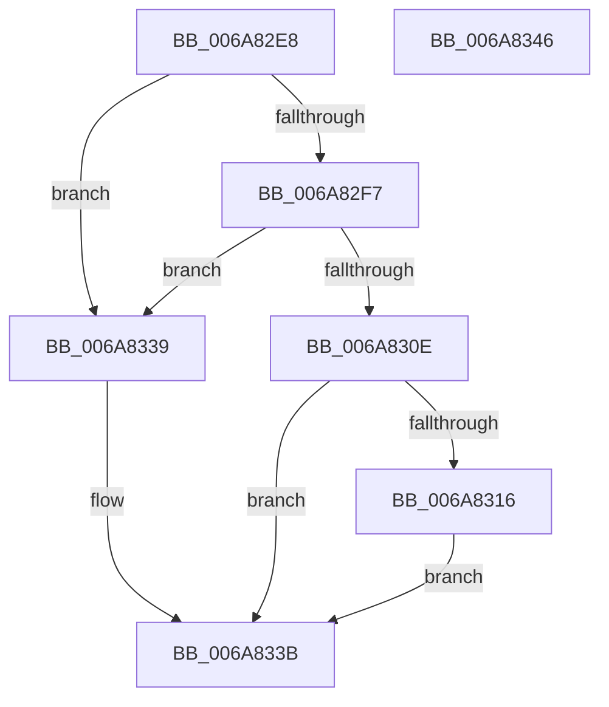

# InbvPortPollOnly

- RVA: `0x006A82E8`–`0x006A8347` (길이 `95` bytes)
- VA: `0x00000001406A82E8`
- 실행 섹션: `.text`
- PDB 이름 있음: `예`; PDB Function 태그: `아니요`
- unwind 정보 RVA: `0x0005CAAC`
- 디코드: `29`개 명령, `95/95` bytes 표시
- 미해석 바이트: `0` (있으면 어셈블리에 `.byte`로 보존)

> 이 문서는 커널 이미지의 기계어와 PDB 기호를 분석해 생성했습니다. 4번과 5번은 함수 원형과 자료형을 바이너리 사용 방식에서 추정한 C 해석이며 원본 소스 복구 결과는 아닙니다.

## 1. Dependencies

- 직접 호출 지점: **1**; 고유 호출 대상: **1**
- 직접 호출자로 확인된 함수: **2**
- RIP 상대 이미지 참조: **2**

### Outgoing calls
- `0x006A8329` → [guard_dispatch_icall](../6B/guard_dispatch_icall_function_006BAAD0.md) (function, `0x006BAAD0`)

### Direct callers
- [HdlspDispatch](../../pagehdls/BB/HdlspDispatch_function_00BBD320.md) at `0x00BBD5C2`
- [HdlspDispatch](../../pagehdls/BB/HdlspDispatch_function_00BBD320.md) at `0x00BBD619`
- [HdlspGetLine](../../pagehdls/BB/HdlspGetLine_function_00BBDAA4.md) at `0x00BBDB29`

### Static image references
- `0x006A82F9` → RVA `0x00EF0050` (`.data`; read)
- `0x006A8316` → RVA `0x00EF0298` (`.data`; read)

## 2. Other-region calls and transfers

- 다른 실행 섹션으로 향하는 call: **0**
- 별도 외부 분기/꼬리 이동을 확인하지 못했습니다.

## 3. Assembly (complete function range)

```asm
006A82E8  48 89 5C 24 08                  mov qword ptr [rsp + 8], rbx
006A82ED  57                              push rdi
006A82EE  48 83 EC 20                     sub rsp, 0x20
006A82F2  83 F9 04                        cmp ecx, 4
006A82F5  73 42                           jae 0x1406a8339
006A82F7  8B C1                           mov eax, ecx
006A82F9  48 8D 3D 50 7D 84 00            lea rdi, [rip + 0x847d50]
006A8300  48 8D 1C 80                     lea rbx, [rax + rax*4]
006A8304  48 8D 0C DF                     lea rcx, [rdi + rbx*8]
006A8308  48 83 39 00                     cmp qword ptr [rcx], 0
006A830C  74 2B                           je 0x1406a8339
006A830E  8A 44 DF 21                     mov al, byte ptr [rdi + rbx*8 + 0x21]
006A8312  84 C0                           test al, al
006A8314  75 25                           jne 0x1406a833b
006A8316  48 8B 05 7B 7F 84 00            mov rax, qword ptr [rip + 0x847f7b]
006A831D  48 8D 57 20                     lea rdx, [rdi + 0x20]
006A8321  48 8D 14 DA                     lea rdx, [rdx + rbx*8]
006A8325  48 8B 40 10                     mov rax, qword ptr [rax + 0x10]
006A8329  E8 A2 27 01 00                  call 0x1406baad0
006A832E  85 C0                           test eax, eax
006A8330  0F 94 C0                        sete al
006A8333  88 44 DF 21                     mov byte ptr [rdi + rbx*8 + 0x21], al
006A8337  EB 02                           jmp 0x1406a833b
006A8339  32 C0                           xor al, al
006A833B  48 8B 5C 24 30                  mov rbx, qword ptr [rsp + 0x30]
006A8340  48 83 C4 20                     add rsp, 0x20
006A8344  5F                              pop rdi
006A8345  C3                              ret
006A8346  CC                              int3
```

## 4. C-style interpretation (structured pseudocode)

```c
__int64 __fastcall InbvPortPollOnly(int a1)
{
    __int64 result;
    __int64 v_rsp;
    unsigned __int64 v_stack_p8;

    v_stack_p8 = v_rbx;
    v_rsp = (v_rsp) - (32);
    if (a1 >= 4) goto loc_006A8339;
    if ((*(unsigned __int64 *)(v_rip + 8682832 + (unsigned int)(a1) + (unsigned int)(a1) * 4 * 8)) == 0) goto loc_006A8339;
    if ((unsigned __int8)(*(unsigned __int8 *)(v_rip + 8682832 + (unsigned int)(a1) + (unsigned int)(a1) * 4 * 8 + 33)) != 0) goto loc_006A833B;
    result = guard_dispatch_icall(v_rip + 8682832 + (unsigned int)(a1) + (unsigned int)(a1) * 4 * 8, v_rip + 8682832 + 32 + (unsigned int)(a1) + (unsigned int)(a1) * 4 * 8, a3, a4);
    result = ((unsigned int)(result) == 0) ? 1 : 0;
    *(unsigned __int8 *)(v_rip + 8682832 + (unsigned int)(a1) + (unsigned int)(a1) * 4 * 8 + 33) = (unsigned __int8)(result);
    goto loc_006A833B;
loc_006A8339:
    result = 0;
loc_006A833B:
    v_rsp = (v_rsp) + (32);
    return result;
}
```

## 5. (Beta) C Style

```c
int64_t InbvPortPollOnly(int32_t Arg1)
{
    int64_t result;
    int64_t local_rsp;
    uint64_t v_stack_p8;

    v_stack_p8 = local_rbx;
    local_rsp = (local_rsp) - (32);
    if (Arg1 >= 4) goto loc_006A8339;
    if ((*(uint64_t *)(v_rip + 0x847D50 + (uint32_t)(Arg1) + (uint32_t)(Arg1) * 4 * 8)) == 0) goto loc_006A8339;
    if ((uint8_t)(*(uint8_t *)(v_rip + 0x847D50 + (uint32_t)(Arg1) + (uint32_t)(Arg1) * 4 * 8 + 0x21)) != 0) goto loc_006A833B;
    result = guard_dispatch_icall(v_rip + 8682832 + (uint32_t)(Arg1) + (uint32_t)(Arg1) * 4 * 8, v_rip + 8682832 + 32 + (uint32_t)(Arg1) + (uint32_t)(Arg1) * 4 * 8, a3, a4);
    result = ((uint32_t)(result) == 0) ? 1 : 0;
    *(uint8_t *)(v_rip + 0x847D50 + (uint32_t)(Arg1) + (uint32_t)(Arg1) * 4 * 8 + 0x21) = (uint8_t)(result);
    goto loc_006A833B;
loc_006A8339:
    result = 0;
loc_006A833B:
    local_rsp = (local_rsp) + (32);
    return result;
}
```

## 6. Execution-region graph

[열기: 2D/3D 그래프와 함수 탐색 컨트롤 패널](../../../control-panel.html?section=text&rva=0x006A82E8&view=graph)

- 2D 그래프는 위에서 아래로 흐르고, 3D 그래프는 빈 공간을 드래그해 회전합니다. Shift+드래그는 이동, 휠은 확대·축소, 함수 노드 선택은 대상 보고서 이동입니다.

### Static fallback


