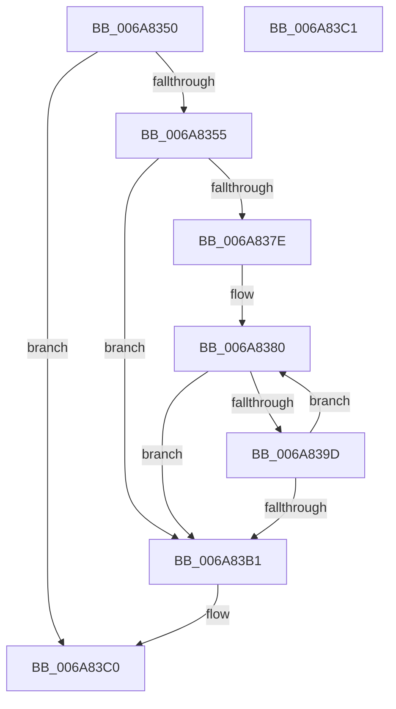

# InbvPortPutByte

- RVA: `0x006A8350`–`0x006A83C2` (길이 `114` bytes)
- VA: `0x00000001406A8350`
- 실행 섹션: `.text`
- PDB 이름 있음: `예`; PDB Function 태그: `아니요`
- unwind 정보 RVA: `0x000ADC24`
- 디코드: `33`개 명령, `114/114` bytes 표시
- 미해석 바이트: `0` (있으면 어셈블리에 `.byte`로 보존)

> 이 문서는 커널 이미지의 기계어와 PDB 기호를 분석해 생성했습니다. 4번과 5번은 함수 원형과 자료형을 바이너리 사용 방식에서 추정한 C 해석이며 원본 소스 복구 결과는 아닙니다.

## 1. Dependencies

- 직접 호출 지점: **2**; 고유 호출 대상: **2**
- 직접 호출자로 확인된 함수: **2**
- RIP 상대 이미지 참조: **2**

### Outgoing calls
- `0x006A8394` → [guard_dispatch_icall](../6B/guard_dispatch_icall_function_006BAAD0.md) (function, `0x006BAAD0`)
- `0x006A83A2` → [KeStallExecutionProcessor](../44/KeStallExecutionProcessor_function_0044F620.md) (function, `0x0044F620`)

### Direct callers
- [HdlspDispatch](../../pagehdls/BB/HdlspDispatch_function_00BBD320.md) at `0x00BBD7DE`
- [HdlspSendStringAtBaud](../../pagehdls/BB/HdlspSendStringAtBaud_function_00BBE5CC.md) at `0x00BBE5E5`

### Static image references
- `0x006A836D` → RVA `0x00EF0050` (`.data`; read)
- `0x006A8380` → RVA `0x00EF0298` (`.data`; read)

## 2. Other-region calls and transfers

- 다른 실행 섹션으로 향하는 call: **0**
- 별도 외부 분기/꼬리 이동을 확인하지 못했습니다.

## 3. Assembly (complete function range)

```asm
006A8350  83 F9 04                        cmp ecx, 4
006A8353  73 6B                           jae 0x1406a83c0
006A8355  48 89 5C 24 08                  mov qword ptr [rsp + 8], rbx
006A835A  48 89 74 24 10                  mov qword ptr [rsp + 0x10], rsi
006A835F  57                              push rdi
006A8360  48 83 EC 20                     sub rsp, 0x20
006A8364  8B C1                           mov eax, ecx
006A8366  40 8A F2                        mov sil, dl
006A8369  48 8D 0C 80                     lea rcx, [rax + rax*4]
006A836D  48 8D 05 DC 7C 84 00            lea rax, [rip + 0x847cdc]
006A8374  48 8D 3C C8                     lea rdi, [rax + rcx*8]
006A8378  48 83 3F 00                     cmp qword ptr [rdi], 0
006A837C  74 33                           je 0x1406a83b1
006A837E  33 DB                           xor ebx, ebx
006A8380  48 8B 05 11 7F 84 00            mov rax, qword ptr [rip + 0x847f11]
006A8387  45 33 C0                        xor r8d, r8d
006A838A  40 8A D6                        mov dl, sil
006A838D  48 8B CF                        mov rcx, rdi
006A8390  48 8B 40 18                     mov rax, qword ptr [rax + 0x18]
006A8394  E8 37 27 01 00                  call 0x1406baad0
006A8399  85 C0                           test eax, eax
006A839B  74 14                           je 0x1406a83b1
006A839D  B9 0A 00 00 00                  mov ecx, 0xa
006A83A2  E8 79 72 DA FF                  call 0x14044f620
006A83A7  FF C3                           inc ebx
006A83A9  81 FB 80 00 00 00               cmp ebx, 0x80
006A83AF  72 CF                           jb 0x1406a8380
006A83B1  48 8B 5C 24 30                  mov rbx, qword ptr [rsp + 0x30]
006A83B6  48 8B 74 24 38                  mov rsi, qword ptr [rsp + 0x38]
006A83BB  48 83 C4 20                     add rsp, 0x20
006A83BF  5F                              pop rdi
006A83C0  C3                              ret
006A83C1  CC                              int3
```

## 4. C-style interpretation (structured pseudocode)

```c
__int64 __fastcall InbvPortPutByte(int a1, unsigned __int8 a2, int a3)
{
    __int64 result;
    __int64 v_rbx;
    __int64 v_rsp;
    unsigned __int64 v_stack_p10;
    unsigned __int64 v_stack_p8;

    if (a1 >= 4) goto loc_006A83C0;
    v_stack_p8 = v_rbx;
    v_stack_p10 = v_rsi;
    v_rsp = (v_rsp) - (32);
    if ((*(unsigned __int64 *)(v_rip + 8682716 + (unsigned int)(a1) + (unsigned int)(a1) * 4 * 8)) == 0) goto loc_006A83B1;
    v_rbx = 0;
loc_006A8380:
    a3 = 0;
    result = guard_dispatch_icall(v_rip + 8682716 + (unsigned int)(a1) + (unsigned int)(a1) * 4 * 8, a2, a3, a4);
    if ((unsigned int)(result) == 0) goto loc_006A83B1;
    result = KeStallExecutionProcessor(10, a2, a3, a4);
    v_rbx = (unsigned int)((v_rbx) + 1);
    if (((unsigned int)(v_rbx)) < 128) goto loc_006A8380;
loc_006A83B1:
    v_rsp = (v_rsp) + (32);
loc_006A83C0:
    return result;
}
```

## 5. (Beta) C Style

```c
int64_t InbvPortPutByte(int32_t Arg1, uint8_t Arg2, int32_t Arg3)
{
    int64_t result;
    int64_t local_rbx;
    int64_t local_rsp;
    uint64_t v_stack_p10;
    uint64_t v_stack_p8;

    if (Arg1 >= 4) goto loc_006A83C0;
    v_stack_p8 = local_rbx;
    v_stack_p10 = local_rsi;
    local_rsp = (local_rsp) - (32);
    if ((*(uint64_t *)(v_rip + 0x847CDC + (uint32_t)(Arg1) + (uint32_t)(Arg1) * 4 * 8)) == 0) goto loc_006A83B1;
    local_rbx = 0;
loc_006A8380:
    Arg3 = 0;
    result = guard_dispatch_icall(v_rip + 8682716 + (uint32_t)(Arg1) + (uint32_t)(Arg1) * 4 * 8, Arg2, Arg3, a4);
    if ((uint32_t)(result) == 0) goto loc_006A83B1;
    result = KeStallExecutionProcessor(10, Arg2, Arg3, a4);
    local_rbx = (uint32_t)((local_rbx) + 1);
    if (((uint32_t)(local_rbx)) < 128) goto loc_006A8380;
loc_006A83B1:
    local_rsp = (local_rsp) + (32);
loc_006A83C0:
    return result;
}
```

## 6. Execution-region graph

[열기: 2D/3D 그래프와 함수 탐색 컨트롤 패널](../../../control-panel.html?section=text&rva=0x006A8350&view=graph)

- 2D 그래프는 위에서 아래로 흐르고, 3D 그래프는 빈 공간을 드래그해 회전합니다. Shift+드래그는 이동, 휠은 확대·축소, 함수 노드 선택은 대상 보고서 이동입니다.

### Static fallback


