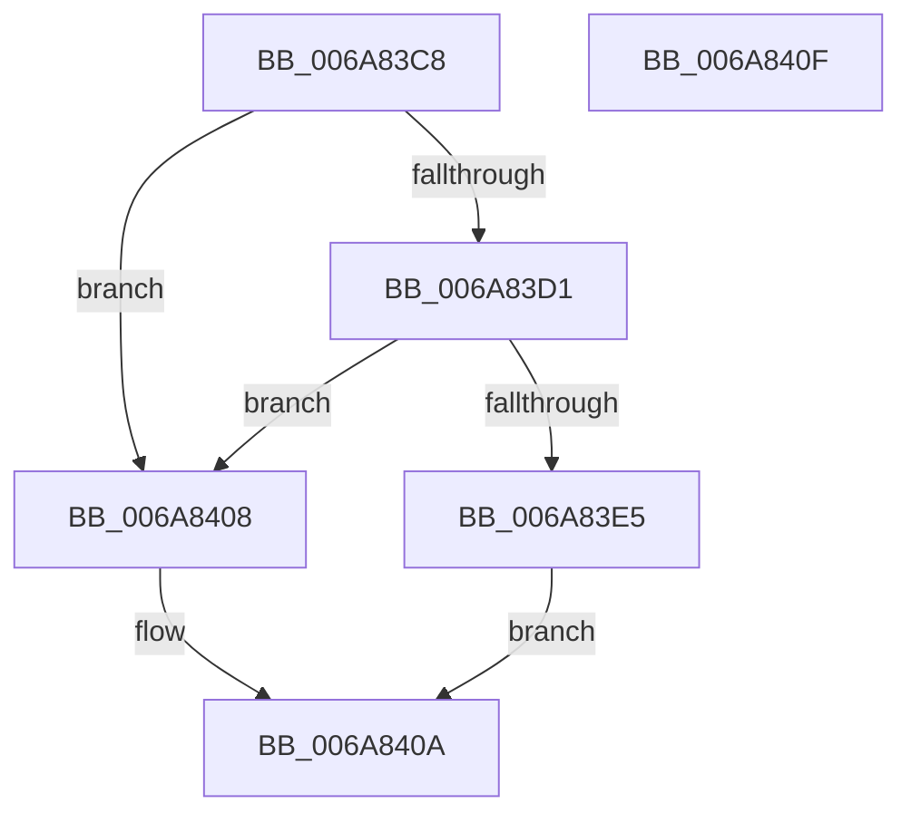

# InbvPortTerminate

- RVA: `0x006A83C8`–`0x006A8410` (길이 `72` bytes)
- VA: `0x00000001406A83C8`
- 실행 섹션: `.text`
- PDB 이름 있음: `예`; PDB Function 태그: `아니요`
- unwind 정보 RVA: `0x0005D2F4`
- 디코드: `21`개 명령, `72/72` bytes 표시
- 미해석 바이트: `0` (있으면 어셈블리에 `.byte`로 보존)

> 이 문서는 커널 이미지의 기계어와 PDB 기호를 분석해 생성했습니다. 4번과 5번은 함수 원형과 자료형을 바이너리 사용 방식에서 추정한 C 해석이며 원본 소스 복구 결과는 아닙니다.

## 1. Dependencies

- 직접 호출 지점: **0**; 고유 호출 대상: **0**
- 직접 호출자로 확인된 함수: **1**
- RIP 상대 이미지 참조: **1**

### Outgoing calls
- 직접 디코드된 call 명령이 없습니다.

### Direct callers
- [HdlspEnableTerminal](../../pagehdls/BB/HdlspEnableTerminal_function_00BBD9D4.md) at `0x00BBDA87`

### Static image references
- `0x006A83D3` → RVA `0x00EF0050` (`.data`; read)

## 2. Other-region calls and transfers

- 다른 실행 섹션으로 향하는 call: **0**
- 별도 외부 분기/꼬리 이동을 확인하지 못했습니다.

## 3. Assembly (complete function range)

```asm
006A83C8  48 83 EC 38                     sub rsp, 0x38
006A83CC  83 F9 04                        cmp ecx, 4
006A83CF  73 37                           jae 0x1406a8408
006A83D1  8B C1                           mov eax, ecx
006A83D3  48 8D 15 76 7C 84 00            lea rdx, [rip + 0x847c76]
006A83DA  48 8D 0C 80                     lea rcx, [rax + rax*4]
006A83DE  48 83 3C CA 00                  cmp qword ptr [rdx + rcx*8], 0
006A83E3  74 23                           je 0x1406a8408
006A83E5  0F 57 C0                        xorps xmm0, xmm0
006A83E8  33 C0                           xor eax, eax
006A83EA  0F 11 04 CA                     movups xmmword ptr [rdx + rcx*8], xmm0
006A83EE  48 89 44 24 20                  mov qword ptr [rsp + 0x20], rax
006A83F3  B0 01                           mov al, 1
006A83F5  0F 11 44 CA 10                  movups xmmword ptr [rdx + rcx*8 + 0x10], xmm0
006A83FA  F2 0F 10 44 24 20               movsd xmm0, qword ptr [rsp + 0x20]
006A8400  F2 0F 11 44 CA 20               movsd qword ptr [rdx + rcx*8 + 0x20], xmm0
006A8406  EB 02                           jmp 0x1406a840a
006A8408  32 C0                           xor al, al
006A840A  48 83 C4 38                     add rsp, 0x38
006A840E  C3                              ret
006A840F  CC                              int3
```

## 4. C-style interpretation (structured pseudocode)

```c
__int64 __fastcall InbvPortTerminate(int a1)
{
    __int64 result;
    __int64 v_rsp;
    unsigned __int64 v_stack_m18;

    v_rsp = (v_rsp) - (56);
    if (a1 >= 4) goto loc_006A8408;
    if ((*(unsigned __int64 *)(v_rip + 8682614 + (unsigned int)(a1) + (unsigned int)(a1) * 4 * 8)) == 0) goto loc_006A8408;
    result = 0;
    *(unsigned __int64 *)(v_rip + 8682614 + (unsigned int)(a1) + (unsigned int)(a1) * 4 * 8) = v_xmm0;
    v_stack_m18 = 0;
    *(unsigned __int64 *)(v_rip + 8682614 + (unsigned int)(a1) + (unsigned int)(a1) * 4 * 8 + 16) = v_xmm0;
    *(unsigned __int64 *)(v_rip + 8682614 + (unsigned int)(a1) + (unsigned int)(a1) * 4 * 8 + 32) = v_xmm0;
    goto loc_006A840A;
loc_006A8408:
    result = 0;
loc_006A840A:
    v_rsp = (v_rsp) + (56);
    return result;
}
```

## 5. (Beta) C Style

```c
int64_t InbvPortTerminate(int32_t Arg1)
{
    int64_t result;
    int64_t local_rsp;
    uint64_t v_stack_m18;

    local_rsp = (local_rsp) - (56);
    if (Arg1 >= 4) goto loc_006A8408;
    if ((*(uint64_t *)(v_rip + 0x847C76 + (uint32_t)(Arg1) + (uint32_t)(Arg1) * 4 * 8)) == 0) goto loc_006A8408;
    result = 0;
    *(uint64_t *)(v_rip + 0x847C76 + (uint32_t)(Arg1) + (uint32_t)(Arg1) * 4 * 8) = v_xmm0;
    v_stack_m18 = 0;
    *(uint64_t *)(v_rip + 0x847C76 + (uint32_t)(Arg1) + (uint32_t)(Arg1) * 4 * 8 + 0x10) = v_xmm0;
    *(uint64_t *)(v_rip + 0x847C76 + (uint32_t)(Arg1) + (uint32_t)(Arg1) * 4 * 8 + 0x20) = v_xmm0;
    goto loc_006A840A;
loc_006A8408:
    result = 0;
loc_006A840A:
    local_rsp = (local_rsp) + (56);
    return result;
}
```

## 6. Execution-region graph

[열기: 2D/3D 그래프와 함수 탐색 컨트롤 패널](../../../control-panel.html?section=text&rva=0x006A83C8&view=graph)

- 2D 그래프는 위에서 아래로 흐르고, 3D 그래프는 빈 공간을 드래그해 회전합니다. Shift+드래그는 이동, 휠은 확대·축소, 함수 노드 선택은 대상 보고서 이동입니다.

### Static fallback


