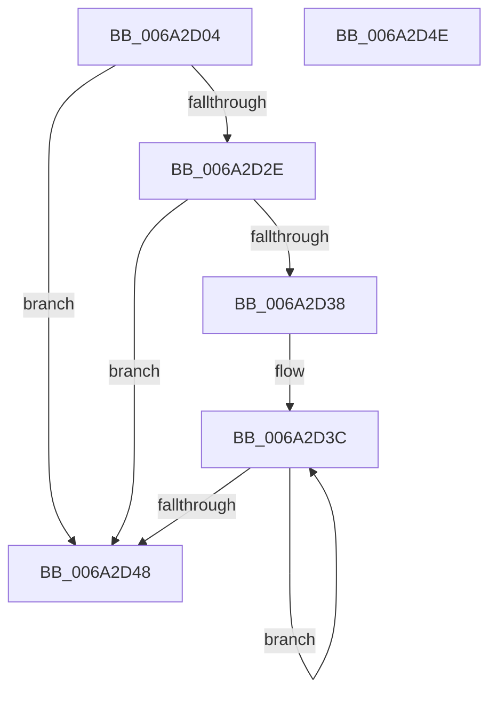

# IntpAllocateGroupContext

- RVA: `0x006A2D04`–`0x006A2D4F` (길이 `75` bytes)
- VA: `0x00000001406A2D04`
- 실행 섹션: `.text`
- PDB 이름 있음: `예`; PDB Function 태그: `아니요`
- unwind 정보 RVA: `0x0005CF00`
- 디코드: `26`개 명령, `75/75` bytes 표시
- 미해석 바이트: `0` (있으면 어셈블리에 `.byte`로 보존)

> 이 문서는 커널 이미지의 기계어와 PDB 기호를 분석해 생성했습니다. 4번과 5번은 함수 원형과 자료형을 바이너리 사용 방식에서 추정한 C 해석이며 원본 소스 복구 결과는 아닙니다.

## 1. Dependencies

- 직접 호출 지점: **1**; 고유 호출 대상: **1**
- 직접 호출자로 확인된 함수: **1**
- RIP 상대 이미지 참조: **0**

### Outgoing calls
- `0x006A2D22` → [ExAllocatePool2](../../poolcode/B8/ExAllocatePool2_function_00B820F0.md) (function, `0x00B820F0`)

### Direct callers
- [IntPartCreate](../../init/C6/IntPartCreate_function_00C6D5C4.md) at `0x00C6D6A3`

### Static image references
- 디코드된 RIP-relative 메모리 참조가 없습니다.

## 2. Other-region calls and transfers

- 다른 실행 섹션으로 향하는 call: **1**
  - `0x006A2D22` → [ExAllocatePool2](../../poolcode/B8/ExAllocatePool2_function_00B820F0.md) (`.text` → `POOLCODE`)
- 별도 외부 분기/꼬리 이동을 확인하지 못했습니다.

## 3. Assembly (complete function range)

```asm
006A2D04  40 53                           push rbx
006A2D06  48 83 EC 20                     sub rsp, 0x20
006A2D0A  0F B6 DA                        movzx ebx, dl
006A2D0D  B9 40 00 00 00                  mov ecx, 0x40
006A2D12  8B D3                           mov edx, ebx
006A2D14  41 B8 4B 65 49 50               mov r8d, 0x5049654b
006A2D1A  48 C1 E2 04                     shl rdx, 4
006A2D1E  48 83 C2 08                     add rdx, 8
006A2D22  E8 C9 F3 4D 00                  call 0x140b820f0
006A2D27  33 C9                           xor ecx, ecx
006A2D29  48 85 C0                        test rax, rax
006A2D2C  74 1A                           je 0x1406a2d48
006A2D2E  66 89 08                        mov word ptr [rax], cx
006A2D31  88 58 02                        mov byte ptr [rax + 2], bl
006A2D34  84 DB                           test bl, bl
006A2D36  74 10                           je 0x1406a2d48
006A2D38  48 8D 50 08                     lea rdx, [rax + 8]
006A2D3C  88 0A                           mov byte ptr [rdx], cl
006A2D3E  FE C1                           inc cl
006A2D40  48 8D 52 10                     lea rdx, [rdx + 0x10]
006A2D44  3A CB                           cmp cl, bl
006A2D46  72 F4                           jb 0x1406a2d3c
006A2D48  48 83 C4 20                     add rsp, 0x20
006A2D4C  5B                              pop rbx
006A2D4D  C3                              ret
006A2D4E  CC                              int3
```

## 4. C-style interpretation (structured pseudocode)

```c
__int64 __fastcall IntpAllocateGroupContext(__int64 a1, unsigned __int8 a2)
{
    __int64 result;
    __int64 v_rsp;

    v_rsp = (v_rsp) - (32);
    a2 = ((unsigned int)(a2)) << (4);
    a2 = (a2) + (8);
    result = ExAllocatePool2(64, a2, (unsigned int)(0x5049654BULL), a4);
    a1 = 0;
    if (result == 0) goto loc_006A2D48;
    *(unsigned __int16 *)(result) = 0;
    *(unsigned __int8 *)(result + 2) = a2;
    if (a2 == 0) goto loc_006A2D48;
loc_006A2D3C:
    *(unsigned __int8 *)(result + 8) = 0;
    a1 = (unsigned __int8)((a1) + 1);
    if (((unsigned __int8)(a1)) < a2) goto loc_006A2D3C;
loc_006A2D48:
    v_rsp = (v_rsp) + (32);
    return result;
}
```

## 5. (Beta) C Style

```c
int64_t IntpAllocateGroupContext(int64_t Arg1, uint8_t Arg2)
{
    int64_t result;
    int64_t local_rsp;

    local_rsp = (local_rsp) - (32);
    Arg2 = ((uint32_t)(Arg2)) << (4);
    Arg2 = (Arg2) + (8);
    result = ExAllocatePool2(64, Arg2, (uint32_t)(0x5049654BULL), a4);
    Arg1 = 0;
    if (result == 0) goto loc_006A2D48;
    *(uint16_t *)(result) = 0;
    *(uint8_t *)(result + 0x2) = Arg2;
    if (Arg2 == 0) goto loc_006A2D48;
loc_006A2D3C:
    *(uint8_t *)(result + 0x8) = 0;
    Arg1 = (uint8_t)((Arg1) + 1);
    if (((uint8_t)(Arg1)) < Arg2) goto loc_006A2D3C;
loc_006A2D48:
    local_rsp = (local_rsp) + (32);
    return result;
}
```

## 6. Execution-region graph

[열기: 2D/3D 그래프와 함수 탐색 컨트롤 패널](../../../control-panel.html?section=text&rva=0x006A2D04&view=graph)

- 2D 그래프는 위에서 아래로 흐르고, 3D 그래프는 빈 공간을 드래그해 회전합니다. Shift+드래그는 이동, 휠은 확대·축소, 함수 노드 선택은 대상 보고서 이동입니다.

### Static fallback


