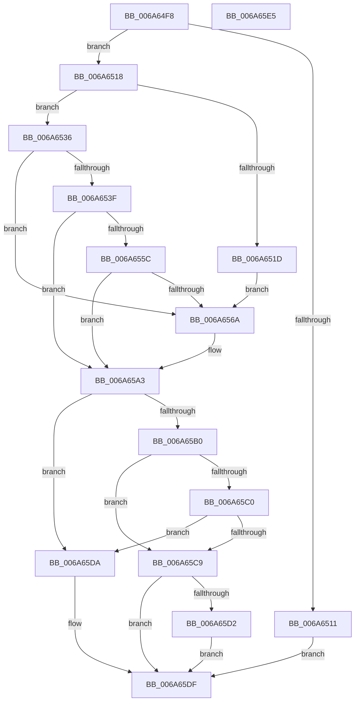

# IpmiHwInitializeContext

- RVA: `0x006A64F8`–`0x006A65E6` (길이 `238` bytes)
- VA: `0x00000001406A64F8`
- 실행 섹션: `.text`
- PDB 이름 있음: `예`; PDB Function 태그: `아니요`
- unwind 정보 RVA: `0x000697A4`
- 디코드: `57`개 명령, `238/238` bytes 표시
- 미해석 바이트: `0` (있으면 어셈블리에 `.byte`로 보존)

> 이 문서는 커널 이미지의 기계어와 PDB 기호를 분석해 생성했습니다. 4번과 5번은 함수 원형과 자료형을 바이너리 사용 방식에서 추정한 C 해석이며 원본 소스 복구 결과는 아닙니다.

## 1. Dependencies

- 직접 호출 지점: **6**; 고유 호출 대상: **5**
- 직접 호출자로 확인된 함수: **1**
- RIP 상대 이미지 참조: **11**

### Outgoing calls
- `0x006A6508` → [IpmiHwContextInitialized](IpmiHwContextInitialized_function_006A64DC.md) (function, `0x006A64DC`)
- `0x006A6536` → [IpmiHwpReadSpmiConfiguration](IpmiHwpReadSpmiConfiguration_function_006A672C.md) (function, `0x006A672C`)
- `0x006A6553` → [IpmiLibReadSmbiosRecord38](IpmiLibReadSmbiosRecord38_function_006A67E4.md) (function, `0x006A67E4`)
- `0x006A6561` → [IpmiLibpParseDeviceInfo](IpmiLibpParseDeviceInfo_function_006A691C.md) (function, `0x006A691C`)
- `0x006A65B7` → [IpmiHwContextInitialized](IpmiHwContextInitialized_function_006A64DC.md) (function, `0x006A64DC`)
- `0x006A65C9` → [IpmiHwKcsInit](IpmiHwKcsInit_function_006A65EC.md) (function, `0x006A65EC`)

### Direct callers
- [InitBootProcessor](../../init/C1/InitBootProcessor_function_00C1B1C8.md) at `0x00C1B6BA`

### Static image references
- `0x006A6501` → RVA `0x00EFA080` (`.data`; read)
- `0x006A652D` → RVA `0x00EFA090` (`.data`; read)
- `0x006A656F` → RVA `0x00EFA0D4` (`.data`; write)
- `0x006A6579` → RVA `0x00EFA0C4` (`.data`; write)
- `0x006A657F` → RVA `0x00EFA0D0` (`.data`; write)
- `0x006A6585` → RVA `0x00EFA0CC` (`.data`; write)
- `0x006A658F` → RVA `0x00EFA0C8` (`.data`; write)
- `0x006A6599` → RVA `0x00EFA0C0` (`.data`; write)
- `0x006A65A8` → RVA `0x00EFA084` (`.data`; read)
- `0x006A65C0` → RVA `0x00EFA098` (`.data`; read)
- `0x006A65D2` → RVA `0x00EFA0D8` (`.data`; read/write)

## 2. Other-region calls and transfers

- 다른 실행 섹션으로 향하는 call: **0**
- 별도 외부 분기/꼬리 이동을 확인하지 못했습니다.

## 3. Assembly (complete function range)

```asm
006A64F8  40 53                           push rbx
006A64FA  48 83 EC 40                     sub rsp, 0x40
006A64FE  4C 8B C1                        mov r8, rcx
006A6501  48 8D 0D 78 3B 85 00            lea rcx, [rip + 0x853b78]
006A6508  E8 CF FF FF FF                  call 0x1406a64dc
006A650D  84 C0                           test al, al
006A650F  74 07                           je 0x1406a6518
006A6511  33 C0                           xor eax, eax
006A6513  E9 C7 00 00 00                  jmp 0x1406a65df
006A6518  4D 85 C0                        test r8, r8
006A651B  74 19                           je 0x1406a6536
006A651D  41 0F 10 00                     movups xmm0, xmmword ptr [r8]
006A6521  0F 11 05 58 3B 85 00            movups xmmword ptr [rip + 0x853b58], xmm0
006A6528  41 0F 10 48 10                  movups xmm1, xmmword ptr [r8 + 0x10]
006A652D  0F 11 0D 5C 3B 85 00            movups xmmword ptr [rip + 0x853b5c], xmm1
006A6534  EB 34                           jmp 0x1406a656a
006A6536  E8 F1 01 00 00                  call 0x1406a672c
006A653B  85 C0                           test eax, eax
006A653D  79 2B                           jns 0x1406a656a
006A653F  0F 57 C0                        xorps xmm0, xmm0
006A6542  48 8D 4C 24 20                  lea rcx, [rsp + 0x20]
006A6547  33 C0                           xor eax, eax
006A6549  0F 11 44 24 20                  movups xmmword ptr [rsp + 0x20], xmm0
006A654E  66 89 44 24 30                  mov word ptr [rsp + 0x30], ax
006A6553  E8 8C 02 00 00                  call 0x1406a67e4
006A6558  85 C0                           test eax, eax
006A655A  78 47                           js 0x1406a65a3
006A655C  48 8D 54 24 20                  lea rdx, [rsp + 0x20]
006A6561  E8 B6 03 00 00                  call 0x1406a691c
006A6566  85 C0                           test eax, eax
006A6568  78 39                           js 0x1406a65a3
006A656A  B8 40 4B 4C 00                  mov eax, 0x4c4b40
006A656F  C7 05 5B 3B 85 00 07 00 00 00   mov dword ptr [rip + 0x853b5b], 7
006A6579  89 05 45 3B 85 00               mov dword ptr [rip + 0x853b45], eax
006A657F  89 05 4B 3B 85 00               mov dword ptr [rip + 0x853b4b], eax
006A6585  C7 05 3D 3B 85 00 E8 03 00 00   mov dword ptr [rip + 0x853b3d], 0x3e8
006A658F  C7 05 2F 3B 85 00 1E 00 00 00   mov dword ptr [rip + 0x853b2f], 0x1e
006A6599  C7 05 1D 3B 85 00 80 84 1E 00   mov dword ptr [rip + 0x853b1d], 0x1e8480
006A65A3  BB 01 00 00 00                  mov ebx, 1
006A65A8  39 1D D6 3A 85 00               cmp dword ptr [rip + 0x853ad6], ebx
006A65AE  75 2A                           jne 0x1406a65da
006A65B0  48 8D 0D C9 3A 85 00            lea rcx, [rip + 0x853ac9]
006A65B7  E8 20 FF FF FF                  call 0x1406a64dc
006A65BC  84 C0                           test al, al
006A65BE  74 09                           je 0x1406a65c9
006A65C0  80 3D D1 3A 85 00 00            cmp byte ptr [rip + 0x853ad1], 0
006A65C7  74 11                           je 0x1406a65da
006A65C9  E8 1E 00 00 00                  call 0x1406a65ec
006A65CE  85 C0                           test eax, eax
006A65D0  78 0D                           js 0x1406a65df
006A65D2  86 1D 00 3B 85 00               xchg byte ptr [rip + 0x853b00], bl
006A65D8  EB 05                           jmp 0x1406a65df
006A65DA  B8 BB 00 00 C0                  mov eax, 0xc00000bb
006A65DF  48 83 C4 40                     add rsp, 0x40
006A65E3  5B                              pop rbx
006A65E4  C3                              ret
006A65E5  CC                              int3
```

## 4. C-style interpretation (structured pseudocode)

```c
__int64 __fastcall IpmiHwInitializeContext(__int64 a1)
{
    __int64 result;
    __int64 v_rsp;
    unsigned __int16 v_stack_m18;
    unsigned __int64 v_stack_m28;

    v_rsp = (v_rsp) - (64);
    result = IpmiHwContextInitialized(v_rip + 8731512, a2, a1, a4);
    if ((unsigned __int8)(result) == 0) goto loc_006A6518;
    result = 0;
    goto loc_006A65DF;
loc_006A6518:
    if (a1 == 0) goto loc_006A6536;
    *(unsigned __int64 *)(v_rip + 8731480) = v_xmm0;
    *(unsigned __int64 *)(v_rip + 8731484) = v_xmm1;
    goto loc_006A656A;
loc_006A6536:
    result = IpmiHwpReadSpmiConfiguration(v_rip + 8731512, a2, a1, a4);
    if (!sign_flag) goto loc_006A656A;
    result = 0;
    v_stack_m28 = v_xmm0;
    v_stack_m18 = 0;
    result = IpmiLibReadSmbiosRecord38(v_stack_m28, a2, a1, a4);
    if (sign_flag) goto loc_006A65A3;
    result = IpmiLibpParseDeviceInfo(v_stack_m28, v_stack_m28, a1, a4);
    if (!(sign_flag)) {
        result = 0x4C4B40ULL;
        *(unsigned int *)(v_rip + 8731483) = 7;
        *(unsigned int *)(v_rip + 8731461) = (unsigned int)(result);
        *(unsigned int *)(v_rip + 8731467) = (unsigned int)(result);
        *(unsigned int *)(v_rip + 8731453) = 1000;
        *(unsigned int *)(v_rip + 8731439) = 30;
        *(unsigned int *)(v_rip + 8731421) = 0x1E8480ULL;
    }
    if ((*(unsigned int *)(v_rip + 8731350)) != 1) goto loc_006A65DA;
    result = IpmiHwContextInitialized(v_rip + 8731337, v_stack_m28, a1, a4);
    if ((unsigned __int8)(result) == 0) goto loc_006A65C9;
    if ((*(unsigned __int8 *)(v_rip + 8731345)) == 0) goto loc_006A65DA;
loc_006A65C9:
    result = IpmiHwKcsInit(v_rip + 8731337, v_stack_m28, a1, a4);
    if (sign_flag) goto loc_006A65DF;
    goto loc_006A65DF;
loc_006A65DA:
loc_006A65DF:
    v_rsp = (v_rsp) + (64);
    return (unsigned int)(0xC00000BBULL);
}
```

## 5. (Beta) C Style

```c
int64_t IpmiHwInitializeContext(int64_t Arg1)
{
    int64_t result;
    int64_t local_rsp;
    uint16_t v_stack_m18;
    uint64_t v_stack_m28;

    local_rsp = (local_rsp) - (64);
    result = IpmiHwContextInitialized(v_rip + 8731512, a2, Arg1, a4);
    if ((uint8_t)(result) == 0) goto loc_006A6518;
    result = 0;
    goto loc_006A65DF;
loc_006A6518:
    if (Arg1 == 0) goto loc_006A6536;
    *(uint64_t *)(v_rip + 0x853B58) = v_xmm0;
    *(uint64_t *)(v_rip + 0x853B5C) = v_xmm1;
    goto loc_006A656A;
loc_006A6536:
    result = IpmiHwpReadSpmiConfiguration(v_rip + 8731512, a2, Arg1, a4);
    if (!sign_flag) goto loc_006A656A;
    result = 0;
    v_stack_m28 = v_xmm0;
    v_stack_m18 = 0;
    result = IpmiLibReadSmbiosRecord38(v_stack_m28, a2, Arg1, a4);
    if (sign_flag) goto loc_006A65A3;
    result = IpmiLibpParseDeviceInfo(v_stack_m28, v_stack_m28, Arg1, a4);
    if (!(sign_flag)) {
        result = 0x4C4B40ULL;
        *(uint32_t *)(v_rip + 0x853B5B) = 7;
        *(uint32_t *)(v_rip + 0x853B45) = (uint32_t)(result);
        *(uint32_t *)(v_rip + 0x853B4B) = (uint32_t)(result);
        *(uint32_t *)(v_rip + 0x853B3D) = 1000;
        *(uint32_t *)(v_rip + 0x853B2F) = 30;
        *(uint32_t *)(v_rip + 0x853B1D) = 0x1E8480ULL;
    }
    if ((*(uint32_t *)(v_rip + 0x853AD6)) != 1) goto loc_006A65DA;
    result = IpmiHwContextInitialized(v_rip + 8731337, v_stack_m28, Arg1, a4);
    if ((uint8_t)(result) == 0) goto loc_006A65C9;
    if ((*(uint8_t *)(v_rip + 0x853AD1)) == 0) goto loc_006A65DA;
loc_006A65C9:
    result = IpmiHwKcsInit(v_rip + 8731337, v_stack_m28, Arg1, a4);
    if (sign_flag) goto loc_006A65DF;
    goto loc_006A65DF;
loc_006A65DA:
loc_006A65DF:
    local_rsp = (local_rsp) + (64);
    return (uint32_t)(0xC00000BBULL);
}
```

## 6. Execution-region graph

[열기: 2D/3D 그래프와 함수 탐색 컨트롤 패널](../../../control-panel.html?section=text&rva=0x006A64F8&view=graph)

- 2D 그래프는 위에서 아래로 흐르고, 3D 그래프는 빈 공간을 드래그해 회전합니다. Shift+드래그는 이동, 휠은 확대·축소, 함수 노드 선택은 대상 보고서 이동입니다.

### Static fallback


