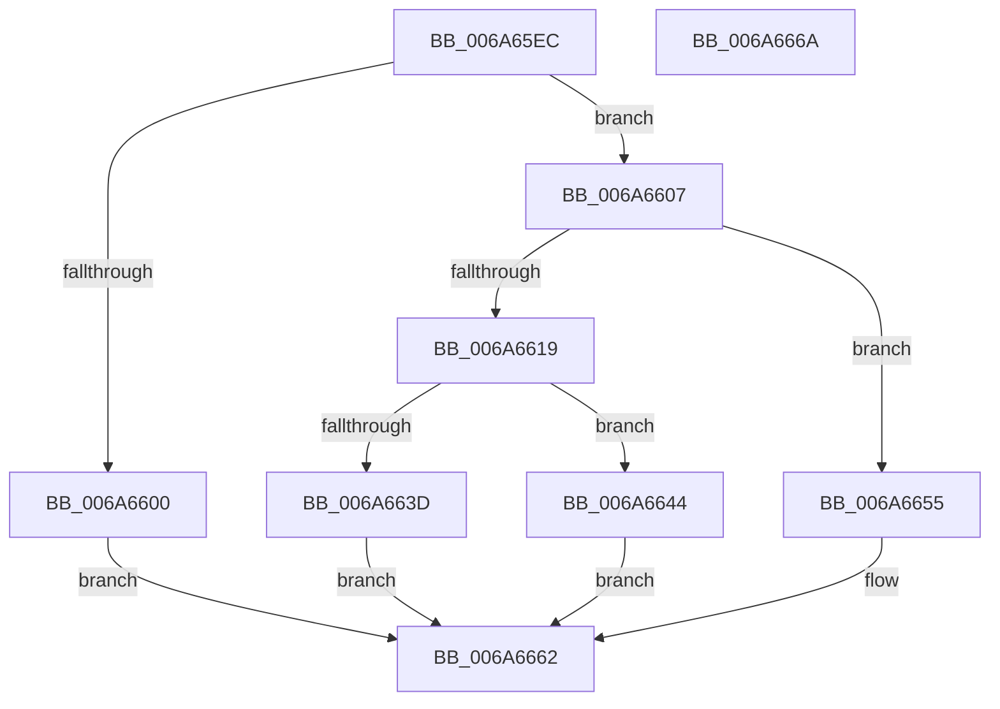

# IpmiHwKcsInit

- RVA: `0x006A65EC`–`0x006A666B` (길이 `127` bytes)
- VA: `0x00000001406A65EC`
- 실행 섹션: `.text`
- PDB 이름 있음: `예`; PDB Function 태그: `아니요`
- unwind 정보 RVA: `0x0005CF00`
- 디코드: `33`개 명령, `127/127` bytes 표시
- 미해석 바이트: `0` (있으면 어셈블리에 `.byte`로 보존)

> 이 문서는 커널 이미지의 기계어와 PDB 기호를 분석해 생성했습니다. 4번과 5번은 함수 원형과 자료형을 바이너리 사용 방식에서 추정한 C 해석이며 원본 소스 복구 결과는 아닙니다.

## 1. Dependencies

- 직접 호출 지점: **1**; 고유 호출 대상: **1**
- 직접 호출자로 확인된 함수: **1**
- RIP 상대 이미지 참조: **6**

### Outgoing calls
- `0x006A662C` → [MmMapIoSpaceEx](../32/MmMapIoSpaceEx_function_00327830.md) (function, `0x00327830`)

### Direct callers
- [IpmiHwInitializeContext](IpmiHwInitializeContext_function_006A64F8.md) at `0x006A65C9`

### Static image references
- `0x006A65F2` → RVA `0x00EFA090` (`.data`; read)
- `0x006A6607` → RVA `0x00EFA098` (`.data`; read)
- `0x006A6610` → RVA `0x00EFA0E0` (`.data`; read)
- `0x006A6619` → RVA `0x00EFA088` (`.data`; read)
- `0x006A6631` → RVA `0x00EFA0E0` (`.data`; write)
- `0x006A664D` → RVA `0x00EFA0E8` (`.data`; write)

## 2. Other-region calls and transfers

- 다른 실행 섹션으로 향하는 call: **0**
- 별도 외부 분기/꼬리 이동을 확인하지 못했습니다.

## 3. Assembly (complete function range)

```asm
006A65EC  40 53                           push rbx
006A65EE  48 83 EC 20                     sub rsp, 0x20
006A65F2  48 8B 05 97 3A 85 00            mov rax, qword ptr [rip + 0x853a97]
006A65F9  33 DB                           xor ebx, ebx
006A65FB  48 85 C0                        test rax, rax
006A65FE  75 07                           jne 0x1406a6607
006A6600  BB 0D 00 00 C0                  mov ebx, 0xc000000d
006A6605  EB 5B                           jmp 0x1406a6662
006A6607  38 1D 8B 3A 85 00               cmp byte ptr [rip + 0x853a8b], bl
006A660D  0F 57 C0                        xorps xmm0, xmm0
006A6610  0F 11 05 C9 3A 85 00            movups xmmword ptr [rip + 0x853ac9], xmm0
006A6617  75 3C                           jne 0x1406a6655
006A6619  0F B6 15 68 3A 85 00            movzx edx, byte ptr [rip + 0x853a68]
006A6620  41 B8 04 02 00 00               mov r8d, 0x204
006A6626  48 03 D2                        add rdx, rdx
006A6629  48 8B C8                        mov rcx, rax
006A662C  E8 FF 11 C8 FF                  call 0x140327830
006A6631  48 89 05 A8 3A 85 00            mov qword ptr [rip + 0x853aa8], rax
006A6638  48 85 C0                        test rax, rax
006A663B  75 07                           jne 0x1406a6644
006A663D  BB 01 00 00 C0                  mov ebx, 0xc0000001
006A6642  EB 1E                           jmp 0x1406a6662
006A6644  0F B6 05 3D 3A 85 00            movzx eax, byte ptr [rip + 0x853a3d]
006A664B  03 C0                           add eax, eax
006A664D  89 05 95 3A 85 00               mov dword ptr [rip + 0x853a95], eax
006A6653  EB 0D                           jmp 0x1406a6662
006A6655  48 89 05 84 3A 85 00            mov qword ptr [rip + 0x853a84], rax
006A665C  89 1D 86 3A 85 00               mov dword ptr [rip + 0x853a86], ebx
006A6662  8B C3                           mov eax, ebx
006A6664  48 83 C4 20                     add rsp, 0x20
006A6668  5B                              pop rbx
006A6669  C3                              ret
006A666A  CC                              int3
```

## 4. C-style interpretation (structured pseudocode)

```c
__int64 __fastcall IpmiHwKcsInit(void)
{
    __int64 result;
    __int64 v_rbx;
    __int64 v_rsp;

    v_rsp = (v_rsp) - (32);
    v_rbx = 0;
    if (*(unsigned __int64 *)(v_rip + 8731287) != 0) goto loc_006A6607;
    goto loc_006A6662;
loc_006A6607:
    *(unsigned __int64 *)(v_rip + 8731337) = v_xmm0;
    if ((*(unsigned __int8 *)(v_rip + 8731275)) != ((unsigned __int8)((unsigned int)(0xC000000DULL)))) goto loc_006A6655;
    a2 = (*(unsigned __int8 *)(v_rip + 8731240)) + (*(unsigned __int8 *)(v_rip + 8731240));
    result = MmMapIoSpaceEx(*(unsigned __int64 *)(v_rip + 8731287), a2, 516, a4);
    *(unsigned __int64 *)(v_rip + 8731304) = result;
    if (result != 0) goto loc_006A6644;
    goto loc_006A6662;
loc_006A6644:
    result = (unsigned int)((*(unsigned __int8 *)(v_rip + 8731197)) + ((unsigned int)(*(unsigned __int8 *)(v_rip + 8731197))));
    *(unsigned int *)(v_rip + 8731285) = (unsigned int)(result);
    goto loc_006A6662;
loc_006A6655:
    *(unsigned __int64 *)(v_rip + 8731268) = result;
    *(unsigned int *)(v_rip + 8731270) = (unsigned int)((unsigned int)(0xC0000001ULL));
loc_006A6662:
    v_rsp = (v_rsp) + (32);
    return (unsigned int)((unsigned int)((unsigned int)(0xC0000001ULL)));
}
```

## 5. (Beta) C Style

```c
void IpmiHwKcsInit(void)
{
    int64_t result;
    int64_t local_rbx;
    int64_t local_rsp;

    local_rsp = (local_rsp) - (32);
    local_rbx = 0;
    if (*(uint64_t *)(v_rip + 0x853A97) != 0) goto loc_006A6607;
    goto loc_006A6662;
loc_006A6607:
    *(uint64_t *)(v_rip + 0x853AC9) = v_xmm0;
    if ((*(uint8_t *)(v_rip + 0x853A8B)) != ((uint8_t)((uint32_t)(0xC000000DULL)))) goto loc_006A6655;
    a2 = (*(uint8_t *)(v_rip + 0x853A68)) + (*(uint8_t *)(v_rip + 0x853A68));
    result = MmMapIoSpaceEx(*(uint64_t *)(v_rip + 0x853A97), a2, 516, a4);
    *(uint64_t *)(v_rip + 0x853AA8) = result;
    if (result != 0) goto loc_006A6644;
    goto loc_006A6662;
loc_006A6644:
    result = (uint32_t)((*(uint8_t *)(v_rip + 0x853A3D)) + ((uint32_t)(*(uint8_t *)(v_rip + 0x853A3D))));
    *(uint32_t *)(v_rip + 0x853A95) = (uint32_t)(result);
    goto loc_006A6662;
loc_006A6655:
    *(uint64_t *)(v_rip + 0x853A84) = result;
    *(uint32_t *)(v_rip + 0x853A86) = (uint32_t)((uint32_t)(0xC0000001ULL));
loc_006A6662:
    local_rsp = (local_rsp) + (32);
    return (uint32_t)((uint32_t)((uint32_t)(0xC0000001ULL)));
}
```

## 6. Execution-region graph

[열기: 2D/3D 그래프와 함수 탐색 컨트롤 패널](../../../control-panel.html?section=text&rva=0x006A65EC&view=graph)

- 2D 그래프는 위에서 아래로 흐르고, 3D 그래프는 빈 공간을 드래그해 회전합니다. Shift+드래그는 이동, 휠은 확대·축소, 함수 노드 선택은 대상 보고서 이동입니다.

### Static fallback


