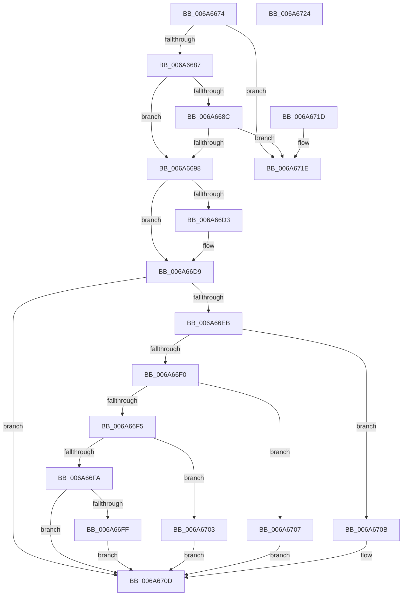

# IpmiHwpParseSpmiTable

- RVA: `0x006A6674`–`0x006A6725` (길이 `177` bytes)
- VA: `0x00000001406A6674`
- 실행 섹션: `.text`
- PDB 이름 있음: `예`; PDB Function 태그: `아니요`
- unwind 정보 RVA: `0x000DB714`
- 디코드: `50`개 명령, `177/177` bytes 표시
- 미해석 바이트: `0` (있으면 어셈블리에 `.byte`로 보존)

> 이 문서는 커널 이미지의 기계어와 PDB 기호를 분석해 생성했습니다. 4번과 5번은 함수 원형과 자료형을 바이너리 사용 방식에서 추정한 C 해석이며 원본 소스 복구 결과는 아닙니다.

## 1. Dependencies

- 직접 호출 지점: **0**; 고유 호출 대상: **0**
- 직접 호출자로 확인된 함수: **1**
- RIP 상대 이미지 참조: **8**

### Outgoing calls
- 직접 디코드된 call 명령이 없습니다.

### Direct callers
- [IpmiHwpReadSpmiConfiguration](IpmiHwpReadSpmiConfiguration_function_006A672C.md) at `0x006A67B4`

### Static image references
- `0x006A669B` → RVA `0x00EFA080` (`.data`; read)
- `0x006A66A2` → RVA `0x00EFA090` (`.data`; read)
- `0x006A66B1` → RVA `0x00EFA080` (`.data`; write)
- `0x006A66BC` → RVA `0x00EFA084` (`.data`; write)
- `0x006A66C5` → RVA `0x00EFA098` (`.data`; write)
- `0x006A66D9` → RVA `0x00EFA090` (`.data`; write)
- `0x006A670D` → RVA `0x00EFA088` (`.data`; write)
- `0x006A6715` → RVA `0x00EFA099` (`.data`; write)

## 2. Other-region calls and transfers

- 다른 실행 섹션으로 향하는 call: **0**
- 별도 외부 분기/꼬리 이동을 확인하지 못했습니다.

## 3. Assembly (complete function range)

```asm
006A6674  0F B7 4A 26                     movzx ecx, word ptr [rdx + 0x26]
006A6678  4C 8B C2                        mov r8, rdx
006A667B  81 E9 00 01 00 00               sub ecx, 0x100
006A6681  0F 84 97 00 00 00               je 0x1406a671e
006A6687  83 E9 50                        sub ecx, 0x50
006A668A  74 0C                           je 0x1406a6698
006A668C  81 F9 B0 00 00 00               cmp ecx, 0xb0
006A6692  0F 85 86 00 00 00               jne 0x1406a671e
006A6698  0F 57 C0                        xorps xmm0, xmm0
006A669B  0F 11 05 DE 39 85 00            movups xmmword ptr [rip + 0x8539de], xmm0
006A66A2  0F 11 05 E7 39 85 00            movups xmmword ptr [rip + 0x8539e7], xmm0
006A66A9  0F B7 42 26                     movzx eax, word ptr [rdx + 0x26]
006A66AD  66 C1 E8 04                     shr ax, 4
006A66B1  66 89 05 C8 39 85 00            mov word ptr [rip + 0x8539c8], ax
006A66B8  0F B6 42 24                     movzx eax, byte ptr [rdx + 0x24]
006A66BC  89 05 C2 39 85 00               mov dword ptr [rip + 0x8539c2], eax
006A66C2  8A 42 30                        mov al, byte ptr [rdx + 0x30]
006A66C5  88 05 CD 39 85 00               mov byte ptr [rip + 0x8539cd], al
006A66CB  48 8B 4A 34                     mov rcx, qword ptr [rdx + 0x34]
006A66CF  3C 04                           cmp al, 4
006A66D1  75 06                           jne 0x1406a66d9
006A66D3  81 E1 FE 00 00 00               and ecx, 0xfe
006A66D9  48 89 0D B0 39 85 00            mov qword ptr [rip + 0x8539b0], rcx
006A66E0  33 D2                           xor edx, edx
006A66E2  41 0F B6 48 33                  movzx ecx, byte ptr [r8 + 0x33]
006A66E7  85 C9                           test ecx, ecx
006A66E9  74 22                           je 0x1406a670d
006A66EB  83 E9 01                        sub ecx, 1
006A66EE  74 1B                           je 0x1406a670b
006A66F0  83 E9 01                        sub ecx, 1
006A66F3  74 12                           je 0x1406a6707
006A66F5  83 E9 01                        sub ecx, 1
006A66F8  74 09                           je 0x1406a6703
006A66FA  83 F9 01                        cmp ecx, 1
006A66FD  75 0E                           jne 0x1406a670d
006A66FF  B2 08                           mov dl, 8
006A6701  EB 0A                           jmp 0x1406a670d
006A6703  B2 04                           mov dl, 4
006A6705  EB 06                           jmp 0x1406a670d
006A6707  B2 02                           mov dl, 2
006A6709  EB 02                           jmp 0x1406a670d
006A670B  B2 01                           mov dl, 1
006A670D  88 15 75 39 85 00               mov byte ptr [rip + 0x853975], dl
006A6713  33 C0                           xor eax, eax
006A6715  C6 05 7D 39 85 00 20            mov byte ptr [rip + 0x85397d], 0x20
006A671C  C3                              ret
006A671D  CC                              int3
006A671E  B8 BB 00 00 C0                  mov eax, 0xc00000bb
006A6723  C3                              ret
006A6724  CC                              int3
```

## 4. C-style interpretation (structured pseudocode)

```c
__int64 __fastcall IpmiHwpParseSpmiTable(__int64 a1, __int64 a2)
{
    __int64 result;

    a1 = (unsigned int)((*(unsigned __int16 *)(a2 + 38)) - (256));
    if (condition_is_equal) goto loc_006A671E;
    a1 = (unsigned int)((a1) - (80));
    if (condition_is_equal) goto loc_006A6698;
    if (((unsigned int)(a1)) != 176) goto loc_006A671E;
loc_006A6698:
    *(unsigned __int64 *)(v_rip + 8731102) = v_xmm0;
    *(unsigned __int64 *)(v_rip + 8731111) = v_xmm0;
    result = (unsigned __int16)((*(unsigned __int16 *)(a2 + 38)) >> (4));
    *(unsigned __int16 *)(v_rip + 8731080) = (unsigned __int16)(result);
    *(unsigned int *)(v_rip + 8731074) = (unsigned int)(*(unsigned __int8 *)(a2 + 36));
    *(unsigned __int8 *)(v_rip + 8731085) = (unsigned __int8)(*(unsigned __int8 *)(a2 + 48));
    if (((unsigned __int8)(*(unsigned __int8 *)(a2 + 48))) == 4) {
        a1 = (unsigned int)((*(unsigned __int64 *)(a2 + 52)) & (254));
    }
    *(unsigned __int64 *)(v_rip + 8731056) = a1;
    a2 = 0;
    if ((unsigned int)(*(unsigned __int8 *)(a2 + 51)) == 0) goto loc_006A670D;
    a1 = (unsigned int)((*(unsigned __int8 *)(a2 + 51)) - (1));
    if (condition_is_equal) goto loc_006A670B;
    a1 = (unsigned int)((a1) - (1));
    if (condition_is_equal) goto loc_006A6707;
    a1 = (unsigned int)((a1) - (1));
    if (condition_is_equal) goto loc_006A6703;
    if (((unsigned int)(a1)) != 1) goto loc_006A670D;
    goto loc_006A670D;
loc_006A6703:
    goto loc_006A670D;
loc_006A6707:
    goto loc_006A670D;
loc_006A670B:
loc_006A670D:
    *(unsigned __int8 *)(v_rip + 8730997) = 1;
    result = 0;
    *(unsigned __int8 *)(v_rip + 8731005) = 32;
    return result;
loc_006A671E:
    return (unsigned int)(0xC00000BBULL);
}
```

## 5. (Beta) C Style

```c
int64_t IpmiHwpParseSpmiTable(int64_t Arg1, void *Arg2)
{
    uint8_t *arg2 = (uint8_t *)Arg2;

    int64_t result;

    Arg1 = (uint32_t)((*(uint16_t *)(arg2 + 0x26)) - (256));
    if (condition_is_equal) goto loc_006A671E;
    Arg1 = (uint32_t)((Arg1) - (80));
    if (condition_is_equal) goto loc_006A6698;
    if (((uint32_t)(Arg1)) != 176) goto loc_006A671E;
loc_006A6698:
    *(uint64_t *)(v_rip + 0x8539DE) = v_xmm0;
    *(uint64_t *)(v_rip + 0x8539E7) = v_xmm0;
    result = (uint16_t)((*(uint16_t *)(arg2 + 0x26)) >> (4));
    *(uint16_t *)(v_rip + 0x8539C8) = (uint16_t)(result);
    *(uint32_t *)(v_rip + 0x8539C2) = (uint32_t)(*(uint8_t *)(arg2 + 0x24));
    *(uint8_t *)(v_rip + 0x8539CD) = (uint8_t)(*(uint8_t *)(arg2 + 0x30));
    if (((uint8_t)(*(uint8_t *)(arg2 + 0x30))) == 4) {
        Arg1 = (uint32_t)((*(uint64_t *)(arg2 + 0x34)) & (254));
    }
    *(uint64_t *)(v_rip + 0x8539B0) = Arg1;
    Arg2 = 0;
    if ((uint32_t)(*(uint8_t *)(arg2 + 0x33)) == 0) goto loc_006A670D;
    Arg1 = (uint32_t)((*(uint8_t *)(arg2 + 0x33)) - (1));
    if (condition_is_equal) goto loc_006A670B;
    Arg1 = (uint32_t)((Arg1) - (1));
    if (condition_is_equal) goto loc_006A6707;
    Arg1 = (uint32_t)((Arg1) - (1));
    if (condition_is_equal) goto loc_006A6703;
    if (((uint32_t)(Arg1)) != 1) goto loc_006A670D;
    goto loc_006A670D;
loc_006A6703:
    goto loc_006A670D;
loc_006A6707:
    goto loc_006A670D;
loc_006A670B:
loc_006A670D:
    *(uint8_t *)(v_rip + 0x853975) = 1;
    result = 0;
    *(uint8_t *)(v_rip + 0x85397D) = 32;
    return result;
loc_006A671E:
    return (uint32_t)(0xC00000BBULL);
}
```

### 관측된 메모리 오프셋

구조체 형식이 확인되지 않은 접근은 인자 기준의 오프셋으로만 기록했습니다.

| 기준 인자 | 오프셋 표현 | 폭 (bit) | 접근 |
|---|---:|---:|---|
| `Arg2` | `+ 0x24` | `8` | `R` |
| `Arg2` | `+ 0x26` | `16` | `R` |
| `Arg2` | `+ 0x30` | `8` | `R` |
| `Arg2` | `+ 0x33` | `8` | `R` |
| `Arg2` | `+ 0x34` | `64` | `R` |

## 6. Execution-region graph

[열기: 2D/3D 그래프와 함수 탐색 컨트롤 패널](../../../control-panel.html?section=text&rva=0x006A6674&view=graph)

- 2D 그래프는 위에서 아래로 흐르고, 3D 그래프는 빈 공간을 드래그해 회전합니다. Shift+드래그는 이동, 휠은 확대·축소, 함수 노드 선택은 대상 보고서 이동입니다.

### Static fallback


