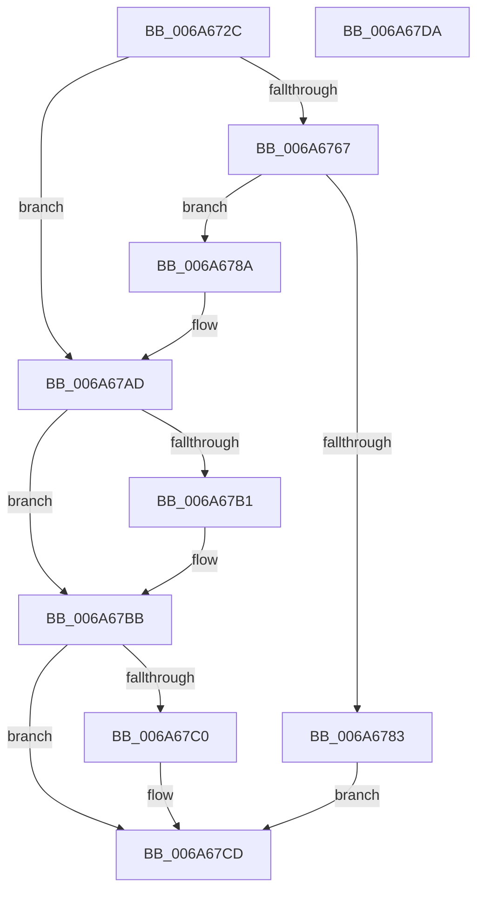

# IpmiHwpReadSpmiConfiguration

- RVA: `0x006A672C`–`0x006A67DB` (길이 `175` bytes)
- VA: `0x00000001406A672C`
- 실행 섹션: `.text`
- PDB 이름 있음: `예`; PDB Function 태그: `아니요`
- unwind 정보 RVA: `0x000704AC`
- 디코드: `50`개 명령, `175/175` bytes 표시
- 미해석 바이트: `0` (있으면 어셈블리에 `.byte`로 보존)

> 이 문서는 커널 이미지의 기계어와 PDB 기호를 분석해 생성했습니다. 4번과 5번은 함수 원형과 자료형을 바이너리 사용 방식에서 추정한 C 해석이며 원본 소스 복구 결과는 아닙니다.

## 1. Dependencies

- 직접 호출 지점: **5**; 고유 호출 대상: **4**
- 직접 호출자로 확인된 함수: **1**
- RIP 상대 이미지 참조: **0**

### Outgoing calls
- `0x006A6759` → [ExGetSystemFirmwareTable](../../page/7C/ExGetSystemFirmwareTable_function_007C3920.md) (function, `0x007C3920`)
- `0x006A6776` → [ExAllocatePool2](../../poolcode/B8/ExAllocatePool2_function_00B820F0.md) (function, `0x00B820F0`)
- `0x006A67A6` → [ExGetSystemFirmwareTable](../../page/7C/ExGetSystemFirmwareTable_function_007C3920.md) (function, `0x007C3920`)
- `0x006A67B4` → [IpmiHwpParseSpmiTable](IpmiHwpParseSpmiTable_function_006A6674.md) (function, `0x006A6674`)
- `0x006A67C8` → [ExFreePoolWithTag](../../poolcode/B8/ExFreePoolWithTag_function_00B82870.md) (function, `0x00B82870`)

### Direct callers
- [IpmiHwInitializeContext](IpmiHwInitializeContext_function_006A64F8.md) at `0x006A6536`

### Static image references
- 디코드된 RIP-relative 메모리 참조가 없습니다.

## 2. Other-region calls and transfers

- 다른 실행 섹션으로 향하는 call: **4**
  - `0x006A6759` → [ExGetSystemFirmwareTable](../../page/7C/ExGetSystemFirmwareTable_function_007C3920.md) (`.text` → `PAGE`)
  - `0x006A6776` → [ExAllocatePool2](../../poolcode/B8/ExAllocatePool2_function_00B820F0.md) (`.text` → `POOLCODE`)
  - `0x006A67A6` → [ExGetSystemFirmwareTable](../../page/7C/ExGetSystemFirmwareTable_function_007C3920.md) (`.text` → `PAGE`)
  - `0x006A67C8` → [ExFreePoolWithTag](../../poolcode/B8/ExFreePoolWithTag_function_00B82870.md) (`.text` → `POOLCODE`)
- 별도 외부 분기/꼬리 이동을 확인하지 못했습니다.

## 3. Assembly (complete function range)

```asm
006A672C  48 8B C4                        mov rax, rsp
006A672F  48 89 58 10                     mov qword ptr [rax + 0x10], rbx
006A6733  48 89 48 08                     mov qword ptr [rax + 8], rcx
006A6737  57                              push rdi
006A6738  48 83 EC 30                     sub rsp, 0x30
006A673C  48 8D 40 08                     lea rax, [rax + 8]
006A6740  33 FF                           xor edi, edi
006A6742  21 38                           and dword ptr [rax], edi
006A6744  45 33 C9                        xor r9d, r9d
006A6747  45 33 C0                        xor r8d, r8d
006A674A  48 89 44 24 20                  mov qword ptr [rsp + 0x20], rax
006A674F  BA 53 50 4D 49                  mov edx, 0x494d5053
006A6754  B9 49 50 43 41                  mov ecx, 0x41435049
006A6759  E8 C2 D1 11 00                  call 0x1407c3920
006A675E  8B D8                           mov ebx, eax
006A6760  3D 23 00 00 C0                  cmp eax, 0xc0000023
006A6765  75 46                           jne 0x1406a67ad
006A6767  8B 54 24 40                     mov edx, dword ptr [rsp + 0x40]
006A676B  B9 00 01 00 00                  mov ecx, 0x100
006A6770  41 B8 49 50 4D 49               mov r8d, 0x494d5049
006A6776  E8 75 B9 4D 00                  call 0x140b820f0
006A677B  48 8B F8                        mov rdi, rax
006A677E  48 85 C0                        test rax, rax
006A6781  75 07                           jne 0x1406a678a
006A6783  BB 17 00 00 C0                  mov ebx, 0xc0000017
006A6788  EB 43                           jmp 0x1406a67cd
006A678A  44 8B 4C 24 40                  mov r9d, dword ptr [rsp + 0x40]
006A678F  48 8D 44 24 40                  lea rax, [rsp + 0x40]
006A6794  4C 8B C7                        mov r8, rdi
006A6797  48 89 44 24 20                  mov qword ptr [rsp + 0x20], rax
006A679C  BA 53 50 4D 49                  mov edx, 0x494d5053
006A67A1  B9 49 50 43 41                  mov ecx, 0x41435049
006A67A6  E8 75 D1 11 00                  call 0x1407c3920
006A67AB  8B D8                           mov ebx, eax
006A67AD  85 DB                           test ebx, ebx
006A67AF  78 0A                           js 0x1406a67bb
006A67B1  48 8B D7                        mov rdx, rdi
006A67B4  E8 BB FE FF FF                  call 0x1406a6674
006A67B9  8B D8                           mov ebx, eax
006A67BB  48 85 FF                        test rdi, rdi
006A67BE  74 0D                           je 0x1406a67cd
006A67C0  BA 49 50 4D 49                  mov edx, 0x494d5049
006A67C5  48 8B CF                        mov rcx, rdi
006A67C8  E8 A3 C0 4D 00                  call 0x140b82870
006A67CD  8B C3                           mov eax, ebx
006A67CF  48 8B 5C 24 48                  mov rbx, qword ptr [rsp + 0x48]
006A67D4  48 83 C4 30                     add rsp, 0x30
006A67D8  5F                              pop rdi
006A67D9  C3                              ret
006A67DA  CC                              int3
```

## 4. C-style interpretation (structured pseudocode)

```c
__int64 __fastcall IpmiHwpReadSpmiConfiguration(__int64 a1, __int64 a2, int a3, int a4)
{
    __int64 result;
    __int64 v_rbx;
    __int64 v_rdi;
    __int64 v_rsp;
    unsigned __int64 v_stack_m18;
    unsigned __int64 v_stack_p10;
    unsigned int v_stack_p8;

    *(unsigned __int64 *)(v_rsp + 16) = v_rbx;
    *(unsigned __int64 *)(v_rsp + 8) = a1;
    v_rsp = (v_rsp) - (48);
    v_rdi = 0;
    a4 = 0;
    a3 = 0;
    v_stack_m18 = v_rsp + 8;
    result = ExGetSystemFirmwareTable((unsigned int)(0x41435049ULL), (unsigned int)(0x494D5053ULL), a3, a4);
    if (((unsigned int)(result)) != 0xC0000023ULL) goto loc_006A67AD;
    result = ExAllocatePool2(256, (unsigned int)(v_stack_p8), (unsigned int)(0x494D5049ULL), a4);
    if (result != 0) goto loc_006A678A;
    goto loc_006A67CD;
loc_006A678A:
    v_stack_m18 = v_stack_p8;
    result = ExGetSystemFirmwareTable((unsigned int)(0x41435049ULL), (unsigned int)(0x494D5053ULL), result, (unsigned int)(v_stack_p8));
loc_006A67AD:
    v_rbx = (unsigned int)((unsigned int)(result));
    if (!(sign_flag)) {
        a2 = result;
        result = IpmiHwpParseSpmiTable((unsigned int)(0x41435049ULL), a2, result, (unsigned int)(v_stack_p8));
        v_rbx = (unsigned int)(result);
    }
    if (result != 0) {
        a2 = 0x494D5049ULL;
        a1 = result;
        result = ExFreePoolWithTag(a1, a2, result, (unsigned int)(v_stack_p8));
    }
    v_rsp = (v_rsp) + (48);
    return (unsigned int)((unsigned int)(v_rbx));
}
```

## 5. (Beta) C Style

```c
int64_t IpmiHwpReadSpmiConfiguration(int64_t Arg1, int64_t Arg2, int32_t Arg3, int32_t Arg4)
{
    int64_t result;
    int64_t local_rbx;
    int64_t local_rdi;
    int64_t local_rsp;
    uint64_t v_stack_m18;
    uint64_t v_stack_p10;
    uint32_t v_stack_p8;

    *(uint64_t *)(local_rsp + 0x10) = local_rbx;
    *(uint64_t *)(local_rsp + 0x8) = Arg1;
    local_rsp = (local_rsp) - (48);
    local_rdi = 0;
    Arg4 = 0;
    Arg3 = 0;
    v_stack_m18 = local_rsp + 8;
    result = ExGetSystemFirmwareTable((uint32_t)(0x41435049ULL), (uint32_t)(0x494D5053ULL), Arg3, Arg4);
    if (((uint32_t)(result)) != 0xC0000023ULL) goto loc_006A67AD;
    result = ExAllocatePool2(256, (uint32_t)(v_stack_p8), (uint32_t)(0x494D5049ULL), Arg4);
    if (result != 0) goto loc_006A678A;
    goto loc_006A67CD;
loc_006A678A:
    v_stack_m18 = v_stack_p8;
    result = ExGetSystemFirmwareTable((uint32_t)(0x41435049ULL), (uint32_t)(0x494D5053ULL), result, (uint32_t)(v_stack_p8));
loc_006A67AD:
    local_rbx = (uint32_t)((uint32_t)(result));
    if (!(sign_flag)) {
        Arg2 = result;
        result = IpmiHwpParseSpmiTable((uint32_t)(0x41435049ULL), Arg2, result, (uint32_t)(v_stack_p8));
        local_rbx = (uint32_t)(result);
    }
    if (result != 0) {
        Arg2 = 0x494D5049ULL;
        Arg1 = result;
        result = ExFreePoolWithTag(Arg1, Arg2, result, (uint32_t)(v_stack_p8));
    }
    local_rsp = (local_rsp) + (48);
    return (uint32_t)((uint32_t)(local_rbx));
}
```

## 6. Execution-region graph

[열기: 2D/3D 그래프와 함수 탐색 컨트롤 패널](../../../control-panel.html?section=text&rva=0x006A672C&view=graph)

- 2D 그래프는 위에서 아래로 흐르고, 3D 그래프는 빈 공간을 드래그해 회전합니다. Shift+드래그는 이동, 휠은 확대·축소, 함수 노드 선택은 대상 보고서 이동입니다.

### Static fallback


