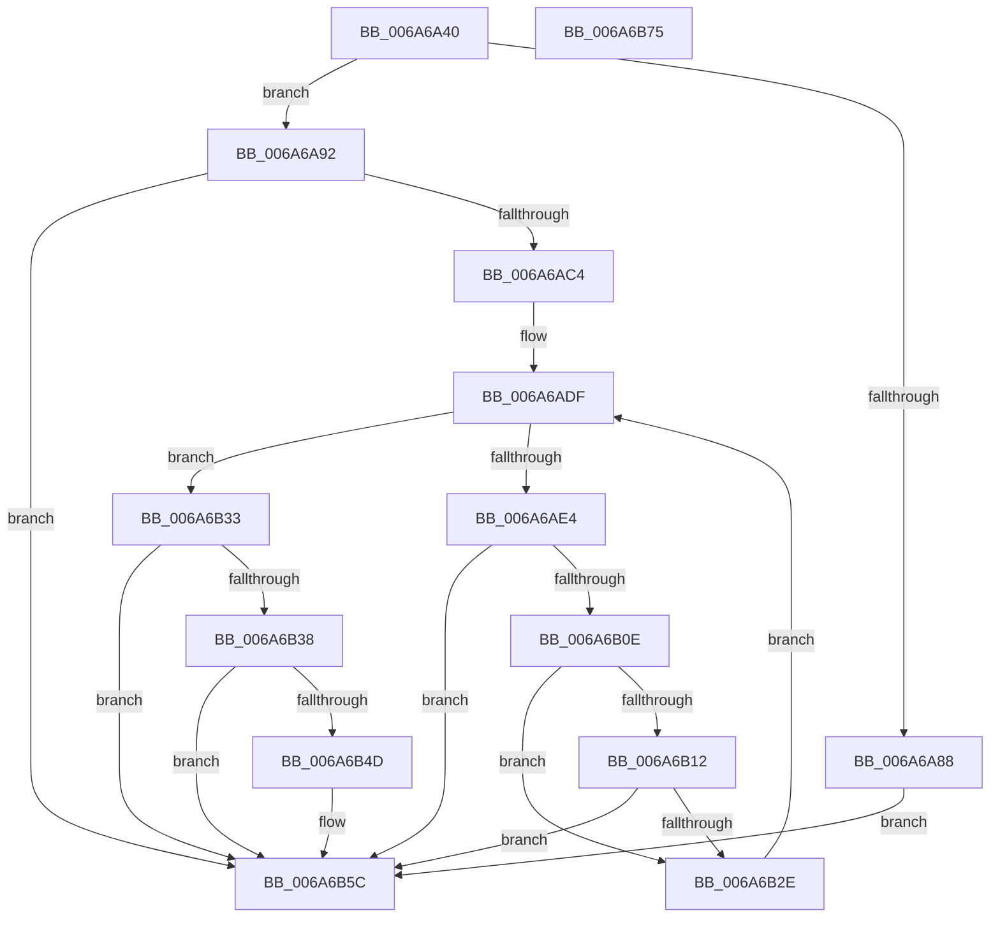

# IpmiLibAddSelBugcheckRecord

- RVA: `0x006A6A40`–`0x006A6B76` (길이 `310` bytes)
- VA: `0x00000001406A6A40`
- 실행 섹션: `.text`
- PDB 이름 있음: `예`; PDB Function 태그: `아니요`
- unwind 정보 RVA: `0x0006B96C`
- 디코드: `86`개 명령, `310/310` bytes 표시
- 미해석 바이트: `0` (있으면 어셈블리에 `.byte`로 보존)

> 이 문서는 커널 이미지의 기계어와 PDB 기호를 분석해 생성했습니다. 4번과 5번은 함수 원형과 자료형을 바이너리 사용 방식에서 추정한 C 해석이며 원본 소스 복구 결과는 아닙니다.

## 1. Dependencies

- 직접 호출 지점: **6**; 고유 호출 대상: **3**
- 직접 호출자로 확인된 함수: **1**
- RIP 상대 이미지 참조: **4**

### Outgoing calls
- `0x006A6A7F` → [IpmiHwContextInitialized](IpmiHwContextInitialized_function_006A64DC.md) (function, `0x006A64DC`)
- `0x006A6AB7` → [IpmiLibAddSelRecord](IpmiLibAddSelRecord_function_006A6C78.md) (function, `0x006A6C78`)
- `0x006A6B05` → [IpmiLibAddSelRecord](IpmiLibAddSelRecord_function_006A6C78.md) (function, `0x006A6C78`)
- `0x006A6B25` → [IpmiLibAddSelRecord](IpmiLibAddSelRecord_function_006A6C78.md) (function, `0x006A6C78`)
- `0x006A6B44` → [IpmiLibpAddSelRawData](IpmiLibpAddSelRawData_function_006A6D10.md) (function, `0x006A6D10`)
- `0x006A6B57` → [IpmiLibpAddSelRawData](IpmiLibpAddSelRawData_function_006A6D10.md) (function, `0x006A6D10`)

### Direct callers
- [KeBugCheck2](../5B/KeBugCheck2_function_005B27D0.md) at `0x005B30FC`

### Static image references
- `0x006A6A5F` → RVA `0x00E667F0` (`.data`; read)
- `0x006A6A65` → RVA `0x00EFA080` (`.data`; read)
- `0x006A6A6C` → RVA `0x00E667E0` (`.data`; read)
- `0x006A6AE8` → RVA `0x00F47580` (`.data`; read)

## 2. Other-region calls and transfers

- 다른 실행 섹션으로 향하는 call: **0**
- 별도 외부 분기/꼬리 이동을 확인하지 못했습니다.

## 3. Assembly (complete function range)

```asm
006A6A40  48 8B C4                        mov rax, rsp
006A6A43  48 89 58 08                     mov qword ptr [rax + 8], rbx
006A6A47  48 89 70 10                     mov qword ptr [rax + 0x10], rsi
006A6A4B  48 89 78 18                     mov qword ptr [rax + 0x18], rdi
006A6A4F  44 89 48 20                     mov dword ptr [rax + 0x20], r9d
006A6A53  55                              push rbp
006A6A54  41 56                           push r14
006A6A56  41 57                           push r15
006A6A58  48 8B EC                        mov rbp, rsp
006A6A5B  48 83 EC 40                     sub rsp, 0x40
006A6A5F  8B 05 8B FD 7B 00               mov eax, dword ptr [rip + 0x7bfd8b]
006A6A65  48 8D 0D 14 36 85 00            lea rcx, [rip + 0x853614]
006A6A6C  48 8B 3D 6D FD 7B 00            mov rdi, qword ptr [rip + 0x7bfd6d]
006A6A73  89 45 E0                        mov dword ptr [rbp - 0x20], eax
006A6A76  33 C0                           xor eax, eax
006A6A78  66 89 45 38                     mov word ptr [rbp + 0x38], ax
006A6A7C  88 45 3A                        mov byte ptr [rbp + 0x3a], al
006A6A7F  E8 58 FA FF FF                  call 0x1406a64dc
006A6A84  84 C0                           test al, al
006A6A86  75 0A                           jne 0x1406a6a92
006A6A88  B8 01 00 00 C0                  mov eax, 0xc0000001
006A6A8D  E9 CA 00 00 00                  jmp 0x1406a6b5c
006A6A92  0F 57 C0                        xorps xmm0, xmm0
006A6A95  4C 8D 45 38                     lea r8, [rbp + 0x38]
006A6A99  0F 11 45 E8                     movups xmmword ptr [rbp - 0x18], xmm0
006A6A9D  48 8D 55 E8                     lea rdx, [rbp - 0x18]
006A6AA1  C6 45 EA 02                     mov byte ptr [rbp - 0x16], 2
006A6AA5  C7 45 EF 41 00 04 20            mov dword ptr [rbp - 0x11], 0x20040041
006A6AAC  C7 45 F3 00 6F 01 FF            mov dword ptr [rbp - 0xd], 0xff016f00
006A6AB3  C6 45 F7 FF                     mov byte ptr [rbp - 9], 0xff
006A6AB7  E8 BC 01 00 00                  call 0x1406a6c78
006A6ABC  85 C0                           test eax, eax
006A6ABE  0F 88 98 00 00 00               js 0x1406a6b5c
006A6AC4  0F 57 C0                        xorps xmm0, xmm0
006A6AC7  32 DB                           xor bl, bl
006A6AC9  0F 11 45 E8                     movups xmmword ptr [rbp - 0x18], xmm0
006A6ACD  C6 45 EA DE                     mov byte ptr [rbp - 0x16], 0xde
006A6AD1  66 C7 45 EF 37 01               mov word ptr [rbp - 0x11], 0x137
006A6AD7  C6 45 F1 00                     mov byte ptr [rbp - 0xf], 0
006A6ADB  C6 45 F7 01                     mov byte ptr [rbp - 9], 1
006A6ADF  80 FB 05                        cmp bl, 5
006A6AE2  73 4F                           jae 0x1406a6b33
006A6AE4  44 0F B6 F3                     movzx r14d, bl
006A6AE8  4C 8D 3D 91 0A 8A 00            lea r15, [rip + 0x8a0a91]
006A6AEF  8D 73 01                        lea esi, [rbx + 1]
006A6AF2  4C 8D 45 38                     lea r8, [rbp + 0x38]
006A6AF6  40 88 75 F2                     mov byte ptr [rbp - 0xe], sil
006A6AFA  48 8D 55 E8                     lea rdx, [rbp - 0x18]
006A6AFE  43 8B 04 F7                     mov eax, dword ptr [r15 + r14*8]
006A6B02  89 45 F3                        mov dword ptr [rbp - 0xd], eax
006A6B05  E8 6E 01 00 00                  call 0x1406a6c78
006A6B0A  85 C0                           test eax, eax
006A6B0C  78 4E                           js 0x1406a6b5c
006A6B0E  84 DB                           test bl, bl
006A6B10  74 1C                           je 0x1406a6b2e
006A6B12  4B 8B 04 F7                     mov rax, qword ptr [r15 + r14*8]
006A6B16  4C 8D 45 38                     lea r8, [rbp + 0x38]
006A6B1A  48 C1 E8 20                     shr rax, 0x20
006A6B1E  48 8D 55 E8                     lea rdx, [rbp - 0x18]
006A6B22  89 45 F3                        mov dword ptr [rbp - 0xd], eax
006A6B25  E8 4E 01 00 00                  call 0x1406a6c78
006A6B2A  85 C0                           test eax, eax
006A6B2C  78 2E                           js 0x1406a6b5c
006A6B2E  40 8A DE                        mov bl, sil
006A6B31  EB AC                           jmp 0x1406a6adf
006A6B33  48 85 FF                        test rdi, rdi
006A6B36  74 24                           je 0x1406a6b5c
006A6B38  41 B9 04 00 00 00               mov r9d, 4
006A6B3E  4C 8D 45 E0                     lea r8, [rbp - 0x20]
006A6B42  B2 C0                           mov dl, 0xc0
006A6B44  E8 C7 01 00 00                  call 0x1406a6d10
006A6B49  85 C0                           test eax, eax
006A6B4B  78 0F                           js 0x1406a6b5c
006A6B4D  44 0F B7 0F                     movzx r9d, word ptr [rdi]
006A6B51  B2 C2                           mov dl, 0xc2
006A6B53  4C 8B 47 08                     mov r8, qword ptr [rdi + 8]
006A6B57  E8 B4 01 00 00                  call 0x1406a6d10
006A6B5C  48 8B 5C 24 60                  mov rbx, qword ptr [rsp + 0x60]
006A6B61  48 8B 74 24 68                  mov rsi, qword ptr [rsp + 0x68]
006A6B66  48 8B 7C 24 70                  mov rdi, qword ptr [rsp + 0x70]
006A6B6B  48 83 C4 40                     add rsp, 0x40
006A6B6F  41 5F                           pop r15
006A6B71  41 5E                           pop r14
006A6B73  5D                              pop rbp
006A6B74  C3                              ret
006A6B75  CC                              int3
```

## 4. C-style interpretation (structured pseudocode)

```c
__int64 __fastcall IpmiLibAddSelBugcheckRecord(__int64 a1, __int64 a2, __int64 a3, int a4)
{
    __int64 result;
    __int64 v_rbx;
    __int64 v_rsp;
    unsigned __int8 v_stack_m21;
    unsigned int v_stack_m25;
    unsigned __int8 v_stack_m26;
    unsigned __int8 v_stack_m27;
    unsigned int v_stack_m29;
    unsigned __int8 v_stack_m2E;
    unsigned __int64 v_stack_m30;
    unsigned int v_stack_m38;
    unsigned __int64 v_stack_p10;
    unsigned __int64 v_stack_p18;
    unsigned __int16 v_stack_p20;
    unsigned __int8 v_stack_p22;
    unsigned __int64 v_stack_p8;

    *(unsigned __int64 *)(v_rsp + 8) = v_rbx;
    *(unsigned __int64 *)(v_rsp + 16) = v_rsi;
    *(unsigned __int64 *)(v_rsp + 24) = v_rdi;
    *(unsigned int *)(v_rsp + 32) = a4;
    v_rsp = (v_rsp) - (64);
    v_stack_m38 = (unsigned int)((unsigned int)(*(unsigned int *)(v_rip + 8125835)));
    result = 0;
    v_stack_p20 = 0;
    v_stack_p22 = 0;
    result = IpmiHwContextInitialized(v_rip + 8730132, a2, a3, a4);
    if ((unsigned __int8)(result) != 0) goto loc_006A6A92;
    goto loc_006A6B5C;
loc_006A6A92:
    v_stack_m30 = v_xmm0;
    v_stack_m2E = 2;
    v_stack_m29 = 0x20040041ULL;
    v_stack_m25 = 0xFF016F00ULL;
    v_stack_m21 = 255;
    result = IpmiLibAddSelRecord(v_rip + 8730132, v_stack_m30, v_stack_p20, a4);
    if (sign_flag) goto loc_006A6B5C;
    v_rbx = 0;
    v_stack_m30 = v_xmm0;
    v_stack_m2E = 222;
    v_stack_m29 = 311;
    v_stack_m27 = 0;
    v_stack_m21 = 1;
loc_006A6ADF:
    if (0 >= 5) goto loc_006A6B33;
    v_stack_m26 = (unsigned __int8)(v_rbx + 1);
    v_stack_m25 = (unsigned int)((unsigned int)(*(unsigned int *)(v_rip + 9046673 + 0 * 8)));
    result = IpmiLibAddSelRecord(v_rip + 8730132, v_stack_m30, v_stack_p20, a4);
    if (sign_flag) goto loc_006A6B5C;
    if (0 == 0) goto loc_006A6B2E;
    result = (*(unsigned __int64 *)(v_rip + 9046673 + 0 * 8)) >> (32);
    v_stack_m25 = (unsigned int)(result);
    result = IpmiLibAddSelRecord(v_rip + 8730132, v_stack_m30, v_stack_p20, a4);
    if (sign_flag) goto loc_006A6B5C;
loc_006A6B2E:
    goto loc_006A6ADF;
loc_006A6B33:
    if (*(unsigned __int64 *)(v_rip + 8125805) == 0) goto loc_006A6B5C;
    result = IpmiLibpAddSelRawData(v_rip + 8730132, 192, v_stack_m38, 4);
    if (!(sign_flag)) {
        a4 = *(unsigned __int16 *)(*(unsigned __int64 *)(v_rip + 8125805));
        a2 = 194;
        a3 = *(unsigned __int64 *)(*(unsigned __int64 *)(v_rip + 8125805) + 8);
        result = IpmiLibpAddSelRawData(v_rip + 8730132, a2, a3, a4);
    }
    v_rsp = (v_rsp) + (64);
    return result;
}
```

## 5. (Beta) C Style

```c
int64_t IpmiLibAddSelBugcheckRecord(int64_t Arg1, int64_t Arg2, int64_t Arg3, int32_t Arg4)
{
    int64_t result;
    int64_t local_rbx;
    int64_t local_rsp;
    uint8_t v_stack_m21;
    uint32_t v_stack_m25;
    uint8_t v_stack_m26;
    uint8_t v_stack_m27;
    uint32_t v_stack_m29;
    uint8_t v_stack_m2E;
    uint64_t v_stack_m30;
    uint32_t v_stack_m38;
    uint64_t v_stack_p10;
    uint64_t v_stack_p18;
    uint16_t v_stack_p20;
    uint8_t v_stack_p22;
    uint64_t v_stack_p8;

    *(uint64_t *)(local_rsp + 0x8) = local_rbx;
    *(uint64_t *)(local_rsp + 0x10) = local_rsi;
    *(uint64_t *)(local_rsp + 0x18) = local_rdi;
    *(uint32_t *)(local_rsp + 0x20) = Arg4;
    local_rsp = (local_rsp) - (64);
    v_stack_m38 = (uint32_t)((uint32_t)(*(uint32_t *)(v_rip + 0x7BFD8B)));
    result = 0;
    v_stack_p20 = 0;
    v_stack_p22 = 0;
    result = IpmiHwContextInitialized(v_rip + 8730132, Arg2, Arg3, Arg4);
    if ((uint8_t)(result) != 0) goto loc_006A6A92;
    goto loc_006A6B5C;
loc_006A6A92:
    v_stack_m30 = v_xmm0;
    v_stack_m2E = 2;
    v_stack_m29 = 0x20040041ULL;
    v_stack_m25 = 0xFF016F00ULL;
    v_stack_m21 = 255;
    result = IpmiLibAddSelRecord(v_rip + 8730132, v_stack_m30, v_stack_p20, Arg4);
    if (sign_flag) goto loc_006A6B5C;
    local_rbx = 0;
    v_stack_m30 = v_xmm0;
    v_stack_m2E = 222;
    v_stack_m29 = 311;
    v_stack_m27 = 0;
    v_stack_m21 = 1;
loc_006A6ADF:
    if (0 >= 5) goto loc_006A6B33;
    v_stack_m26 = (uint8_t)(local_rbx + 1);
    v_stack_m25 = (uint32_t)((uint32_t)(*(uint32_t *)(v_rip + 0x8A0A91 + 0x0 * 8)));
    result = IpmiLibAddSelRecord(v_rip + 8730132, v_stack_m30, v_stack_p20, Arg4);
    if (sign_flag) goto loc_006A6B5C;
    if (0 == 0) goto loc_006A6B2E;
    result = (*(uint64_t *)(v_rip + 0x8A0A91 + 0x0 * 8)) >> (32);
    v_stack_m25 = (uint32_t)(result);
    result = IpmiLibAddSelRecord(v_rip + 8730132, v_stack_m30, v_stack_p20, Arg4);
    if (sign_flag) goto loc_006A6B5C;
loc_006A6B2E:
    goto loc_006A6ADF;
loc_006A6B33:
    if (*(uint64_t *)(v_rip + 0x7BFD6D) == 0) goto loc_006A6B5C;
    result = IpmiLibpAddSelRawData(v_rip + 8730132, 192, v_stack_m38, 4);
    if (!(sign_flag)) {
        Arg4 = *(uint16_t *)(*(uint64_t *)(v_rip + 0x7BFD6D));
        Arg2 = 194;
        Arg3 = *(uint64_t *)(*(uint64_t *)(v_rip + 0x7BFD6D) + 0x8);
        result = IpmiLibpAddSelRawData(v_rip + 8730132, Arg2, Arg3, Arg4);
    }
    local_rsp = (local_rsp) + (64);
    return result;
}
```

## 6. Execution-region graph

[열기: 2D/3D 그래프와 함수 탐색 컨트롤 패널](../../../control-panel.html?section=text&rva=0x006A6A40&view=graph)

- 2D 그래프는 위에서 아래로 흐르고, 3D 그래프는 빈 공간을 드래그해 회전합니다. Shift+드래그는 이동, 휠은 확대·축소, 함수 노드 선택은 대상 보고서 이동입니다.

### Static fallback


