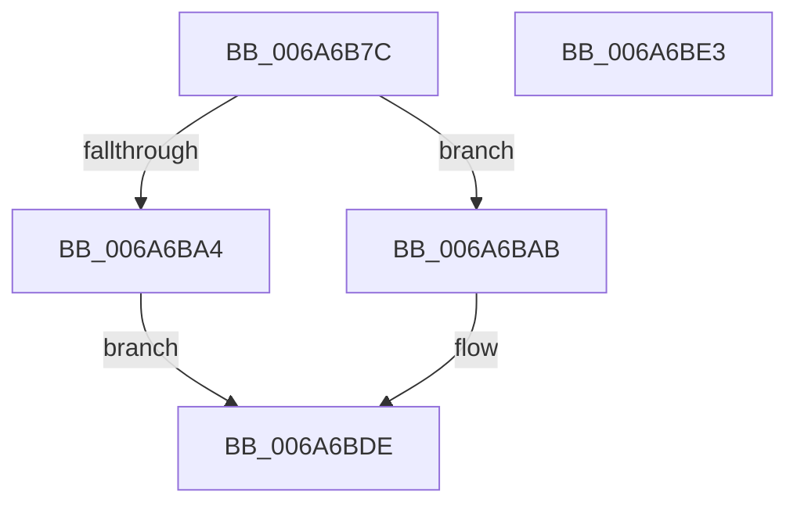

# IpmiLibAddSelCheckpointRecord

- RVA: `0x006A6B7C`–`0x006A6BE4` (길이 `104` bytes)
- VA: `0x00000001406A6B7C`
- 실행 섹션: `.text`
- PDB 이름 있음: `예`; PDB Function 태그: `아니요`
- unwind 정보 RVA: `0x0006BDBC`
- 디코드: `25`개 명령, `104/104` bytes 표시
- 미해석 바이트: `0` (있으면 어셈블리에 `.byte`로 보존)

> 이 문서는 커널 이미지의 기계어와 PDB 기호를 분석해 생성했습니다. 4번과 5번은 함수 원형과 자료형을 바이너리 사용 방식에서 추정한 C 해석이며 원본 소스 복구 결과는 아닙니다.

## 1. Dependencies

- 직접 호출 지점: **2**; 고유 호출 대상: **2**
- 직접 호출자로 확인된 함수: **1**
- RIP 상대 이미지 참조: **1**

### Outgoing calls
- `0x006A6B9B` → [IpmiHwContextInitialized](IpmiHwContextInitialized_function_006A64DC.md) (function, `0x006A64DC`)
- `0x006A6BD9` → [IpmiLibAddSelRecord](IpmiLibAddSelRecord_function_006A6C78.md) (function, `0x006A6C78`)

### Direct callers
- [WheaSelLogCheckPoint](../../page/7D/WheaSelLogCheckPoint_function_007D6800.md) at `0x007D688F`

### Static image references
- `0x006A6B87` → RVA `0x00EFA080` (`.data`; read)

## 2. Other-region calls and transfers

- 다른 실행 섹션으로 향하는 call: **0**
- 별도 외부 분기/꼬리 이동을 확인하지 못했습니다.

## 3. Assembly (complete function range)

```asm
006A6B7C  48 89 4C 24 08                  mov qword ptr [rsp + 8], rcx
006A6B81  48 83 EC 38                     sub rsp, 0x38
006A6B85  33 C0                           xor eax, eax
006A6B87  48 8D 0D F2 34 85 00            lea rcx, [rip + 0x8534f2]
006A6B8E  66 89 44 24 40                  mov word ptr [rsp + 0x40], ax
006A6B93  44 0F B7 CA                     movzx r9d, dx
006A6B97  88 44 24 42                     mov byte ptr [rsp + 0x42], al
006A6B9B  E8 3C F9 FF FF                  call 0x1406a64dc
006A6BA0  84 C0                           test al, al
006A6BA2  75 07                           jne 0x1406a6bab
006A6BA4  B8 01 00 00 C0                  mov eax, 0xc0000001
006A6BA9  EB 33                           jmp 0x1406a6bde
006A6BAB  0F 57 C0                        xorps xmm0, xmm0
006A6BAE  48 8D 54 24 20                  lea rdx, [rsp + 0x20]
006A6BB3  0F 11 44 24 20                  movups xmmword ptr [rsp + 0x20], xmm0
006A6BB8  44 89 44 24 2C                  mov dword ptr [rsp + 0x2c], r8d
006A6BBD  4C 8D 44 24 40                  lea r8, [rsp + 0x40]
006A6BC2  C6 44 24 22 DF                  mov byte ptr [rsp + 0x22], 0xdf
006A6BC7  66 C7 44 24 27 37 01            mov word ptr [rsp + 0x27], 0x137
006A6BCE  C6 44 24 29 00                  mov byte ptr [rsp + 0x29], 0
006A6BD3  66 44 89 4C 24 2A               mov word ptr [rsp + 0x2a], r9w
006A6BD9  E8 9A 00 00 00                  call 0x1406a6c78
006A6BDE  48 83 C4 38                     add rsp, 0x38
006A6BE2  C3                              ret
006A6BE3  CC                              int3
```

## 4. C-style interpretation (structured pseudocode)

```c
__int64 __fastcall IpmiLibAddSelCheckpointRecord(__int64 a1, unsigned __int16 a2, int a3)
{
    __int64 result;
    __int64 v_rsp;
    unsigned __int16 v_stack_m11;
    unsigned __int8 v_stack_m16;
    unsigned __int64 v_stack_m18;
    unsigned int v_stack_mC;
    unsigned __int16 v_stack_mE;
    unsigned __int8 v_stack_mF;
    unsigned __int64 v_stack_p8;
    unsigned __int8 v_stack_pA;

    v_stack_p8 = a1;
    v_rsp = (v_rsp) - (56);
    result = 0;
    v_stack_p8 = 0;
    v_stack_pA = 0;
    result = IpmiHwContextInitialized(v_rip + 8729842, a2, a3, a2);
    if ((unsigned __int8)(result) != 0) goto loc_006A6BAB;
    goto loc_006A6BDE;
loc_006A6BAB:
    v_stack_m18 = v_xmm0;
    v_stack_mC = a3;
    v_stack_m16 = 223;
    v_stack_m11 = 311;
    v_stack_mF = 0;
    v_stack_mE = a2;
    result = IpmiLibAddSelRecord(v_rip + 8729842, v_stack_m18, v_stack_p8, a2);
loc_006A6BDE:
    v_rsp = (v_rsp) + (56);
    return result;
}
```

## 5. (Beta) C Style

```c
int64_t IpmiLibAddSelCheckpointRecord(int64_t Arg1, uint16_t Arg2, int32_t Arg3)
{
    int64_t result;
    int64_t local_rsp;
    uint16_t v_stack_m11;
    uint8_t v_stack_m16;
    uint64_t v_stack_m18;
    uint32_t v_stack_mC;
    uint16_t v_stack_mE;
    uint8_t v_stack_mF;
    uint64_t v_stack_p8;
    uint8_t v_stack_pA;

    v_stack_p8 = Arg1;
    local_rsp = (local_rsp) - (56);
    result = 0;
    v_stack_p8 = 0;
    v_stack_pA = 0;
    result = IpmiHwContextInitialized(v_rip + 8729842, Arg2, Arg3, Arg2);
    if ((uint8_t)(result) != 0) goto loc_006A6BAB;
    goto loc_006A6BDE;
loc_006A6BAB:
    v_stack_m18 = v_xmm0;
    v_stack_mC = Arg3;
    v_stack_m16 = 223;
    v_stack_m11 = 311;
    v_stack_mF = 0;
    v_stack_mE = Arg2;
    result = IpmiLibAddSelRecord(v_rip + 8729842, v_stack_m18, v_stack_p8, Arg2);
loc_006A6BDE:
    local_rsp = (local_rsp) + (56);
    return result;
}
```

## 6. Execution-region graph

[열기: 2D/3D 그래프와 함수 탐색 컨트롤 패널](../../../control-panel.html?section=text&rva=0x006A6B7C&view=graph)

- 2D 그래프는 위에서 아래로 흐르고, 3D 그래프는 빈 공간을 드래그해 회전합니다. Shift+드래그는 이동, 휠은 확대·축소, 함수 노드 선택은 대상 보고서 이동입니다.

### Static fallback


