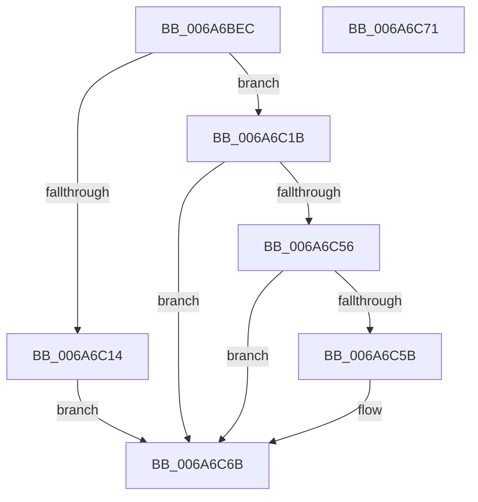

# IpmiLibAddSelErrorRecord

- RVA: `0x006A6BEC`–`0x006A6C72` (길이 `134` bytes)
- VA: `0x00000001406A6BEC`
- 실행 섹션: `.text`
- PDB 이름 있음: `예`; PDB Function 태그: `아니요`
- unwind 정보 RVA: `0x000BDB64`
- 디코드: `36`개 명령, `134/134` bytes 표시
- 미해석 바이트: `0` (있으면 어셈블리에 `.byte`로 보존)

> 이 문서는 커널 이미지의 기계어와 PDB 기호를 분석해 생성했습니다. 4번과 5번은 함수 원형과 자료형을 바이너리 사용 방식에서 추정한 C 해석이며 원본 소스 복구 결과는 아닙니다.

## 1. Dependencies

- 직접 호출 지점: **3**; 고유 호출 대상: **3**
- 직접 호출자로 확인된 함수: **1**
- RIP 상대 이미지 참조: **1**

### Outgoing calls
- `0x006A6C0B` → [IpmiHwContextInitialized](IpmiHwContextInitialized_function_006A64DC.md) (function, `0x006A64DC`)
- `0x006A6C4D` → [IpmiLibAddSelRecord](IpmiLibAddSelRecord_function_006A6C78.md) (function, `0x006A6C78`)
- `0x006A6C66` → [IpmiLibpAddSelRawData](IpmiLibpAddSelRawData_function_006A6D10.md) (function, `0x006A6D10`)

### Direct callers
- [WheaSelLogError](../65/WheaSelLogError_function_0065D8A8.md) at `0x0065D937`

### Static image references
- `0x006A6BF8` → RVA `0x00EFA080` (`.data`; read)

## 2. Other-region calls and transfers

- 다른 실행 섹션으로 향하는 call: **0**
- 별도 외부 분기/꼬리 이동을 확인하지 못했습니다.

## 3. Assembly (complete function range)

```asm
006A6BEC  66 89 54 24 10                  mov word ptr [rsp + 0x10], dx
006A6BF1  53                              push rbx
006A6BF2  48 83 EC 30                     sub rsp, 0x30
006A6BF6  33 C0                           xor eax, eax
006A6BF8  48 8D 0D 81 34 85 00            lea rcx, [rip + 0x853481]
006A6BFF  66 89 44 24 48                  mov word ptr [rsp + 0x48], ax
006A6C04  49 8B D9                        mov rbx, r9
006A6C07  88 44 24 4A                     mov byte ptr [rsp + 0x4a], al
006A6C0B  E8 CC F8 FF FF                  call 0x1406a64dc
006A6C10  84 C0                           test al, al
006A6C12  75 07                           jne 0x1406a6c1b
006A6C14  B8 01 00 00 C0                  mov eax, 0xc0000001
006A6C19  EB 50                           jmp 0x1406a6c6b
006A6C1B  0F 57 C0                        xorps xmm0, xmm0
006A6C1E  48 8D 54 24 20                  lea rdx, [rsp + 0x20]
006A6C23  0F 11 44 24 20                  movups xmmword ptr [rsp + 0x20], xmm0
006A6C28  44 89 44 24 2C                  mov dword ptr [rsp + 0x2c], r8d
006A6C2D  B8 0A 00 00 00                  mov eax, 0xa
006A6C32  4C 8D 44 24 48                  lea r8, [rsp + 0x48]
006A6C37  C6 44 24 22 D0                  mov byte ptr [rsp + 0x22], 0xd0
006A6C3C  66 C7 44 24 27 37 01            mov word ptr [rsp + 0x27], 0x137
006A6C43  C6 44 24 29 00                  mov byte ptr [rsp + 0x29], 0
006A6C48  66 89 44 24 2A                  mov word ptr [rsp + 0x2a], ax
006A6C4D  E8 26 00 00 00                  call 0x1406a6c78
006A6C52  85 C0                           test eax, eax
006A6C54  78 15                           js 0x1406a6c6b
006A6C56  48 85 DB                        test rbx, rbx
006A6C59  74 10                           je 0x1406a6c6b
006A6C5B  41 B9 0C 00 00 00               mov r9d, 0xc
006A6C61  4C 8B C3                        mov r8, rbx
006A6C64  B2 C0                           mov dl, 0xc0
006A6C66  E8 A5 00 00 00                  call 0x1406a6d10
006A6C6B  48 83 C4 30                     add rsp, 0x30
006A6C6F  5B                              pop rbx
006A6C70  C3                              ret
006A6C71  CC                              int3
```

## 4. C-style interpretation (structured pseudocode)

```c
__int64 __fastcall IpmiLibAddSelErrorRecord(__int64 a1, unsigned __int16 a2, int a3, __int64 a4)
{
    __int64 result;
    __int64 v_rsp;
    unsigned __int16 v_stack_m11;
    unsigned __int8 v_stack_m16;
    unsigned __int64 v_stack_m18;
    unsigned int v_stack_mC;
    unsigned __int16 v_stack_mE;
    unsigned __int8 v_stack_mF;
    unsigned __int16 v_stack_p10;
    unsigned __int8 v_stack_p12;

    v_stack_p10 = a2;
    v_rsp = (v_rsp) - (48);
    result = 0;
    v_stack_p10 = 0;
    v_stack_p12 = 0;
    result = IpmiHwContextInitialized(v_rip + 8729729, a2, a3, a4);
    if ((unsigned __int8)(result) != 0) goto loc_006A6C1B;
    goto loc_006A6C6B;
loc_006A6C1B:
    v_stack_m18 = v_xmm0;
    v_stack_mC = a3;
    v_stack_m16 = 208;
    v_stack_m11 = 311;
    v_stack_mF = 0;
    v_stack_mE = 10;
    result = IpmiLibAddSelRecord(v_rip + 8729729, v_stack_m18, v_stack_p10, a4);
    if (sign_flag) goto loc_006A6C6B;
    if (a4 != 0) {
        a4 = 12;
        a3 = a4;
        a2 = 192;
        result = IpmiLibpAddSelRawData(v_rip + 8729729, a2, a3, a4);
    }
    v_rsp = (v_rsp) + (48);
    return result;
}
```

## 5. (Beta) C Style

```c
int64_t IpmiLibAddSelErrorRecord(int64_t Arg1, uint16_t Arg2, int32_t Arg3, int64_t Arg4)
{
    int64_t result;
    int64_t local_rsp;
    uint16_t v_stack_m11;
    uint8_t v_stack_m16;
    uint64_t v_stack_m18;
    uint32_t v_stack_mC;
    uint16_t v_stack_mE;
    uint8_t v_stack_mF;
    uint16_t v_stack_p10;
    uint8_t v_stack_p12;

    v_stack_p10 = Arg2;
    local_rsp = (local_rsp) - (48);
    result = 0;
    v_stack_p10 = 0;
    v_stack_p12 = 0;
    result = IpmiHwContextInitialized(v_rip + 8729729, Arg2, Arg3, Arg4);
    if ((uint8_t)(result) != 0) goto loc_006A6C1B;
    goto loc_006A6C6B;
loc_006A6C1B:
    v_stack_m18 = v_xmm0;
    v_stack_mC = Arg3;
    v_stack_m16 = 208;
    v_stack_m11 = 311;
    v_stack_mF = 0;
    v_stack_mE = 10;
    result = IpmiLibAddSelRecord(v_rip + 8729729, v_stack_m18, v_stack_p10, Arg4);
    if (sign_flag) goto loc_006A6C6B;
    if (Arg4 != 0) {
        Arg4 = 12;
        Arg3 = Arg4;
        Arg2 = 192;
        result = IpmiLibpAddSelRawData(v_rip + 8729729, Arg2, Arg3, Arg4);
    }
    local_rsp = (local_rsp) + (48);
    return result;
}
```

## 6. Execution-region graph

[열기: 2D/3D 그래프와 함수 탐색 컨트롤 패널](../../../control-panel.html?section=text&rva=0x006A6BEC&view=graph)

- 2D 그래프는 위에서 아래로 흐르고, 3D 그래프는 빈 공간을 드래그해 회전합니다. Shift+드래그는 이동, 휠은 확대·축소, 함수 노드 선택은 대상 보고서 이동입니다.

### Static fallback


