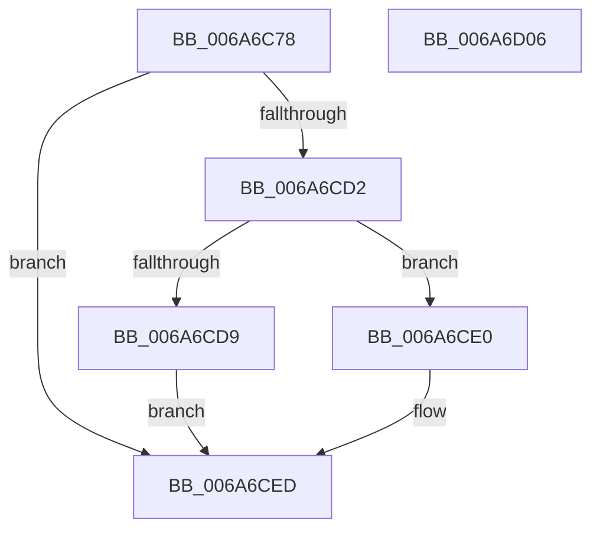

# IpmiLibAddSelRecord

- RVA: `0x006A6C78`–`0x006A6D07` (길이 `143` bytes)
- VA: `0x00000001406A6C78`
- 실행 섹션: `.text`
- PDB 이름 있음: `예`; PDB Function 태그: `아니요`
- unwind 정보 RVA: `0x000C4080`
- 디코드: `40`개 명령, `143/143` bytes 표시
- 미해석 바이트: `0` (있으면 어셈블리에 `.byte`로 보존)

> 이 문서는 커널 이미지의 기계어와 PDB 기호를 분석해 생성했습니다. 4번과 5번은 함수 원형과 자료형을 바이너리 사용 방식에서 추정한 C 해석이며 원본 소스 복구 결과는 아닙니다.

## 1. Dependencies

- 직접 호출 지점: **2**; 고유 호출 대상: **2**
- 직접 호출자로 확인된 함수: **4**
- RIP 상대 이미지 참조: **2**

### Outgoing calls
- `0x006A6CC7` → [IpmiLibRequestReceive](IpmiLibRequestReceive_function_006A6DDC.md) (function, `0x006A6DDC`)
- `0x006A6CF6` → [_security_check_cookie](_security_check_cookie_function_006AC640.md) (function, `0x006AC640`)

### Direct callers
- [IpmiLibAddSelBugcheckRecord](IpmiLibAddSelBugcheckRecord_function_006A6A40.md) at `0x006A6AB7`
- [IpmiLibAddSelBugcheckRecord](IpmiLibAddSelBugcheckRecord_function_006A6A40.md) at `0x006A6B05`
- [IpmiLibAddSelBugcheckRecord](IpmiLibAddSelBugcheckRecord_function_006A6A40.md) at `0x006A6B25`
- [IpmiLibAddSelCheckpointRecord](IpmiLibAddSelCheckpointRecord_function_006A6B7C.md) at `0x006A6BD9`
- [IpmiLibAddSelErrorRecord](IpmiLibAddSelErrorRecord_function_006A6BEC.md) at `0x006A6C4D`
- [IpmiLibpAddSelRawData](IpmiLibpAddSelRawData_function_006A6D10.md) at `0x006A6DA6`

### Static image references
- `0x006A6C85` → RVA `0x00E0A740` (`.data`; read)
- `0x006A6C93` → RVA `0x00EFA099` (`.data`; read)

## 2. Other-region calls and transfers

- 다른 실행 섹션으로 향하는 call: **0**
- 별도 외부 분기/꼬리 이동을 확인하지 못했습니다.

## 3. Assembly (complete function range)

```asm
006A6C78  48 89 5C 24 08                  mov qword ptr [rsp + 8], rbx
006A6C7D  55                              push rbp
006A6C7E  48 8B EC                        mov rbp, rsp
006A6C81  48 83 EC 50                     sub rsp, 0x50
006A6C85  48 8B 05 B4 3A 76 00            mov rax, qword ptr [rip + 0x763ab4]
006A6C8C  48 33 C4                        xor rax, rsp
006A6C8F  48 89 45 F0                     mov qword ptr [rbp - 0x10], rax
006A6C93  8A 05 00 34 85 00               mov al, byte ptr [rip + 0x853400]
006A6C99  49 8B D8                        mov rbx, r8
006A6C9C  0F 10 0A                        movups xmm1, xmmword ptr [rdx]
006A6C9F  83 65 D3 00                     and dword ptr [rbp - 0x2d], 0
006A6CA3  4C 8D 45 D0                     lea r8, [rbp - 0x30]
006A6CA7  88 45 D8                        mov byte ptr [rbp - 0x28], al
006A6CAA  48 8D 55 D8                     lea rdx, [rbp - 0x28]
006A6CAE  B8 07 00 00 00                  mov eax, 7
006A6CB3  C7 45 D9 10 00 28 44            mov dword ptr [rbp - 0x27], 0x44280010
006A6CBA  66 89 45 D0                     mov word ptr [rbp - 0x30], ax
006A6CBE  F3 0F 7F 4D DD                  movdqu xmmword ptr [rbp - 0x23], xmm1
006A6CC3  C6 45 D2 FF                     mov byte ptr [rbp - 0x2e], 0xff
006A6CC7  E8 10 01 00 00                  call 0x1406a6ddc
006A6CCC  8B C8                           mov ecx, eax
006A6CCE  85 C0                           test eax, eax
006A6CD0  78 1B                           js 0x1406a6ced
006A6CD2  66 83 7D D0 02                  cmp word ptr [rbp - 0x30], 2
006A6CD7  73 07                           jae 0x1406a6ce0
006A6CD9  B9 3E 00 00 C0                  mov ecx, 0xc000003e
006A6CDE  EB 0D                           jmp 0x1406a6ced
006A6CE0  0F B7 45 D2                     movzx eax, word ptr [rbp - 0x2e]
006A6CE4  66 89 03                        mov word ptr [rbx], ax
006A6CE7  8A 45 D4                        mov al, byte ptr [rbp - 0x2c]
006A6CEA  88 43 02                        mov byte ptr [rbx + 2], al
006A6CED  8B C1                           mov eax, ecx
006A6CEF  48 8B 4D F0                     mov rcx, qword ptr [rbp - 0x10]
006A6CF3  48 33 CC                        xor rcx, rsp
006A6CF6  E8 45 59 00 00                  call 0x1406ac640
006A6CFB  48 8B 5C 24 60                  mov rbx, qword ptr [rsp + 0x60]
006A6D00  48 83 C4 50                     add rsp, 0x50
006A6D04  5D                              pop rbp
006A6D05  C3                              ret
006A6D06  CC                              int3
```

## 4. C-style interpretation (structured pseudocode)

```c
__int64 __fastcall IpmiLibAddSelRecord(__int64 a1, __int64 a2, __int64 a3)
{
    __int64 result;
    __int64 v_rsp;
    unsigned __int64 v_stack_m18;
    unsigned __int64 v_stack_m2B;
    unsigned int v_stack_m2F;
    unsigned __int8 v_stack_m30;
    unsigned __int8 v_stack_m34;
    unsigned int v_stack_m35;
    unsigned __int8 v_stack_m36;
    unsigned __int64 v_stack_m38;
    unsigned __int64 v_stack_p8;

    v_stack_p8 = v_rbx;
    v_rsp = (v_rsp) - (80);
    result = (*(unsigned __int64 *)(v_rip + 7748276)) ^ (v_rsp);
    v_stack_m18 = result;
    v_stack_m30 = (unsigned __int8)(*(unsigned __int8 *)(v_rip + 8729600));
    v_stack_m2F = 0x44280010ULL;
    v_stack_m38 = 7;
    v_stack_m2B = v_xmm1;
    v_stack_m36 = 255;
    result = IpmiLibRequestReceive(a1, v_stack_m30, v_stack_m38, a4);
    if (sign_flag) goto loc_006A6CED;
    if (v_stack_m38 >= 2) goto loc_006A6CE0;
    goto loc_006A6CED;
loc_006A6CE0:
    *(unsigned __int16 *)(a3) = (unsigned __int16)(v_stack_m36);
    *(unsigned __int8 *)(a3 + 2) = (unsigned __int8)(v_stack_m34);
loc_006A6CED:
    a1 = (v_stack_m18) ^ (v_rsp);
    result = _security_check_cookie(a1, v_stack_m30, v_stack_m38, a4);
    v_rsp = (v_rsp) + (80);
    return result;
}
```

## 5. (Beta) C Style

```c
int64_t IpmiLibAddSelRecord(int64_t Arg1, void *Arg2, void *Arg3)
{
    uint8_t *arg2 = (uint8_t *)Arg2;
    uint8_t *arg3 = (uint8_t *)Arg3;

    int64_t result;
    int64_t local_rsp;
    uint64_t v_stack_m18;
    uint64_t v_stack_m2B;
    uint32_t v_stack_m2F;
    uint8_t v_stack_m30;
    uint8_t v_stack_m34;
    uint32_t v_stack_m35;
    uint8_t v_stack_m36;
    uint64_t v_stack_m38;
    uint64_t v_stack_p8;

    v_stack_p8 = local_rbx;
    local_rsp = (local_rsp) - (80);
    result = (*(uint64_t *)(v_rip + 0x763AB4)) ^ (local_rsp);
    v_stack_m18 = result;
    v_stack_m30 = (uint8_t)(*(uint8_t *)(v_rip + 0x853400));
    v_stack_m2F = 0x44280010ULL;
    v_stack_m38 = 7;
    v_stack_m2B = v_xmm1;
    v_stack_m36 = 255;
    result = IpmiLibRequestReceive(Arg1, v_stack_m30, v_stack_m38, a4);
    if (sign_flag) goto loc_006A6CED;
    if (v_stack_m38 >= 2) goto loc_006A6CE0;
    goto loc_006A6CED;
loc_006A6CE0:
    *(uint16_t *)(arg3) = (uint16_t)(v_stack_m36);
    *(uint8_t *)(arg3 + 0x2) = (uint8_t)(v_stack_m34);
loc_006A6CED:
    Arg1 = (v_stack_m18) ^ (local_rsp);
    result = _security_check_cookie(Arg1, v_stack_m30, v_stack_m38, a4);
    local_rsp = (local_rsp) + (80);
    return result;
}
```

### 관측된 메모리 오프셋

구조체 형식이 확인되지 않은 접근은 인자 기준의 오프셋으로만 기록했습니다.

| 기준 인자 | 오프셋 표현 | 폭 (bit) | 접근 |
|---|---:|---:|---|
| `Arg2` | `+ 0x0` | `128` | `R` |
| `Arg3` | `+ 0x0` | `16` | `W` |
| `Arg3` | `+ 0x2` | `8` | `W` |

## 6. Execution-region graph

[열기: 2D/3D 그래프와 함수 탐색 컨트롤 패널](../../../control-panel.html?section=text&rva=0x006A6C78&view=graph)

- 2D 그래프는 위에서 아래로 흐르고, 3D 그래프는 빈 공간을 드래그해 회전합니다. Shift+드래그는 이동, 휠은 확대·축소, 함수 노드 선택은 대상 보고서 이동입니다.

### Static fallback


