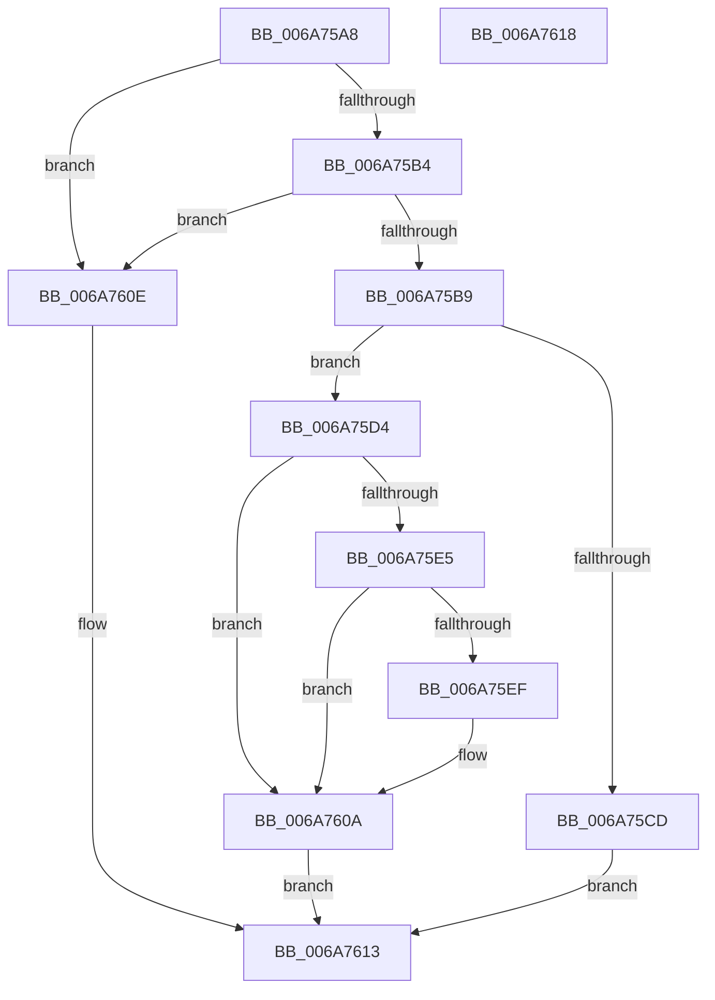

# IpmiLibKcsIpmiMessageUnpack

- RVA: `0x006A75A8`–`0x006A7619` (길이 `113` bytes)
- VA: `0x00000001406A75A8`
- 실행 섹션: `.text`
- PDB 이름 있음: `예`; PDB Function 태그: `아니요`
- unwind 정보 RVA: `0x0005C788`
- 디코드: `34`개 명령, `113/113` bytes 표시
- 미해석 바이트: `0` (있으면 어셈블리에 `.byte`로 보존)

> 이 문서는 커널 이미지의 기계어와 PDB 기호를 분석해 생성했습니다. 4번과 5번은 함수 원형과 자료형을 바이너리 사용 방식에서 추정한 C 해석이며 원본 소스 복구 결과는 아닙니다.

## 1. Dependencies

- 직접 호출 지점: **1**; 고유 호출 대상: **1**
- 직접 호출자로 확인된 함수: **1**
- RIP 상대 이미지 참조: **0**

### Outgoing calls
- `0x006A7605` → [memcpy](../6C/memcpy_function_006C6840.md) (function, `0x006C6840`)

### Direct callers
- [IpmiLibpKcsRequestAndReceive](IpmiLibpKcsRequestAndReceive_function_006A7210.md) at `0x006A728B`

### Static image references
- 디코드된 RIP-relative 메모리 참조가 없습니다.

## 2. Other-region calls and transfers

- 다른 실행 섹션으로 향하는 call: **0**
- 별도 외부 분기/꼬리 이동을 확인하지 못했습니다.

## 3. Assembly (complete function range)

```asm
006A75A8  48 83 EC 28                     sub rsp, 0x28
006A75AC  45 33 C9                        xor r9d, r9d
006A75AF  48 85 C9                        test rcx, rcx
006A75B2  74 5A                           je 0x1406a760e
006A75B4  48 85 D2                        test rdx, rdx
006A75B7  74 55                           je 0x1406a760e
006A75B9  44 0F B7 01                     movzx r8d, word ptr [rcx]
006A75BD  45 8D 51 03                     lea r10d, [r9 + 3]
006A75C1  0F B7 42 02                     movzx eax, word ptr [rdx + 2]
006A75C5  45 03 C2                        add r8d, r10d
006A75C8  44 3B C0                        cmp r8d, eax
006A75CB  73 07                           jae 0x1406a75d4
006A75CD  B8 17 00 00 C0                  mov eax, 0xc0000017
006A75D2  EB 3F                           jmp 0x1406a7613
006A75D4  8A 82 29 01 00 00               mov al, byte ptr [rdx + 0x129]
006A75DA  88 41 02                        mov byte ptr [rcx + 2], al
006A75DD  66 44 89 09                     mov word ptr [rcx], r9w
006A75E1  84 C0                           test al, al
006A75E3  75 25                           jne 0x1406a760a
006A75E5  0F B7 42 02                     movzx eax, word ptr [rdx + 2]
006A75E9  66 41 3B C2                     cmp ax, r10w
006A75ED  76 1B                           jbe 0x1406a760a
006A75EF  66 41 2B C2                     sub ax, r10w
006A75F3  48 81 C2 2A 01 00 00            add rdx, 0x12a
006A75FA  44 0F B7 C0                     movzx r8d, ax
006A75FE  66 44 89 01                     mov word ptr [rcx], r8w
006A7602  49 03 CA                        add rcx, r10
006A7605  E8 36 F2 01 00                  call 0x1406c6840
006A760A  33 C0                           xor eax, eax
006A760C  EB 05                           jmp 0x1406a7613
006A760E  B8 0D 00 00 C0                  mov eax, 0xc000000d
006A7613  48 83 C4 28                     add rsp, 0x28
006A7617  C3                              ret
006A7618  CC                              int3
```

## 4. C-style interpretation (structured pseudocode)

```c
__int64 __fastcall IpmiLibKcsIpmiMessageUnpack(__int64 a1, __int64 a2, __int64 a3, int a4)
{
    __int64 result;
    __int64 v_rsp;

    v_rsp = (v_rsp) - (40);
    a4 = 0;
    if (a1 == 0) goto loc_006A760E;
    if (a2 == 0) goto loc_006A760E;
    a3 = (unsigned int)((*(unsigned __int16 *)(a1)) + ((unsigned int)(a4 + 3)));
    if (((unsigned int)(a3)) >= ((unsigned int)(*(unsigned __int16 *)(a2 + 2)))) goto loc_006A75D4;
    goto loc_006A7613;
loc_006A75D4:
    *(unsigned __int8 *)(a1 + 2) = (unsigned __int8)(*(unsigned __int8 *)(a2 + 297));
    *(unsigned __int16 *)(a1) = 0;
    if ((unsigned __int8)(*(unsigned __int8 *)(a2 + 297)) != 0) goto loc_006A760A;
    result = *(unsigned __int16 *)(a2 + 2);
    if (((unsigned __int16)(*(unsigned __int16 *)(a2 + 2))) >= = ((unsigned __int16)(a4 + 3))) {
        result = (unsigned __int16)((*(unsigned __int16 *)(a2 + 2)) - ((unsigned __int16)(a4 + 3)));
        a2 = (a2) + (298);
        a3 = (unsigned __int16)(result);
        *(unsigned __int16 *)(a1) = (unsigned __int16)(a3);
        a1 = (a1) + (a4 + 3);
        result = memcpy(a1, a2, a3, a4);
    }
    result = 0;
    goto loc_006A7613;
loc_006A760E:
loc_006A7613:
    v_rsp = (v_rsp) + (40);
    return (unsigned int)(0xC000000DULL);
}
```

## 5. (Beta) C Style

```c
int64_t IpmiLibKcsIpmiMessageUnpack(int64_t Arg1, int64_t Arg2, int64_t Arg3, int32_t Arg4)
{
    int64_t result;
    int64_t local_rsp;

    local_rsp = (local_rsp) - (40);
    Arg4 = 0;
    if (Arg1 == 0) goto loc_006A760E;
    if (Arg2 == 0) goto loc_006A760E;
    Arg3 = (uint32_t)((*(uint16_t *)(Arg1)) + ((uint32_t)(Arg4 + 3)));
    if (((uint32_t)(Arg3)) >= ((uint32_t)(*(uint16_t *)(Arg2 + 0x2)))) goto loc_006A75D4;
    goto loc_006A7613;
loc_006A75D4:
    *(uint8_t *)(Arg1 + 0x2) = (uint8_t)(*(uint8_t *)(Arg2 + 0x129));
    *(uint16_t *)(Arg1) = 0;
    if ((uint8_t)(*(uint8_t *)(Arg2 + 0x129)) != 0) goto loc_006A760A;
    result = *(uint16_t *)(Arg2 + 0x2);
    if (((uint16_t)(*(uint16_t *)(Arg2 + 0x2))) >= = ((uint16_t)(Arg4 + 3))) {
        result = (uint16_t)((*(uint16_t *)(Arg2 + 0x2)) - ((uint16_t)(Arg4 + 3)));
        Arg2 = (Arg2) + (298);
        Arg3 = (uint16_t)(result);
        *(uint16_t *)(Arg1) = (uint16_t)(Arg3);
        Arg1 = (Arg1) + (Arg4 + 3);
        result = memcpy(Arg1, Arg2, Arg3, Arg4);
    }
    result = 0;
    goto loc_006A7613;
loc_006A760E:
loc_006A7613:
    local_rsp = (local_rsp) + (40);
    return (uint32_t)(0xC000000DULL);
}
```

## 6. Execution-region graph

[열기: 2D/3D 그래프와 함수 탐색 컨트롤 패널](../../../control-panel.html?section=text&rva=0x006A75A8&view=graph)

- 2D 그래프는 위에서 아래로 흐르고, 3D 그래프는 빈 공간을 드래그해 회전합니다. Shift+드래그는 이동, 휠은 확대·축소, 함수 노드 선택은 대상 보고서 이동입니다.

### Static fallback


