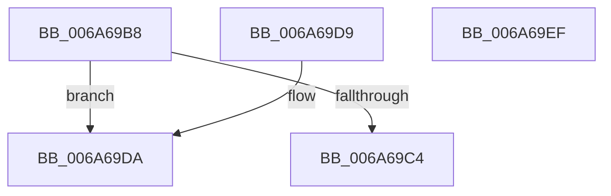

# IpmiLibReadOneByte

- RVA: `0x006A69B8`–`0x006A69F0` (길이 `56` bytes)
- VA: `0x00000001406A69B8`
- 실행 섹션: `.text`
- PDB 이름 있음: `예`; PDB Function 태그: `아니요`
- unwind 정보 RVA: `0x000DB714`
- 디코드: `18`개 명령, `56/56` bytes 표시
- 미해석 바이트: `0` (있으면 어셈블리에 `.byte`로 보존)

> 이 문서는 커널 이미지의 기계어와 PDB 기호를 분석해 생성했습니다. 4번과 5번은 함수 원형과 자료형을 바이너리 사용 방식에서 추정한 C 해석이며 원본 소스 복구 결과는 아닙니다.

## 1. Dependencies

- 직접 호출 지점: **0**; 고유 호출 대상: **0**
- 직접 호출자로 확인된 함수: **4**
- RIP 상대 이미지 참조: **3**

### Outgoing calls
- 직접 디코드된 call 명령이 없습니다.

### Direct callers
- [IpmiLibpKcsHandleError](IpmiLibpKcsHandleError_function_006A6F48.md) at `0x006A7016`
- [IpmiLibpKcsReceiveResponseFromBmc](IpmiLibpKcsReceiveResponseFromBmc_function_006A7098.md) at `0x006A711F`
- [IpmiLibpKcsReceiveResponseFromBmc](IpmiLibpKcsReceiveResponseFromBmc_function_006A7098.md) at `0x006A714B`
- [IpmiLibpKcsReceiveResponseFromBmc](IpmiLibpKcsReceiveResponseFromBmc_function_006A7098.md) at `0x006A71AD`
- [IpmiLibpKcsSendRequestToBMC](IpmiLibpKcsSendRequestToBMC_function_006A72BC.md) at `0x006A7318`
- [IpmiLibpKcsSendRequestToBMC](IpmiLibpKcsSendRequestToBMC_function_006A72BC.md) at `0x006A7360`
- [IpmiLibpKcsSendRequestToBMC](IpmiLibpKcsSendRequestToBMC_function_006A72BC.md) at `0x006A7377`
- [IpmiLibpKcsSendRequestToBMC](IpmiLibpKcsSendRequestToBMC_function_006A72BC.md) at `0x006A73CD`
- [IpmiLibpKcsSendRequestToBMC](IpmiLibpKcsSendRequestToBMC_function_006A72BC.md) at `0x006A73E4`
- [IpmiLibpKcsSendRequestToBMC](IpmiLibpKcsSendRequestToBMC_function_006A72BC.md) at `0x006A7439`
- [IpmiLibpKcsSendRequestToBMC](IpmiLibpKcsSendRequestToBMC_function_006A72BC.md) at `0x006A7448`
- [IpmiLibpKcsSpinRegister](IpmiLibpKcsSpinRegister_function_006A74A8.md) at `0x006A74E4`

### Static image references
- `0x006A69B8` → RVA `0x00EFA098` (`.data`; read)
- `0x006A69C4` → RVA `0x00EFA088` (`.data`; read)
- `0x006A69CE` → RVA `0x00EFA0E0` (`.data`; read)

## 2. Other-region calls and transfers

- 다른 실행 섹션으로 향하는 call: **0**
- 별도 외부 분기/꼬리 이동을 확인하지 못했습니다.

## 3. Assembly (complete function range)

```asm
006A69B8  80 3D D9 36 85 00 00            cmp byte ptr [rip + 0x8536d9], 0
006A69BF  0F B6 CA                        movzx ecx, dl
006A69C2  75 16                           jne 0x1406a69da
006A69C4  0F B6 05 BD 36 85 00            movzx eax, byte ptr [rip + 0x8536bd]
006A69CB  0F AF C1                        imul eax, ecx
006A69CE  48 03 05 0B 37 85 00            add rax, qword ptr [rip + 0x85370b]
006A69D5  90                              nop
006A69D6  8A 00                           mov al, byte ptr [rax]
006A69D8  C3                              ret
006A69D9  CC                              int3
006A69DA  0F B6 15 A7 36 85 00            movzx edx, byte ptr [rip + 0x8536a7]
006A69E1  0F AF D1                        imul edx, ecx
006A69E4  48 03 15 F5 36 85 00            add rdx, qword ptr [rip + 0x8536f5]
006A69EB  90                              nop
006A69EC  EC                              in al, dx
006A69ED  90                              nop
006A69EE  C3                              ret
006A69EF  CC                              int3
```

## 4. C-style interpretation (structured pseudocode)

```c
__int64 __fastcall IpmiLibReadOneByte(__int64 a1, unsigned __int8 a2)
{
    __int64 result;

    if ((*(unsigned __int8 *)(v_rip + 8730329)) != 0) goto loc_006A69DA;
    result = (unsigned int)((*(unsigned __int8 *)(v_rip + 8730301)) * (a2));
    result = (result) + (*(unsigned __int64 *)(v_rip + 8730379));
    return *(unsigned __int8 *)(result);
loc_006A69DA:
    a2 = (unsigned int)((*(unsigned __int8 *)(v_rip + 8730279)) * (a2));
    a2 = (a2) + (*(unsigned __int64 *)(v_rip + 8730357));
    return *(unsigned __int8 *)(result);
}
```

## 5. (Beta) C Style

```c
int64_t IpmiLibReadOneByte(int64_t Arg1, uint8_t Arg2)
{
    int64_t result;

    if ((*(uint8_t *)(v_rip + 0x8536D9)) != 0) goto loc_006A69DA;
    result = (uint32_t)((*(uint8_t *)(v_rip + 0x8536BD)) * (Arg2));
    result = (result) + (*(uint64_t *)(v_rip + 0x85370B));
    return *(uint8_t *)(result);
loc_006A69DA:
    Arg2 = (uint32_t)((*(uint8_t *)(v_rip + 0x8536A7)) * (Arg2));
    Arg2 = (Arg2) + (*(uint64_t *)(v_rip + 0x8536F5));
    return *(uint8_t *)(result);
}
```

## 6. Execution-region graph

[열기: 2D/3D 그래프와 함수 탐색 컨트롤 패널](../../../control-panel.html?section=text&rva=0x006A69B8&view=graph)

- 2D 그래프는 위에서 아래로 흐르고, 3D 그래프는 빈 공간을 드래그해 회전합니다. Shift+드래그는 이동, 휠은 확대·축소, 함수 노드 선택은 대상 보고서 이동입니다.

### Static fallback


