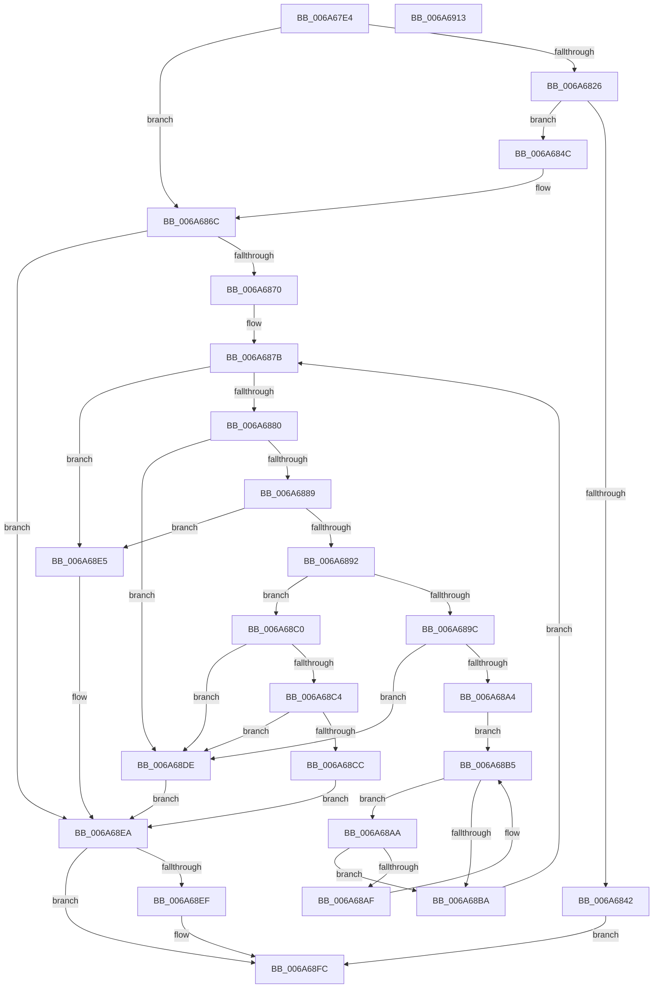

# IpmiLibReadSmbiosRecord38

- RVA: `0x006A67E4`–`0x006A6914` (길이 `304` bytes)
- VA: `0x00000001406A67E4`
- 실행 섹션: `.text`
- PDB 이름 있음: `예`; PDB Function 태그: `아니요`
- unwind 정보 RVA: `0x000A7960`
- 디코드: `93`개 명령, `304/304` bytes 표시
- 미해석 바이트: `0` (있으면 어셈블리에 `.byte`로 보존)

> 이 문서는 커널 이미지의 기계어와 PDB 기호를 분석해 생성했습니다. 4번과 5번은 함수 원형과 자료형을 바이너리 사용 방식에서 추정한 C 해석이며 원본 소스 복구 결과는 아닙니다.

## 1. Dependencies

- 직접 호출 지점: **4**; 고유 호출 대상: **3**
- 직접 호출자로 확인된 함수: **1**
- RIP 상대 이미지 참조: **0**

### Outgoing calls
- `0x006A6818` → [ExGetSystemFirmwareTable](../../page/7C/ExGetSystemFirmwareTable_function_007C3920.md) (function, `0x007C3920`)
- `0x006A6835` → [ExAllocatePool2](../../poolcode/B8/ExAllocatePool2_function_00B820F0.md) (function, `0x00B820F0`)
- `0x006A6865` → [ExGetSystemFirmwareTable](../../page/7C/ExGetSystemFirmwareTable_function_007C3920.md) (function, `0x007C3920`)
- `0x006A68F7` → [ExFreePoolWithTag](../../poolcode/B8/ExFreePoolWithTag_function_00B82870.md) (function, `0x00B82870`)

### Direct callers
- [IpmiHwInitializeContext](IpmiHwInitializeContext_function_006A64F8.md) at `0x006A6553`

### Static image references
- 디코드된 RIP-relative 메모리 참조가 없습니다.

## 2. Other-region calls and transfers

- 다른 실행 섹션으로 향하는 call: **4**
  - `0x006A6818` → [ExGetSystemFirmwareTable](../../page/7C/ExGetSystemFirmwareTable_function_007C3920.md) (`.text` → `PAGE`)
  - `0x006A6835` → [ExAllocatePool2](../../poolcode/B8/ExAllocatePool2_function_00B820F0.md) (`.text` → `POOLCODE`)
  - `0x006A6865` → [ExGetSystemFirmwareTable](../../page/7C/ExGetSystemFirmwareTable_function_007C3920.md) (`.text` → `PAGE`)
  - `0x006A68F7` → [ExFreePoolWithTag](../../poolcode/B8/ExFreePoolWithTag_function_00B82870.md) (`.text` → `POOLCODE`)
- 별도 외부 분기/꼬리 이동을 확인하지 못했습니다.

## 3. Assembly (complete function range)

```asm
006A67E4  48 8B C4                        mov rax, rsp
006A67E7  48 89 58 08                     mov qword ptr [rax + 8], rbx
006A67EB  48 89 68 18                     mov qword ptr [rax + 0x18], rbp
006A67EF  48 89 70 20                     mov qword ptr [rax + 0x20], rsi
006A67F3  57                              push rdi
006A67F4  48 83 EC 30                     sub rsp, 0x30
006A67F8  33 ED                           xor ebp, ebp
006A67FA  48 8B F1                        mov rsi, rcx
006A67FD  89 68 10                        mov dword ptr [rax + 0x10], ebp
006A6800  48 8D 40 10                     lea rax, [rax + 0x10]
006A6804  45 33 C9                        xor r9d, r9d
006A6807  48 89 44 24 20                  mov qword ptr [rsp + 0x20], rax
006A680C  45 33 C0                        xor r8d, r8d
006A680F  33 D2                           xor edx, edx
006A6811  B9 42 4D 53 52                  mov ecx, 0x52534d42
006A6816  8B FD                           mov edi, ebp
006A6818  E8 03 D1 11 00                  call 0x1407c3920
006A681D  8B D8                           mov ebx, eax
006A681F  3D 23 00 00 C0                  cmp eax, 0xc0000023
006A6824  75 46                           jne 0x1406a686c
006A6826  8B 54 24 48                     mov edx, dword ptr [rsp + 0x48]
006A682A  B9 00 01 00 00                  mov ecx, 0x100
006A682F  41 B8 49 50 4D 49               mov r8d, 0x494d5049
006A6835  E8 B6 B8 4D 00                  call 0x140b820f0
006A683A  48 8B F8                        mov rdi, rax
006A683D  48 85 C0                        test rax, rax
006A6840  75 0A                           jne 0x1406a684c
006A6842  BB 17 00 00 C0                  mov ebx, 0xc0000017
006A6847  E9 B0 00 00 00                  jmp 0x1406a68fc
006A684C  44 8B 4C 24 48                  mov r9d, dword ptr [rsp + 0x48]
006A6851  48 8D 44 24 48                  lea rax, [rsp + 0x48]
006A6856  4C 8B C7                        mov r8, rdi
006A6859  48 89 44 24 20                  mov qword ptr [rsp + 0x20], rax
006A685E  33 D2                           xor edx, edx
006A6860  B9 42 4D 53 52                  mov ecx, 0x52534d42
006A6865  E8 B6 D0 11 00                  call 0x1407c3920
006A686A  8B D8                           mov ebx, eax
006A686C  85 DB                           test ebx, ebx
006A686E  78 7A                           js 0x1406a68ea
006A6870  8B 54 24 48                     mov edx, dword ptr [rsp + 0x48]
006A6874  48 8D 4F 08                     lea rcx, [rdi + 8]
006A6878  48 03 D7                        add rdx, rdi
006A687B  48 3B CA                        cmp rcx, rdx
006A687E  73 65                           jae 0x1406a68e5
006A6880  48 8D 41 04                     lea rax, [rcx + 4]
006A6884  48 3B C2                        cmp rax, rdx
006A6887  77 55                           ja 0x1406a68de
006A6889  44 8A 01                        mov r8b, byte ptr [rcx]
006A688C  41 80 F8 7F                     cmp r8b, 0x7f
006A6890  74 53                           je 0x1406a68e5
006A6892  0F B6 41 01                     movzx eax, byte ptr [rcx + 1]
006A6896  41 80 F8 26                     cmp r8b, 0x26
006A689A  74 24                           je 0x1406a68c0
006A689C  48 03 C8                        add rcx, rax
006A689F  48 3B CA                        cmp rcx, rdx
006A68A2  77 3A                           ja 0x1406a68de
006A68A4  48 8D 41 02                     lea rax, [rcx + 2]
006A68A8  EB 0B                           jmp 0x1406a68b5
006A68AA  66 39 29                        cmp word ptr [rcx], bp
006A68AD  74 0B                           je 0x1406a68ba
006A68AF  48 FF C1                        inc rcx
006A68B2  48 FF C0                        inc rax
006A68B5  48 3B C2                        cmp rax, rdx
006A68B8  72 F0                           jb 0x1406a68aa
006A68BA  48 83 C1 02                     add rcx, 2
006A68BE  EB BB                           jmp 0x1406a687b
006A68C0  3C 12                           cmp al, 0x12
006A68C2  72 1A                           jb 0x1406a68de
006A68C4  48 03 C1                        add rax, rcx
006A68C7  48 3B C2                        cmp rax, rdx
006A68CA  77 12                           ja 0x1406a68de
006A68CC  0F 10 01                        movups xmm0, xmmword ptr [rcx]
006A68CF  8B DD                           mov ebx, ebp
006A68D1  0F 11 06                        movups xmmword ptr [rsi], xmm0
006A68D4  0F B7 41 10                     movzx eax, word ptr [rcx + 0x10]
006A68D8  66 89 46 10                     mov word ptr [rsi + 0x10], ax
006A68DC  EB 0C                           jmp 0x1406a68ea
006A68DE  BB 3E 00 00 C0                  mov ebx, 0xc000003e
006A68E3  EB 05                           jmp 0x1406a68ea
006A68E5  BB 25 02 00 C0                  mov ebx, 0xc0000225
006A68EA  48 85 FF                        test rdi, rdi
006A68ED  74 0D                           je 0x1406a68fc
006A68EF  BA 49 50 4D 49                  mov edx, 0x494d5049
006A68F4  48 8B CF                        mov rcx, rdi
006A68F7  E8 74 BF 4D 00                  call 0x140b82870
006A68FC  48 8B 6C 24 50                  mov rbp, qword ptr [rsp + 0x50]
006A6901  8B C3                           mov eax, ebx
006A6903  48 8B 5C 24 40                  mov rbx, qword ptr [rsp + 0x40]
006A6908  48 8B 74 24 58                  mov rsi, qword ptr [rsp + 0x58]
006A690D  48 83 C4 30                     add rsp, 0x30
006A6911  5F                              pop rdi
006A6912  C3                              ret
006A6913  CC                              int3
```

## 4. C-style interpretation (structured pseudocode)

```c
__int64 __fastcall IpmiLibReadSmbiosRecord38(__int64 a1, int a2, int a3, int a4)
{
    __int64 result;
    __int64 v_rbp;
    __int64 v_rsp;
    unsigned __int64 v_stack_m18;
    unsigned int v_stack_p10;
    unsigned __int64 v_stack_p18;
    unsigned __int64 v_stack_p20;
    unsigned __int64 v_stack_p8;

    *(unsigned __int64 *)(v_rsp + 8) = v_rbx;
    *(unsigned __int64 *)(v_rsp + 24) = v_rbp;
    *(unsigned __int64 *)(v_rsp + 32) = v_rsi;
    v_rsp = (v_rsp) - (48);
    v_rbp = 0;
    *(unsigned int *)(v_rsp + 16) = 0;
    a4 = 0;
    v_stack_m18 = v_rsp + 16;
    a3 = 0;
    a2 = 0;
    result = ExGetSystemFirmwareTable((unsigned int)(0x52534D42ULL), a2, a3, a4);
    if (((unsigned int)(result)) != 0xC0000023ULL) goto loc_006A686C;
    result = ExAllocatePool2(256, (unsigned int)(v_stack_p10), (unsigned int)(0x494D5049ULL), a4);
    if (result != 0) goto loc_006A684C;
    goto loc_006A68FC;
loc_006A684C:
    v_stack_m18 = v_stack_p10;
    a2 = 0;
    result = ExGetSystemFirmwareTable((unsigned int)(0x52534D42ULL), a2, result, (unsigned int)(v_stack_p10));
loc_006A686C:
    if (sign_flag) goto loc_006A68EA;
    a2 = ((unsigned int)(v_stack_p10)) + (result);
loc_006A687B:
    if ((result + 8) >= a2) goto loc_006A68E5;
    if ((result + 8 + 4) > a2) goto loc_006A68DE;
    if (((unsigned __int8)(*(unsigned __int8 *)(result + 8))) == 127) goto loc_006A68E5;
    if (((unsigned __int8)(*(unsigned __int8 *)(result + 8))) == 38) goto loc_006A68C0;
    a1 = (result + 8) + (*(unsigned __int8 *)(result + 8 + 1));
    if (a1 > a2) goto loc_006A68DE;
    goto loc_006A68B5;
loc_006A68AA:
    if ((*(unsigned __int16 *)(a1)) == 0) goto loc_006A68BA;
    a1 = (a1) + 1;
    result = (a1 + 2) + 1;
loc_006A68B5:
    if (result < a2) goto loc_006A68AA;
loc_006A68BA:
    a1 = (a1) + (2);
    goto loc_006A687B;
loc_006A68C0:
    if (((unsigned __int8)(result)) < 18) goto loc_006A68DE;
    result = (result) + (a1);
    if (result > a2) goto loc_006A68DE;
    *(unsigned __int64 *)(a1) = v_xmm0;
    *(unsigned __int16 *)(a1 + 16) = (unsigned __int16)(*(unsigned __int16 *)(a1 + 16));
    goto loc_006A68EA;
loc_006A68DE:
    goto loc_006A68EA;
loc_006A68E5:
loc_006A68EA:
    result = *(unsigned __int16 *)(a1 + 16);
    if (result != 0) {
        a2 = 0x494D5049ULL;
        a1 = result;
        result = ExFreePoolWithTag(a1, a2, *(unsigned __int8 *)(result + 8), (unsigned int)(v_stack_p10));
    }
    v_rsp = (v_rsp) + (48);
    return (unsigned int)((unsigned int)((unsigned int)(0xC0000225ULL)));
}
```

## 5. (Beta) C Style

```c
int64_t IpmiLibReadSmbiosRecord38(void *Arg1, int32_t Arg2, int32_t Arg3, int32_t Arg4)
{
    uint8_t *arg1 = (uint8_t *)Arg1;

    int64_t result;
    int64_t local_rbp;
    int64_t local_rsp;
    uint64_t v_stack_m18;
    uint32_t v_stack_p10;
    uint64_t v_stack_p18;
    uint64_t v_stack_p20;
    uint64_t v_stack_p8;

    *(uint64_t *)(local_rsp + 0x8) = local_rbx;
    *(uint64_t *)(local_rsp + 0x18) = local_rbp;
    *(uint64_t *)(local_rsp + 0x20) = local_rsi;
    local_rsp = (local_rsp) - (48);
    local_rbp = 0;
    *(uint32_t *)(local_rsp + 0x10) = 0;
    Arg4 = 0;
    v_stack_m18 = local_rsp + 16;
    Arg3 = 0;
    Arg2 = 0;
    result = ExGetSystemFirmwareTable((uint32_t)(0x52534D42ULL), Arg2, Arg3, Arg4);
    if (((uint32_t)(result)) != 0xC0000023ULL) goto loc_006A686C;
    result = ExAllocatePool2(256, (uint32_t)(v_stack_p10), (uint32_t)(0x494D5049ULL), Arg4);
    if (result != 0) goto loc_006A684C;
    goto loc_006A68FC;
loc_006A684C:
    v_stack_m18 = v_stack_p10;
    Arg2 = 0;
    result = ExGetSystemFirmwareTable((uint32_t)(0x52534D42ULL), Arg2, result, (uint32_t)(v_stack_p10));
loc_006A686C:
    if (sign_flag) goto loc_006A68EA;
    Arg2 = ((uint32_t)(v_stack_p10)) + (result);
loc_006A687B:
    if ((result + 8) >= Arg2) goto loc_006A68E5;
    if ((result + 8 + 4) > Arg2) goto loc_006A68DE;
    if (((uint8_t)(*(uint8_t *)(result + 0x8))) == 127) goto loc_006A68E5;
    if (((uint8_t)(*(uint8_t *)(result + 0x8))) == 38) goto loc_006A68C0;
    Arg1 = (result + 8) + (*(uint8_t *)(result + 0x8 + 0x1));
    if (Arg1 > Arg2) goto loc_006A68DE;
    goto loc_006A68B5;
loc_006A68AA:
    if ((*(uint16_t *)(arg1)) == 0) goto loc_006A68BA;
    Arg1 = (Arg1) + 1;
    result = (Arg1 + 2) + 1;
loc_006A68B5:
    if (result < Arg2) goto loc_006A68AA;
loc_006A68BA:
    Arg1 = (Arg1) + (2);
    goto loc_006A687B;
loc_006A68C0:
    if (((uint8_t)(result)) < 18) goto loc_006A68DE;
    result = (result) + (Arg1);
    if (result > Arg2) goto loc_006A68DE;
    *(uint64_t *)(arg1) = v_xmm0;
    *(uint16_t *)(arg1 + 0x10) = (uint16_t)(*(uint16_t *)(arg1 + 0x10));
    goto loc_006A68EA;
loc_006A68DE:
    goto loc_006A68EA;
loc_006A68E5:
loc_006A68EA:
    result = *(uint16_t *)(arg1 + 0x10);
    if (result != 0) {
        Arg2 = 0x494D5049ULL;
        Arg1 = result;
        result = ExFreePoolWithTag(Arg1, Arg2, *(uint8_t *)(result + 0x8), (uint32_t)(v_stack_p10));
    }
    local_rsp = (local_rsp) + (48);
    return (uint32_t)((uint32_t)((uint32_t)(0xC0000225ULL)));
}
```

### 관측된 메모리 오프셋

구조체 형식이 확인되지 않은 접근은 인자 기준의 오프셋으로만 기록했습니다.

| 기준 인자 | 오프셋 표현 | 폭 (bit) | 접근 |
|---|---:|---:|---|
| `Arg1` | `+ 0x0` | `128` | `R` |
| `Arg1` | `+ 0x10` | `16` | `W` |

## 6. Execution-region graph

[열기: 2D/3D 그래프와 함수 탐색 컨트롤 패널](../../../control-panel.html?section=text&rva=0x006A67E4&view=graph)

- 2D 그래프는 위에서 아래로 흐르고, 3D 그래프는 빈 공간을 드래그해 회전합니다. Shift+드래그는 이동, 휠은 확대·축소, 함수 노드 선택은 대상 보고서 이동입니다.

### Static fallback


