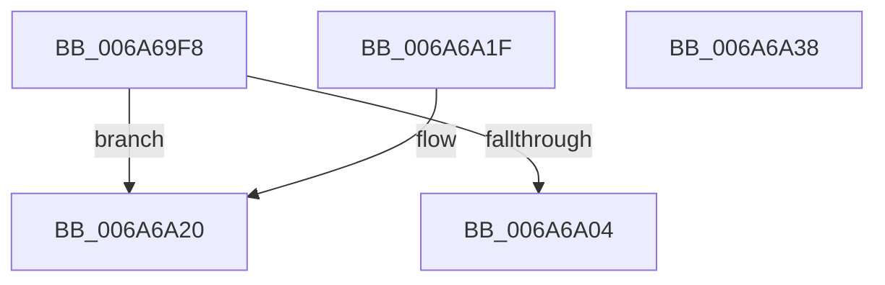

# IpmiLibWriteOneByte

- RVA: `0x006A69F8`–`0x006A6A39` (길이 `65` bytes)
- VA: `0x00000001406A69F8`
- 실행 섹션: `.text`
- PDB 이름 있음: `예`; PDB Function 태그: `아니요`
- unwind 정보 RVA: `0x000DB714`
- 디코드: `19`개 명령, `65/65` bytes 표시
- 미해석 바이트: `0` (있으면 어셈블리에 `.byte`로 보존)

> 이 문서는 커널 이미지의 기계어와 PDB 기호를 분석해 생성했습니다. 4번과 5번은 함수 원형과 자료형을 바이너리 사용 방식에서 추정한 C 해석이며 원본 소스 복구 결과는 아닙니다.

## 1. Dependencies

- 직접 호출 지점: **0**; 고유 호출 대상: **0**
- 직접 호출자로 확인된 함수: **4**
- RIP 상대 이미지 참조: **3**

### Outgoing calls
- 직접 디코드된 call 명령이 없습니다.

### Direct callers
- [IpmiLibpKcsHandleError](IpmiLibpKcsHandleError_function_006A6F48.md) at `0x006A6F95`
- [IpmiLibpKcsHandleError](IpmiLibpKcsHandleError_function_006A6F48.md) at `0x006A6FD0`
- [IpmiLibpKcsHandleError](IpmiLibpKcsHandleError_function_006A6F48.md) at `0x006A7020`
- [IpmiLibpKcsHandleError](IpmiLibpKcsHandleError_function_006A6F48.md) at `0x006A7077`
- [IpmiLibpKcsReceiveResponseFromBmc](IpmiLibpKcsReceiveResponseFromBmc_function_006A7098.md) at `0x006A7158`
- [IpmiLibpKcsReceiveResponseFromBmc](IpmiLibpKcsReceiveResponseFromBmc_function_006A7098.md) at `0x006A71EA`
- [IpmiLibpKcsSendRequestToBMC](IpmiLibpKcsSendRequestToBMC_function_006A72BC.md) at `0x006A732A`
- [IpmiLibpKcsSendRequestToBMC](IpmiLibpKcsSendRequestToBMC_function_006A72BC.md) at `0x006A7393`
- [IpmiLibpKcsSendRequestToBMC](IpmiLibpKcsSendRequestToBMC_function_006A72BC.md) at `0x006A73FD`
- [IpmiLibpKcsSendRequestToBMC](IpmiLibpKcsSendRequestToBMC_function_006A72BC.md) at `0x006A7457`
- [IpmiLibpKcsSendRequestToBMC](IpmiLibpKcsSendRequestToBMC_function_006A72BC.md) at `0x006A7477`
- [IpmiLibpHandleReadInterrupt](IpmiLibpHandleReadInterrupt_function_006A76D8.md) at `0x006A7774`

### Static image references
- `0x006A69F8` → RVA `0x00EFA098` (`.data`; read)
- `0x006A6A04` → RVA `0x00EFA088` (`.data`; read)
- `0x006A6A0E` → RVA `0x00EFA0E0` (`.data`; read)

## 2. Other-region calls and transfers

- 다른 실행 섹션으로 향하는 call: **0**
- 별도 외부 분기/꼬리 이동을 확인하지 못했습니다.

## 3. Assembly (complete function range)

```asm
006A69F8  80 3D 99 36 85 00 00            cmp byte ptr [rip + 0x853699], 0
006A69FF  0F B6 CA                        movzx ecx, dl
006A6A02  75 1C                           jne 0x1406a6a20
006A6A04  0F B6 05 7D 36 85 00            movzx eax, byte ptr [rip + 0x85367d]
006A6A0B  0F AF C8                        imul ecx, eax
006A6A0E  48 8B 05 CB 36 85 00            mov rax, qword ptr [rip + 0x8536cb]
006A6A15  44 88 04 01                     mov byte ptr [rcx + rax], r8b
006A6A19  F0 83 0C 24 00                  lock or dword ptr [rsp], 0
006A6A1E  C3                              ret
006A6A1F  CC                              int3
006A6A20  0F B6 15 61 36 85 00            movzx edx, byte ptr [rip + 0x853661]
006A6A27  41 8A C0                        mov al, r8b
006A6A2A  0F AF D1                        imul edx, ecx
006A6A2D  48 03 15 AC 36 85 00            add rdx, qword ptr [rip + 0x8536ac]
006A6A34  90                              nop
006A6A35  EE                              out dx, al
006A6A36  90                              nop
006A6A37  C3                              ret
006A6A38  CC                              int3
```

## 4. C-style interpretation (structured pseudocode)

```c
__int64 __fastcall IpmiLibWriteOneByte(__int64 a1, unsigned __int8 a2, unsigned __int8 a3)
{
    unsigned int v_stack_p0;

    if ((*(unsigned __int8 *)(v_rip + 8730265)) != 0) goto loc_006A6A20;
    a1 = (unsigned int)((a2) * ((unsigned int)(*(unsigned __int8 *)(v_rip + 8730237))));
    *(unsigned __int8 *)(a1 + *(unsigned __int64 *)(v_rip + 8730315) * 1) = a3;
    return *(unsigned __int64 *)(v_rip + 8730315);
loc_006A6A20:
    a2 = (unsigned int)((*(unsigned __int8 *)(v_rip + 8730209)) * ((unsigned int)(a1)));
    a2 = (a2) + (*(unsigned __int64 *)(v_rip + 8730284));
    return a3;
}
```

## 5. (Beta) C Style

```c
int64_t IpmiLibWriteOneByte(int64_t Arg1, void *Arg2, uint8_t Arg3)
{
    uint8_t *arg2 = (uint8_t *)Arg2;

    uint32_t v_stack_p0;

    if ((*(uint8_t *)(v_rip + 0x853699)) != 0) goto loc_006A6A20;
    Arg1 = (uint32_t)((Arg2) * ((uint32_t)(*(uint8_t *)(v_rip + 0x85367D))));
    *(uint8_t *)(Arg1 + *(uint64_t *)(v_rip + 0x8536CB) * 1) = Arg3;
    return *(uint64_t *)(v_rip + 0x8536CB);
loc_006A6A20:
    Arg2 = (uint32_t)((*(uint8_t *)(v_rip + 0x853661)) * ((uint32_t)(Arg1)));
    Arg2 = (Arg2) + (*(uint64_t *)(v_rip + 0x8536AC));
    return Arg3;
}
```

### 관측된 메모리 오프셋

구조체 형식이 확인되지 않은 접근은 인자 기준의 오프셋으로만 기록했습니다.

| 기준 인자 | 오프셋 표현 | 폭 (bit) | 접근 |
|---|---:|---:|---|
| `Arg2` | `+ 0x0 + rax*1` | `8` | `W` |

## 6. Execution-region graph

[열기: 2D/3D 그래프와 함수 탐색 컨트롤 패널](../../../control-panel.html?section=text&rva=0x006A69F8&view=graph)

- 2D 그래프는 위에서 아래로 흐르고, 3D 그래프는 빈 공간을 드래그해 회전합니다. Shift+드래그는 이동, 휠은 확대·축소, 함수 노드 선택은 대상 보고서 이동입니다.

### Static fallback


