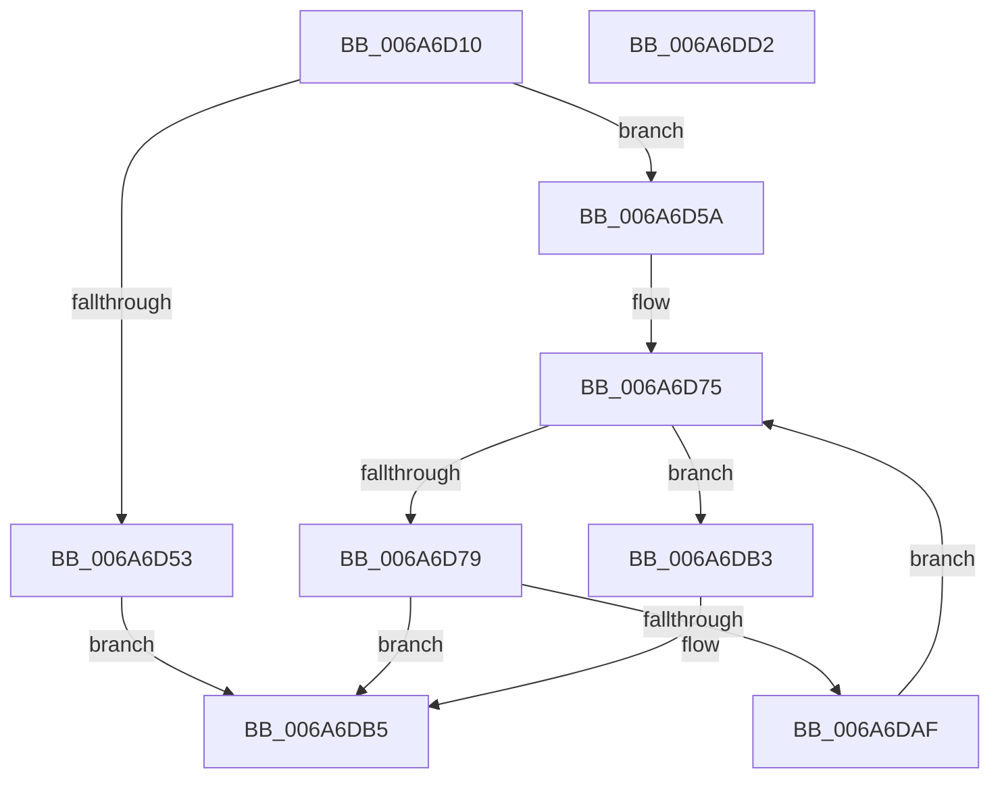

# IpmiLibpAddSelRawData

- RVA: `0x006A6D10`–`0x006A6DD3` (길이 `195` bytes)
- VA: `0x00000001406A6D10`
- 실행 섹션: `.text`
- PDB 이름 있음: `예`; PDB Function 태그: `아니요`
- unwind 정보 RVA: `0x000DB070`
- 디코드: `64`개 명령, `195/195` bytes 표시
- 미해석 바이트: `0` (있으면 어셈블리에 `.byte`로 보존)

> 이 문서는 커널 이미지의 기계어와 PDB 기호를 분석해 생성했습니다. 4번과 5번은 함수 원형과 자료형을 바이너리 사용 방식에서 추정한 C 해석이며 원본 소스 복구 결과는 아닙니다.

## 1. Dependencies

- 직접 호출 지점: **4**; 고유 호출 대상: **4**
- 직접 호출자로 확인된 함수: **2**
- RIP 상대 이미지 참조: **2**

### Outgoing calls
- `0x006A6D4A` → [IpmiHwContextInitialized](IpmiHwContextInitialized_function_006A64DC.md) (function, `0x006A64DC`)
- `0x006A6D99` → [memcpy](../6C/memcpy_function_006C6840.md) (function, `0x006C6840`)
- `0x006A6DA6` → [IpmiLibAddSelRecord](IpmiLibAddSelRecord_function_006A6C78.md) (function, `0x006A6C78`)
- `0x006A6DBC` → [_security_check_cookie](_security_check_cookie_function_006AC640.md) (function, `0x006AC640`)

### Direct callers
- [IpmiLibAddSelBugcheckRecord](IpmiLibAddSelBugcheckRecord_function_006A6A40.md) at `0x006A6B44`
- [IpmiLibAddSelBugcheckRecord](IpmiLibAddSelBugcheckRecord_function_006A6A40.md) at `0x006A6B57`
- [IpmiLibAddSelErrorRecord](IpmiLibAddSelErrorRecord_function_006A6BEC.md) at `0x006A6C66`

### Static image references
- `0x006A6D23` → RVA `0x00E0A740` (`.data`; read)
- `0x006A6D33` → RVA `0x00EFA080` (`.data`; read)

## 2. Other-region calls and transfers

- 다른 실행 섹션으로 향하는 call: **0**
- 별도 외부 분기/꼬리 이동을 확인하지 못했습니다.

## 3. Assembly (complete function range)

```asm
006A6D10  48 89 5C 24 08                  mov qword ptr [rsp + 8], rbx
006A6D15  55                              push rbp
006A6D16  56                              push rsi
006A6D17  57                              push rdi
006A6D18  41 56                           push r14
006A6D1A  41 57                           push r15
006A6D1C  48 8B EC                        mov rbp, rsp
006A6D1F  48 83 EC 40                     sub rsp, 0x40
006A6D23  48 8B 05 16 3A 76 00            mov rax, qword ptr [rip + 0x763a16]
006A6D2A  48 33 C4                        xor rax, rsp
006A6D2D  48 89 45 F8                     mov qword ptr [rbp - 8], rax
006A6D31  33 C0                           xor eax, eax
006A6D33  48 8D 0D 46 33 85 00            lea rcx, [rip + 0x853346]
006A6D3A  41 8B F1                        mov esi, r9d
006A6D3D  66 89 45 E0                     mov word ptr [rbp - 0x20], ax
006A6D41  88 45 E2                        mov byte ptr [rbp - 0x1e], al
006A6D44  4D 8B F0                        mov r14, r8
006A6D47  44 8A CA                        mov r9b, dl
006A6D4A  E8 8D F7 FF FF                  call 0x1406a64dc
006A6D4F  84 C0                           test al, al
006A6D51  75 07                           jne 0x1406a6d5a
006A6D53  B8 01 00 00 C0                  mov eax, 0xc0000001
006A6D58  EB 5B                           jmp 0x1406a6db5
006A6D5A  33 DB                           xor ebx, ebx
006A6D5C  0F 57 C0                        xorps xmm0, xmm0
006A6D5F  0F 11 45 E8                     movups xmmword ptr [rbp - 0x18], xmm0
006A6D63  44 88 4D EA                     mov byte ptr [rbp - 0x16], r9b
006A6D67  66 C7 45 EF 37 01               mov word ptr [rbp - 0x11], 0x137
006A6D6D  44 8D 7B 06                     lea r15d, [rbx + 6]
006A6D71  C6 45 F1 00                     mov byte ptr [rbp - 0xf], 0
006A6D75  3B DE                           cmp ebx, esi
006A6D77  73 3A                           jae 0x1406a6db3
006A6D79  33 C0                           xor eax, eax
006A6D7B  8B D3                           mov edx, ebx
006A6D7D  49 03 D6                        add rdx, r14
006A6D80  89 45 F2                        mov dword ptr [rbp - 0xe], eax
006A6D83  8B FE                           mov edi, esi
006A6D85  66 89 45 F6                     mov word ptr [rbp - 0xa], ax
006A6D89  2B FB                           sub edi, ebx
006A6D8B  48 8D 4D F2                     lea rcx, [rbp - 0xe]
006A6D8F  41 3B FF                        cmp edi, r15d
006A6D92  41 0F 47 FF                     cmova edi, r15d
006A6D96  44 8B C7                        mov r8d, edi
006A6D99  E8 A2 FA 01 00                  call 0x1406c6840
006A6D9E  4C 8D 45 E0                     lea r8, [rbp - 0x20]
006A6DA2  48 8D 55 E8                     lea rdx, [rbp - 0x18]
006A6DA6  E8 CD FE FF FF                  call 0x1406a6c78
006A6DAB  85 C0                           test eax, eax
006A6DAD  78 06                           js 0x1406a6db5
006A6DAF  03 DF                           add ebx, edi
006A6DB1  EB C2                           jmp 0x1406a6d75
006A6DB3  33 C0                           xor eax, eax
006A6DB5  48 8B 4D F8                     mov rcx, qword ptr [rbp - 8]
006A6DB9  48 33 CC                        xor rcx, rsp
006A6DBC  E8 7F 58 00 00                  call 0x1406ac640
006A6DC1  48 8B 5C 24 70                  mov rbx, qword ptr [rsp + 0x70]
006A6DC6  48 83 C4 40                     add rsp, 0x40
006A6DCA  41 5F                           pop r15
006A6DCC  41 5E                           pop r14
006A6DCE  5F                              pop rdi
006A6DCF  5E                              pop rsi
006A6DD0  5D                              pop rbp
006A6DD1  C3                              ret
006A6DD2  CC                              int3
```

## 4. C-style interpretation (structured pseudocode)

```c
__int64 __fastcall IpmiLibpAddSelRawData(__int64 a1, unsigned __int8 a2, __int64 a3, int a4)
{
    __int64 result;
    __int64 v_rbx;
    __int64 v_rdi;
    __int64 v_rsp;
    unsigned __int64 v_stack_m30;
    unsigned __int16 v_stack_m32;
    unsigned int v_stack_m36;
    unsigned __int8 v_stack_m37;
    unsigned __int16 v_stack_m39;
    unsigned __int8 v_stack_m3E;
    unsigned __int64 v_stack_m40;
    unsigned __int8 v_stack_m46;
    unsigned __int16 v_stack_m48;
    unsigned __int64 v_stack_p8;

    v_stack_p8 = v_rbx;
    v_rsp = (v_rsp) - (64);
    result = (*(unsigned __int64 *)(v_rip + 7748118)) ^ (v_rsp);
    v_stack_m30 = result;
    result = 0;
    v_stack_m48 = 0;
    v_stack_m46 = 0;
    result = IpmiHwContextInitialized(v_rip + 8729414, a2, a3, a2);
    if ((unsigned __int8)(result) != 0) goto loc_006A6D5A;
    goto loc_006A6DB5;
loc_006A6D5A:
    v_rbx = 0;
    v_stack_m40 = v_xmm0;
    v_stack_m3E = a2;
    v_stack_m39 = 311;
    v_stack_m37 = 0;
loc_006A6D75:
    if (0 >= ((unsigned int)((unsigned int)(a4)))) goto loc_006A6DB3;
    result = 0;
    a2 = (0) + (a3);
    v_stack_m36 = 0;
    v_stack_m32 = 0;
    v_rdi = (unsigned int)(((unsigned int)((unsigned int)((unsigned int)(a4)))) - (0));
    if (((unsigned int)(v_rdi)) > ((unsigned int)(v_rbx + 6))) { v_rdi = (unsigned int)(v_rbx + 6); }
    result = memcpy(v_stack_m36, a2, (unsigned int)((unsigned int)(v_rdi)), a2);
    result = IpmiLibAddSelRecord(v_stack_m36, v_stack_m40, v_stack_m48, a2);
    if (sign_flag) goto loc_006A6DB5;
    v_rbx = (unsigned int)((v_rbx) + ((unsigned int)(v_rdi)));
    goto loc_006A6D75;
loc_006A6DB3:
    result = 0;
loc_006A6DB5:
    a1 = (v_stack_m30) ^ (v_rsp);
    result = _security_check_cookie(a1, v_stack_m40, v_stack_m48, a2);
    v_rsp = (v_rsp) + (64);
    return result;
}
```

## 5. (Beta) C Style

```c
int64_t IpmiLibpAddSelRawData(int64_t Arg1, uint8_t Arg2, int64_t Arg3, int32_t Arg4)
{
    int64_t result;
    int64_t local_rbx;
    int64_t local_rdi;
    int64_t local_rsp;
    uint64_t v_stack_m30;
    uint16_t v_stack_m32;
    uint32_t v_stack_m36;
    uint8_t v_stack_m37;
    uint16_t v_stack_m39;
    uint8_t v_stack_m3E;
    uint64_t v_stack_m40;
    uint8_t v_stack_m46;
    uint16_t v_stack_m48;
    uint64_t v_stack_p8;

    v_stack_p8 = local_rbx;
    local_rsp = (local_rsp) - (64);
    result = (*(uint64_t *)(v_rip + 0x763A16)) ^ (local_rsp);
    v_stack_m30 = result;
    result = 0;
    v_stack_m48 = 0;
    v_stack_m46 = 0;
    result = IpmiHwContextInitialized(v_rip + 8729414, Arg2, Arg3, Arg2);
    if ((uint8_t)(result) != 0) goto loc_006A6D5A;
    goto loc_006A6DB5;
loc_006A6D5A:
    local_rbx = 0;
    v_stack_m40 = v_xmm0;
    v_stack_m3E = Arg2;
    v_stack_m39 = 311;
    v_stack_m37 = 0;
loc_006A6D75:
    if (0 >= ((uint32_t)((uint32_t)(Arg4)))) goto loc_006A6DB3;
    result = 0;
    Arg2 = (0) + (Arg3);
    v_stack_m36 = 0;
    v_stack_m32 = 0;
    local_rdi = (uint32_t)(((uint32_t)((uint32_t)((uint32_t)(Arg4)))) - (0));
    if (((uint32_t)(local_rdi)) > ((uint32_t)(local_rbx + 6))) { local_rdi = (uint32_t)(local_rbx + 6); }
    result = memcpy(v_stack_m36, Arg2, (uint32_t)((uint32_t)(local_rdi)), Arg2);
    result = IpmiLibAddSelRecord(v_stack_m36, v_stack_m40, v_stack_m48, Arg2);
    if (sign_flag) goto loc_006A6DB5;
    local_rbx = (uint32_t)((local_rbx) + ((uint32_t)(local_rdi)));
    goto loc_006A6D75;
loc_006A6DB3:
    result = 0;
loc_006A6DB5:
    Arg1 = (v_stack_m30) ^ (local_rsp);
    result = _security_check_cookie(Arg1, v_stack_m40, v_stack_m48, Arg2);
    local_rsp = (local_rsp) + (64);
    return result;
}
```

## 6. Execution-region graph

[열기: 2D/3D 그래프와 함수 탐색 컨트롤 패널](../../../control-panel.html?section=text&rva=0x006A6D10&view=graph)

- 2D 그래프는 위에서 아래로 흐르고, 3D 그래프는 빈 공간을 드래그해 회전합니다. Shift+드래그는 이동, 휠은 확대·축소, 함수 노드 선택은 대상 보고서 이동입니다.

### Static fallback


