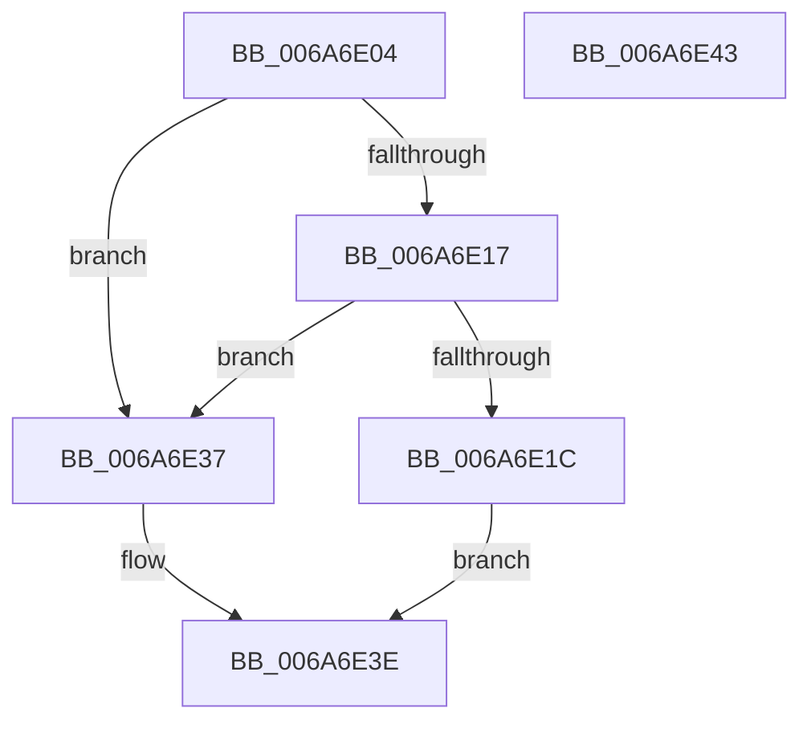

# IpmiLibpDelay

- RVA: `0x006A6E04`–`0x006A6E44` (길이 `64` bytes)
- VA: `0x00000001406A6E04`
- 실행 섹션: `.text`
- PDB 이름 있음: `예`; PDB Function 태그: `아니요`
- unwind 정보 RVA: `0x00085914`
- 디코드: `20`개 명령, `64/64` bytes 표시
- 미해석 바이트: `0` (있으면 어셈블리에 `.byte`로 보존)

> 이 문서는 커널 이미지의 기계어와 PDB 기호를 분석해 생성했습니다. 4번과 5번은 함수 원형과 자료형을 바이너리 사용 방식에서 추정한 C 해석이며 원본 소스 복구 결과는 아닙니다.

## 1. Dependencies

- 직접 호출 지점: **2**; 고유 호출 대상: **2**
- 직접 호출자로 확인된 함수: **1**
- RIP 상대 이미지 참조: **1**

### Outgoing calls
- `0x006A6E30` → [KeDelayExecutionThread](../20/KeDelayExecutionThread_function_00209550.md) (function, `0x00209550`)
- `0x006A6E39` → [KeStallExecutionProcessor](../44/KeStallExecutionProcessor_function_0044F620.md) (function, `0x0044F620`)

### Direct callers
- [IpmiLibpKcsSpinRegister](IpmiLibpKcsSpinRegister_function_006A74A8.md) at `0x006A754D`

### Static image references
- `0x006A6E0D` → RVA `0x00EFA0A0` (`.data`; read)

## 2. Other-region calls and transfers

- 다른 실행 섹션으로 향하는 call: **0**
- 별도 외부 분기/꼬리 이동을 확인하지 못했습니다.

## 3. Assembly (complete function range)

```asm
006A6E04  48 89 4C 24 08                  mov qword ptr [rsp + 8], rcx
006A6E09  48 83 EC 28                     sub rsp, 0x28
006A6E0D  8B 05 8D 32 85 00               mov eax, dword ptr [rip + 0x85328d]
006A6E13  A8 04                           test al, 4
006A6E15  75 20                           jne 0x1406a6e37
006A6E17  83 FA 32                        cmp edx, 0x32
006A6E1A  72 1B                           jb 0x1406a6e37
006A6E1C  6B C2 F6                        imul eax, edx, -0xa
006A6E1F  4C 8D 44 24 30                  lea r8, [rsp + 0x30]
006A6E24  33 D2                           xor edx, edx
006A6E26  48 63 C8                        movsxd rcx, eax
006A6E29  48 89 4C 24 30                  mov qword ptr [rsp + 0x30], rcx
006A6E2E  33 C9                           xor ecx, ecx
006A6E30  E8 1B 27 B6 FF                  call 0x140209550
006A6E35  EB 07                           jmp 0x1406a6e3e
006A6E37  8B CA                           mov ecx, edx
006A6E39  E8 E2 87 DA FF                  call 0x14044f620
006A6E3E  48 83 C4 28                     add rsp, 0x28
006A6E42  C3                              ret
006A6E43  CC                              int3
```

## 4. C-style interpretation (structured pseudocode)

```c
__int64 __fastcall IpmiLibpDelay(__int64 a1, int a2)
{
    __int64 result;
    __int64 v_rsp;
    unsigned __int64 v_stack_p8;

    v_stack_p8 = a1;
    v_rsp = (v_rsp) - (40);
    if ((((unsigned __int8)((unsigned int)(*(unsigned int *)(v_rip + 8729229)))) & (4)) != 0) goto loc_006A6E37;
    if (a2 < 50) goto loc_006A6E37;
    result = (unsigned int)(((unsigned int)(*(unsigned int *)(v_rip + 8729229))) * (a2));
    a2 = 0;
    v_stack_p8 = (int)((unsigned int)(result));
    a1 = 0;
    result = KeDelayExecutionThread(a1, a2, v_stack_p8, a4);
    goto loc_006A6E3E;
loc_006A6E37:
    result = KeStallExecutionProcessor(0, a2, v_stack_p8, a4);
loc_006A6E3E:
    v_rsp = (v_rsp) + (40);
    return result;
}
```

## 5. (Beta) C Style

```c
int64_t IpmiLibpDelay(int64_t Arg1, int32_t Arg2)
{
    int64_t result;
    int64_t local_rsp;
    uint64_t v_stack_p8;

    v_stack_p8 = Arg1;
    local_rsp = (local_rsp) - (40);
    if ((((uint8_t)((uint32_t)(*(uint32_t *)(v_rip + 0x85328D)))) & (4)) != 0) goto loc_006A6E37;
    if (Arg2 < 50) goto loc_006A6E37;
    result = (uint32_t)(((uint32_t)(*(uint32_t *)(v_rip + 0x85328D))) * (Arg2));
    Arg2 = 0;
    v_stack_p8 = (int32_t)((uint32_t)(result));
    Arg1 = 0;
    result = KeDelayExecutionThread(Arg1, Arg2, v_stack_p8, a4);
    goto loc_006A6E3E;
loc_006A6E37:
    result = KeStallExecutionProcessor(0, Arg2, v_stack_p8, a4);
loc_006A6E3E:
    local_rsp = (local_rsp) + (40);
    return result;
}
```

## 6. Execution-region graph

[열기: 2D/3D 그래프와 함수 탐색 컨트롤 패널](../../../control-panel.html?section=text&rva=0x006A6E04&view=graph)

- 2D 그래프는 위에서 아래로 흐르고, 3D 그래프는 빈 공간을 드래그해 회전합니다. Shift+드래그는 이동, 휠은 확대·축소, 함수 노드 선택은 대상 보고서 이동입니다.

### Static fallback


